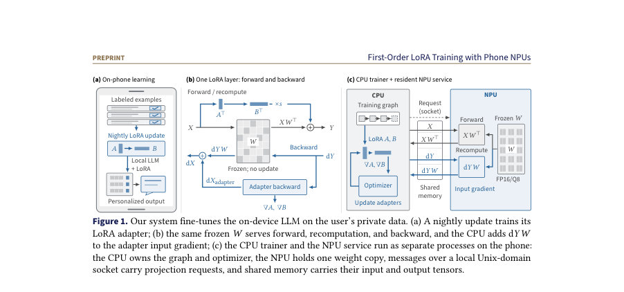
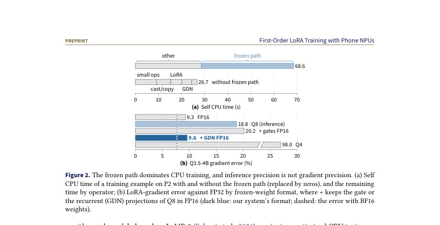
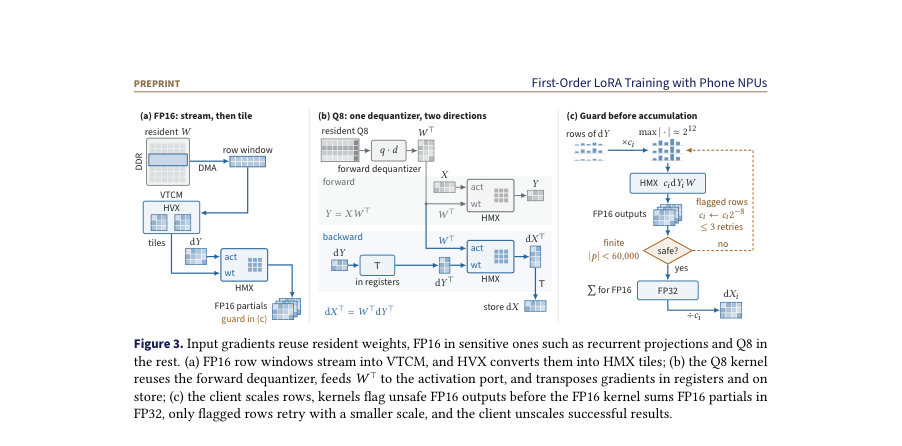

# First-Order LoRA Training with Phone NPUs

- **게시일:** 2026-10-20
- **arXiv:** [2610.24816v1](http://arxiv.org/abs/2610.24816v1) · [PDF](https://arxiv.org/pdf/2610.24816v1)
- **저자:** Xu Zheng, Wei Cheng, Zhuomin Chen, Dongkuan Xu, Mo Sha, Jingchao Ni, Dongsheng Luo
- **분야:** cs.LG, cs.AI
- **선정 점수:** 7.89
- **선정 이유:** 최근성 0.5, 인용 영향 0.0 (인용 0회), 저자 영향 0.0 (최고 h-index 0), AI 주제 적합성 3.0, 개발자 관심 0.2, 학술 신호 0.6, 오픈 웨이트·주요 연구조직 신호 3.6

[← 2026-10-20 목록으로 돌아가기](../daily/2026-10-20.html)

<!-- paper-visuals:start -->
## 주요 Figure

> 원문 PDF에서 실제 Figure 캡션과 그림 영역이 함께 확인된 자료만 자동 추출했다.

*Figure · 원문 PDF 2쪽 · Figure 1. Our system fine-tunes the on-device LLM on the user’s private data. (a) A nightly update trains its*

*Figure · 원문 PDF 3쪽 · Figure 2. The frozen path dominates CPU training, and inference precision is not gradient precision. (a) Self*

*Figure · 원문 PDF 5쪽 · Figure 3. Input gradients reuse resident weights, FP16 in sensitive ones such as recurrent projections and Q8 in*

<!-- paper-visuals:end -->

## 한 문장 요약

휴대폰 NPU의 추론용 가중치 타일을 재사용해 첫번째-오더(First-Order) LoRA 학습의 '동결 경로'(forward, recompute, input-gradient) 연산을 NPU에서 수행하고 어댑터와 옵티마이저는 CPU에 두어 온-디바이스 미세조정을 가능하게 한 시스템을 제안한다.

## 해결하려는 문제

LoRA는 학습 가능한 매개변수를 줄이지만, 각 학습 스텝은 여전히 동결된 베이스 모델 가중치 W에 대해 세 번의 큰 행렬곱(순전파, 활성화 재계산, 입력 그래디언트 계산)을 수행해야 하며 이 연산이 휴대폰 CPU에서 병목을 만든다. 휴대폰 NPU는 이미 정량화된 가중치를 레지던트 타일로 보유하고 순전파를 가속하지만, NPU의 추론 인터페이스는 입력 그래디언트 연산을 제공하지 않아 백프로파게이션을 직접 수행할 수 없고, 추론용 가중치 포맷(Q8 등)과 NPU의 FP16 출력 범위가 그래디언트 정확도와 범위에 문제를 일으킨다. 추가로 트레이닝 작업은 메모리·열 제약과 긴 실행시간을 견뎌야 한다.

## 핵심 기여

- CPU 학습 그래프와 NPU 상주 서비스로 학습을 분할하여 동결 경로(순전파·재계산·입력 그래디언트)를 NPU의 추론 가중치 타일에서 수행하도록 한 전체 시스템 설계 (Sections 3,6).
- 추론 NPU에서 동결 경로의 역전파를 지원하는 입력-그래디언트 커널: 레지던트 가중치 타일과 순전파의 디퀀타이저(데퀀타이저)를 재사용해 전치된 가중치 복사를 피하고 forward/backward가 동일한 유효 가중치를 보게 함, 그리고 그래디언트 민감도 기반 정밀도 정책과 FP16 출력의 범위 오버플로우를 다루는 행 단위 범위 가드 도입 (Section 4).
- CPU 측 런타임 최적화: GDN·LoRA·어휘 헤드 등의 연산 융합, 비동기 NPU 요청을 통한 CPU·NPU 중복 실행, 활성화 용량 예산과 재계산 스케줄링, 옵티마이저-스텝 경계에서의 커밋/재개 및 열(thermal) 페이싱으로 수시간짜리 백그라운드 학습을 지속시키는 메커니즘 구현 (Section 5).
- 두 Qualcomm Snapdragon 플랫폼(V79, V81)과 Qwen/Llama 계열 모델들에 대한 종합 평가로, 최적화된 CPU 기준·폰 GPU·forward-only 방법·GPU 레퍼런스와 비교해 정확도·속도·에너지·수행완료성 검증 (Section 7).

## 접근 방법

* 시스템은 학습 그래프·어댑터·옵티마이저를 CPU에 두고, NPU는 '프로젝션 단위' 연산 인터페이스(입력: X, 방향 플래그 forward 또는 input-gradient)를 제공하는 상주 서비스로 동작한다.
* 핵심 기법은 다음과 같다: (1) FP16 레지던트 가중치에 대해 NPU 내부에서 행 단위 윈도를 스트리밍하여 온-칩에서 전치(transpose)·타일 변환을 수행하는 FP16 입력-그래디언트 커널을 구현(3.2,4.2).
* (2) Q8(블록 32, 1 스케일 FP16) 타일의 경우 순전파에서 쓰이는 디퀀타이저 연산을 재사용하고 HMX의 피연산자 역할을 교환하여 backward가 순전파의 유효 행렬 W^T를 사용하도록 함(4.3).
* (3) 그래디언트 민감도에 따라 투사 유형별로 정밀도를 결정: 반복성(recurrent) 프로젝션(예: GDN의 재귀 투사)은 FP16으로 보관·연산하고, 주의(attention)·MLP 등은 Q8으로 보관해 레지던스 메모리 감소와 수치적 안정성 균형을 맞춤(4.4).
* (4) FP16 출력의 범위 문제와 underflow/overflow를 해결하기 위해 각 입력-그래디언트 행을 2의 거듭제곱 스케일 c_i로 사전 스케일링하고, 커널이 비유한(nonfinite) 또는 임계값(60,000)에 근접한 partial을 플래그하면 클라이언트가 스케일을 2^{-8}배씩 줄이며 최대 3회 재시도하는 행 단위 범위 가드(4.5, Fig.3c).
* (5) CPU에서는 GDN·LoRA·vocab head 등을 대형 fused autograd 노드로 구현해 남은 CPU 연산을 줄이고, 어댑터 기울기 계산을 NPU 요청과 비동기적으로 겹치게 스케줄링하며 활성화 예산을 바탕으로 일부 레이어는 재계산(recompute)하도록 스케줄링(Section 5).
* 구현은 PyTorch 기반 CPU 트레이너와 수정된 ggml Hexagon 백엔드(NPU 서비스)를 사용하고, 스타트업 시 커널 플래너로 지원되는 형태를 검증한다(Section 6).

## 주요 결과

- 완전한 온-디바이스 업데이트(222 optimizer 스텝, nightly personalization)를 P1(OnePlus13T, V79)와 P2(OnePlus15, V81)에서 성공적으로 완료: P1(외부 쿨러·스크린 off, 8스레드) 활성시간 7.82–8.51시간, P2(쿨러 있음) 8.09–9.01시간(테이블 2).
- LaMP-2 벤치마크에서 전화로 학습한 어댑터의 정확도는 GPU 참조에 근접: Q3.5-2B Ours 58.96% (GPU seeds 58.96,57.95), Q3-4B Ours 57.51% (GPU 58.24,57.66), L3.2-3B Ours 61.13% (GPU 61.27,61.13) — 모든 모델에서 베이스 대비 21–29 포인트 향상(테이블 4, Section 7.2).
- 성능·효율: 제어 실험에서 CPU 최적화(C3) 대비 동기화된 NPU 오프로드(Ours(sync))는 step time을 251.4s→62.4s로 줄여 4.03× 속도 개선(부분비교: 5.79× 전체 개선 포함)(Fig.5b, Appendix C). 에너지 측면에서 P2에서의 전체 장치당 추가 에너지는 Ours 0.2275 J/token으로 C3(0.7057 J/token)의 약 32.2% 수준(Section 7.5, Table D.1).
- 수치정확도: 입력-그래디언트 커널의 NMSE는 FP16 7.7e-8, Q8 1.2e-7로 작으며(테이블 3), 그래디언트 민감도 기반 정책(재귀 프로젝션 FP16, 나머지 Q8)은 전체 가중치 FP16 수준의 그래디언트 오차(약 9.6% vs FP16 9.3%)를 달성해 학습 성능 보전(테이블 6, Section 7.4).
- 폰 GPU 대비: 동일 모델(L3.2-3B)에서 폰-GPU 기반 Fabric 대비 토큰 처리율이 P1에서 18.7×(72.9 vs 3.9 tok/s), P2에서 12.8×(65.1 vs 5.1 tok/s) 우수(Section 7.7, Table 9).

## 한계

- 저자가 명시한 한계: (a) 시스템은 NPU의 추론 인터페이스에 기반하므로 지원되는 프로젝션 형태와 토큰/타일 형태에 따라 실행 가능 여부가 결정되며, 지원 외 형태(출력 차원 작은 gate 등)는 CPU 구현으로 대체되어 NPU 이득을 못 보는 경우가 있음(Section 4.1). (b) 추론 엔진의 FP16 출력·정밀도 한계로 인해 Q8 단일 포맷은 그래디언트 손실이 크며, 이를 완화하려면 프로젝션 유형별로 FP16을 유지해야 하는 정책이 필요함(Section 2.3,4.4). (c) FP16 부분합의 overflow를 처리하기 위해 행 단위 스케일링·재시도 메커니즘을 사용하지만 대형 행 분할(segment)에서의 부분 결과 반올림 특성 때문에 모든 경우를 완전히 보장하지는 않음(Section 4.2,4.5).
- 실험·범위에서 합리적으로 확인되는 제약(분석자 판단): (d) 평가와 구현은 Qualcomm Hexagon V79/V81 기반으로 한정되어 있어 다른 NPU 아키텍처로의 이식성·성능·정밀도 동작은 추가 검증이 필요함(Section 7.1,6). (e) 하나의 NPU 요청만 동시 비행(in-flight)하도록 설계되어 NPU·CPU 양측 병렬성을 더 높이는 확장성에는 제약이 있음(Section 5.2 설명). (f) 전체 시스템은 수시간에 걸친 백그라운드 작업으로 설계되었으나 열·배터리 제약으로 인해 thermal pacing에 따라 유의미히 실행률(duty cycle)이 떨어질 수 있으며(예: 무냉각 시 처리율 감소), 그에 따른 사용자 영향·품질 보장에는 정책적 고려가 필요함(Section 5.3,7.6).

## 개발자 관점

- 아키텍처 분할: 학습 그래프·어댑터·옵티마이저는 CPU에 두고 NPU는 ‘프로젝션 단위’의 forward/input-gradient 서비스만 제공하면 기존 트레이너를 대폭 변경하지 않고 NPU 이득을 얻기 쉽다(Sections 3,6).
- 숫자 안정성 팁: 순전파에서 사용하는 디퀀타이저(데퀀타이저)를 역방향에서도 재사용해 forward/backward가 동일한 '유효 가중치'를 보게 해야 전치된 별도 정량화 복사로 인한 편차를 피할 수 있다(Section 4.3).
- 정밀도 정책: Q8 같은 추론 포맷을 도입할 때는 프로젝션 유형별 그래디언트 민감도(특히 재귀 GDN 관련 투사가 민감함)를 측정해 민감한 투사만 FP16으로 유지하는 하이브리드 정책이 효과적이다(Section 2.3,4.4,Table 6).
- 범위·오버플로우 처리: 전역 스케일 대신 행 단위 2의 거듭제곱 스케일링과 커널-레벨 오버플로우 플래깅+재시도(최대 3회)를 구현하면 FP16 출력의 under/overflow 문제를 실용적으로 완화할 수 있다(Section 4.5).
- 런타임·운영: CPU 쪽에서 GDN·LoRA·vocab head 같은 작은 연산을 융합해 남은 CPU 비용을 줄이고, NPU 요청과 어댑터 그래디언트 계산을 비동기로 중복 실행해 전체 스텝 시간을 줄이며, 옵티마이저-스텝 경계에서 상태를 커밋해 재개/중단을 안전하게 지원하라. 또한 열 제어(thermal pacing)와 스레드 제약으로 실운영 조건을 고려해야 한다(Section 5).

**근거 범위:** 이 분석은 제공된 논문 PDF 본문(본문, 표, 그림, 부록)의 텍스트를 근거로 작성되었음. 수치·설정·실험 수치는 PDF 본문과 부록에 명시된 값만 사용했으며, 코드 수준의 구현 세부사항이나 다른 NPU/폰 모델로의 일반화 여부는 본문에 명시된 근거를 넘어서는 추정은 하지 않았음을 밝힘.
