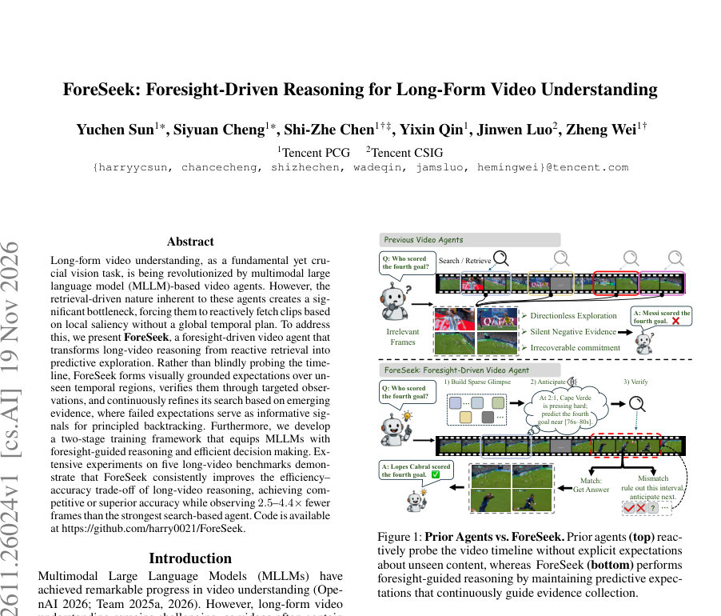
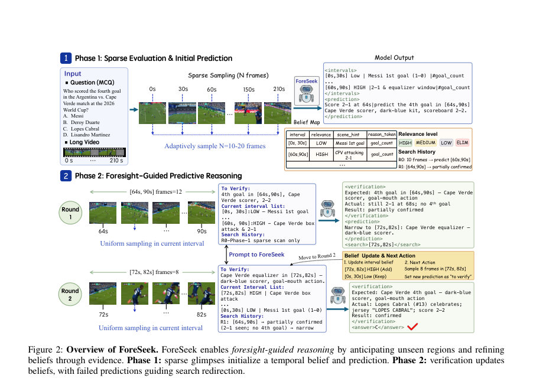
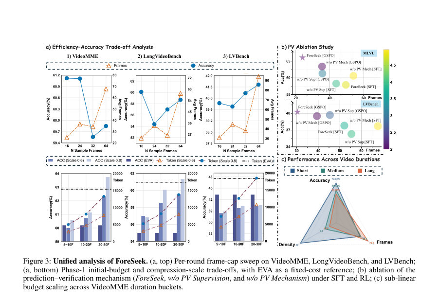

# ForeSeek: Foresight-Driven Reasoning for Long-Form Video Understanding

- **게시일:** 2026-11-20
- **arXiv:** [2611.26024v1](http://arxiv.org/abs/2611.26024v1) · [PDF](https://arxiv.org/pdf/2611.26024v1)
- **저자:** Yuchen Sun, Siyuan Cheng, Shi-Zhe Chen, Yixin Qin, Jinwen Luo, Zheng Wei
- **분야:** cs.AI
- **선정 점수:** 5.15
- **선정 이유:** 최근성 1.1, 인용 영향 0.0 (인용 0회), 저자 영향 0.0 (최고 h-index 0), AI 주제 적합성 3.0, 개발자 관심 0.8, 학술 신호 0.3, 오픈 웨이트·주요 연구조직 신호 0.0

[← 2026-11-20 목록으로 돌아가기](../daily/2026-11-20.html)

<!-- paper-visuals:start -->
## 주요 Figure

> 원문 PDF에서 실제 Figure 캡션과 그림 영역이 함께 확인된 자료만 자동 추출했다.

*Figure · 원문 PDF 1쪽 · Figure 1: Prior Agents vs. ForeSeek. Prior agents (top) reac-*

*Figure · 원문 PDF 4쪽 · Figure 2: Overview of ForeSeek. ForeSeek enables foresight-guided reasoning by anticipating unseen regions and refining*

*Figure · 원문 PDF 7쪽 · Figure 3: Unified analysis of ForeSeek. (a, top) Per-round frame-cap sweep on VideoMME, LongVideoBench, and LVBench;*

<!-- paper-visuals:end -->

## 한 문장 요약

ForeSeek는 장시간(video) 이해를 위해 MLLM 기반 비디오 에이전트의 반응적 조회(retrieval) 방식을 예측적 탐색(foresight-driven exploration)으로 전환해, 타임라인의 보이지 않는 구간에 대해 시각적으로 근거 있는 기대(expectation)를 생성·검증·갱신하면서 적은 프레임으로 정확한 추론을 달성하는 방법을 제안한다.

## 해결하려는 문제

기존 MLLM 기반 비디오 에이전트는 반복적 클립 검색·검사 중심의 반응적(retrieval-driven) 탐색을 수행해 (i) 전역적 시간 계획 없이 지역적 유의성에 따라 방향성 없는 탐색을 수행하고, (ii) 실패한 검색을 정보로 활용하지 않아 부정적 증거를 활용하지 못하며, (iii) 일단 잘못된 시간 가설을 추적하면 되돌릴 수 있는 전역적 메커니즘이 부족해 프레임 소모가 비효율적이라는 한계를 가진다. 본 논문은 이러한 한계를 해결해 적은 관찰로 장시간 비디오의 질의에 답하는 효율적·정확한 에이전트를 설계하는 것을 문제로 삼는다.

## 핵심 기여

- foresight 기반 비디오 에이전트 ForeSeek 제안: 보이지 않는 시간구간에 대해 시각적으로 근거 있는 기대(expectation)를 유지하고, 관찰로 이를 검증·정제·기각하며 탐색을 전역적으로 재배치하는 패러다임을 제시함.
- 전역 구간 신념(global interval-level belief) 메커니즘 도입: (start, end, relevance, hint) 형태의 구간 리스트를 유지해 확인되지 않은 구간을 'Low/Medium/High/Elim'으로 관리하고, 실패한 예측을 부정적 증거로 취급해 탐색 우선순위를 갱신함.
- 예측-검증(prediction–verification) 궤적을 합성하는 3단계 데이터파이프라인과 그에 따른 지도학습(SFT) + 궤적 수준 강화학습(GSPO)으로 구성된 2단계 학습 프레임워크 제안.
- 효율성-정확도 균형을 직접 장려하는 보상 설계(T(n)에 따른 라운드 기반 감쇠)와 GSPO를 적용해 실전 추론에서 불필요한 라운드·프레임 소모를 줄임.
- 5개 장시간 비디오 벤치마크(VideoMME, LongVideoBench, LVBench, VideoHolmes, MLVU)에서 SOTA 또는 경쟁력 있는 정확도를 유지하면서 EVA 등 비교 대상보다 2.5–4.4× 적은 프레임으로 동작하는 것을 보임.

## 접근 방법

* ForeSeek는 반복적 추론 단계 r에서 상태 Sr = (Br, ϕr, H<r)로 표현되는 예측 상태를 유지한다.
* 초기화(Phase-1)에서는 비디오 전역에 대해 지속시간 적응형 희박 스캔 N(T) (Nmin=10, Nmax=20, D0=600s, α=3)을 수행해 초기 신념 B1과 초기 기대 ϕ1을 생성한다.
* 각 라운드에서 현재 검색 구간 [ts_r, te_r]에서 nr ∈ [4,16] 프레임을 샘플링해 관찰하고 모델 πθ에 Sr을 프롬프트하여 기대의 검증 결과 vr ∈ {confirmed, partially confirmed, not found}를 산출한다.
* 검증 결과에 따라 (i) 확인되면 정답 제시 가능, (ii) 부분 확인이면 기대를 정제하고 더 좁은 하위구간 제안, (iii) 찾지 못하면 해당 구간을 낮은 우선순위로 강등하고 전역적으로 탐색을 재배치한다.
* 전역 신념 Br는 다수(Mr) 구간 (start, end, relevance, hint)을 유지하며 relevance는 {High, Medium, Low, Elim}이다.
* 학습은 두 단계로 진행된다.
* Stage1 SFT: 교사(oracle)로 합성한 foresight-궤적(기대 생성, 검증, 신념 갱신을 포함)을 토큰 수준 NLL로 학습(데이터 8,165 궤적).
* Stage2 GSPO: SFT 초기화 모델에서 그룹 단위 시퀀스 정책 최적화(rollout 그룹 8)로 트레이스 수준 보상 R(τ)=Rans(τ)·T(n)를 최적화해 정확하면서 짧은 추론 궤적을 유도한다.
* 보상 감쇠는 n<4면 1.0, 4≤n≤Rmax(=5)면 선형 감소(T(5)=0.8).
* 데이터파이프라인은 (1) QA 보강(dual-answerer + judge), (2) 궤적 합성(교사 모델의 Phase-1 제한 호출 및 오라클 호출로 SFT 대화 합성), (3) Pass@K 필터링으로 RL용 샘플 선별을 포함한다.

## 주요 결과

- 주요 벤치마크 성능(ForeSeek-GSPO, Qwen3-VL-8B 기반): VideoMME 24.8 frames, Acc 61.1; LongVideoBench 24.1 frames, Acc 60.1; LVBench 31.0 frames, Acc 40.3; VideoHolmes 22.0 frames, Acc 53.2; MLVU 23.4 frames, Acc 66.2 (Table 1).
- 동일 백본 비교(Qwen2.5-VL-7B)에서도 ForeSeek-GSPO는 여러 벤치마크에서 경쟁력 있는 성능을 보이며 적은 프레임으로 EVA와 유사하거나 우수한 성능을 달성함(부록 Table 3).
- 기준 균일 샘플링(Qwen3-VL-8B, 32프레임) 대비 정확도 이득: VideoMME +1.7, LongVideoBench +2.1, LVBench +2.0, VideoHolmes +10.5, MLVU +4.9(본문).
- 효율성-정확도 관점: ForeSeek-GSPO는 EVA 대비 2.5–4.4× 적은 프레임(예: EVA 55.6–137.1 프레임 구간 vs ForeSeek 22.0–31.0)으로 유사하거나 더 나은 정확도를 확보함(본문).
- 예측–검증(PV) 메커니즘의 기여: post-RL 엄격 비교에서 ForeSeek(Full)는 w/o PV Mech 대비 VideoMME/LongVideoBench/LVBench/VideoHolmes에서 각각 최대 +3.0점까지의 정확도 이득을 보였고, 평균적으로 프레임과 라운드를 줄였음(Table 4, Fig.3b). 특히 RL 단계가 있을 때 PV 구조가 일관된 효율·정확도 개선을 제공함을 보고함(Ablation).

## 한계

- 저자가 명시한 한계: (i) ForeSeek의 활동적 탐색이 원시 백본 용량을 완전히 대체하지 못해 일부 벤치마크(LVBench, MLVU)에서는 대형/상용 모델(GPT-4o, GPT-5, EVA 등)과의 격차가 남음. (본문: "active seeking partially substitutes for—but does not fully replace—raw backbone capacity").
- 저자가 언급한 실험 범위·일반성 제약: 학습 데이터는 CG-Bench, LLaVA-Video, LongVideoBench, VideoHolmes에서 수집되어 일부 벤치마크는 in-distribution(ID)이고 일부는 OOD이며(본문), 이는 성능이 데이터 분포에 일부 의존함을 시사함.
- 본문에서 확인되는 제약(추론·배포 관련): (i) 구간 강등(예: not_found → Low/Elim)은 효율성을 높이지만 관련 증거를 놓칠 위험(효율성–재현성(trade-off))이 있으며 본문도 이를 효율–재현성 균형 문제로 평함(A.2). (ii) 긴 비디오에 대해 에이전트가 전체 길이에 비례해 샘플을 늘리지 않아(밀도는 길이 증가에 따라 크게 감소) 긴 영상에서 정확도가 하락하는 경향이 나타남(Fig.3c).
- 재현성·자원 제약: 전체 파이프라인(교사 오라클 호출, GSPO RL, SFT 데이터 합성)은 대규모 연산자원(8×H20 GPU로 8B 모델의 전수 파라미터 업데이트)을 요구해 비용·시간 측면 제약이 있음(Implementation).

## 개발자 관점

- 재현성: 공개 코드가 제공되며 본문에는 SFT/GSPO 파이프라인, 데이터 합성(교사 오라클/Phase-1 호출), SFT 데이터 크기(≈8,165 궤적), RL 롤아웃 수와 필터링 기준(4,663 RL 샘플) 등 구체적 파라미터가 기술되어 있어 재현 가능한 구성 요소가 많음. 다만 오라클 교사(예: Gemini-3-Flash)와 판정자·answerer 구성은 외부 API/모델 접근이 필요함.
- 비용·인프라: Qwen3-VL-8B 전체 파라미터 업데이트에 8×H20 GPU를 사용했으므로 유사한 실험을 재현하려면 상당한 GPU 메모리·시간이 필요함. 경량화로는 Qwen2.5-VL-7B 실험(부록)을 먼저 시도해 비교하는 것을 권장함.
- 학습 데이터·합성 요구: ForeSeek는 단순 정답이 아니라 expectation 생성·검증·궤적이 포함된 SFT 데이터가 필수적이다. 이를 위해 (i) 교사 모델의 오라클 모드로 증거 기반 궤적 합성, (ii) 실패한 예측이 재탐색을 유도하는 패턴을 포함하도록 필터링하는 절차가 필요함. 따라서 데이터 파이프라인을 성립시키는 작업이 핵심 비용·개발 병목이 될 수 있음.
- 추론·배포: ForeSeek는 VLM 호출을 평균 ~2.01회로 줄여 호출 횟수 및 토큰 비용을 감소시키는 이점이 있음(부록 Table 6). 배포 시에는 per-question 고정 예산(대략 20–31 프레임)과 per-round cap(nr ∈ [4,16])을 설정해 지연·비용을 제어할 수 있음.
- 안전성·정확성 관점: 예측-검증 구조는 실패한 기대를 '부정적 증거'로 활용해 불필요한 탐색을 줄이므로 잘못된 지역에 고착되는 위험을 줄일 수 있으나, 잘못된 Early rejection(구간 강등)이 정답 구간을 놓칠 수 있으므로 보수적 하이퍼파라미터(예: Low/Elim 정책, 검증 라운드 수)를 도입해 안정성을 확보해야 함.

**근거 범위:** 이 분석은 제공된 논문 PDF 본문(본문 및 부록, 표와 그림 포함)을 근거로 작성되었음. 표와 본문에서 인용한 수치(프레임 수, 정확도, 데이터셋 분포, 학습 설정 등)는 PDF에 명시된 값을 그대로 사용했으며, PDF에 명시되지 않은 내부 구현 세부(예: 정확한 하드웨어 시간, 하이퍼파라미터의 미세 튜닝 값 등)는 추정하지 않았음. 일부 구현·환경 관련 세부(예: 교사 모델 접근 방식 또는 내부 토큰 전처리 세부)는 본문에 제한적으로 기술되어 있어 재현 시 외부 모델 액세스와 인프라 차이에 따른 변동이 있을 수 있다.
