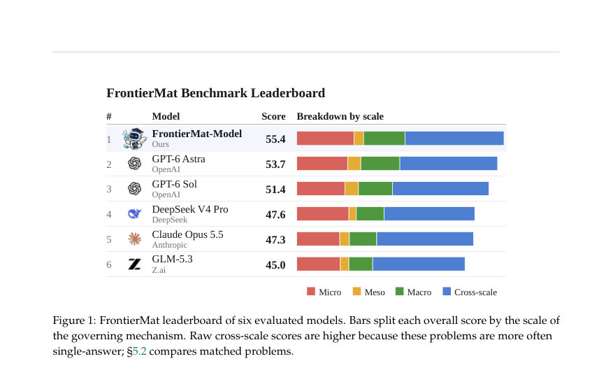
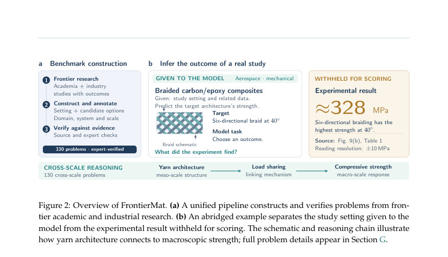
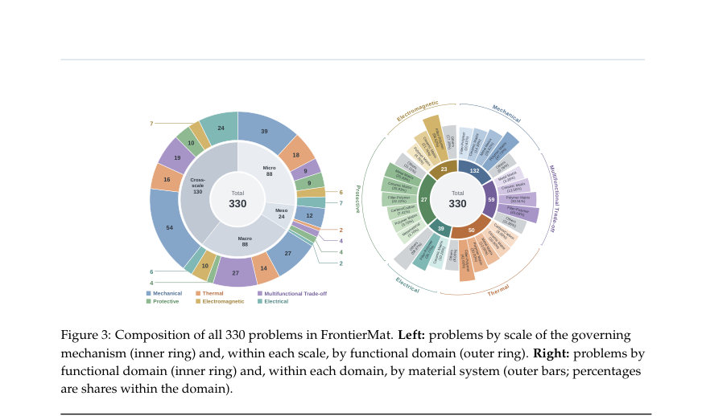

# FrontierMat: Benchmarking Language Models at the Frontier of Materials R&D

- **게시일:** 2026-11-02
- **arXiv:** [2610.41162v1](http://arxiv.org/abs/2610.41162v1) · [PDF](https://arxiv.org/pdf/2610.41162v1)
- **저자:** Feng Chen, Jianguo Huang, Yushan Xiao, Yue Li, Bijun Tang, Xuyu Dong, Xingguo Wang, Feiyang Xie, Jianhui Gu, Dongfeng Cao, Hongda Chen, Yongji Gong, Ruiqi Li, Shuxin Li, Xingji Li, Ruitao Lv, Li Song, Lei Wang, Ye Zhang, Xiaoxu Zhao, Xitao Zheng, Bo An, Zheng Liu
- **분야:** cs.AI
- **선정 점수:** 5.41
- **선정 이유:** 최근성 0.4, 인용 영향 0.0 (인용 0회), 저자 영향 0.0 (최고 h-index 0), AI 주제 적합성 2.1, 개발자 관심 0.0, 학술 신호 0.6, 오픈 웨이트·주요 연구조직 신호 2.4

[← 2026-11-02 목록으로 돌아가기](../daily/2026-11-02.html)

<!-- paper-visuals:start -->
## 주요 Figure

> 원문 PDF에서 실제 Figure 캡션과 그림 영역이 함께 확인된 자료만 자동 추출했다.

*Figure · 원문 PDF 2쪽 · Figure 1: FrontierMat leaderboard of six evaluated models. Bars split each overall score by the scale of*

*Figure · 원문 PDF 3쪽 · Figure 2: Overview of FrontierMat. (a) A unified pipeline constructs and verifies problems from fron-*

*Figure · 원문 PDF 6쪽 · Figure 3: Composition of all 330 problems in FrontierMat. Left: problems by scale of the governing*

<!-- paper-visuals:end -->

## 한 문장 요약

FrontierMat은 최전선의 재료 연구에서 나온 330개 실험 기반 문제로 언어모델의 교차-스케일 추론 능력과 R&D 적용 가능성을 평가하고, 이 벤치마크로 유도된 메타가중 CPT(continued pretraining)과 스케일 모듈식 자기증류로 오픈모델을 크게 향상시킨 연구이다.

## 해결하려는 문제

기존 재료 분야 벤치마크는 교과서·시험형 문제나 모델이 생성한 문제에 치중해 연구 최전선(frontier)에서 요구되는 '실험 근거에 기반한 결과 예측/해석' 능력을 평가하지 못한다. 따라서 언어모델이 실제 R&D 문제(특정 재료계·실험 세팅에서 보고된 결과나 결론을 은닉한 뒤 모델이 이를 추론하도록 요구하는 문제)를 해결할 수 있는지를 측정할 필요가 있다.

## 핵심 기여

- FrontierMat: 학계·산업 현장의 실험 연구에서 추출한 330개 문제(각 문제는 실험 설정과 증거를 제시하고 실제 연구에서 숨긴 결과를 맞히거나 증거로부터 결론을 도출하도록 구성), 각 문제에 도메인·재료계·지배 메커니즘의 스케일(미시·메조·거시·교차스케일) 주석을 부여하고 130개 문제는 교차-스케일 추론 체인을 기록함 (§3).
- 광범위한 평가: 7개 모델(3개 프로프라이어터리, 3개 오픈웨이트, 1개 도메인 적응 모델)을 FrontierMat으로 평가하고 실패 패턴(교차-스케일 어려움, '가능하지만 보고되지 않은' 결과를 지지하는 오류 등)을 분석함 (§4–5).
- 스케일 인지 도메인 적응법: meta-weighted continued pretraining과 scale-modular self-distillation을 포함하는 스케일-인식 적응 레시피를 제안하여 오픈웨이트 모델(Qwen3.5-35B-A3B)을 36.7%에서 55.4%로 향상시킴(FrontierMat 점수), 이를 통해 공개 재료 벤치마크에서도 전이 성능 향상을 보였음 (§6).
- 벤치마크의 신뢰성·난이도 분석: 문제별 판별력, 재표집 기반 순위 안정성, 교차-스케일 문제가 단일-스케일보다 유의하게 어려움(통제 후 평균 8.7점 격차, p=0.008) 등을 보고함 (§4.3, §5.2).
- 오픈 데이터·평가 관점 제시: 문제 구성·검증 파이프라인(전문가 리뷰, 출처 검증, 모델을 활용한 초기 일관성 검사)과 채점 규칙을 명시해 재현 가능한 평가 관행을 제안함 (§3, §C).

## 접근 방법

* 프레임워크는 (1) 학계·산업 연구자들과 협업하여 실험 연구에서 '측정 결과 또는 데이터로 뒷받침되는 결론'을 가진 논문·연구를 수집하고(총 330개 문제), (2) 각 문제는 모델에 실험 설정과 선택된 증거만 제공하고 정답(연구결과)은 은닉하는 다지문·단일선택 또는 다중선택 형태로 작성하며(정답 있으면 1점, 적절한 부분집합이면 0.5점, 잘못된 옵션 포함시 0점), (3) 각 문제에 도메인(기능적 속성), 재료계, 지배 메커니즘의 스케일(미시·메조·거시) 주석을 붙였음(교차-스케일 문제는 추론체인 표기).
* 도메인 적응은 다음 절차로 수행됨: continued pretraining(CPT) — 전체 토큰 예산 10.94B로 재료 문헌·합성 텍스트·일반 리플레이 혼합(참고 혼합 비율 표) — meta-weighting: 자료 블록의 교차-스케일 문제 유용성을 강모델의 in-context 답변 마진으로 평가해 버킷별 샘플링 가중치 부여, 이어서 supervised fine-tuning(SFT, 133K 샘플, 그중 23K는 재료 특화), 마지막으로 scale-modular self-distillation: 미시·메조·거시 각 스케일별 저랭크 잔차 모듈을 추가하고(각 모듈을 해당 스케일 증거로 교수 신뢰모델이 가르침) 게이트 융합 모듈로 결합하여 증거별 지식을 모듈에 내장시키는 방식으로 학습함(추론 시 모델은 문제만 입력받음).
* 성능 평가는 폐쇄책(문헌 비공개), 동일 프롬프트·디코딩 설정 하에서 수행됨(샘플링, 토큰 제한 명시).

## 주요 결과

- 데이터셋: 330개 문제(단일선택 98, 다중선택 232), 스케일 분포는 미시 88, 메조 24, 거시 88, 교차-스케일 130 (§A, Table 5).
- 리더보드: FrontierMat-Model(도메인 적응 Qwen3.5) 55.4%, GPT-6-Astra 53.7% (95% CI 48.9–58.4), GPT-6-Sol 51.4%, DeepSeek V4 Pro 47.6%, Claude Opus 5.5 47.3%, GLM-5.3 45.0%, 공식 Qwen3.5-35B-A3B(사전적용) 36.7% (Table 2).
- 교차-스케일 난이도: 동일한 답 형식·구성 채널 내 다중선택 문제에서 교차-스케일 문제는 단일-스케일보다 평균 8.7점 낮음(계층화된 무작위화 테스트, one-sided p = 0.008), 모델별 격차는 4.6~11.3점 범위(§5.2).
- 문제별 난이도: 129개 문제는 모든 일반목적 모델(프로프라이어터리·오픈 포함)에서 정답을 못 맞힘, 전체 문제의 절반(164개)은 최대 1개 모델만 풀음(§5.2, Figure 4c).
- 오류 패턴: 다중선택 문제에서 파싱된 잘못된 응답의 83%가 연구에서 보고되지 않은(unsupported) 옵션을 포함함; 49%는 모든 정답을 포함하면서 추가로 부적합 옵션을 포함(과잉지지 현상). GPT-6-Astra는 부적합 옵션을 포함하는 경우가 상대적으로 적음(§5.3, Figure 4a). (예시) 일부 모델은 Hall–Petch 기여를 계산하고도 전체 강도를 추론하지 않음(증거충분성 판단).(§5.3, H 사례).

## 한계

- 저자 명시 한계: 규모 및 범위 편향 — 330개 문제로 소규모이고 도메인·재료계(복합재 중심) 분포가 고르지 않아 몇 포인트 차이는 높은 불확실성에 노출됨; 일부 소그룹(예: 메조)의 추정 불확실성 큼(§7 Limitations).
- 저자 명시 한계: 출처 증거 의존성 — 정답은 원문 연구 결과에서 가져오며 일부 값은 도표에서 읽어낸 것이고, 문제 생성 과정에서 언어모델을 사용하여 출처와 교차검증한 점이 있어 모델이 파싱하기 쉬운 출처로 편향될 가능성 존재(§7 Limitations).
- 저자 명시 한계: 답안 형식 — 객관식(단/다중선택)은 실제 R&D에서 얻을 수 없는 추가 정보를 내포할 수 있고 정답 선택 수의 불균형 문제 존재(§7 Limitations).
- 저자 명시 한계: 적응 연구 범위 — 적응 실험은 주 모델 하나(Qwen3.5-35B-A3B)와 축소된 ablation(0.8B)으로 수행되었고, 문헌 코퍼스가 주로 복합재·2D 재료를 포함하므로 다른 아키텍처·데이터 혼합·재료계로 일반화할 수 없음(§7 Limitations).

## 개발자 관점

- 벤치마크 설계: '실험적 결과를 은닉하고 증거로부터 결과를 추론'하도록 문제를 구성하면 실제 R&D 요건(증거충분성, 메커니즘 연계)를 평가할 수 있으므로 재료·공학 분야 벤치마크를 만들 때 이 방식을 고려할 것(§3).
- 주석 필요성: 문제마다 기능 도메인(기계·열·전기 등), 재료계, 지배 메커니즘의 스케일(미시·메조·거시·교차)을 표기하면 모델 실패 원인 분석(예: 교차-스케일 추론)을 정량적으로 수행할 수 있음(§3.2, §5.2).
- 도메인 적응 레시피: (1) 자료 유틸리티를 평가해 버킷별 재샘플링(메타가중 CPT), (2) SFT(자료·추론 포맷 정렬), (3) 스케일별 저랭크 모듈+게이팅을 통한 self-distillation 조합은 교차-스케일 능력 향상에 효과적이며 실제로 오픈모델을 상업 모델 수준으로 끌어올림(정량: 36.7 → 55.4%, CPT 토큰 10.94B, SFT 133K 샘플) (§6, Table 2, Table 9, Table 10).
- 평가·운영 유의사항: 폐쇄책 평가(문헌·도구 비활성)와 출력 파싱 규칙(Answer: 라인 파싱, unparseable은 0점)은 결과에 큰 영향을 미치므로 실전 배포 전에 도구 사용·출력형식·긴출력 처리(32k 토큰 제한) 정책을 검증할 것(§4.1, §C, F.5).
- 안전·책임: 저자 권고처럼 높은 벤치마크 점수는 자율적 R&D 사용을 정당화하지 않으므로(§7 Ethical Considerations) 실험 지시·비지도 실험 설계 등 위험한 사용에는 인간 전문검토를 필수화할 것.

**근거 범위:** 이 분석은 제공된 논문 PDF 본문 전체를 근거로 작성했다. 표와 본문에서 명시된 수치(예: 문제 개수 330, 교차-스케일 130, GPT-6-Astra 53.7%, Qwen3.5 공식 36.7% → 도메인 적응 55.4%, CPT 토큰 10.94B, SFT 133K 등)만 인용했으며 본문에 구체적으로 기록되지 않은 내부 훈련비용·하드웨어·정밀 하이퍼파라미터(일부 표 제외) 등은 추정하지 않았다. 일부 세부 구현(예: 교차-스케일 in-context 유틸리티 계산의 내부 파라미터 λ=3 등)은 본문에 언급된 내용만을 반영했으며, 추가 재현을 위해 원저자 코드·데이터 공개 여부를 확인할 것을 권장한다.
