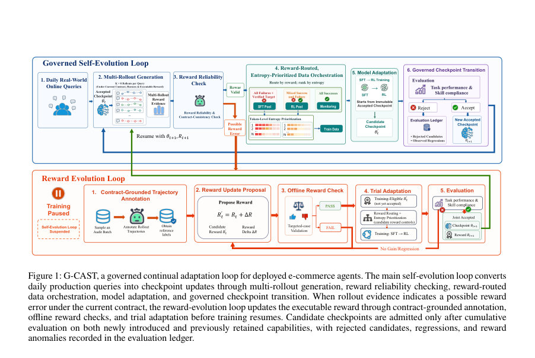
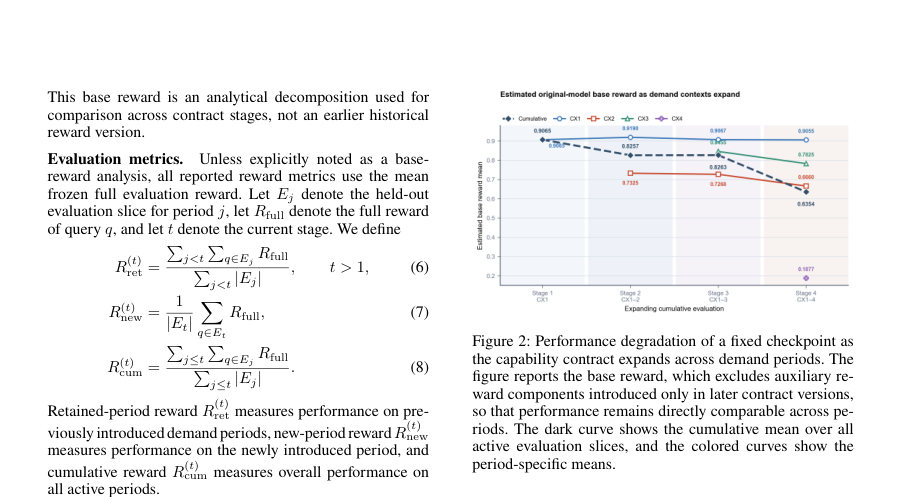

# G-CAST: Governed Continual Self-Training for E-Commerce Agents under Evolving Demands

- **게시일:** 2026-11-16
- **arXiv:** [2611.17814v1](http://arxiv.org/abs/2611.17814v1) · [PDF](https://arxiv.org/pdf/2611.17814v1)
- **저자:** Yuechun Yu, Wenzheng Kong, Xiaofeng Mao, Jin Zhang
- **분야:** cs.AI, cs.CL
- **선정 점수:** 6.38
- **선정 이유:** 최근성 0.4, 인용 영향 0.0 (인용 0회), 저자 영향 0.0 (최고 h-index 0), AI 주제 적합성 3.0, 개발자 관심 0.2, 학술 신호 0.8, 오픈 웨이트·주요 연구조직 신호 2.0

[← 2026-11-16 목록으로 돌아가기](../daily/2026-11-16.html)

<!-- paper-visuals:start -->
## 주요 Figure

> 원문 PDF에서 실제 Figure 캡션과 그림 영역이 함께 확인된 자료만 자동 추출했다.

*Figure · 원문 PDF 3쪽 · Figure 1: G-CAST, a governed continual adaptation loop for deployed e-commerce agents. The main self-evolution loop converts*

*Figure · 원문 PDF 5쪽 · Figure 2: Performance degradation of a fixed checkpoint as*

<!-- paper-visuals:end -->

## 한 문장 요약

생산 환경에서 새로운 제품·기능 요구와 에이전트 하니스(도구·스킬·절차)의 확장으로 발생하는 수요·데이터·보상 불일치 문제를, 다중 롤아웃 기반의 보상 라우팅·엔트로피 우선순위 데이터조직과 계약 기반 보상 진화 및 거버넌스된 체크포인트 전환으로 해결하는 연속적 자기학습 시스템 G-CAST를 제안한다.

## 해결하려는 문제

대규모 언어모델 기반 전자상거래 에이전트는 배포 이후 사용자 요구(신규 상품군·조달 시나리오·기능요청)가 지속적으로 변화하고, 이에 따라 에이전트를 둘러싼 하니스(문맥 구성·메모리·도구·재사용 가능한 스킬·운영절차)도 확장된다. 이로 인해 1) 모델 불일치: 기존에 학습된 모델이 신규 기능의 적용·호출·통합을 못함, 2) 데이터 불일치: 이전 하니스에서 수집된 궤적이 신규 기능을 반영하지 못함, 3) 보상 불일치: 이전 보상함수가 확장된 계약에서 잘못된(또는 누락된) 평가를 함—이 세 가지가 결합되어 모델이 하니스 확장의 이익을 활용하지 못한다. 기존의 주기적 수동 재학습은 지연·비용이 크며, 선행 방법들은 하니스·데이터·보상 불일치의 결합을 다루지 못한다.

## 핵심 기여

- 체크포인트 전환을 적응의 단위로 보고 모델·하니스(계약)·실행 가능한 보상·학습 증거·누적 평가 원장을 공동 버전관리하는 거버닝된 연속 자기학습 루프(G-CAST)를 제안하여, 신규 수요에 적응하면서 이전에 승인된 동작을 보존함.
- 보상 라우팅(reward-routed)과 토큰 수준 엔트로피 기반 우선순위를 결합한 데이터 조정 기법을 제안하여, 학습 역할(SFT, RL, 모니터링)은 보상으로 결정하고 엔트로피는 같은 역할 내에서 샘플 우선순위를 정함으로써 샘플 선별의 효과를 향상시킴.
- 능력(계약)-구동 보상 진화 메커니즘을 도입하여 확장된 하니스에서 보상 실행가능성(executable reward)을 버전·게이트로 관리하고, 표적 검증·회귀체크·오프라인 재채점·궤적 재생(trajectory replay)을 통해 잘못된 보상 업데이트의 학습 유입을 방지함.

## 접근 방법

* G-CAST는 주요 루프와 보상 진화 루프 두 축으로 작동한다.
* 주요 루프: (1) 불변의 'accepted' 체크포인트와 현행 하니스·실행 보상으로 생산 쿼리를 재생해 K=8개의 다중 롤아웃을 생성한다.
* (2) 롤아웃에 대해 보상 신뢰성 검사(reward reliability check)를 수행해 '훈련 가능' 증거와 '회귀 모니터링'을 분리하고, 보상 오류 의심은 보상 진화 루프를 트리거한다.
* (3) 보상 라우팅: 라운드 수준 기준(reference)을 평균 유효 보상에서 상·하위 5% 절단으로 정의하고, 모든 롤아웃이 기준 미만이면(실패) 검증된 타겟이 있을 때 SFT 풀로, 일부 성공·실패 혼합이면 RL 풀로, 모두 성공이면 모니터링 풀로 라우팅한다.
* (4) 엔트로피 우선순위: 각 롤아웃의 토큰 엔트로피의 90번째 백분위수를 계산하고 쿼리 점수는 롤아웃들 가운데 최대값을 사용하여 SFT/RL 풀 내 우선순위를 매긴다.
* (5) 학습: 불변된 accepted 체크포인트에서 SFT→RL 순으로 후보를 학습하고, 후보는 누적 평가(새로운 기간과 이전에 유지된 기간 모두)에 통과해야 accepted로 승격된다.
* 보상 진화 루프(5단계): 계약-근거 궤적 주석 수집, 보상 업데이트 제안(어떤 스코어링 오류·계약 변경을 반영할지 명시), 오프라인 보상 검증(표적 사례 검증·회귀 체크·오프라인 재채점·재생), 시험적 적응(감사 배치로 라우팅·학습 통제), 공동 평가 후 수용.
* 실행 보상은 구성요소별 적용조건을 가진 버전화된 규칙 번들로 설계된다.
* 학습·평가는 '동결된 최종 평가 보상(frozen evaluation reward)'을 기준으로 모든 체크포인트를 비교 가능하게 측정한다.
* 논문은 기간별 보상 누적 규격 Rtrain의 진화를 수식(Period1: Rfmt, Period2: +Pgd+Pretrieval, Period3: +Rskill-sel+Rskill-adh, Period4: Rfull 유지)으로 제시하고 Rbase = Rfull − Rskill-sel − Rskill-adh를 분석용 분해로 정의한다.

## 주요 결과

- 실험 환경: Alibaba의 B2B 에이전트 Yuancai 생산 쿼리에서 기간별로 각각 2,000 쿼리 롤아웃 풀과 분리된 100 쿼리 평가 슬라이스(총 4기간)를 사용. 기본 사전학습 모델은 Qwen3-4B-Thinking-2507, 각 쿼리당 K=8 롤아웃(기간당 최대 16,000 궤적).
- 지속적 자기학습 필요성: 고정 체크포인트는 계약 확장(Period1→Period4) 동안 누적 성능이 베이스 보상 기준으로 0.9065→0.6354(누적 Periods1–4)로 크게 저하했으며 신규 Period4 보상은 0.1877로 급락함(본문 Figure 2 설명).
- G-CAST vs AutoTrainess(동일 누적 평가 프로토콜): Table 2에서 Iteration 4(Periods1–4) 누적 보상은 G-CAST 0.8078 vs AutoTrainess 0.7911; G-CAST의 신규 기간 보상은 0.3983→0.5813(Δ+0.183), 유지된 기간 보상은 0.8712→0.8833(Δ+0.012)인 반면 AutoTrainess는 신규 0.3433→0.5428(Δ+0.200)이나 유지된 기간은 0.8907→0.8739(Δ−0.017)으로 일부 망각 관찰.
- 기술 중심 이득: 계약이 스킬 호출·절차 준수를 요구하는 시점(Iteration 3–4)에서 G-CAST가 두드러진 우위. 예: Iteration 3 스킬 선택 정확도 G-CAST 0.8667 vs AutoTrainess 0.8433, 스킬 준수(adh) 0.5233 vs 0.5153; Iteration 4 스킬 선택 0.7625 vs 0.6875, 스킬 준수 0.4503 vs 0.4219.
- 라우팅·우선순위 절체실험(Table 3): 동일 데이터 예산(150 SFT + 500 RL)·후보 우주 기준에서 Post-RL 누적 보상은 Random 0.7334, Reward+Random 0.7721, Reward+Entropy(제안) 0.7930으로 보상 라우팅과 엔트로피 우선순위가 모두 성능 향상에 기여함. 형식 보상(format)·스킬 준수 측면에서도 Reward+Entropy가 최고 성능을 보였음(예: Post-RL 형식 보상 0.8069, 선택 정확도 73.25%, 스킬 준수 0.3637).」「보상 진화의 필요성과 게이트 효과(Table 4): 계약 확장 후 동일 학습 데이터·하이퍼파라미터에서 'Static'(보상 미진화) 누적 보상 0.8810, 'Ungated'(일회성 계약 보상 추가) 0.8926, 'Gated'(제안된 연속 게이트·검증 있음) 0.9288로, 게이트로 제어된 보상 진화가 성능(특히 스킬 집약적 Period3) 개선에 크게 기여함(Period3 보상: Static 0.8801, Ungated 0.8812, Gated 0.9538; 스킬 선택 정확도 Gated 0.8667).

## 한계

- 저자가 명시한 한계: 연구는 하나의 장기적 생산 응용(Yuancai)과 하나의 기본 모델 계열(Qwen3-4B 계열)을 중심으로 수행되어, 수요·하니스 진화 패턴과 결과가 다른 에이전트 환경으로 직접 일반화되지 않을 수 있음.
- 실험·방법론에서 확인되는 제약: 기간별 평가 슬라이스는 각 기간당 100 쿼리로 제한되어 있으며(논문 전반의 평가 프로토콜), 실험은 주로 해당 서비스의 계약 확장 시나리오(도구·스킬·절차 추가)에 초점이 있으므로 다른 유형의 분포 변화(예: 악성 입력·광범위 도메인 이동)에 대한 동작은 본문에서 평가되지 않음.

## 개발자 관점

- 체크포인트 전환을 적응의 원자 단위로 삼아 '불변의 accepted 부모에서 후보를 학습'하고 후보는 누적(새로운·기존) 평가를 통과해야만 승격하도록 구현하면 배포 리스크를 통제할 수 있다.
- 생산 증거를 K=8 다중 롤아웃으로 생성하고 보상 패턴으로 SFT/RL/모니터링으로 라우팅하면, 혼합 성과 쿼리를 RL로 보내 결과 변이를 학습할 수 있어 효율적인 신호 활용이 가능하다.
- 보상 라우팅과 분리된 토큰 수준 엔트로피(롤아웃별 90번째 백분위수, 쿼리 점수는 롤아웃 최대)를 같은 라우팅 풀 내 우선순위로 쓰면 샘플 유용성을 높일 수 있으므로, 엔트로피는 '정확도 대 불확실성' 혼동을 피해 '풀 내 우선순위'로 사용하라.
- 보상은 버전화된 실행 가능한 규칙 번들로 설계하고, 보상 업데이트는 표적 케이스 검증·회귀체크·오프라인 재채점·궤적 재생의 게이트를 거치게 하여 잘못된 보상으로 인한 손상을 방지해야 한다.
- 운영상 이득: 실제 배포에서 G-CAST는 라운드당 보상 감사 인력을 약 2인·일 → 30분으로, 수요→승인 전환 시간을 약 1주 → 2일로 단축했으며(본문 Operational Impact), 거버닝 게이트는 실패하는 후보(논문: 후보 3건, 제안된 보상 버전 2건 거부)를 걸러내어 안전성을 높였다. 다만 보상 업데이트를 위해서는 표적 주석(감사 사례)·교사 레퍼런스가 필요하므로 인간-주석 비용과 워크플로우가 남아 있음.

**근거 범위:** 논문 PDF 본문(제공된 페이지 1–9)을 기반으로 분석·요약함. 본문에서 직접 언급된 표·수치(예: Table 2–4, Figure 2)와 운영 진술(운영 영향·거부 사례)을 사용하였으며, 일부 세부 구현·초기화 하이퍼파라미터 등은 부록(Appendix)이나 외부 자료를 참조해야 완전 검증 가능함(본문은 Appendix B, E 등을 언급하나 해당 부록 전문은 제공되지 않음).
