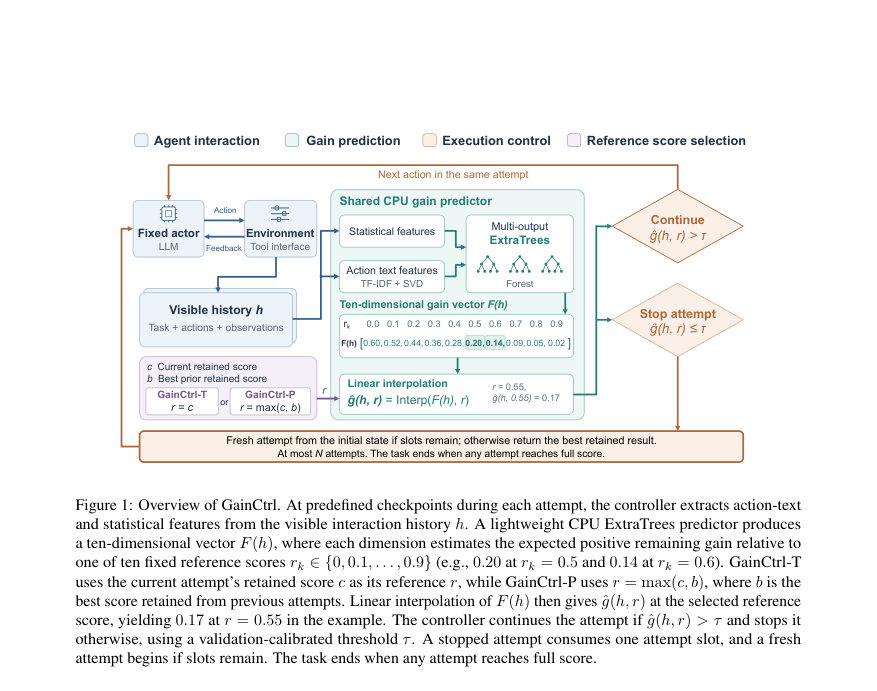
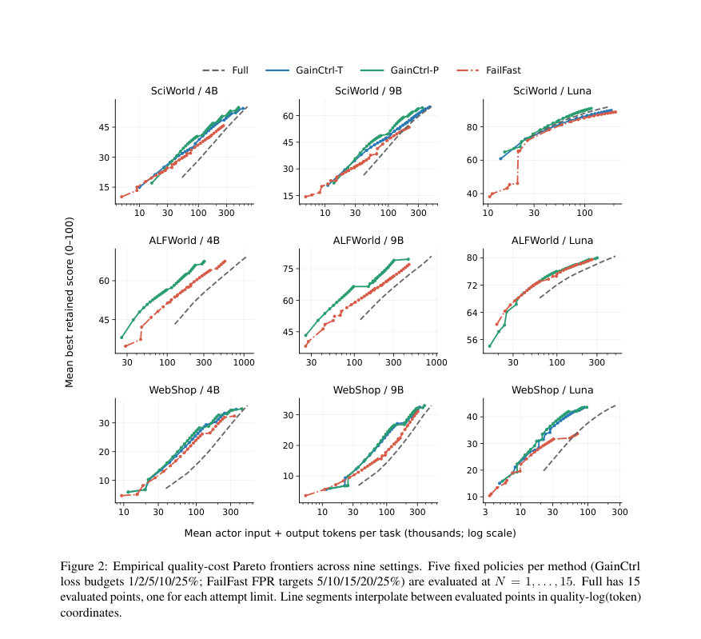
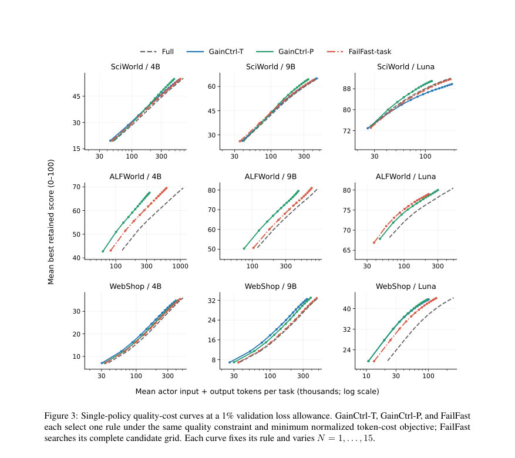

# GainCtrl: Predicting Remaining Gains for Efficient LLM Agent Execution

- **게시일:** 2026-11-17
- **arXiv:** [2611.20736v1](http://arxiv.org/abs/2611.20736v1) · [PDF](https://arxiv.org/pdf/2611.20736v1)
- **저자:** Kangwen Zhao, Jianfeng Cai, Ruopei Sun, Mingxiao Feng, Peng Zhang, Wengang Zhou, Houqiang Li
- **분야:** cs.AI
- **선정 점수:** 5.07
- **선정 이유:** 최근성 1.0, 인용 영향 0.0 (인용 0회), 저자 영향 0.0 (최고 h-index 0), AI 주제 적합성 3.0, 개발자 관심 0.8, 학술 신호 0.3, 오픈 웨이트·주요 연구조직 신호 0.0

[← 2026-11-17 목록으로 돌아가기](../daily/2026-11-17.html)

<!-- paper-visuals:start -->
## 주요 Figure

> 원문 PDF에서 실제 Figure 캡션과 그림 영역이 함께 확인된 자료만 자동 추출했다.

*Figure · 원문 PDF 4쪽 · Figure 1: Overview of GainCtrl. At predefined checkpoints during each attempt, the controller extracts action-text*

*Figure · 원문 PDF 7쪽 · Figure 2: Empirical quality-cost Pareto frontiers across nine settings. Five fixed policies per method (GainCtrl*

*Figure · 원문 PDF 16쪽 · Figure 3: Single-policy quality-cost curves at a 1% validation loss allowance. GainCtrl-T, GainCtrl-P, and FailFast*

<!-- paper-visuals:end -->

## 한 문장 요약

LLM 에이전트의 반복 시도 실행을 중단할 시점을 예측하기 위해, 실행 이력으로부터 남은 기대 개선량(positive remaining gain)을 CPU 기반의 경량 회귀기로 추정하고 검증 기반 임계치로 중단을 결정하는 GainCtrl을 제안한다.

## 해결하려는 문제

도구를 사용하는 LLM 에이전트는 동일 태스크에 대해 여러 번 시도하여 Best-of-N 품질을 높이지만, 추가 시도는 모델 호출·환경 상호작용·긴 히스토리로 인한 토큰 비용을 증가시킨다. 언제 현재 시도를 중단해도 최종 Best-of-N 품질 손실을 제한하면서 불필요한 토큰 소비를 줄일지 결정하는 문제를 다룬다. 기존 접근은 내부 모델 활성화(activation)나 토큰-레벨 신호에 의존해 블랙박스 모델에 적용하기 어렵거나 도구 피드백·교차 시도(retained scores)를 고려하지 못하는 한계가 있다.

## 핵심 기여

- 도구-사용 에이전트를 대상으로 현재 시도와 포트폴리오(이전 시도 보유 결과)를 기준으로 잔여 기대 개선량을 예측하여 중단 결정을 내리는 GainCtrl 프레임워크(구성: GainCtrl-T, GainCtrl-P)를 제안함.
- 공개 가능한 상호작용 히스토리만으로 동작하는 경량 CPU 예측기(멀티-아웃풋 ExtraTrees)로 10개의 기준 점수(rk∈{0,0.1,…,0.9})에 대한 양(positive) 잔여 이득을 회귀하도록 설계하여 블랙박스/화이트박스 배우 모두에서 모니터링 가능하게 함.
- 검증 데이터에서 허용 가능한 평균 Best-of-N 품질 손실(정책별 δ)을 기준으로 임계치 τ를 보정해 토큰 비용 감소와 태스크 수준 품질 보전을 균형있게 달성하는 stopping-rule과 임계치 선택 절차를 제시함.
- WebShop, ScienceWorld, ALFWorld의 세 환경과 Qwen3.5-4B/9B, GPT-6-Luna 배우를 사용한 대규모 궤적 리플레이 평가를 통해, 동일 품질 목표에서 Actor-토큰 사용량 절감 및 동일 예산에서 더 높은 품질을 보이는 경험적 증거를 제시함.
- 고정 정책(fixed thresholds)을 단일 임계치로 유지하면서도 전체 실행 대비 품질을 근접하게 유지하면서도 토큰 소비를 크게 줄일 수 있음을 보이고, CPU 단일 스레드에서 밀리초 수준의 예측 지연으로 저비용 모니터링이 가능함을 확인함.

## 접근 방법

* GainCtrl는 다음 구성으로 동작한다.
* (1) 문제설정: 각 태스크는 최대 N번의 독립적 시도를 허용하고, 각 시도는 체크포인트에서 중단 가능하다.
* 목표는 평균 Best-of-N 품질 손실을 δ 이내로 유지하면서 배우(LLM) 입력·출력 토큰 소비를 줄이는 것이다.
* (2) 잔여 이득 정의: 체크포인트 시점의 가시적 히스토리 h와 기준 점수 r에 대해 bg(h,r)=E[ (Y−r)+ \| h ]로 정의하며, Y는 해당 시도에서 완전한 계속 실행으로 얻을 실제 점수(ScienceWorld의 경우 체크포인트 이후의 최대 점수, 비감소 환경은 최종 점수)를 사용한다.
* (3) 예측기 설계: 단일 예측기는 10차원 벡터 F(h)을 출력해 rk∈{0,0.1,…,0.9}에서의 양의 잔여 이득을 추정하고, 임의 r에 대해 선형 보간으로 bg(h,r)를 계산한다.
* 입력 특징은 (A) 액션 텍스트: 초기 가시 상태·실행된 액션까지의 텍스트를 TF-IDF(최대 12k unigram/bigram, min_df=2) 후 SVD(64차원)로 인코딩하고, (B) 환경별 통계 피처(예: 단계 사용률, 최근 점수 변화, 행동 반복 등)를 결합해 사용한다.
* (4) 학습: 기록된 완전 궤적에서 각 체크포인트별로 목표 벡터 [Y−rk]+ (k=0..9)를 구성해 다출력 ExtraTrees 회귀기(128개 나무, max_depth=18, min_leaf=8, max_features=1.0, seed=42)를 학습한다.
* 태스크 간 불균형을 피하기 위해 각 예제는 태스크의 예제 수의 역수로 가중한다.
* (5) 레퍼런스 점수: GainCtrl-T는 현재 시도의 retained score c를, GainCtrl-P는 max(c,b) (b는 이전 시도들 중 최고 보유 점수)를 기준으로 사용한다.
* (6) 중단 규칙: 체크포인트에서 bg(h,r) ≤ τ이면 해당 시도를 중단하고 새로운 시도를 시작한다(시도 슬롯 소모).
* 임계치 τ는 검증 태스크에서 모든 N=1..15에 대해 최대 상대 품질 손실 L(τ)≤δ를 만족하는 τ 중 평균 상대 토큰 비용 A(τ)를 최소화하는 규칙으로 선택한다.
* (7) 추론 비용·운영: TF-IDF/SVD 변환과 ExtraTrees 예측으로 ms 수준(테스트에서 median 7.0–11.9 ms/체크포인트, 단일 CPU 스레드)의 지연을 달성하며, Actor 내부 상태나 토큰 확률에 접근하지 않고 블랙박스 배우에서 작동한다.

## 주요 결과

- 평가 설정: WebShop/ScienceWorld/ALFWorld 세 환경, Qwen3.5-4B·Qwen3.5-9B·GPT-6-Luna 세 배우, 각 환경별로 훈련/검증/테스트 할당(예: ScienceWorld train/val/test=897/200/200), 각 훈련 태스크는 3개의 기록된 시도, 테스트는 각 태스크당 15개의 기록된 후보 시도(총 27,000 테스트 궤적)로 리플레이 평가를 수행함(시도 제한 및 체크포인트는 환경별 고정).
- 품질-비용 파레토: GainCtrl-P는 동일 품질 조건에서 FailFast(적응된 failure monitor) 대비 일반적으로 더 적은 actor 토큰을 사용함. 예시: ScienceWorld/4B에서 Full=294.2k 토큰, FailFast=227.1k, GainCtrl-P=143.5k(표에서 GainCtrl-P는 FailFast 대비 36.8% 절감으로 표기됨). ALFWorld와 WebShop 전반에서도 유사한 비용-품질 이득 관찰(테이블 1에 상세 수치).
- 동일 품질에서의 토큰 절감 및 동일 예산에서의 품질 향상: 테이블 1의 매치된 품질(q*) 결과에서 GainCtrl-P가 FailFast보다 토큰을 더 적게 사용하는 경우가 다수(예: WebShop/4B: GainCtrl-P 98.8k vs FailFast 161.7k). 또한 고정 예산(Full N=5 기준 토큰 예산)에서 GainCtrl-P가 FailFast보다 평균 유지 품질이 높음(테이블 2, 예: ScienceWorld/4B 기준 점수 GainCtrl-P 49.80 vs FailFast 44.86).
- 훈련 데이터 요구: 각 태스크당 1개 기록 시도만 사용해도 N=15, 검증 손실 허용 2%에서 품질 유지율은 96.79–99.09% 범위이고, actor 토큰 절감은 21.54–65.09% 범위임(테이블 3). 추가 기록 시도는 일반적으로 추가 절감을 제공함.
- 입력 특징 영향: 통계 피처 + 액션 텍스트(64-d SVD 벡터)를 결합한 입력이 대부분 설정에서 가장 큰 토큰 절감을 달성함(테이블 4/5). 액션 텍스트만·통계만 각각은 장단점 존재함(구성별 성능 표 참조). 95% paired-bootstrap 신뢰구간 분석 제공(부록).  

모니터 비용·시간: GainCtrl의 학습(encoder+forest) 적합 시간은 설정당 약 4–13초(4 CPU 스레드)이며, 체크포인트 예측의 단일-스레드 중간 지연은 median 7.0–11.9 ms임. 대조적으로 FailFast 적응 모니터는 4 GPU에서 12.8–53.1 분의 학습 시간이 필요하고, GPU 단일 전달의 median 전방-지연은 66–127 ms(입력 전처리 제외)로 보고됨(테이블 12).

## 한계

- 저자가 명시한 한계: GainCtrl은 잔여 이득 예측기 학습과 임계치 보정을 위해 완전한(또는 기록된) 전체 궤적과 검증 태스크를 필요로 한다; 환경별 통계 피처와 점수 보존 규칙은 새로운 환경에 대해 조정이 필요할 수 있다; 효율성 분석은 배우(Actor) 토큰 소비만을 고려하고 환경 리셋·실행 비용은 포함하지 않는다.
- 본문 실험에서 확인되는 제약(저자 서술과 구별): 예측기는 환경별·배우별로 별도 적합을 수행하므로 실제 서비스에서 다수 배우·다수 환경을 운용하면 학습·관리 비용이 증가한다; 통계 피처는 환경 특화로 수작업(문서화된 설계, 일부는 GPT 보조)로 만들어져 일반화에 추가 설계가 필요하다; 중단 결정을 위한 체크포인트와 보상(부분 보상 포함) 규칙이 환경마다 달라 재사용성에 한계가 있다.

## 개발자 관점

- 재현을 위해 필수: 각 환경과 배우별로 완성된 기록 궤적(저자는 훈련에 태스크당 최대 3개 사용)과 검증 태스크 세트가 필요하다. 정밀한 임계치 보정을 위해 N=1..15의 시나리오로 리플레이 가능한 후보 시도들이 요구된다.
- 특징 공학: 텍스트 특성은 TF-IDF(최대 12k n-gram, min_df=2)와 SVD(64차원)를 사용하고, 환경별 통계 피처는 환경의 인터페이스·보상 체계에 맞춰 설계해야 한다(논문 부록 A.2에 환경별 피처 목록 제공).
- 모델·하이퍼파라미터: 다출력 ExtraTrees(128 trees, max_depth=18, min_leaf=8, max_features=1.0, seed=42)를 사용한다. 예제 가중치는 태스크별 예제 수의 역수로 정규화해 태스크 불균형을 완화한다(Algorithm 1).
- 임계치 보정·운영: 임계치 τ는 검증에서 L(τ)=max_{1≤N≤15} (1 − QN(τ)/Qfull_N)+ 를 계산해 주어진 품질 손실 허용 δ를 만족하는 후보 중 평균 상대 토큰 비용 A(τ)를 최소화하는 방식으로 선택한다. 단일 τ를 고정해 다양한 N에서 운영할 수 있다.
- 배포·비용 고려: GainCtrl 예측기는 단일 CPU 스레드에서 체크포인트당 median 7–12 ms로 경량이므로 오버헤드가 작고 블랙박스 LLM에도 적용 가능하다. 그러나 실제 배포 시 환경 리셋 비용, 병렬 시도 비용, 모니터 호출 빈도(체크포인트 수) 등 전체 시스템 비용을 반드시 함께 고려해야 한다.

**근거 범위:** 이 분석은 제공된 논문 PDF 본문(본문 및 부록 포함)에서 직접 인용·요약한 내용에 기반함. 실험 수치와 하이퍼파라미터는 PDF의 표와 본문·부록에 명시된 값을 따랐음. 구현 세부사항(예: 운영환경별 추가 튜닝, 배포시의 환경 리셋 비용 추정 등)은 본문에 명시되지 않아 기술하지 않았으며, 본문에 주어지지 않은 추가 실험 결과나 외삽된 수치는 포함하지 않았다. 전반적으로 본문에 충실하므로 분석 신뢰도는 높음.
