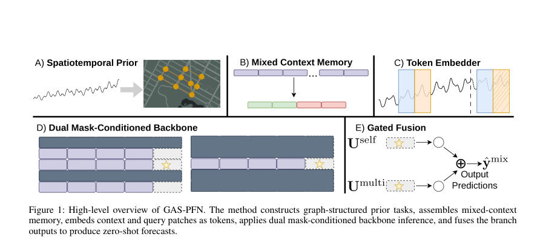
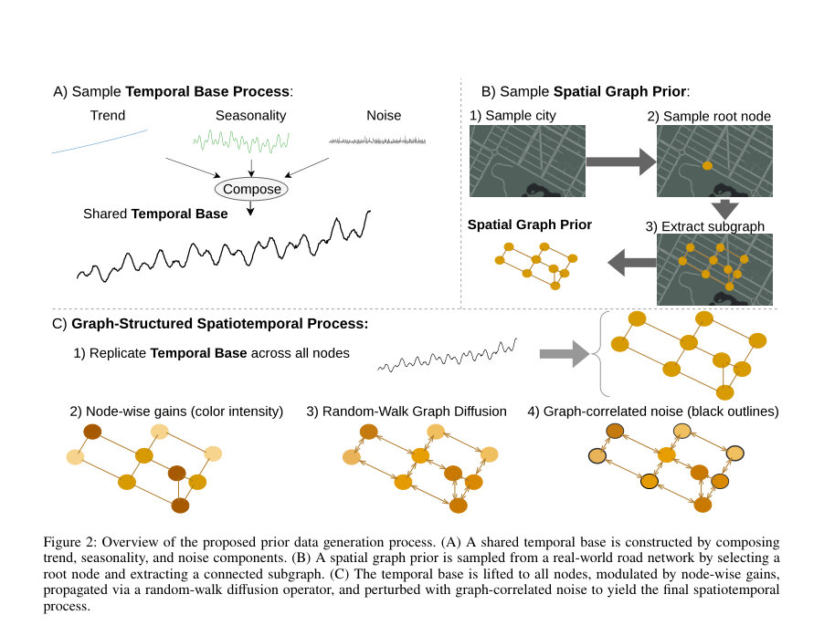
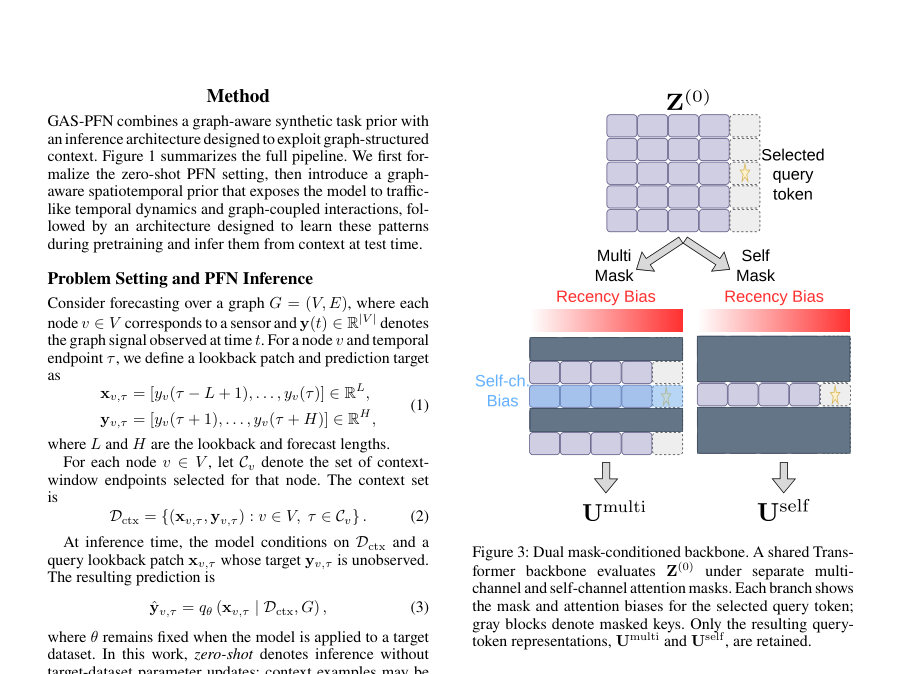

# GAS-PFN: Graph-Aware Spatiotemporal Prior-Data Fitted Networks for Zero-Shot Traffic Forecasting

- **게시일:** 2026-10-29
- **arXiv:** [2610.37598v1](http://arxiv.org/abs/2610.37598v1) · [PDF](https://arxiv.org/pdf/2610.37598v1)
- **저자:** Joseph Natter, Long Vu, Yifan Zhang, Bobin Deng, Kun Suo, Rui Wu
- **분야:** cs.LG, cs.AI, cs.NE
- **선정 점수:** 3.79
- **선정 이유:** 최근성 0.7, 인용 영향 0.0 (인용 0회), 저자 영향 0.0 (최고 h-index 0), AI 주제 적합성 2.0, 개발자 관심 0.6, 학술 신호 0.5, 오픈 웨이트·주요 연구조직 신호 0.0

[← 2026-10-29 목록으로 돌아가기](../daily/2026-10-29.html)

<!-- paper-visuals:start -->
## 주요 Figure

> 원문 PDF에서 실제 Figure 캡션과 그림 영역이 함께 확인된 자료만 자동 추출했다.

*Figure · 원문 PDF 2쪽 · Figure 1: High-level overview of GAS-PFN. The method constructs graph-structured prior tasks, assembles mixed-context*

*Figure · 원문 PDF 3쪽 · Figure 2: Overview of the proposed prior data generation process. (A) A shared temporal base is constructed by composing*

*Figure · 원문 PDF 4쪽 · Figure 3: Dual mask-conditioned backbone. A shared Trans-*

<!-- paper-visuals:end -->

## 한 문장 요약

도로망 토폴로지로 생성한 그래프-구조적 합성 사전과 랜덤-워크 확산을 이용해 PFN을 그래프 인식형 시공간 예측기로 사전학습하고, 쿼리별로 두 가지 마스크를 적용한 Transformer 전방향을 병렬로 구동해 대상 네트워크에서 무파인튜닝(zero-shot) 예측을 수행한다.

## 해결하려는 문제

교통 예측은 복잡한 시간적 동역학과 도로 토폴로지에 따른 공간적 의존성을 동시에 모델링해야 한다. 기존의 그래프 기반 감독 학습 모델은 특정 데이터셋과 센서 그래프에 맞춰 파라미터를 최적화하므로 새로운 도로망이나 센서 구성으로 배포·적응할 때 높은 데이터·계산 비용이 든다. Prior-Data Fitted Networks(PFNs)는 합성 사전으로 in-context 무파인튜닝 추론을 가능하게 하나, 기존 시계열 PFN들은 명시적으로 그래프 구조를 사전(prior)이나 추론 아키텍처에 반영하지 않아 도로-조건부(spatially coupled) 상호작용을 학습·활용하지 못한다. 연구 질문은 ‘PFN의 합성 사전과 추론 아키텍처에 그래프 구조를 결합하면 무파인튜닝 교통 예측 성능이 개선되는가’이다.

## 핵심 기여

- 그래프 인식 합성 사전: 실제 도로 네트워크에서 샘플한 연결 서브그래프와 랜덤-워크(지연 랜덤-워크) 확산을 결합해 채널 간 상호작용을 그래프-조건적 시공간 프로세스로 생성하는 PFN 합성 사전을 제안함.
- 그래프-인식 ICL(인컨텍스트 러닝) 아키텍처: 동일 Transformer 백본을 두 번(두 마스크) 실행하여 센서-로컬 시간 동역학(self pass)과 이웃-감지 결합 상호작용(multi-channel pass)을 분리 학습·추론하고, 게이트 기반 융합으로 예측을 생성하도록 공동 설계함.
- 혼합-컨텍스트 메모리 설계: 각 센서에 대해 K 최근 창(최근 정렬)과 K 역사적 앵커(센서별, 비정렬)를 혼합해 대상 네트워크의 짧은 연속 최근 이력(보고서에서는 90분=18스텝)과 더 오래된 관측을 함께 활용하는 제로-샷 추론 파이프라인을 구현함.
- 종합 평가: 6개 표준 교통 벤치마크(속도·유량)와 3개 예측 지평에서 평가하여, 90분 지평에서 TimePFN 대비 평균 MSE 34.0% 절감 등 기존 제로-샷·교차-네트워크 방법 대비 유의한 성능 향상을 보임.
- 구성 요소 기여 분석: 이중 브랜치(dual-branch) 구조, 혼합-컨텍스트 지원, 하이브리드(그래프+시맨틱) 라우팅이 추론 성능에 기여함을 동결-체크포인트(ablation)로 분석함.

## 접근 방법

* (아키텍처/사전/학습·추론 절차 요약)
* 문제 설정: 그래프 G=(V,E) 위의 노드별 시계열 y_v(t)를 L=18 길이의 lookback 패치와 H=18 길이의 forecast 패치로 정의.
* PFN q_theta는 합성 사전 Π에서 샘플한 태스크로 사전학습되어, 추론 시 D_ctx(노드별 컨텍스트 패치 집합)와 그래프 G를 조건으로 쿼리 패치의 예측을 생성(무파인튜닝).
* 그래프-기반 합성 사전: (부본 구조)
* 단변량 시간 기저(y0(t))는 trend, seasonality, stochastic 컴포넌트를 합성해 T=12,000 길이로 대규모(최종 은행: 1,000,000개 다변량 시리즈)로 생성.
* 도로 그래프 은행: OpenStreetMap 기반 20개 미주 대도시 그래프에서 연결 서브그래프(사이즈 24/36/48/60 노드)를 샘플해 50개의 고정 그래프 구성으로 은행을 구축.
* 공간화: 시간 기저를 모든 노드로 복제(y0(t)1), 노드별 게인 g~1+σ_g N(0,1) (σ_g=0.05) 적용 후 지연 랜덤-워크 확산 P(u)=0.5(u+Pu)로 전파: z_prop(t)=(1-β)z(t)+βP(z(t)), β=0.7(실험표기·부록).
* 그래프-상관 노이즈 ϵ_G(t)=σ_ϵ[βP_u(n(t))+(1-β)P_d(n(t))], σ_ϵ=0.02를 더하고 전체 스케일 α=0.05로 결합해서 최종 y(t)=y0(t)+α[z_prop(t)-y0(t)+ϵ_G(t)].
* 추론 아키텍처(dual mask-conditioned backbone):
* 토크나이제이션: 각 (node,endpoint)별로 컨텍스트 토큰(정답 포함)과 쿼리 토큰(타깃 0으로 채움)을 독립적 affine 투영으로 임베딩(d=512).
* mixed-context 메모리(평가 시): 각 노드에 대해 K=16의 최근 정렬 창(C_recent)과 K=16의 역사적 앵커(C_anchor_v)를 합쳐 총 32개 컨텍스트 패치 제공.
* (사전학습시에는 더 큰 샘플에서 요약·풀링 포함)
* 백본: 동일 Transformer(10 레이어, 8헤드, hidden=512, FF=2048)를 두 번 실행하되 서로 다른 attention 마스크를 적용: self-branch는 같은 센서의 인과적(과거) 토큰만 열람하여 센서-로컬 시간적 패턴을 캡처; multi-branch는 선택된 이웃 채널(N_v)을 포함하는 토큰과 동일 예측 시각의 쿼리들(평가 규약에서) 간 상호작용을 허용해 그래프-조건 상호작용을 캡처.
* 이웃 라우팅: 그래프 스코어 A와 토큰 기반 의미 유사도 S_sem을 가중 혼합(Shyb=(1-η)A+η S_sem, η=0.4)하고 TopK(최대 7)로 하드 라우팅해 멀티채널 마스크를 구성.
* 라우팅에 사용하는 MLP ψ_ω0는 시드 초기화 후(평가시 드롭아웃 해제) 라우팅에만 사용되며(라우팅 인덱스는 이산 TopK), 라우팅은 이산 마스크로 Transformer에 전달된다.
* 어텐션 로깅: 마스크 허용 쌍에 대해 temporal-distance penalty(각 헤드별 γ_h, 초기 0.01)와 같은 채널 bias b_same를 더해 logit을 계산.
* 융합: 두 브랜치의 쿼리 표현 u_self, u_multi를 게이트 g=σ(w_g [u_self;u_multi]+b_g)로 가중합해 최종 예측 bY_mix를 생성.
* 학습 손실 L = MSE(bY_mix,Y) + 0.3 MSE(bY_self,Y) + 0.3 MSE(bY_multi,Y) -0.03 H(g)로 보조 분기사용과 게이트 엔트로피 정규화를 적용.
* 사전학습/옵티마이저: AdamW, lr=1e-4, weight decay=0.05, warmup 50k steps, cosine decay to 1e-5, 총 1,000,000 optimizer steps(보고된 체크포인트의 terminal state).
* 모델 파라미터 수 약 32.1M.
* 추론 규약: zero-shot(대상 데이터 파라미터 업데이트 없음).
* 입력으로 대상 그래프의 인접행렬(대각을 1로 설정)과 mixed-context(16+16)를 제공.
* 대형 그래프(PEMS07)는 채널-코호트(최대 50) 기반 메모리-제한 추론으로 처리해 메모리 조절.

## 주요 결과

- 데이터셋: METR-LA(207 센서, 속도), PEMS-BAY(325, 속도), PEMS03(358, 유량), PEMS04(307), PEMS07(883), PEMS08(170). 시간해상도 5분, lookback/forecast L=H=18(30/60/90분 누적 지평).
- 주요 성과 요약: GAS-PFN은 6개 데이터셋·3지평(총 36 MAE/MSE 비교)에서 전체적으로 우수함(논문: 27/36에서 최저 MAE/MSE 획득). 90분 지평에서 6개 데이터셋 평균 MSE는 TimePFN 대비 34.0% 감소, 네 개(Chronos-2, TimesFM-2.5, Moirai-2, Lag-Llama)의 일반 목적 제로-샷 포어캐스터 대비 평균 MSE 27.7% 감소를 보고함.
- 데이터·컨텍스트 조건: 모든 모델은 90분(18스텝)의 연속 최근 이력을 공통으로 제공받았고(추가 컨텍스트는 각 베이스라인의 규약대로 훈련-스플릿에서 제공), GAS-PFN은 고정 mixed-context(16 recent +16 historical)로 평가됨.
- 교차-도로(transfer) 성능: SCPT와 비교 실험에서 SCPT가 대상 도로들 일부(10%,20%,30% 등)를 감독학습에 사용하도록 허용한 상황에서도, SCPT가 10% 도로만 학습했을 때 GAS-PFN이 평균 MSE를 34.7% 감소시켜 우위(논문 본문 및 그림 5).
- 컨텍스트 예산 효과: 90분 지평에서 K(각 소스당 패치 수)를 0에서 K=16(즉 총 32 support 패치)로 늘리면 평균 MAE가 25.4% 감소했다(데이터셋별로 감소폭 상이). 가중치·구성요소 기여: 동결 체크포인트 기반 절제(ablation)에서 이중-브랜치 융합, 혼합-컨텍스트 지원, 하이브리드 라우팅이 추론 성능 향상에 기여함(예: 역사적 지원 제거 시 모든 36 설정에서 성능 저하).

## 한계

- 저자 명시 한계: 본문과 결론에서는 명시적 제한점 목록을 제시하지 않음. 저자는 결과가 ‘두 가지 배포 시나리오(신규 센서/관측 중단 상황)에 유용하다’고 제안하지만 일반화 한계에 대한 구체적 진술은 없음.
- 본문·실험으로부터 합리적 도출(확인된 제약):
- - 합성 사전의 분포·그래프 은행 제약: 합성 다변량 사전은 OpenStreetMap에서 샘플한 20개 미국 대도시의 서브그래프(24/36/48/60 노드 고정 50개 샤드)로 구성됨. 따라서 다른 국가/도로 유형·규모(예: 매우 큰 도시간 네트워크)에서의 prior-mismatch 위험은 존재한다.
- - 고정 lookback/forecast 설정: L=H=18로 설계·사전학습되어 이 값에서의 제로-샷 성능을 주로 보고함; 다른 L/H 조합에 대한 일반성은 본문에서 평가되지 않음(사전학습 규약과 평가 규약의 일치가 성능에 민감할 수 있음).","- 사전학습 비용·리소스: 사전학습은 1,000,000 스텝(모델 파라미터 약 32.1M)으로 이루어져 있어 상당한 계산 자원이 필요함(논문은 정확한 GPU-일 수를 제공하지 않음).","- 메모리·스케일 제약: 대규모 그래프(PEMS07)는 채널-코호트 분할로 처리해야 했음. 이는 전체-채널 동시 처리 비용과 메모리 한계를 시사함.

## 개발자 관점

- 재현·데이터 준비: 합성 사전은 미리 생성된 은행(1M 다변량 시리즈, T=12,000)으로 동결해 사용하므로 동일한 실험을 재현하려면 합성 생성 파이프라인(부록 A의 파라미터 분포 포함)과 도로 그래프 은행(OSMnx 기반 20개 도시)을 재생성·저장해야 함.
- 그래프 입력·전처리: 대상 데이터의 인접행렬을 그대로 사용하되 평가 전 대각(diagonal)을 1로 설정(자기 루프 추가). 원시 엣지 속성(거리·길이 등)은 사용하지 않고 저장된 가중치/타입(대칭·비대칭)을 그대로 둠.
- 컨텍스트 설계: 실전 배포 시 최근 16패치 + 센서별 역사적 16패치(K=16) 구성이 좋은 경험적 균형을 보였음. 역사적 앵커는 센서별로 층화(stratified) 샘플링해 시간 정렬을 요구하지 않음. 실무에서는 대상 데이터의 역사 가용성·결측 특성에 맞춰 앵커 정책을 조정해야 함.
- 라우팅·마스크: 하이브리드 라우팅(그래프 연결성 + 의미 유사도, η=0.4)과 TopK(최대 7) 하드 라우팅을 사용해 멀티채널 마스크 구성. 라우팅은 discrete TopK 인덱스(무차별적 surrogate gradient 없음)를 Transformer에 전달하므로 라우팅 모듈은 체크포인트 초기화(seed 고정) 방식으로 안정화함.
- 추론 아키텍처 팁: 동일 Transformer 파라미터를 두 번 실행하고 각 패스에 대해 다른 마스크를 적용하는 전략은 파라미터 수를 늘리지 않으면서 서로 다른 상호작용 유형을 캡처함. 게이트에 엔트로피 항(-0.03 H(g))을 둬서 편향적 게이트 붕괴를 방지한 점을 참조할 것(학습 안정화).

**근거 범위:** 이 분석은 제공된 논문 PDF 본문(주 본문 및 별첨 부록 A–E 포함)에 근거함. 아키텍처·하이퍼파라미터·수치(예: α, β, σ값, L/H, K, 네트워크 구성, 학습 스텝 수, 옵티마이저 설정 등)는 본문과 부록에서 직접 확인 가능한 항목만 기술했음. 반면 사전학습의 실제 벽시계 시간(예: GPU-일)이나 일부 배포비용 추정치는 PDF에 명시되지 않아 포함하지 않았음.
