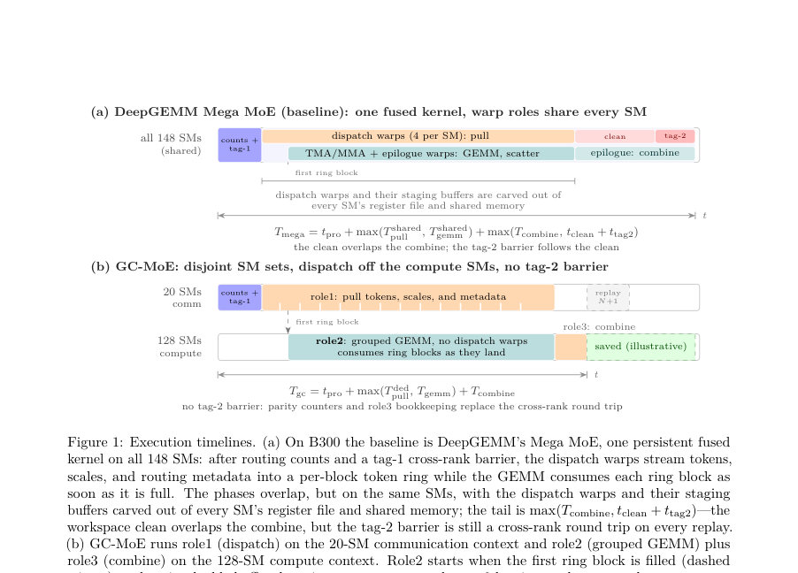
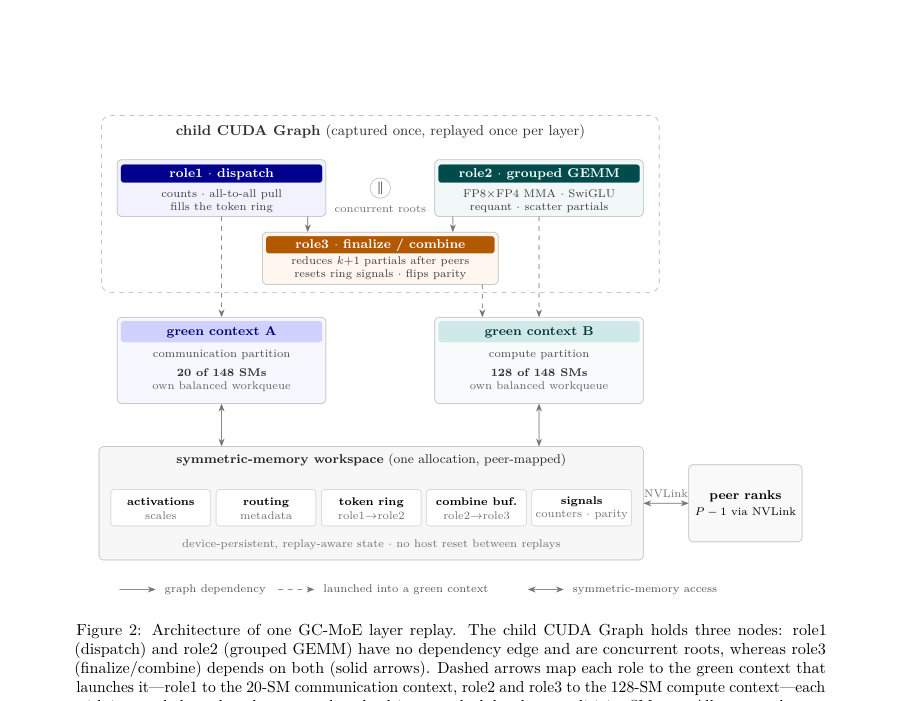
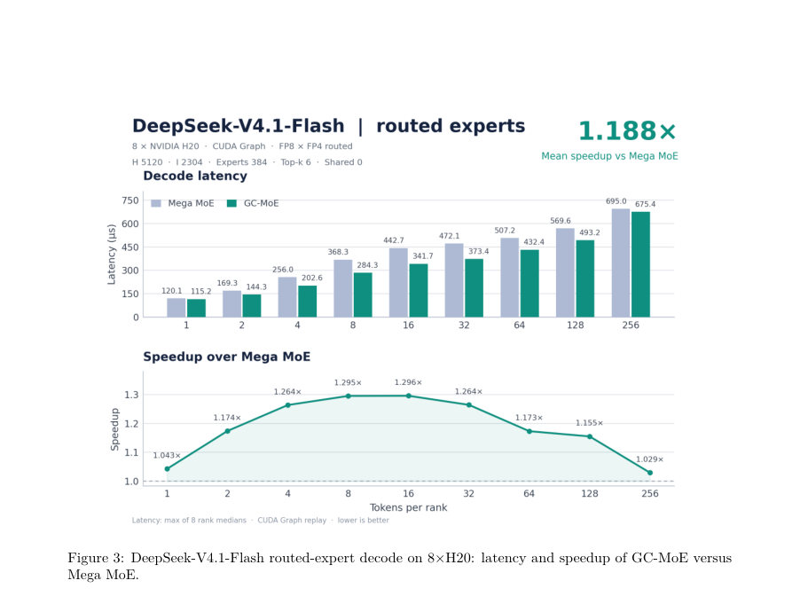

# GC-MoE: Overlapping Expert-Parallel Token Dispatch with FP8/FP4 Grouped GEMM via CUDA Green Contexts

- **게시일:** 2026-11-04
- **arXiv:** [2611.04222v1](http://arxiv.org/abs/2611.04222v1) · [PDF](https://arxiv.org/pdf/2611.04222v1)
- **저자:** Yong Li, Kan Liu, Tao Lan
- **분야:** cs.DC, cs.AI, cs.AR, cs.LG, cs.PF
- **선정 점수:** 6.84
- **선정 이유:** 최근성 0.9, 인용 영향 0.0 (인용 0회), 저자 영향 0.0 (최고 h-index 0), AI 주제 적합성 2.0, 개발자 관심 1.1, 학술 신호 0.3, 오픈 웨이트·주요 연구조직 신호 2.5

[← 2026-11-04 목록으로 돌아가기](../daily/2026-11-04.html)

<!-- paper-visuals:start -->
## 주요 Figure

> 원문 PDF에서 실제 Figure 캡션과 그림 영역이 함께 확인된 자료만 자동 추출했다.

*Figure · 원문 PDF 6쪽 · Figure 1: Execution timelines. (a) On B300 the baseline is DeepGEMM’s Mega MoE, one persistent fused*

*Figure · 원문 PDF 9쪽 · Figure 2: Architecture of one GC-MoE layer replay. The child CUDA Graph holds three nodes: role1*

*Figure · 원문 PDF 15쪽 · Figure 3: DeepSeek-V4.1-Flash routed-expert decode on 8×H20: latency and speedup of GC-MoE versus*

<!-- paper-visuals:end -->

## 한 문장 요약

CUDA Green Contexts로 GPU를 통신 파티션(디스패치)과 연산 파티션(그룹화 GEMM)으로 분리하고, 링 기반 핸드셰이크와 이중 버퍼 카운터, 아키텍처별 FP8×FP4 grouped GEMM(Blackwell: tcgen05 K128 프리패킹, Hopper: 레지스터 WGMMA+인레지스터 FP4 디코드)을 결합해 MoE 디코드 추론을 가속화한 연산자이다.

## 해결하려는 문제

기존의 fused MoE 연산자(예: DeepGEMM의 Mega MoE)는 디스패치와 grouped GEMM을 동일한 SM 배열에서 warp 수준으로 공간 공유함으로써(1) 디스패치 워프가 각 SM의 레지스터·공유메모리·이슈 슬롯을 차지해 GEMM 효율을 저하시키고, (2) 전체 디바이스 단위의 동기화(프로로그/테일 그리드 sync, tag-2 교차-랭크 장벽)가 짧은 디코드 레이어에서 큰 지연을 초래하며, (3) 각 단계가 하나의 CTA 자원 예산을 공유해 개별 단계 최적화가 어려운 한계가 있다. 또한 디코드에서는 각 랭크당 토큰 수가 작아(grouped GEMM이 대역폭-바운드) 추가 SM이 산술 성능 개선에 기여하지 못하고, Hopper/Blackwell 세대는 혼합 정밀도(특히 FP4)에 대해 서로 다른 명령 집합을 제공한다는 문제가 있다.

## 핵심 기여

- CUDA Green Contexts 기반의 디코드-인식 분해: 디바이스를 작은 통신(디스패치) 파티션과 큰 연산(GEMM) 파티션으로 드라이버-정렬 분할하여 두 역할을 별도의 커널·자원·동기화 도메인에서 병렬 실행하도록 한 점(섹션 3,4.2).
- 파티션 간 미세 동기화: 세대 태그(full/empty) 카운터를 이용한 토큰 링과 64비트 W1 완료 비트맵, 이중 버퍼(receive parity) 카운터로 블록-단위 핸드셰이크를 파티션 경계로 확장하고 교차-랭크 반복 간 trailing barrier를 제거한 점(섹션 4.3,4.6).
- 이중 아키텍처 FP8×FP4 grouped GEMM 구현: Blackwell(SM103)에서 operand-swapped tcgen05 block-scaled MMA와 K128 타일 프리패킹을 사용하고; Hopper(SM90)에서 레지스터-A WGMMA와 인레지스터 FP4→E4M3 디코딩 및 윈도우 기반 스케일 재포장으로 구현한 점(섹션 4.4,4.5, 표 2).
- SwiGLU·재양자화·선택적 shared-expert 융합: W1 epilogue에서 SwiGLU, 라우팅 가중치 적용, FP8 재양자화를 융합하고(선택적으로 shared experts도 동일 스트림에 융합) 디코드 경로를 일원화한 점(섹션 4.4,4.5).
- 시스템적 평가 및 오픈소스 배포: 8×H20와 8×B300에서 DeepSeek-V4.1-Flash와 GLM-5.2를 대상으로 Mega MoE 대비 전 영역(총 54 포인트)에서 우월함을 보이고(예: H20에서 평균 1.188×, B300에서 평균 1.106–1.123×), 연산자 코드를 공개한 점(섹션 6).

## 접근 방법

* 아키텍처: 하나의 MoE 레이어를 세 개(또는 Hopper에서 fused shared experts일 때 네 개) 노드로 구성한 자식 CUDA Graph로 표현하고, 두 개의 CUDA Green Contexts를 생성해 통신 파티션(예: B300에서 드라이버 정렬로 20 SM)과 연산 파티션(예: 128 SM)에 각 역할을 고정 배치한다.
* 역할(role) 구성: role1(dispatch, 통신 파티션)에서 라우팅 계수 집계와 NVLink 기반 all-to-all 토큰 pull을 수행해 전역 재사용 토큰 링(BM 블록 단위)에 채워 l1_full_count를 게시한다; role2(compute, 연산 파티션)은 스케줄러 워프가 W1/W2 작업을 CTAs 클러스터에 브로드캐스트하고, 링 블록이 채워지는 즉시(l1_full_count acquire) W1을 수행(Blackwell: tcgen05.mma operand-swapped, K128 prepacked FP4/FP8 형식; Hopper: 레지스터-A WGMMA 전개 전 인레지스터 FP4 디코드 및 창 기반 재스케일)해 SwiGLU·라우팅 가중치·재양자화를 융합한 후 W2를 수행해 BF16 fragment를 소스 랭크의 combine 버퍼로 직접 스캐터한다.
* role3(finalize, 연산 파티션)은 이중-버퍼된 receive 카운터와 release/acquire 신호를 소비해 링 신호를 리셋하고 peer readiness를 기다린 뒤 combine을 수행한다.
* 동기화: 토큰 링(세대 태그), 64비트 W1 완료 비트맵, 이중 버퍼 recv_parity로 파티션 경계 동기화를 구현해 trailing cross-rank barrier를 제거한다.
* 구현: Python + CuTe DSL로 JIT-컴파일(PTX→cubin), 캡처된 CUDA Graph에 by-value 커널 파라미터(텐서맵, 피어 주소 테이블)를 담아 재생성 없이 낮은 오버헤드로 재실행한다(섹션 4·5).

## 주요 결과

- 평가 환경: CUDA 13.2/ptxas 13.2.78, PyTorch 2.11.0, CUTLASS DSL(CuTe) 4.8.1; 하드웨어는 8×H20(Hopper, sm_90a)와 8×B300(Blackwell, sm_103f). 비교 대상은 DeepGEMM의 Mega MoE(공개 baseline) 및 SM90 포팅된 레퍼런스(섹션 6.1, 표 3).
- DeepSeek-V4.1-Flash on 8×H20 (routed): GC-MoE가 모든 9 포인트에서 빠르며 평균 속도향상 1.188×, 최고 1.296×(표 5·섹션 6.2). 구체적 예: 토큰/랭크=8에서 Mega 368.254 µs → GC-MoE 284.310 µs, 속도비 1.2953×.
- GLM-5.2 and DeepSeek-V4.1-Flash on 8×B300 (routed): 모든 18 포인트에서 GC-MoE가 우세. GLM-5.2 평균 1.1024×, DeepSeek 평균 1.1094×, 전체 18포인트 평균 1.1059×(표 6·섹션 6.2). 예: DeepSeek 토큰/랭크=1에서 Mega 70.630 µs → GC-MoE 59.387 µs (1.1893×).
- Fused shared experts: H20에서 shared expert를 융합한 GC-MoE는 GC-unfused 대비 평균 1.0307×(내부 ablation), Mega unfused 대비 평균 1.188× 우위(표 7). B300에서는 두 연산자 모두 fused shared-expert 모드를 비교해 GC-MoE가 18포인트에서 모두 우세, GLM 평균 1.1306×, DeepSeek 평균 1.1154×(표 8·섹션 6.3).
- 정확도: 라우티드 및 shared-expert 테스트에서 BF16 대비 cosine ≥0.97(라우티드), GC-versus-Mega 최소 cosine ≥0.9999997(예: H20 shared-expert), 최대 절대오차 및 상대 L2 오차는 baseline과 동일한 범위(BF16 출력 한계 내)(섹션 6.5, 표 11).

## 한계

- [저자 명시] 대상 범위는 디코드 중심으로 설계됨: prefill(대규모 토큰) 시에는 연산 파티션이 병목이 되어 이득이 축소되며(예: 256 토큰/랭크에서 이득이 1.01–1.13×로 좁아짐), 작업공간(workspace)이 단일 인스턴스라 같은 워크스페이스를 공유하는 호출은 직렬화해야 함(결론·Limitations 섹션).
- [저자 명시] 설계상 제약들(부록 A): I ≤ 4096, I mod 128 = 0(64비트 W1 bitmap과 K128 타일 제약), H mod 256 = 0, k+1[shared] ≤32, E ≤2048, P ≤72 등 고정된 신호/데스크립터 크기와 토폴로지 제한으로 범용성 제약이 존재함(부록 A).
- [저자 명시] 이 버전에서는 파티션 크기(디스패치 SM 수)와 오버랩의 on/off에 대한 통제된 ablation 실험이 포함되지 않음(결론).
- [관찰적] 평가가 두 모델(GLM-5.2, DeepSeek-V4.1-Flash)과 특정 정밀도/스케일 레시피((1,1,32) 등)에 제한되어 있어 다른 모델 구조·다른 스케일 레시피·학습-시나리오에 대한 일반화는 추가 검증이 필요함(섹션 2.3, 6).

## 개발자 관점

- 재현/배포: 연산자는 오픈소스이며 Python/CuTe DSL 기반으로 빌드 시 커널은 구성별로 JIT 컴파일됨. 호출 환경은 프로세스당 GPU 1개, torch distributed group, PyTorch 대칭 메모리(symm) 필요(섹션 5, Listing 1).
- 운영 요구사항: CUDA 12.4+에서 도입된 CUDA Green Contexts와 드라이버의 SM 분할 API(cuDevSmResourceSplitByCount, cuGreenCtxCreate)를 사용하므로 드라이버/런타임이 해당 기능을 지원해야 하며, balanced workqueue 설정(공유범위=GREEN_CTX_BALANCED, wqConcurrencyLimit=1)을 활성화해야 의도한 동시성·격리가 보장된다(섹션 2.2·4.2).
- 실행 설계: 연산자는 세 노드(또는 SM90에서 네 노드)를 가진 자식 CUDA Graph로 캡처·재생하며, 커널 파라미터(텐서맵, 피어 주소 테이블)는 by-value로 그래프에 포함해 런타임 오버헤드를 줄였음(섹션 4.6·5). 따라서 Graph 캡처/재생 워크플로우에 통합해야 성능을 재현 가능하다.
- 메모리·데이터 레이아웃: Blackwell 경로는 FP4 가중치를 K128 타일로 사전 포장(prepack)해 TMA로 큰 연속 버스트를 읽고, Hopper는 윈도우 리패킹과 레지스터 디코딩을 통해 WGMMA를 사용함. 가중치 변환은 호출자가 비동기적으로 한 번 수행해 재사용해야 부담이 작음(섹션 4.4,5).
- 디버깅/제약: 운영자가 확인할 제약(예: I/H 배수, k+1 ≤ 32, P ≤72, BM 후보 집합 등)이 있으므로 호출 전 입력·모델 파라미터가 부합하는지 검증 파이프라인을 마련해야 함(부록 A, 표 12).

**근거 범위:** 이 분석은 제공된 논문 PDF 본문 전체에서 직접 추출한 내용에 근거한다(표·섹션·수치 인용). 저자가 본문에 명시하지 않은 내부 구현 세부(예: 드라이버 내부의 정확한 파티션 정렬 정책의 런타임 변동 등)는 추정하지 않았으며, 논문이 언급한 제한점과 평가 범위(모델·정밀도·하드웨어)를 그대로 반영했다. 일부 실험적 비교(예: 파티션 크기별 통제된 ablation)는 논문에 포함되지 않아 해당 영향은 본문에서 확인 불가하다.
