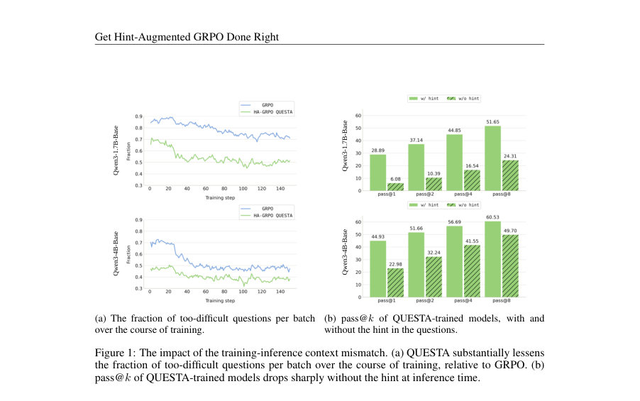
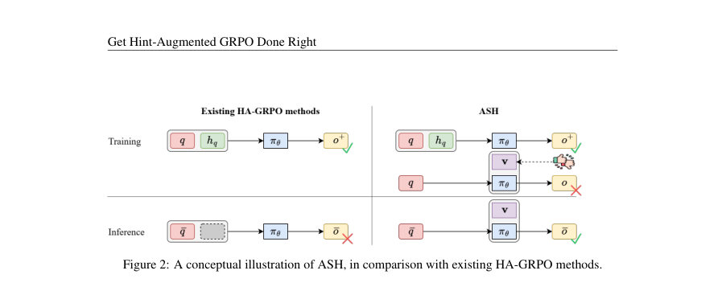
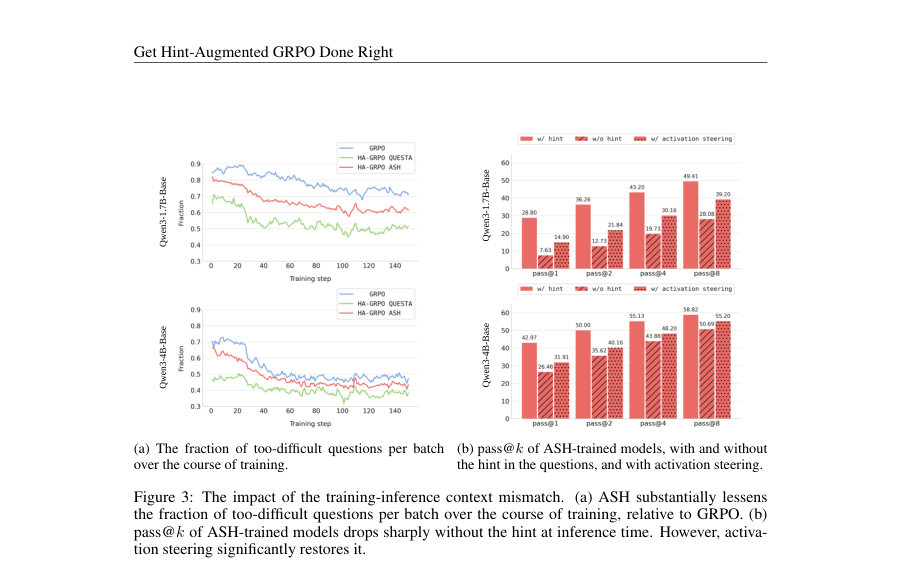

# Get Hint-Augmented GRPO Done Right Through Activation Steering

- **게시일:** 2026-11-18
- **arXiv:** [2611.23124v1](http://arxiv.org/abs/2611.23124v1) · [PDF](https://arxiv.org/pdf/2611.23124v1)
- **저자:** Khiem Le, Ting Hua, Nitesh V. Chawla
- **분야:** cs.LG
- **선정 점수:** 5.53
- **선정 이유:** 최근성 1.3, 인용 영향 0.0 (인용 0회), 저자 영향 0.0 (최고 h-index 0), AI 주제 적합성 2.5, 개발자 관심 0.2, 학술 신호 0.3, 오픈 웨이트·주요 연구조직 신호 1.2

[← 2026-11-18 목록으로 돌아가기](../daily/2026-11-18.html)

<!-- paper-visuals:start -->
## 주요 Figure

> 원문 PDF에서 실제 Figure 캡션과 그림 영역이 함께 확인된 자료만 자동 추출했다.

*Figure · 원문 PDF 2쪽 · Figure 1: The impact of the training-inference context mismatch. (a) QUESTA substantially lessens*

*Figure · 원문 PDF 5쪽 · Figure 2: A conceptual illustration of ASH, in comparison with existing HA-GRPO methods.*

*Figure · 원문 PDF 7쪽 · Figure 3: The impact of the training-inference context mismatch. (a) ASH substantially lessens*

<!-- paper-visuals:end -->

## 한 문장 요약

힌트를 행동 ‘난이도 감소’가 아니라 ‘행동 스티어링(steering)’으로 재해석하고, 훈련 시 힌트-유도 행동을 활성화(activation)에 내재화한 전역 스티어링 벡터를 학습해 추론 시 힌트 없이도 성능을 회복·향상시키는 ASH 방법을 제안한다.

## 해결하려는 문제

GRPO 기반 RL로 LLM의 추론 능력을 향상시키는 과정에서, 훈련 질문이 기본 모델의 능력을 초과하면 모든 샘플 답안이 실패해 보상이 0이 되고 기울기 신호가 사라져 학습이 정체된다. 이를 해결하기 위해 힌트를 입력 문맥에 추가하는 HA-GRPO가 등장했으나, 훈련 시에는 힌트를 쓸 수 있어도(힌트가 문맥에 포함됨) 추론 시에는 힌트가 없어 훈련-추론 문맥 불일치가 발생하며 훈련 시 얻은 이득이 추론으로 잘 전이되지 않는 문제가 있다.

## 핵심 기여

- 훈련-추론 문맥 불일치(training-inference context mismatch)를 정식으로 지적하고 사전 실험으로 그 영향(힌트가 있으면 지나치게 성능 의존)이 큼을 보였다.
- 힌트를 '난이도 완화'가 아니라 '모델 행동을 스티어링(제어)하는 수단'으로 재해석하고, 이 관점에 기반한 새로운 HA-GRPO 기법 ASH(Activation Steering for Hinting)를 제안했다.
- 훈련 중 힌트가 포함된 질문과 평문(plain) 질문을 모두 사용하고, 힌트-유도 행동의 질문 비특이적 성분을 포착하는 전역 스티어링 벡터를 DPO 유사 손실로 온라인 학습해 추론 시 활성화에 주입하여 힌트 없이 힌트-조건화된 동작을 재현하도록 했다.
- 다양한 모델(Qwen3-1.7B/4B-Base, Llama-3.2-1B/3B-Instruct)과 여러 벤치마크(AMC, OlympiadBench, AIME24/25, Minerva, GPQA-Diamond)에서 ASH가 일관되게 pass@k를 향상함을 보였고, 학습된 스티어링 벡터가 논리 QA·코드 도메인으로도 전이 가능함을 보여줬다.

## 접근 방법

* (요약) ASH는 두 단계로 구성된다.
* 1) 힌트 생성: 각 훈련 질문 q에 대해 레퍼런스 해답 z_q로부터 F(q,z_q) (본 논문에서는 QUESTA와 동일하게 해답의 앞 50% 토큰)을 추출해 힌트 h_q를 만들고 q+ = concat[q, h_q]를 구성한다.
* 2) 스티어링 벡터 학습(온라인): 모델 π_θ로부터 힌트가 포함된 q+와 평문 q 각각에 대해 ˆG(=4)개의 응답을 샘플링한다.
* 선택한 (중간) 레이어 l의 활성화 h^(l)_t에 학습 가능한 벡터 v를 더한 뒤(모든 토큰에 동일하게 적용) DPO 유사 손실 L(v; q) (논문 식(4))을 최소화해, 힌트-응답에 대한 모델 π^v_θ의 우선도가 평문 응답에 비해 커지게 하여 v가 힌트가 유도하는 행동 변화의 질문-비특이적 성분을 포착하도록 한다.
* 이 단계에서 v는 매 훈련 스텝마다 최적화되며, 반드시 모델 파라미터 θ를 갱신하기 전에 업데이트되어야 한다(코-트레이닝 순서 중요).
* 3) GRPO 업데이트: v 업데이트 후 힌트와 평문 각각에서 얻은 응답들에 대해 GRPO 식에 따라 이점을 계산하고 J(θ;q+)+J(θ;q)를 최소화해 θ를 업데이트한다(표준 GRPO와 동일하되 두 종류의 질문으로 합산).
* 추론 시에는 힌트 없이 질문 q만 주되 학습된 전역 스티어링 벡터 v*를 동일한 레이어에 주입(활성화 더하기)해 힌트-조건화 행동을 재현한다.

## 주요 결과

- 데이터·설정: 훈련에 OpenR1-MATH-220k에서 Math-Verify로 필터링한 후 랜덤 추출한 15k 문항 사용(Appendix C). 모델: Qwen3-1.7B-Base, Qwen3-4B-Base, Llama-3.2-1B-Instruct, Llama-3.2-3B-Instruct. 훈련 예산: baselines는 질문당 G=8 응답, ASH는 힌트/평문 각각 4응답(ˆG=4)으로 동일한 총생성 예산 유지. 평가: pass@k (k<=8) 및 특히 pass@8 보고.
- 주요 정량 결과(논문 표 및 본문 근거):
- - Qwen3-1.7B-Base: ASH의 competition-level(AMC, OlympiadBench, AIME24, AIME25) 평균 pass@8 = 39.50 vs GRPO = 35.66 (향상 +3.84%p). OOD(Minerva, GPQA-Diamond) 평균 pass@8 = 60.84 vs GRPO = 55.05 (향상 +5.79%p). 전체 표(Table 1)에서 각 벤치마크별 절대값 제시.
- - Qwen3-4B-Base: ASH competition-level 평균 pass@8 = 55.83 vs GRPO = 50.54 (+5.29%p). OOD 평균 = 70.47 vs GRPO = 66.86 (+3.61%p).
- - 논문 요약 수치: Qwen3-1.7B/4B-Base에서 ASH가 평균 pass@8을 각각 2.60%/2.21% 향상시킨다고 요약(본문 여러 위치에서 모델·벤치마크 분류별로 세분화된 증가치 표기). 표·본문의 상세 수치들은 위 Table 1·2와 본문 근거에 근거함(예: Table 2는 활성화 스티어링 적용 전후 비교).

## 한계

- 저자가 명시한 한계: 스티어링 벡터 학습의 계산 오버헤드가 존재(논문은 실무적으로 '약 1.5×'의 학습 시간 증가로 '실용적'이라고 주장). 현재 구현은 단일 전역 스티어링 벡터를 사용하므로 용량 한계가 있을 수 있으며, 작업·질문별 스티어링 벡터로 확장하는 것이 향후 과제라고 명시함.
- 본문과 실험에서 합리적으로 확인되는 한계(저자-관찰 구분):
- - 단일 전역 벡터의 용량 한계로 유도되지 않은 실패 사례(활성화 주입으로 질문에서 벗어나 잘못된 추론 경로를 생성하는 사례)를 관찰(부록 G, 사례와 해석 제시).
- - 실험은 수학 데이터(15k subset)로 학습된 스티어링 벡터의 전이성을 일부 다른 도메인(논리 QA, 코딩)에서 탐색했으나, 학습 데이터·모델·층 선택(중간층 고정) 등은 제한적이며 대규모/다양한 조건에서의 일반성은 추가 검증 필요. 또한 활성화 주입의 레이어 선택, β 등의 하이퍼파라미터 민감도에 대한 광범위한 탐색은 본문에서 수행되지 않음(논문은 중간층을 선택했다고 명시).

## 개발자 관점

- 재현·구현 핵심: 스티어링 벡터 v는 매 훈련 스텝마다 힌트와 평문에서 생성한 응답 쌍으로 DPO 유사 손실(논문 식(4))로 먼저 최적화한 뒤 모델 파라미터 θ를 업데이트해야 함(순서 필수). 마지막 스텝에서는 모델 갱신을 하지 않아 v와 θ의 동기 유지.
- 활성화 주입: 선택한 레이어의 모든 토큰 활성화 h^(l)_t에 동일한 벡터 v를 더하고 이후 레이어를 그대로 통과시키는 방식으로 구현. 논문은 중간층(middlemost layer)을 사용했다.
- 핵심 하이퍼파라미터·설정(본문·부록 근거): β(스케일링) = 0.1, ˆG=4(힌트/평문 각각), baselines G=8, max prompt length=1088, max response length=4096, 학습 step size=1e-6, batch size=128, 총 epoch=1(부록 C). 프레임워크: verl 사용(Sheng et al., 2025) 및 공개된 baseline 구현 활용.
- 자원·비용 예시: 실험은 2×NVIDIA A100 80GB에서 수행했고, 학습 시간은 Qwen3-1.7B 기준 GRPO 약 10h, QUESTA 12h, SAGE 18h, HILL 20h, ASH 약 15h(부록 C의 표). Qwen3-4B는 GRPO~20h, ASH~30h 등 표 기재.
- 안전성·운영 시 고려사항: 활성화 스티어링이 모델 행동을 '드리프트'시켜 질문 핵심을 놓치게 하는 사례가 존재하므로(부록 G), 배포 전 실패 케이스 검사(질문-응답 정합성 검증)와 스티어링 적용 여부를 모니터링해야 함.

**근거 범위:** 이 분석은 제출된 논문 PDF 본문(본문, 표, 부록 A–G 포함)을 근거로 작성되었음. 제시된 수치(표·본문의 pass@k, 훈련시간, 하이퍼파라미터 등)는 PDF 내 표와 부록에서 직접 발췌한 것이다. 다만 구현 세부(예: 정확한 옵티마이저 종류·모멘텀 설정, 랜덤시드 정책, 코드 수준의 최적화 등)는 PDF에서 명시적으로 제공되지 않거나 공개 코드에 의존하므로 그 부분은 문서에 근거해 추정하지 않았음을 밝힌다.
