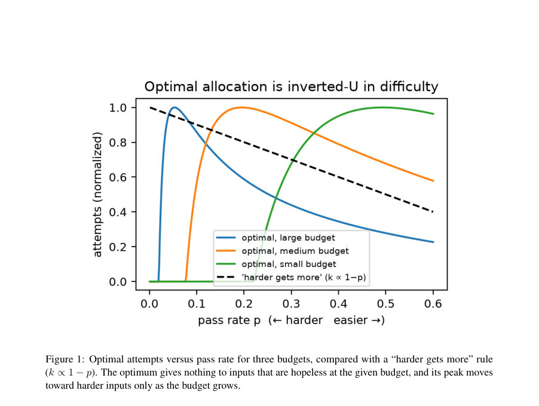
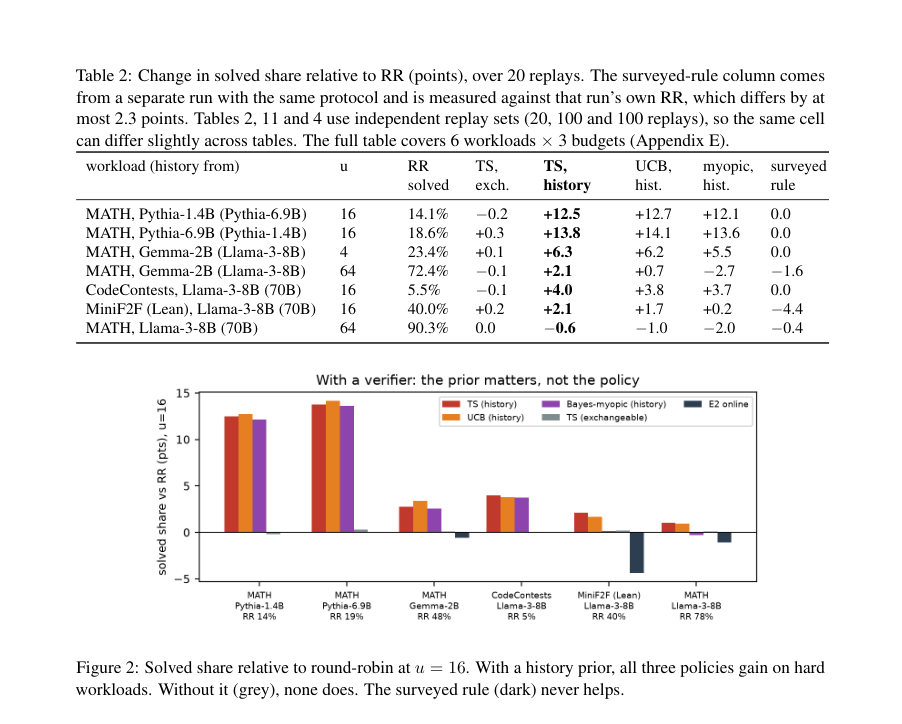
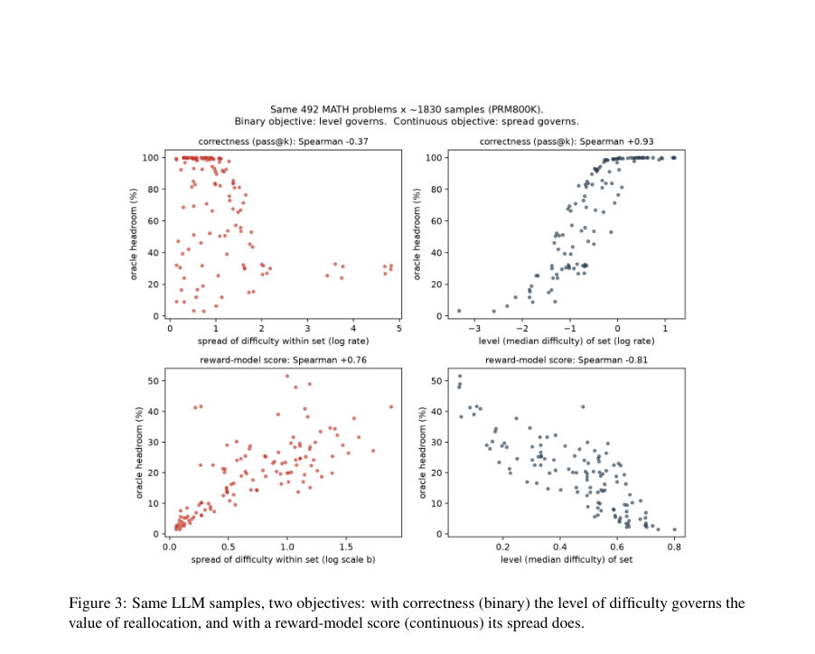

# Give Up to Get More: Priors, Not Policies, Govern Test-Time Compute Allocation

- **게시일:** 2026-11-05
- **arXiv:** [2611.06372v1](http://arxiv.org/abs/2611.06372v1) · [PDF](https://arxiv.org/pdf/2611.06372v1)
- **저자:** Jinhyung Bae
- **분야:** cs.LG
- **선정 점수:** 4.84
- **선정 이유:** 최근성 1.1, 인용 영향 0.0 (인용 0회), 저자 영향 0.0 (최고 h-index 0), AI 주제 적합성 2.9, 개발자 관심 0.2, 학술 신호 0.6, 오픈 웨이트·주요 연구조직 신호 0.0

[← 2026-11-05 목록으로 돌아가기](../daily/2026-11-05.html)

<!-- paper-visuals:start -->
## 주요 Figure

> 원문 PDF에서 실제 Figure 캡션과 그림 영역이 함께 확인된 자료만 자동 추출했다.

*Figure · 원문 PDF 4쪽 · Figure 1: Optimal attempts versus pass rate for three budgets, compared with a “harder gets more” rule*

*Figure · 원문 PDF 9쪽 · Figure 2: Solved share relative to round-robin at u = 16. With a history prior, all three policies gain on hard*

*Figure · 원문 PDF 24쪽 · Figure 3: Same LLM samples, two objectives: with correctness (binary) the level of difficulty governs the*

<!-- paper-visuals:end -->

## 한 문장 요약

반복 시도 예산을 고정된 입력들에 분배할 때, 최적의 정적·순차적 할당은 난이도에 단조적이지 않고(역-U형), 실제로 이득을 주려면 관련 모델의 과거 실행으로 만든 입력별 사전정보(페어 레이트)가 필요하므로, 우수한 사전(및 검증기) 없이는 정책 개선이 거의 불가능하다는 점을 이론 유도·대규모 재생실험·문헌조사로 입증하고 실무용 의사결정 지침을 제시한다.

## 해결하려는 문제

많은 입력이 하나의 고정된 반복 시도 예산을 공유하는 상황에서 기존의 관습적 규칙들(예: 더 어려운 입력에 더 많은 시도 할당, 'harder gets more')이 언제·어떤 조건에서 이득을 주는지를 명확히 하지 못한다. 특히 (i) 정적 할당 시 최적 분배의 형태가 난이도에 대해 단조 증가인지 여부, (ii) 검증기가 있을 때 순차할당(policy)이 정보를 얼마나 요구하는지, (iii) 실제 LLM 벤치마크(수학·코드·정리증명 등)에서 알려진 휴리스틱들이 실제로 얼마나 오라클(headroom)을 회수하는지, (iv) 어떤 수준의 사전(prior)·검증기 성능이 있어야 순차정책이 라운드로빈을 이기는지 등을 규명하는 문제가 있다. 기존 연구들은 종종 예산이 큰 쉬운 설정에 기반해 'harder gets more'를 사용해 왔고, 이 규칙이 어려운 작업에서 비용을 초래할 수 있음이 의문으로 남아 있다.

## 핵심 기여

- 문헌조사 및 실험 측정: 공개 수학·코드·정리증명 샘플에서, 난이도 비례 규칙(최고의 출판 규칙인 IAS 포함)이 모델이 주로 해결하는 쉬운 벤치마크에서는 오라클(headroom)의 50–100%를 회수하지만, 어려운 워크로드에서는(단일-시도 정확도·예산 곱 기준) 실제 패스율을 주어도 최대 13%만 회수함을 보여줌.
- 이론적 분석: 이진 성공 목표(성공·실패) 하에서 정적 최적 할당은 입력의 '해결 가능성'에 대해 역-U(존재하는 임계값 아래는 시도할당 0, 중간 난이도에 최대값)를 가진다는 고전적 최적 탐색·분배 결과를 유도하고, 이를 바탕한 'left-branch' 진단을 제시함.
- 검증기 기반 순차할당의 실험적 평가: 라운드로빈(RR), Thompson Sampling(TS), UCB, Bayes-myopic을 검증기(단위 테스트·증명체커 등) 존재 여부와 두 종류의 prior(교환가능한 분포 vs 관련 모델의 과거 기록) 아래에서 비교하여, 정보(사전)가 정책보다 크고(우선순위), 관련 모델의 히스토리 prior가 있으면 TS 등으로 어려운 워크로드에서 해결률을 거의 두 배로 늘릴 수 있음을 보임(예: MATH Pythia-1.4B에서 14%→27%).
- 실무 지침과 한계점 분석: 221편의 LLM 할당 논문 엄격조사(전문 본문 재판정 포함)를 제공하고, 실무자가 배분 규칙을 선택하기 전에 수행할 체크리스트(검증기 존재·사전의 순위 상관·검증기 거짓 수락률 등)를 제안함.

## 접근 방법

* 본 논문은 (1) 이론 유도: 입력 i의 단일 시도 성공률 p_i를 쓴 이진 성공 모델에서 한 시도의 한계가치 Δ(p,k)=p(1−p)^k임을 보이고, 라그랑주 조건으로 최적 연속해 k*(r)=max(0, ln(r/λ)/r) (r=−ln(1−p))를 얻어 정적 최적이 역-U 형임을 수학적으로 정리했다.
* (2) 문헌조사: '반복 시도' 단위를 갖는 LLM 관련 3,016건 후보에서 정밀 필터링을 거쳐 221편을 코드북에 따라 재판정하고, 엄격 기준으로 'harder-gets-more'(HGM) 규칙을 사용하는 논문을 식별·분석했다.
* (3) 재생실험: 공개 저장 샘플(Large Language Monkeys, PRM800K, Weaver 등)의 각 문제별 풀(pool)에서 독립 i.i.d.
* 시도로 가정해 동일한 시도 집합을 재생하여 정적 규칙(IAS, k∝1−p, tiers 등)과 오라클(한계가치에 따른 탐욕적 할당)을 비교했다(유닛: 문제당 평균 시도 u, 주로 u=4,16,64).
* (4) 검증기 있는 순차실험: 단위검사/증명체커 등이 존재할 때 RR, TS, UCB, Bayes-myopic을 비교했으며 prior로는 (a) 교환가능한(empirical) 분포와 (b) 관련 모델의 같은 입력에 대한 과거 실행(pass rates)을 사용한 'history prior'를 적용하고, history prior를 노이즈로 열화하거나(순위상관을 조절) 혼합(tempering)하여 이득이 prior 품질에 따라 어떻게 변하는지 조사했다.
* (5) 검증기 오류 민감도 및 시도 비용(길이로 충전) 실험을 수행해 false acceptance(FA)·false rejection(FR) 영향과 길이 기반 비용 영향을 측정했다.
* 모든 비교는 동일 예비시드 재생·부트스트랩 신뢰구간으로 통계적으로 평가하였다.

## 주요 결과

- 정적 할당(검증기 없음): 공개 수학·코드·정리증명 샘플에서 최고의 출판 규칙(IAS)은 모델이 주로 해결하는 쉬운 워크로드에서 오라클의 헤드룸의 50–100%를 회수했으나, 어려운 워크로드에서는(예: Pythia 기반 MATH, CodeContests의 약한 모델들) 실제 단일-시도 패스율을 알고 있어도 최대 13%만 회수함(논문 전체 실험표와 Table 1 참조).
- 역-U 원리·진단: 정적 최적은 난이도(r)에 대해 k*(r)=max(0, ln(r/λ)/r)로 주어지고, 'left-branch' (r < eλ) 비율이 높을수록 난이도 비례 규칙이 잃는 몫을 잘 설명함(11개 workload–model 조합에서 left-branch 비율과 모노톤 규칙의 손실 간 Spearman −0.92).
- 검증기 있는 순차할당: 검증기가 있고 관련 모델의 과거 실행으로 만든 history prior가 주어지면 TS·UCB·myopic 모두 어려운 워크로드에서 RR보다 유의미하게 이득을 보았음. 예: MATH Pythia-1.4B에 대해 u=16일 때 RR의 해결률이 약 14%에서 TS(history)로 27% 수준으로 거의 두 배 증가(논문 본문·요약에서 '14%→27%'로 제시). 반대로 교환가능한 prior만 있을 때는 어떤 정책도 RR을 거의 넘지 못함(모든 셀에서 교환가능 prior의 신뢰구간이 0을 포함).
- 사전(우선정보) 품질의 영향: history prior의 순위상관(rank correlation)을 인위적으로 낮추자 이득은 연속적으로 감소했으며, TS의 경우 이득이 0을 횡단하는(손익분기) 상관계수는 약 0.3–0.4 수준, 다른 정책들에서는 약 0.3–0.55 사이였음. 논문은 이 값을 실무에서 사전의 유용성 판별 기준으로 사용할 것을 제안함.
- 검증기 오류 민감도: false rejection(예: 20%)는 이득을 크게 훼손하지 않았으나 false acceptance가 핵심적 제약임. FA=2%에서 이득이 약 40% 감소, FA=5%에서는 대부분 사라짐(예시와 Table 7). 이는 평균 패스율이 매우 낮은 어려운 워크로드에서는 검증기의 거짓수락률이 패스율보다 훨씬 작아야 이득이 유지된다는 의미임. 또한 저장된 보상모델(learned verifiers)들은 어려운 문제에서 정답/오답을 잘 분리하지 못해(예: AUROC 0.44–0.76 범위, 많은 경우 낮음) 실제 이득을 크게 줄였음(실험 Table 8).

## 한계

- 저자가 명시한 한계: (i) 대부분 실험이 오프라인 재생(replay) 기반이며 시도가 i.i.d.라는 가정(동일 입력에서 시도들이 독립·동일분포)과 정적 재생 데이터에 의존함. (ii) 긍정적 결과는 주로 '프로그램적 검증기'(단위테스트·증명체커·정답키)가 있는 이진 검증 과제(수학·코드·증명)와 반복되는 입력(과거 실행 존재) 상황에 한정됨. (iii) 프론티어급(reasoning frontier) 모델이나 개방형·비검증 과제에 결과를 일반화하지 못함. (iv) 정책 비교는 RR, TS, UCB, Bayes-myopic 네 정책에 한정되며, 학습된 정책은 다른 거동을 할 수 있음. (v) 설계된 tempering 가중치(w=0.75)는 한 사례에서 사후 선택된 값이며 보편적 기본값으로 검증되지 않음. (vi) 설문(221편) 코딩은 LLM 보조·부분 이중코딩을 사용했으므로 완전히 독립적이지 않음; 13편은 엄격 기준으로의 하한(approximate lower bound)임. 
- 추가로 본문에서 확인되는 제약: (a) 과거 기록(prior)은 '같은 입력'의 이전 실행이 필요하므로 신규 입력에는 효용이 거의 없음—텍스트 기반 쉬운 사전(난이도 추정, TF-IDF 회귀 등)은 약한 모델들에서 0.05–0.46의 순위상관을 보이며 대부분의 경우 이득을 제공하지 못했음. (b) 검증기 오류 모델의 가정(무시할 수 있는 FR, 알려진 α/β) 등은 현실의 학습된 보상모델에서 충족되지 않는 경우가 많아 실무적 적용이 제한될 수 있음. (c) 실험에 사용된 모델·데이터셋은 0.5B–70B 범위의 공개 모델 및 저장 샘플에 국한되어 있어 최첨단 모델로 일반화가 불확실함.

## 개발자 관점

- 실무 의사결정 체크리스트(Section 6 요약): (1) 검증기(프로그램적)가 없다면 정적 규칙을 쓰기 전에 계획된 예산 u와 워크로드의 평균 패스율 ¯p(또는 left-branch share)를 계산하라; u·¯p가 작으면(논문 실험에서 u·¯p ≤1.5) 난이도 비례 규칙은 거의 이득을 못 냄. (2) 검증기가 있고 과거 실행 기록(같은 입력의 pass rates)이 존재하면 우선 그 사전의 순위상관을 보정용 캘리브레이션 세트에서 측정하라; TS의 손익분기점은 본 실험에서 약 0.3–0.4였으므로 이 값보다 높으면 tempered TS 사용을 검토하라. (3) prior를 그대로 쓰기 전 tempering(히스토리 빈-분포와 교환가능 분포를 혼합) 및 교차검증으로 혼합가중치를 선택하라(논문은 교차검증을 권고, 실험에서 w=0.75가 한 사례에서 좋았음). (4) 검증기의 false-acceptance(FA) 비율을 추정하라; 예산 u에 곱한 값 u·FA가 논문이 제시한 임계치(x* = uα*의 형태)를 넘으면 어떠한 정책도 RR보다 이득을 보기 어렵다. (5) 구현 실무: 입력별 패스율 로그를 저장·매칭하는 엔지니어링이 필요하며, 캘리브레이션 세트로 prior 품질(순위상관)·tempering 가중치·검증기 FA 수준을 점검해야 함. (6) 비용 산정: 시도 비용을 길이(토큰)로 충전하는 경우에도 정답 샘플이 보통 더 짧아 히스토리 prior 기반 할당 이득은 보존되므로 토큰 기반 비용 산정 시에도 적용 가능성 있음. (7) 배포 안전성: 검증기의 거짓수락률이 낮지 않다면(특히 어려운 데이터셋에서) 우수한 prior가 있어도 서비스 품질·회수량 기대치가 실패할 수 있으니 검증기 성능 측정이 우선되어야 함.

**근거 범위:** 이 분석은 제출된 논문의 PDF 본문 전체(제공된 텍스트)에 근거해 작성했다. 주요 수치와 주장(예: '14%→27%', 우선순위 순위상관의 손익분기 0.3–0.4, IAS의 쉬운/어려운 워크로드별 회수 비율, FA의 영향 등)은 본문과 표(예: Table 1, Table 4, Table 7, Table 8, Table 11)에 직접 기재된 값에서 추출했다. 논문 내 몇몇 부표(부록 표·그림)의 세부 셀 값은 본문에서 요약된 수치와 동일하게 인용했고, 설문 코딩의 정밀도·일부 선택적 파라미터(w=0.75) 등은 저자가 본문에서 한정적으로 보고한 바를 그대로 반영했다. PDF 텍스트에는 LLM 보조 판정·부트스트랩 CI 등 실험 절차가 상세히 기술되어 있어 이를 따랐으나, 외부 재현(라이브 생성·프론티어 모델 적용)은 논문이 직접 수행하지 않았으므로 본 분석은 그 범위를 벗어나지 않음을 밝힌다.
