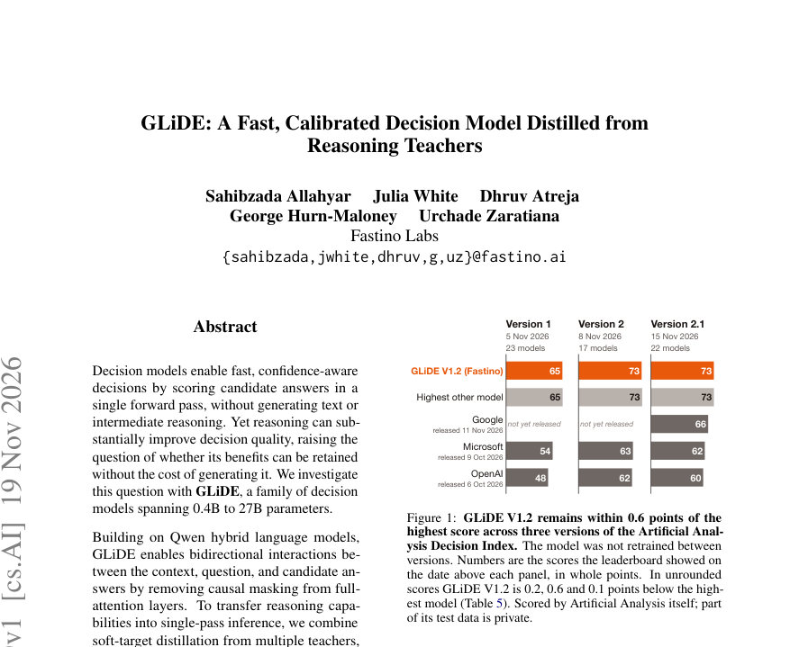
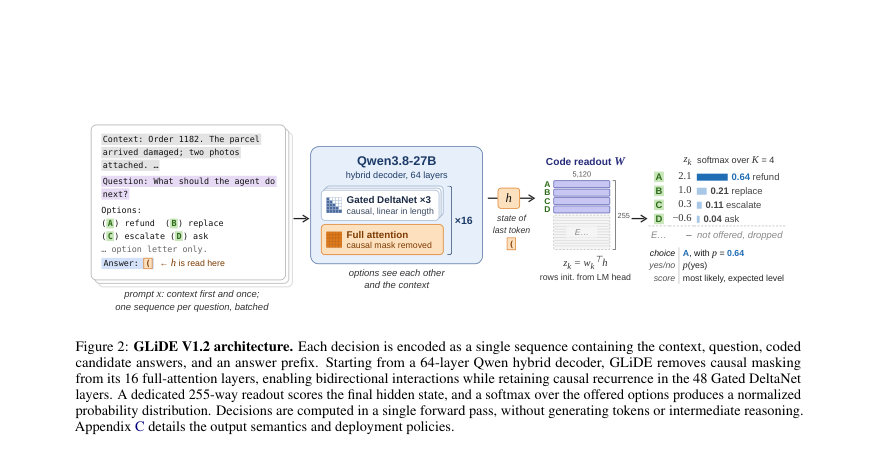
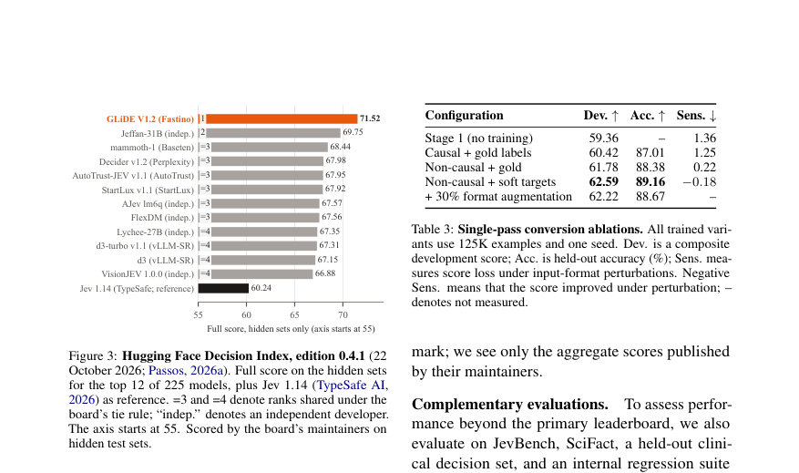

# GLiDE: A Fast, Calibrated Decision Model Distilled from Reasoning Teachers

- **게시일:** 2026-11-21
- **arXiv:** [2611.26509v1](http://arxiv.org/abs/2611.26509v1) · [PDF](https://arxiv.org/pdf/2611.26509v1)
- **저자:** Sahibzada Allahyar, Julia White, Dhruv Atreja, George Hurn-Maloney, Urchade Zaratiana
- **분야:** cs.AI, cs.CL
- **선정 점수:** 6.77
- **선정 이유:** 최근성 0.7, 인용 영향 0.0 (인용 0회), 저자 영향 0.0 (최고 h-index 0), AI 주제 적합성 2.6, 개발자 관심 0.6, 학술 신호 0.3, 오픈 웨이트·주요 연구조직 신호 2.6

[← 2026-11-21 목록으로 돌아가기](../daily/2026-11-21.html)

<!-- paper-visuals:start -->
## 주요 Figure

> 원문 PDF에서 실제 Figure 캡션과 그림 영역이 함께 확인된 자료만 자동 추출했다.

*Figure · 원문 PDF 1쪽 · Figure 1: GLiDE V1.2 remains within 0.6 points of the*

*Figure · 원문 PDF 3쪽 · Figure 2: GLiDE V1.2 architecture. Each decision is encoded as a single sequence containing the context, question, coded*

*Figure · 원문 PDF 6쪽 · Figure 3: Hugging Face Decision Index, edition 0.4.1 (22*

<!-- paper-visuals:end -->

## 한 문장 요약

GLiDE는 Qwen 계열 하이브리드 디코더에서 일부 self-attention의 인과 마스킹을 제거하고, 여러 교사(그중 하나는 사고(Reasoning) 수행 후의 분포)를 이용한 소프트-타겟 증류와 점진적 후속 학습으로 사고의 이득을 단일 전방향 패스(토큰 생성 없이)로 옮긴 빠르고 보정된(잘 캘리브레이션된) 결정 모델 군이다.

## 해결하려는 문제

결정 모델은 후보 정답들을 한 번의 전방향 계산으로 점수화해 빠르고 확신(신뢰도) 있는 결정을 제공하지만, 다단계 추론(생각하기)이 결정 품질을 크게 끌어올릴 수 있어도 추론을 생성하는 비용(순차적 토큰 생성)이 크다. 질문은 추론의 이득을 유지하면서도 토큰 생성 없이(단일 패스) 빠르고 캘리브레이션된 결정을 내릴 수 있는가이며, 이를 실현하는 동안 일반화와 신뢰도(캘리브레이션)를 해치지 않는 방법을 찾는 것이다.

## 핵심 기여

- 하이브리드 디코더 구조 수정: Qwen3.8-27B 기반에서 16개 full-attention 레이어의 인과 마스킹을 제거해 문맥·질문·옵션 간 양방향 상호작용을 허용하고, 48개 Gated DeltaNet 레이어의 인과성은 유지함으로써 계산 비용을 일부 절감하면서도 양방향 정보 흐름을 확보함(아키텍처 수술).
- 추론 교사로부터의 소프트-타겟 증류: 사고(thinking) 후 분포와 직접 분포를 교사로부터 얻어 입력별 신뢰도에 따라(직접 신뢰도 ≥ η(=0.8)이면 직접 분포 사용, 아니면 두 분포 평균) 학생 모델에 소프트 타깃으로 증류하여 '사고의 결과'를 단일-패스에서 근사하도록 학습함(Equation 10–11, α=0.3).
- 진행적(post-) 학습 파이프라인: (1) LoRA로 사고 가능한 교사 생성, (2) 비인과적 변환 및 다(다중)교사 소프트타깃 증류로 단일-패스 전환, (3) 여러 짧은 라운드와 라운드 간 가중치 평균(부모와 1/2 균등 평균)으로 안정화, (4) 최종 단계에서 과제군별 로그선형 풀링(교사 가중치 최적화)·gold-anchoring·절제된 abstention 타깃을 사용해 성능을 정교화함.
- 파라미터 추가 없이 추론 시 연산량을 늘리는 기법(무학습 재귀 깊이)과 체크포인트 평균화: 중간 블록을 반복 적용하는 감쇠된 고정점 반복(x_{k+1}=x_k+η[F(x_k)-x_k], η=1/2)으로 추론 성능을 개선하고, 체크포인트 평균화(soup)와 조합해 GLiDE 27B의 성능을 73.37까지 끌어올림.

## 접근 방법

* 아키텍처: 입력은 (문맥 c, 질문 q_j, 옵션 aj,k의 코드 γ_k+본문, 답표시 접두사)로 하나의 시퀀스로 인코딩된다.
* 64-layer Qwen 하이브리드 디코더(48 Gated DeltaNet + 16 full-attention)를 사용하되, 16개의 full-attention 레이어에서 인과 마스크 Ω를 제거(Ω=0)하여 양방향 attention을 허용하고, Gated DeltaNet(48개)은 인과적 선형 복잡성을 유지한다.
* 출력은 마지막 토큰 위치의 은닉벡터 h_j를 255×d readout W로 선형 변환해(행들은 사전학습된 LM 헤드에서 초기화) 해당 입력에 제공된 옵션 코드들에 대응하는 로짓만 남기고 softmax해 정규화된 후보 분포 p_θ(·\|u_j)를 얻는다.
* 학습 절차: 네 단계 진행학습(Stage1–4): Stage1에서 LoRA를 사용해 사고(trace)를 생성하고 추론 후 분포 q_think와 직접 분포 q_direct를 수집해 사고 교사를 구축; Stage2에서 비인과(full-attn unmask)+옵션 리드아웃으로 아키텍처를 바꾸고 다중 교사(사고 후 분포 포함)로 소프트타깃 증류; Stage3에서 5회의 짧은 라운드, 각 라운드 후 새 체크포인트를 부모와 1/2 가중치로 평균(재귀적 평균)하여 GLiDE V1.1 생성; Stage4에서 재구성된 다양한 결정 데이터 374,720예와 과제별 로그선형 풀링(Equation 12–13, λ_f,t ∈[0,4], 가중치는 5% 보류 데이터로 최적화, twofold cross-fitting)·gold anchoring·abstention 정책으로 최종 미세조정해 GLiDE V1.2를 얻음.
* 소프트타깃 구성: q = q_direct if κ(x)=max_k q_direct(k\|x) ≥ η(=0.8) else 0.5(q_direct+q_think).
* 손실: L(θ)=−α log p_θ(y\|x)+(1−α) D_KL(q∥p_θ) with α=0.3.
* 데이터·규모: 파이프라인 전반에 걸쳐 >1.6M distinct questions, 약 2.3B 토큰, 최종 포스트트레이닝 374,720 예.
* 최적화: AdamW lr=1e-6, batch=128, 2,928 steps(1 epoch), 각 시드 약 6시간(8×B200 GPU), 최종 공개 모델은 두 시드의 가중치 평균.

## 주요 결과

- Hugging Face Decision Index (edition 0.4.1, 22 Oct 2026, hidden sets, 외부 유지자 평가): GLiDE V1.2(27B) Full=71.52(1위/225), same-skill=68.31, new-domain=76.32, 숨겨진-공개 격차(Gen. gap)=−0.47, ECE=2.0%, median latency=92.9 ms (RTX PRO 6000).
- 체크포인트 평균화 및 무파라미터 재귀 반복 적용 모델(GLiDE 27B): Full=73.37, ECE=2.1%, median latency=122 ms (중간 블록 2개를 각각 2회 적용).
- GLiDE 가족(모델 크기별 Hugging Face hidden Full 점수, 12 Nov 2026 보드): 0.4B: 33.84 (Δ over best ≤ same size = +4.57), 0.8B: 36.36 (+3.89), 2B: 43.72 (+10.91), 9B: 62.48 (+6.49), 27B: 73.37 (+3.19). 모든 다섯 모델이 보고된 성능–파라미터의 파레토 전선 상에 위치함(동일 또는 더 작은 크기의 평가된 대안들보다 성능 우위).
- 캘리브레이션·신뢰도: GLiDE V1.2의 ECE=2.0%으로 상위 10개 모델 중 최저 수준, 평균 신뢰도 − 정확도 = +1.1 percentage points(과신은 아님). 태스크별 ECE: 언어 1.8%, 검색(리트리벌) 3.5%, 도구 3.9%, 예술 4.2%, 지식 7.5%(지식 영역에서 캘리브레이션 저하).
- 신뢰도 기반 커버리지 트레이드오프(Table6): 전체(문항 모두) 정확도 81.5%; confidence≥0.8로 행동하면 응답 67.9% 유지·정확도 95.0%; confidence≥0.9면 응답 56.0% 유지·정확도 97.4%. 이로써 애플리케이션 단에서 임계치로 커버리지/정확도 선택 가능.」「단계별 전환 절차 실험(절제된 ablation): Table3에서 비인과 마스크 제거과 소프트타깃 도입은 개발 점수·held-out 정확도·형식 민감도(입력 포맷 교란에 대한 민감도)를 개선했음(예: Stage1 초기 59.36 → 인과+gold 60.42 → non-causal+gold 61.78 → non-causal+soft 62.59), 다만 일부 변화는 단일 시드 변동 범위 내임을 저자도 표기.

## 한계

- (저자 명시) 단일(외부) 벤치마크만으로 분포 전반의 견고성(distribution-wide robustness)을 확정할 수 없음(본문에서 명시).
- 훈련·평가 접근의 제약: Hugging Face 및 Artificial Analysis의 숨겨진 테스트는 외부 유지자가 관리하므로 논문 저자에게는 개별 문항·정답·세부 결과가 제공되지 않음—따라서 분류별·질문별 상세 오분석 해석 불가(저자 언급).
- 교사 기반 감독의 위험: 교사 모델의 오류 전파 가능성(이를 완화하기 위해 gold-anchoring을 사용했음). 교사 의존성·라벨 생성 방식(언어모델 생성 데이터 포함)은 편향·오류를 포함할 수 있음(논문은 이를 데이터 스크리닝 및 gold-anchoring으로 제어했음을 기술).
- 작업별 캘리브레이션 차이: 지식 관련 태스크에서 ECE가 상대적으로 높음(7.5%), 그리고 중간 규모 이하 모델(예: 2B, 0.8B)의 ECE는 더 높아(표에서 2B:6.6%, 0.8B:7.6%) 작은 모델로의 보편적 캘리브레이션 보장에는 한계가 있음. 이는 배포 시 태스크별 보정·모니터링이 필요함을 시사.」「실험 통계적 제약: 일부 개선 효과는 단일 시드 변동 범위 내에 있어(논문 본문에서 저자들이 보수적으로 기술) 결과 해석 시 신중함 필요. 또한 반복 적용 횟수·댐핑(η) 값·블록 선택 등이 내부 개발 데이터로 선택되었고 공개 검증이 제한적임.

## 개발자 관점

- 재현성: 출발점은 Qwen3.8-27B(토크나이저 공유). 비인과(full-attn unmask)는 '16개 full-attention 레이어'에만 적용하고 Gated DeltaNet 레이어(48개)는 인과성 유지. 255-way readout은 사전학습된 LM 헤드 행으로 초기화해 옵션 코드별 초기 의미 보존. 옵션 수 최대 255(단일 토큰 코드).
- 증류 하이퍼: 소프트타깃 결합 규칙(η=0.8), 손실 가중치 α=0.3 사용. 교사로부터 post-thinking 분포와 direct 분포를 모두 수집해 불확실한 경우 평균해 학생에 전달한 점을 그대로 재현해야 함.
- 다중교사 풀링: 과제군별 로그선형 풀링(Equation 12–13)과 과제별 가중치 λ_f,t ∈[0,4]을 5% 보류 데이터로 최적화(2-fold cross-fit)해 교사 조합을 구성. 구현 시 보류 셋·크로스피팅 파이프라인 필요.
- 훈련 실무: 최종 단계 데이터 374,720 예, 전체 파이프라인에서 >1.6M question, 총 약 2.3B 토큰 사용. 최종 단계 최적화: AdamW lr=1e-6 batch=128 steps=2,928(1 epoch). 각 시드 훈련 약 6시간(8×B200 GPU). 공개 모델은 두 시드의 파라미터 평균. 이러한 자원 요구를 운영 예산에 반영해야 함.
- 배포·운영: 모델은 단일 전방향 패스로 후보 확률을 반환하므로 응용에서 임계값(예: 0.8, 0.9)으로 자동화/사람중재(Deferral) 전략 구현 가능. Batched 질문은 마진분포(각 질문의 주변분포)를 반환하므로 교차-질문 제약(서로배타성 등)은 후처리로 강제해야 함. 옵션 순서 편향 완화를 위해 훈련 중 옵션 섞기(shuffle)를 반드시 수행할 것.」「성능·추론 트릭: 체크포인트 평균화(model soup)로 안정적 성능 향상 가능; 추론 시 중간 블록을 반복 적용하는 무파라미터 재귀(η=0.5, 2번 적용 등)는 파라미터를 추가하지 않고 성능을 올리지만 지연(latency) 증가(예: 92.9→122 ms)를 감수해야 함. 추론 비용·지연 요구에 따라 재귀 적용 여부 조절 권장.」「안전성·감시: 교사 오류 전파를 막기 위해 gold-anchoring 절차와 데이터 중복/유사도 기반 필터링을 도입함(실험에서 일부 예 제거). 운영 시 태스크별 캘리브레이션(특히 지식 태스크) 모니터링과 절대 신뢰도 임계치 정책 권장.

**근거 범위:** 이 분석은 제공된 논문 PDF 본문(제공된 텍스트)을 근거로 직접 추출·정리한 것이다. 본문에 명시된 수치(점수, ECE, 지연, 데이터 규모, 하이퍼파라미터 등)만을 사용했으며, 논문이 명시하지 않은 내부 구현 세부사항이나 추가 측정치는 생성하지 않았다. 일부 실험적 결정(예: 재귀 블록 선택, 라운드 수, 개발 데이터 기반 선택)은 본문에서만 기술되어 외부 재현시 추가 검증이 필요하다.
