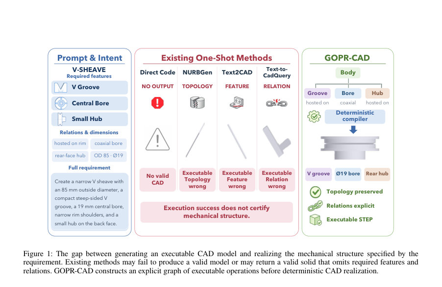
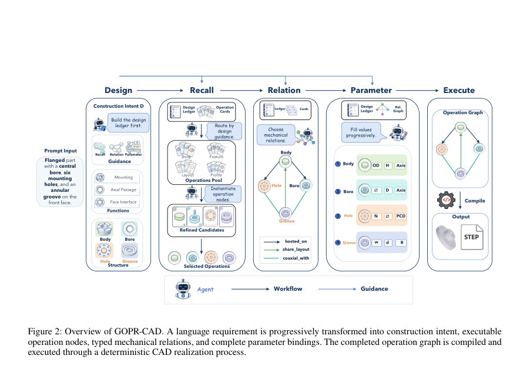
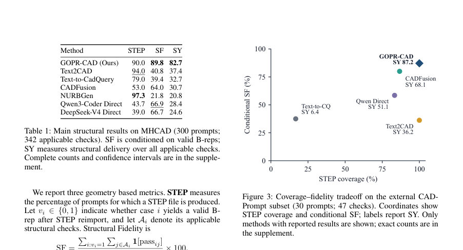

# GOPR-CAD: Graph-of-Operations Progressive Reasoning for CAD Generation

- **게시일:** 2026-11-10
- **arXiv:** [2611.11470v1](http://arxiv.org/abs/2611.11470v1) · [PDF](https://arxiv.org/pdf/2611.11470v1)
- **저자:** Yitian Pang, Yifan Li, Xiaowei Yue, Li Zheng
- **분야:** cs.AI
- **선정 점수:** 4.94
- **선정 이유:** 최근성 0.7, 인용 영향 0.0 (인용 0회), 저자 영향 0.0 (최고 h-index 0), AI 주제 적합성 3.0, 개발자 관심 0.5, 학술 신호 0.8, 오픈 웨이트·주요 연구조직 신호 0.0

[← 2026-11-10 목록으로 돌아가기](../daily/2026-11-10.html)

<!-- paper-visuals:start -->
## 주요 Figure

> 원문 PDF에서 실제 Figure 캡션과 그림 영역이 함께 확인된 자료만 자동 추출했다.

*Figure · 원문 PDF 2쪽 · Figure 1: The gap between generating an executable CAD model and realizing the mechanical structure specified by the*

*Figure · 원문 PDF 4쪽 · Figure 2: Overview of GOPR-CAD. A language requirement is progressively transformed into construction intent, executable*

*Figure · 원문 PDF 6쪽 · Figure 3: Coverage–fidelity tradeoff on the external CAD-*

<!-- paper-visuals:end -->

## 한 문장 요약

자연어 설계 요구문을 받아 언어모델을 의사결정 에이전트로 사용해 실행 가능한 CAD 연산 노드들을 점진적으로 구성하는 그래프를 만들고, 이를 결정론적 컴파일러로 CAD 모델로 실현하는 GOPR-CAD 파이프라인을 제안한다.

## 해결하려는 문제

기존의 LLM 기반 Text-to-CAD는 긴 코드나 일련의 명령을 직접 생성하면서 기하학적·위상학적·치수적 제약을 일관되게 유지하지 못해, 실행 가능한 파일을 생성하더라도 요구한 기계적 구조(특징 존재, 호스트 관계, 동축성, 반복배치 등)를 보장하지 못한다. 또한 기존 평가는 실행 성공이나 렌더링 외형에 의존해 내부 구조 결함을 놓치거나 단일 레퍼런스 비교에 제한되어 구조적 충실도를 정밀하게 측정하기 어렵다.

## 핵심 기여

- Graph-of-Operations Progressive Reasoning(GOPR-CAD)를 제안하여 자연어 요구문을 네 단계(Design, Recall, Relation, Parameters)로 점진 변환하고, 각 단계에서 LLM이 타입화된 실행 가능 연산(계약 포함)을 선택·조합하도록 하는 훈련 불필요한 에이전트-컴파일러 분리 파이프라인을 제시함.
- MHCAD라는 300개 표준 기계 부품 요구문(머시너리 핸드북 유래)과, 참조 모델 없이 STEP/B-rep 상에서 구조적 조건을 검증하는 결정론적 평가 프로토콜(Structural Fidelity, Structural Yield)을 구축함.
- 타입화된 연산 계약과 결정론적 컴파일러 경계를 통해 언어모델은 설계 결정을 내리는 역할만 수행하고 기하학적 실현은 컴파일러가 담당하도록 하여 언어모델 종류를 교체해도 파이프라인을 재학습할 필요가 없음을 보임.
- 광범위한 실험(여러 백본 LLM, 비교군, 설계 소거실험)을 통해 GOPR-CAD가 MHCAD 및 CADPrompt 구조적 부분집합에서 다른 방법들보다 높은 구조적 충실도와 전달율을 달성함을 실증함.

## 접근 방법

* 아키텍처와 절차 요약:
* 연산 라이브러리 O와 각 연산의 계약 oj=(dj, Rj, Θj, κj)를 정의한다.
* dj는 기계적 역할, Rj는 참여 가능한 관계 타입, Θj는 파라미터 인터페이스, κj는 결정론적 CAD 구현 바인딩이다.
* 입력 요구문 x는 네 단계로 점진 변환된다: Design(구성 의도 D 작성), Recall(연산 선택으로 GO 구성), Relation(타입화된 관계를 추가해 GR 구성), Parameters(그래프 의존 구조에 따라 파라미터 완성해 GP 구성).
* 각 단계에서 LLM은 허용된 결정 집합 At(st) 내에서 구조화된 결정을 선택한다.
* Parameters 단계에서 모든 연산의 요구 파라미터가 채워지면 결정론적 컴파일러 C가 GP를 실행 계획 Π로 변환하고 CAD 커널 K가 Π를 실행해 최종 CAD 모델 y를 생성한다.
* 실행 경계 이후에는 추가 LLM 결정이 개입하지 않는다.
* 평가: STEP 생성 여부, STEP 재임포트 및 B-rep 유효성 게이트를 적용한 뒤 구조적 체크 집합(Ai)에 대해 Structural Fidelity(SF; 유효 B-rep에 조건부)와 Structural Yield(SY; 전체 벤치마크 대비 전달율)를 계산한다.
* 구현·실험 세부: 기본 에이전트는 Qwen3.5-9B(기본), 다른 백본들(Phi-4-14B, Granite 4.1 8B, Nemotron 등)도 교체해 실험함.
* 연산 라이브러리·컴파일러·커널은 고정.
* 부트스트랩(10,000 샘플, 프롬프트 수준 클러스터링)으로 불확실성 추정.
* GPU 리소스: 6×NVIDIA H100 사용(논문 본문 보고).

## 주요 결과

- 주요 정량 성능(MHCAD, 300프롬프트, 342 적용 가능한 체크): GOPR-CAD는 STEP 생성률 90.0%(270/300), Structural Fidelity 89.8% (283/315, 유효 B-rep 기준), Structural Yield 82.7% (283/342, 전체 체크 기준)를 달성함 (표 및 부록 수치).
- 비교 결과: 다른 방법들은 파일 생성률은 높지만 구조적 전달율은 낮음(예: Text2CAD STEP 94.0%이지만 SY 37.4%; NURBGen STEP 97.3%이지만 SY 20.8%).
- 외부 CADPrompt 구조적 부분집합(30 사례, 47 체크)에서 GOPR-CAD는 SY 87.2% (41/47)를 달성해 다른 방법들보다 우수한 전달율을 보임(세부 표 제공).
- 구조별 성능: GOPR-CAD는 Bore 99.0%, Mounting-holes 100%, Circular-pattern 96.4%, Rolling-count 94.7%, Coaxial-axis 82.5% 등 체크 군에서 높은 통과율을 기록함(테이블 2).
- 소거 실험: 'Free-Text Stages' 변형(같은 단계 순서를 사용하되 중간 상태를 타입화하지 않고 자유 문장/직접 코드 생성으로 대체)은 STEP 커버리지를 3.3%로 급락시키고 SY를 0.9%로 만듦 — 타입화된 실행 가능 경계가 전달 신뢰성에 핵심임을 보여줌.

## 한계

- 저자가 명시한 한계(논문 본문에서 직접 언급): 제안 방법은 향후 조립체(assembly)로 확장되어야 하며, 결합 제약(mating), 운동 관계, 부품 간 의존성, 조립 인식 컴파일러가 필요하다고 밝힘. 또한 향후에는 SF·SY와 컴파일러 진단을 보상 신호로 사용해 학습 기반 정책으로 발전시킬 계획을 제시함.
- 본문에서 확인 가능한 제약과 실험 범위 한계: GOPR-CAD는 고정된 연산 라이브러리와 결정론적 컴파일러에 의존하므로 라이브러리의 완전성·표현력 한계가 설계 전달을 제한할 수 있음. MHCAD는 단일 부품 요구문 300개로 구성되며 구조적 체크는 결정론적 검사가 가능한 요구에만 적용되어(342개의 적용 체크, 일부 프롬프트는 구조적 체크 없음) 평가는 특정 구조군에 국한됨.
- 오류 분포: 본문은 잔여 오류가 체적(body) 실현과 관계 민감한 배치에 집중되어 있음을 보고하므로, 복잡한 호스트/컨테인/정렬 관계에서 여전히 실패 가능성이 존재함.
- 검증·재현성 관련 제한: 연산 라이브러리의 전체 목록, 각 연산의 구체적 규칙과 파라미터 완성 규칙 등 상세 구현은 본문에 요약·부록 형태로 제공되나 완전한 코드·데이터는 논문 본문만으로는 재현 불가(부록·실제 코드 필요).

## 개발자 관점

- 재현 요소: 결정론적 컴파일러와 연산 라이브러리(연산 계약 포함), 동일한 CAD 커널과 STEP 재임포트·B-rep 검사 파이프라인이 필수임. 논문은 연산 계약(역할·관계·파라미터·구현 바인딩)과 네 단계(Design, Recall, Relation, Parameters) 워크플로우를 명확히 기술하므로 이를 그대로 구현해야 결과 재현 가능성이 높음.
- LLM 선택과 비용: 언어모델은 에이전트 결정자 역할만 하며 백본 교체가 가능해 별도 재학습 불필요(논문에서 Qwen3.5-9B 기본, 다른 모델로도 유사 성능 확인). 다만 실사용 시 대형 모델·GPU(실험에서는 6×H100)가 필요하므로 추론 비용과 배포·운영 비용을 고려해야 함.
- 디버깅·안정성: 중간 상태를 타입화(연산 노드·타입화된 관계·파라미터 그래프)하고 미해결 값을 명시적으로 보존하면 실패 원인 추적과 보완이 용이함. Free-Text(비타입) 방식은 코드 생성·실행 실패로 이어질 확률이 매우 큼(실험에서 실행 실패가 다수).
- 평가 권고: 단순 렌더나 파일 생성 성공으로는 충분치 않으므로 STEP 재임포트/유효성 검사와 도메인 특화 구조적 체크(SF, SY)를 포함한 파이프라인 기반 검증을 통합할 것.
- 확장·배포 고려사항: 현재는 단일 부품 중심이다. 어셈블리·조립 제약을 다루려면 연산 그래프·컴파일러·체커의 확장과 더 복잡한 호환성·운동 검증이 필요. 또한 운영 환경에서는 결정론적 컴파일러의 안정성 보장과 사용자 인터랙션(예: 불확실 항목에 대한 쿼리)이 중요함.

**근거 범위:** 본 분석은 제공된 논문 PDF 본문(주본문 및 부록 A–F에서 추출된 텍스트)을 기반으로 작성되었다. 주요 수치(예: SF, SY, STEP 커버리지), 실험 구성, 소거실험 결과 및 백본별 성능은 본문 및 부록 표·설명에서 직접 인용하였다. 논문이 참조하는 완전한 연산 라이브러리 목록, 구현 코드, 및 일부 부록의 상세 파라미터 규칙은 PDF 본문에 요약·언급되어 있으나 전체 소스·코드는 제공되지 않아 구현 세부는 본문 기술에 근거해 정리했고 일부 미세한 구현 파라미터는 원문(추가 자료) 없이는 확인 불가할 수 있다.
