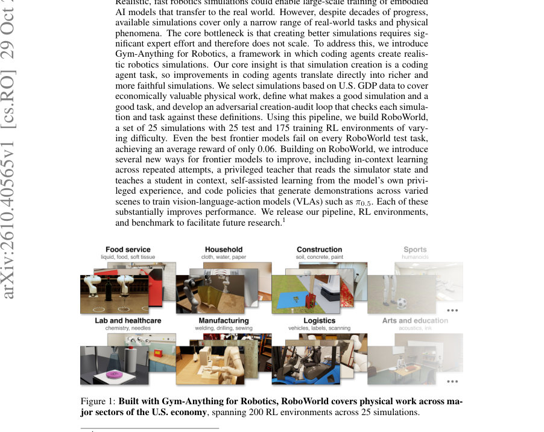
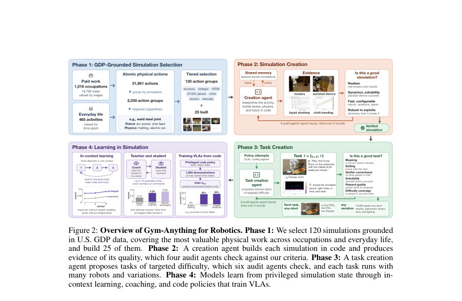
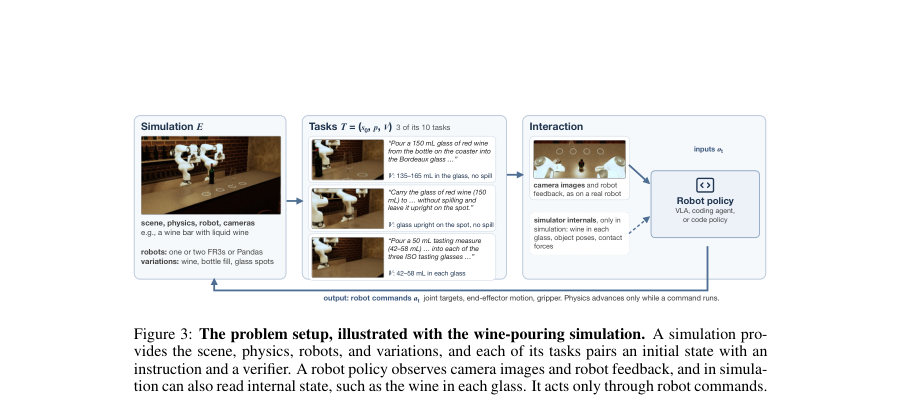

# Gym-Anything for Robotics: Scaling physical simulations with digital agents

- **게시일:** 2026-11-01
- **arXiv:** [2610.40565v1](http://arxiv.org/abs/2610.40565v1) · [PDF](https://arxiv.org/pdf/2610.40565v1)
- **저자:** Pranjal Aggarwal, Sean Welleck
- **분야:** cs.RO, cs.AI, cs.LG
- **선정 점수:** 3.72
- **선정 이유:** 최근성 0.5, 인용 영향 0.0 (인용 0회), 저자 영향 0.0 (최고 h-index 0), AI 주제 적합성 2.2, 개발자 관심 0.5, 학술 신호 0.6, 오픈 웨이트·주요 연구조직 신호 0.0

[← 2026-11-01 목록으로 돌아가기](../daily/2026-11-01.html)

<!-- paper-visuals:start -->
## 주요 Figure

> 원문 PDF에서 실제 Figure 캡션과 그림 영역이 함께 확인된 자료만 자동 추출했다.

*Figure · 원문 PDF 1쪽 · Figure 1: Built with Gym-Anything for Robotics, RoboWorld covers physical work across ma-*

*Figure · 원문 PDF 2쪽 · Figure 2: Overview of Gym-Anything for Robotics. Phase 1: We select 120 simulations grounded*

*Figure · 원문 PDF 4쪽 · Figure 3: The problem setup, illustrated with the wine-pouring simulation. A simulation pro-*

<!-- paper-visuals:end -->

## 한 문장 요약

경제적 가치로 선정한 작업 범위를 바탕으로, 코딩 에이전트가 시뮬레이션과 과제를 자동 생성·감사하는 적대적 파이프라인으로 대규모 현실적 로봇 시뮬레이션을 구축하고(“Gym-Anything for Robotics”), 이를 통해 RoboWorld 벤치마크와 시뮬레이션 내 학습 방법들을 제안한다.

## 해결하려는 문제

현행 로보틱스 시뮬레이션은 물리 현상과 작업 유형의 범위가 제한적이며(예: 액체·천·절단·화학 반응 등 복합 물리 취급 부족), 더 현실적인 시뮬레이션을 만드는 데는 도메인 전문가의 많은 수작업과 시간이 필요해 확장성이 떨어진다. 따라서 연구 질문은 ‘시뮬레이션 생성이라는 작업을 코딩 에이전트에 위임하면 시뮬레이션 구축을 대규모로 확장하고, 그 결과로 현실성·다양성을 갖춘 학습 환경을 얻을 수 있는가’와, 그 환경에서 최첨단(프론티어) 모델들이 어떻게 학습하고 개선될 수 있는가이다.

## 핵심 기여

- Gym-Anything for Robotics: 코딩 에이전트 기반의 모듈형 파이프라인(시뮬레이션 생성 에이전트 + 다수의 감사(audit) 에이전트)을 제시하고, ‘좋은 시뮬레이션’과 ‘좋은 과제’의 구체적 기준을 정의함.
- RoboWorld: 경제(미국 GDP, 직업·작업 데이터)를 기반으로 선정한 25개의 시뮬레이션과 총 200개의 RL 환경(25개 테스트, 175개 학습 환경)을 구축·공개함(각 환경은 스왑 가능한 로봇·다양성·결정적 검증기 지원).
- 프론티어 모델 평가 및 시뮬레이션 내 학습 방법 제시: 프론티어 모델들이 RoboWorld 전체 테스트에서 전부 실패함을 보이고(전체 벤치마크에서 성공률 0%), 시뮬레이션의 특권 상태(privileged state)를 이용한 in-context 학습, 특권 교사→학생 코칭(정성적 힌트), 자기 특권 경험 학습, 코드 정책(code policies)로 생성한 데모로 VLA(예: π0.5) 훈련 등 실질적 개선 수단을 제시함.
- 파이프라인·환경·코드 공개: 시뮬레이션 라이브러리와 환경, 벤치마크를 공개하여 후속 연구 재현·확장을 지원함.

## 접근 방법

* 전체 접근은 네 단계로 구성된다.
* (1) GDP-기반 시뮬레이션 선정: 직업·작업 데이터와 시간 사용·임금을 결합해 각 작업을 원자적 물리 액션으로 분해하고(LM 기반 분해), 경제적 가치가 높은 물리 역량을 커버하도록 액션 그룹(총 120 선정, 본 논문에서 25개 구축)을 선택한다.
* (2) 시뮬레이션 생성: 코딩(creation) 에이전트가 각 액션 그룹에 대해 시나리오·장면·물리·로봇 코드를 작성하고 증거(렌더, 물리 측정, 보조 시연)를 생성한다.
* 시뮬레이션 품질 기준은 현실성, 역학·해결 가능성, 빠른 실행·설정 가능성, 익스플로잇에 대한 견고성의 10개 항목으로 정의된다.
* (3) 생성-감사(adversarial creation–audit) 루프: 생성 에이전트가 제출한 증거를 4개 감사 에이전트(범주별; 하나는 적대적 파괴 시나리오 생성 포함)가 읽고 실험을 재실행해 문제를 리포트하면 생성자가 수리하고 총 3라운드 반복한다.
* 과제(task) 생성 또한 과제 생성 에이전트가 제안하고 6개 감사 에이전트가 검증하며(의미·설정·검증기 정확성·해결 가능성·보상 품질·난이도 분포), 각 과제는 초기 상태 s0, 자연어 지시 p, 물리 기반 검증기 V로 구성된다.
* (4) 학습 실험·전달: 시뮬레이터의 특권 상태(객체 상태·접촉력·평가)를 이용해 (a) 동일 초기 상태에서의 반복 시도에 의한 in-context 학습(3회 시도), (b) 특권 교사가 제한적 관측 학생에게 정성적 힌트(수치·좌표 금지)로 가르치는 교사-학생 코칭, (c) 모델 자신의 특권 경험을 이용한 자기 학습, (d) 특권을 읽는 코드 정책이 대규모 데모(예: 1,000 롤아웃)를 생성해 VLA(π0.5 등)를 지도 학습으로 훈련시키는 방식 등을 실험한다.
* 구현 측면에서 각 시뮬레이션은 공통 라이브러리 인터페이스를 제공하며, 로봇 교체·카메라·변이(seeds)를 지원하고 제한 접근(restricted)과 특권 접근(privileged)을 구분한다.
* 논문에서 사용한 에이전트 인스턴스는 Claude Opus/Haiku 등으로 기술됨.

## 주요 결과

- RoboWorld 구성: 25개의 시뮬레이션, 총 200 RL 환경(25 테스트 환경, 175 학습 환경). 각 환경은 여러 로봇 구성을 지원하고 변이를 통해 초기 상태를 다양화함(예: 각 시뮬레이션당 최대 10,000 변이 사례 가능 사례 설명).
- 프론티어 모델 성능: 논문 본문·초록의 서술에 따르면 전체 RoboWorld(25개 테스트 과제)에서 프론티어 모델들은 모든 테스트 과제에서 성공하지 못했고(테스트 집합에서 성공률 0%), 논문은 '평균 보상 0.06'(초록)이라는 요약 수치를 제시함. 더 쉬운 서브셋(학습 분할에서 추출한 25개 과제)에서는 최고 모델이 약 32% 성공률을 보였음(본문).
- 특권 기반 학습 개선: (a) in-context 반복 시도에서 특권 접근 모델이 제한 접근 모델보다 더 빠르게 보상 개선을 이룸(그림으로 비교 제시), (b) 교사-학생 코칭(교사가 특권 상태를 보며 최대 10개의 정성적 힌트 제공)은 학생의 초회 보상을 두 배 수준으로 향상시킴(본문 예: 첫 시도 보상 증가 수치 예시 제시), (c) 코드 정책으로 생성한 데모로 VLA(π0.5)를 학습시키면 일부 과제에서 성능이 0%에서 53%로 상승(그림 2에서 두 과제에 대해 π0.5 성공률 0%→53%→55% 표기)함.
- 시뮬레이션 검증: 각 시뮬레이션은 물리 체크리스트와 수치적 물리 검사(예: 와인 붓기 시 12개 물리 검사, 화학적 적정에서 보존·종말점 체크 등)를 통해 검증되며, 생성-감사 루프의 예시(와인 붓기)에서 감사 보고서에 따라 여러 물리적 결함(액체가 로봇을 통과 등)을 수정하고 재측정하여 개선함을 보여줌.

## 한계

- 저자가 명시한 한계: (1) 선택된 120개 액션 그룹 중 본 논문에서 실제로 구축한 시뮬레이션은 25개에 불과함(향후 확장 예정). (2) 본 파이프라인의 현 구현(인스턴스)은 Claude Opus/Haiku 등 특정 상업적 LLM 인스턴스들을 사용해 에이전트들을 구동한 사례로 기술되어 있으며, 결과는 이 에이전트 성능에 의존함(본문 명시).
- 본 분석에서 합리적으로 확인되는 한계(본문 근거 기반 추론): (1) 시뮬레이션→실세계 전이(sim-to-real)를 실험적으로 검증하지 않음 — 논문은 시뮬레이션 내 학습·데모로 VLA를 훈련시키는 사례를 보이나 실제 로봇에서의 직접적 전이 결과는 제시되지 않음. (2) 특권 상태는 시뮬레이션 전용 정보로, 실제 로봇에서 직접 사용할 수 없어 특권 정보를 학생으로 전달하려면 별도 증명(지식 증류·데모 생성 등)이 필요함(논문에서도 이를 문제로 인식하고 여러 전달 방법을 제시함). (3) 시뮬레이션 생성·감사 및 물리 체크는 상당한 계산·엔지니어링 비용이 들며(본문에 여러 물리검사·수치 측정·수정 라운드 기술), 대규모 확장 시 자원·시간 비용 및 신뢰성 확보가 관건임.

## 개발자 관점

- 재현·배포: 코드·데이터·환경을 공개(논문에 URL 제시)하므로 Gym-Anything 라이브러리 인터페이스를 통해 각 시뮬레이션을 동일한 API로 실행할 수 있음 — 구현 시 라이브러리의 로봇 스왑, 접근 레벨(restricted/privileged), 변이 시드 설계 등 규약을 준수하면 다양한 정책을 즉시 평가 가능.
- 시뮬레이션 개발 워크플로우: 자동 생성 + 다중 감사(시뮬레이션 감사 4개 에이전트, 과제 감사 6개 에이전트) + 3 라운드 수리 루프를 도입하면 자동 생성 에러(시각적이지만 물리적 효과가 없는 애니메이션 대체, 파라미터 튜닝 오류, 익스플로잇 가능성 등)를 체계적으로 잡아낼 수 있음. 엔지니어는 감사 체크리스트(현실성·해결성·속도·익스플로잇)와 정량 물리 검사를 설계해야 함.
- 학습·모델 개발: 시뮬레이터의 특권 상태를 활용해 (a) 빠른 in-context 개선 실험, (b) 특권 교사가 정성적 힌트만으로 학생 성능을 높이는 코칭 파이프라인, (c) 특권 기반 코드 정책으로 대규모 데모를 생성하여 카메라·관절만 쓰는 VLA를 지도학습시키는 실용적 절차가 유효함 — 실무에서 특권 정보는 데모 생성·지식 증류에 주로 쓰는 것이 현실적임.
- 비용·인프라: 물리 정밀성 검증(다수의 물리 체크), 고해상도 물리 시뮬레이션(예: 수십만 입자·미세 시각적 물리), 그리고 수백~천 시간의 에이전트-시뮬레이션 반복이 필요하므로 GPU/CPU 집약적이며 렌더링·데이터 저장 비용도 큼. 대규모 적용 시 비용 산정을 필수로 해야 함.
- 안전성·견고성: 강화학습은 시뮬레이션의 익스플로잇을 학습할 수 있으므로 적대적 감사(adversarial auditor)와 명시적 안정성 검사(비유한 상태·비유한 힘 발생 여부, 비유한 값 발생 방지)를 파이프라인에 포함시키는 것이 중요함.

**근거 범위:** 이 분석은 제공된 논문 PDF 본문(주어진 텍스트 블록)을 근거로 작성되었음. 도표의 일부 작은 숫자들은 시각적으로 읽기 어려운 경우가 있어(예: 도표의 개별 모델별 아주 작은 수치 표기) 본문과 초록에 명시된 수치(예: 전체 벤치마크에서의 평균 보상 0.06, 전체 테스트에서 성공률 0% 등)를 우선으로 사용함. 또한 PDF 본문이 중복 페이지를 포함해 일부 문단이 반복 노출되었으나, 핵심 문장·수치·방법·실험 설정은 본문 내 명시된 정보를 바탕으로 엄밀히 추출·요약했음을 밝힘.
