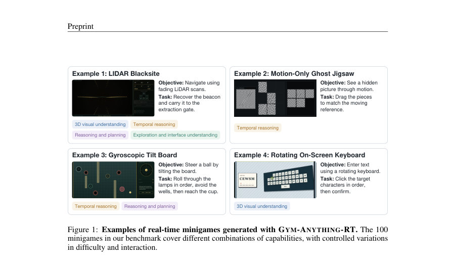
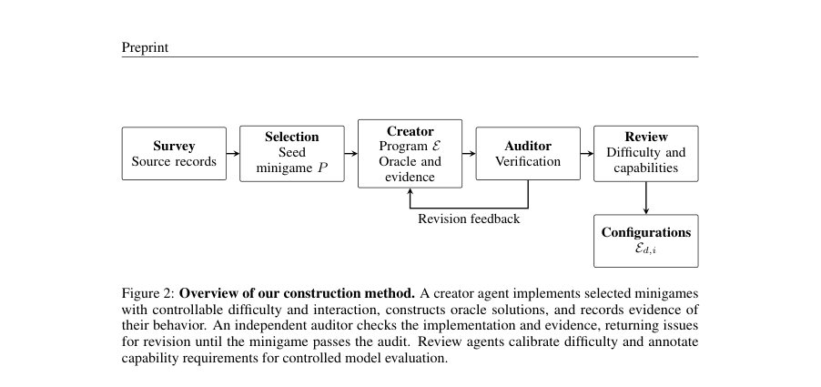
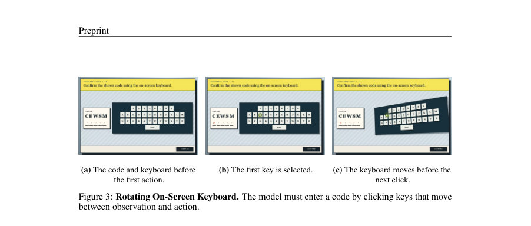

# Gym-Anything-RT: Scaling Real-Time Environments for Vision-Language Agents

- **게시일:** 2026-10-28
- **arXiv:** [2610.37567v1](http://arxiv.org/abs/2610.37567v1) · [PDF](https://arxiv.org/pdf/2610.37567v1)
- **저자:** Pranjal Aggarwal, Sean Welleck
- **분야:** cs.LG, cs.AI
- **선정 점수:** 4.95
- **선정 이유:** 최근성 1.3, 인용 영향 0.0 (인용 0회), 저자 영향 0.0 (최고 h-index 0), AI 주제 적합성 2.8, 개발자 관심 0.5, 학술 신호 0.3, 오픈 웨이트·주요 연구조직 신호 0.0

[← 2026-10-28 목록으로 돌아가기](../daily/2026-10-28.html)

<!-- paper-visuals:start -->
## 주요 Figure

> 원문 PDF에서 실제 Figure 캡션과 그림 영역이 함께 확인된 자료만 자동 추출했다.

*Figure · 원문 PDF 2쪽 · Figure 1: Examples of real-time minigames generated with GYM-ANYTHING-RT. The 100*

*Figure · 원문 PDF 4쪽 · Figure 2: Overview of our construction method. A creator agent implements selected minigames*

*Figure · 원문 PDF 6쪽 · Figure 3: Rotating On-Screen Keyboard. The model must enter a code by clicking keys that move*

<!-- paper-visuals:end -->

## 한 문장 요약

실시간 상호작용이 요구되는 시각·언어 에이전트 능력을 평가하기 위해, LLM 기반의 코딩 파이프라인으로 100개의 시각적 실시간 미니게임(및 비실시간 대응 버전)을 자동 생성하고 시간 제어(실시간/감속/일시정지)를 통해 응답 지연과 능력 요구를 분리해 평가하는 벤치마크 프레임워크를 제안한다.

## 해결하려는 문제

최신 비전·언어 에이전트들은 추론에 다수 초가 걸려 환경이 에이전트 응답을 기다려주지 않는 실시간 상호작용(예: 비디오 게임, 물리 장치 조작) 환경에서 성능 저하가 발생할 수 있다. 기존 벤치마크는 대부분 환경이 에이전트를 기다려 시간이 흐르지 않도록 하거나(컴퓨터 사용 벤치마크), 개별 게임만 평가해 여러 요구 능력이 혼재되어 실패 원인을 분리하기 어렵다. 본 연구는 동일한 과제에서 시간 가용성을 제어(실시간/감속/일시정지)해 '느림으로 인한 실패'와 '다른 능력 부족으로 인한 실패'를 분리해 측정하고자 한다.

## 핵심 기여

- GYM-ANYTHING-RT: 실시간 요구를 포함하는 시각적 미니게임을 LLM 코딩 에이전트(creator)와 독립 감사자(auditor)가 자동 생성·검증하는 파이프라인 및 실행 스택을 제안함.
- 100개의 실시간 미니게임과 각각의 비실시간 대응판(총 구성: 난이도 5단계 × 상호작용 모드 2종 × 실시간/비실시간)을 포함하는 벤치마크를 구축하고 공개함(총 구성별 인스턴스 2,000개).
- 환경 클록을 제어(실시간/감속(slowdown)/일시정지)하는 평가 스택을 제공해 동일 과제에서 시간 제약의 효과를 정량적으로 비교할 수 있게 함.
- 광범위한 평가를 통해 현재 모델들이 실시간 상호작용에서 큰 성능 격차를 보이며, 특히 응답 속도가 전면적 병목이라는 사실을 규명함(예: GPT-6 Astra (xHigh): 실시간 통과율 9.0% → 일시정지 75.0%).
- 에이전트가 코드 실행 권한을 부여받으면(격리 샌드박스) 실시간 부분을 코드로 옮겨 성능을 일부 보완할 수 있음을 관찰하고 분석함(예: Astra (xHigh): 코드 허용 시 실시간 통과율 9.0% → 31.0%).

## 접근 방법

* 프레임워크는 다음 구성요소로 동작한다.
* (1) 능력 분류: 3D 시각 이해, 시간적 추론 등 실시간 상호작용에 필요한 능력 군을 정의하고 후보 과제를 수집(survey agent).
* (2) 생성·감사 루프: creator 에이전트가 미니게임을 프로그램으로 구현하고(인터페이스, 다이내믹스, 그레이더 포함) 내부 상태를 이용한 오라클 해법을 작성한 뒤, 독립 auditor가 코드·렌더링·채점·실시간 요구 충족 여부(우회 방법 유무 포함)를 검사해 수정 반복한다.
* (3) 구성 및 변형: 각 미니게임은 난이도 d∈{1..5}와 interaction∈{simplified, full}를 갖고, 동일 코드에서 slowdown s(1× 실시간, s>1 감속, 또는 일시정지)로 실행 시간을 제어할 수 있다.
* (4) 비실시간 대응판 ¯E: 실시간 요구를 제거하는 최소한의 타이밍 변경으로 대응 환경을 생성해 비교 가능성을 보장한다.
* (5) 평가 스택: 중앙 서버와 샌드박스 구조에서 각 에이전트가 스크린샷 관찰과 마우스/키보드 액션만으로 상호작용하도록 하고, 직접 연결 프로토콜을 통해 액션→결과 스크린샷 왕복 지연을 낮춰(타이밍 테스트에서 중앙값 < 50 ms) 실시간 제약을 정확히 측정한다.
* 모든 구성은 오라클 솔버와 감사 증거를 포함해 자동 채점 가능하게 구현된다.

## 주요 결과

- 벤치마크: 100개의 실시간 미니게임과 100개의 비실시간 대응판; 총 구성(난이도 5 × 상호작용 2)으로 2,000 구성 제공. 능력 분포: 실시간 게임 중 31%가 3D 시각 이해를 요구, 100%가 시간적 추론을 요구(비실시간 대응판에서는 시간적 추론 비율 82%), 96%가 추론·계획 요구, 52%가 인터페이스 탐색 요구.
- 기본 실험(난이도 5, full interaction, live): GPT-6 Astra (xHigh) 실시간 통과율 9.0% vs 비실시간 대응판 66.0%; Claude Opus 5.5 (xHigh) 5.0% vs 57.0%; GPT-6 Luna (xHigh) 1.0% vs 17.0%; Qwen3.8-27B 1.0% 실시간(대응판 2.0%), Qwen3.5-9B 0.0% 실시간(대응판 1.0%).
- 환경 감속 효과(Astra, xHigh): 실시간 s=1에서 9% → 4× 17% → 16× 48% → 64× 57% → 일시정지 75%; 감속에 따라 추가 추론 노력(xHigh)이 더 큰 이득을 냄(예: 64×에서 xHigh 57% vs Low 42%).
- 코딩 허용 실험: Astra (xHigh) 실시간 성능 9.0% → 코드 실행 허용 시 31.0%로 향상(오라클/템플릿 매칭·이미지 처리 스크립트로 실시간 부분을 자동화). Astra (Low) 8.0%→14.0%; Luna (xHigh) 1.0%→5.0%.
- 속도·비용: Astra (xHigh) 평균 시도 시간 7.2분, 평균 비용 $4.50, 통과율 9.0%; Astra (Low) 4.3분 $2.76 8.0%; Claude Opus 15.8분 $6.40 5.0%; Luna 6.4분 $0.07 1.0%; Qwen3.8 63.0분 $0.64 1.0%; Qwen3.5 75.9분 $0.62 0.0%. 인간(저자, 20샘플) 통과율 45.0% 평균 2.2분(비교: Astra (xHigh)보다 높은 통과율·더 빠름).

## 한계

- 저자가 명시한 한계: (1) 코딩을 통한 보완은 가능하지만 여전히 일시정지 성능(예: Astra xHigh 75.0%)에 미치지 못하며, 시각 정보가 코드로 안정적으로 추출되지 않는 경우 스크립트 작성이 어렵다. (2) 일부 과제는 환경이 계속 변하는 한 근본적으로 어렵다(감속해도 일시정지 성능과 차이가 남음).
- 본 분석에서 합리적으로 확인되는 제약(본문 근거 기반): (1) 평가에 사용된 모델 셋이 한정적(상용 최첨단 모델 중심)이라 다른 모델군에 대한 일반화가 제한될 수 있음. (2) 미니게임은 에이전트 생성 ·감사 파이프라인으로 합성된 프로그램형 과제들로, 현실 세계의 복잡한 3D 게임/로보틱 환경을 완전 대체하지 못할 가능성(분포 차이). (3) 실험에서 에이전트는 기본적으로 스크린샷·마우스·키보드 인터페이스만 사용하므로 센서 다양성(연속 비디오, 로우 센서 데이터 등)에 따른 성능은 미측정. (4) 지연·비용 측정은 중앙 서버·샌드박스 아키텍처에 의존하므로 다른 배포 환경에서는 달라질 수 있음.

## 개발자 관점

- 재현·배포: 논문은 코드·미니게임을 공개(저자 제공 GitHub 링크)하므로 재현 가능하나, 생성 파이프라인은 LLM 기반의 creator/auditor 루프와 샌드박스 실행 환경을 필요로 해 상당한 컴퓨팅·운영 인프라가 요구된다.
- 구현: 각 미니게임은 프로그램화되어 오라클 솔버·그레이더를 포함하므로 새로운 과제 추가 시 동일 인터페이스(스크린샷·마우스·키보드·타이밍 제어)를 따르는 것이 중요하다. 감사자는 실시간 요구의 우회(브레이크·주기적 모션으로 미리 계산 가능한 해법 등)를 검사해야 한다.
- 성능·비용 최적화: 실제 실시간 응용을 목표로 한다면 모델 지연(latency) 최적화가 우선 과제이다(감속 실험으로 확인됨). 또 에이전트가 안전하게 실행 가능한 로컬·격리된 스크립트를 통해 시간 민감한 루틴을 오프로드하는 설계가 실용적이다(코딩 실험에서 성능 향상 관찰).
- 안전성·샌드박스: 모델이 직접 코드를 작성·실행할 때는 샌드박스 격리와 권한 제한이 필수이다(논문도 격리 샌드박스 사용). 코드 실행을 허용하면 에이전트가 환경을 우회하거나 불법적 접근 시도를 할 수 있으므로 감사·제한 정책이 필요하다.
- 평가 디자인: 동일 과제의 실시간·감속·일시정지 변형과 비실시간 대응판을 마련하면 '응답 지연'과 '능력 부족'을 분리해 진단할 수 있다. 또한 난이도·상호작용 모드를 함께 설계하면 약한 모델의 진보를 측정하는 데 유용하다.

**근거 범위:** 이 분석은 제공된 논문 PDF 본문(본문과 부록에서 인용한 수치·절차·표·그림)을 직접 근거로 작성함. 일부 세부 구현 목록(예: 전체 100개 미니게임의 개별 설명, Table 7 전체 항목)은 본문에서 부록 또는 공개 저장소를 가리키므로, 구체적 게임별 구현 세부는 해당 부록·저장소를 참조해야 함.
