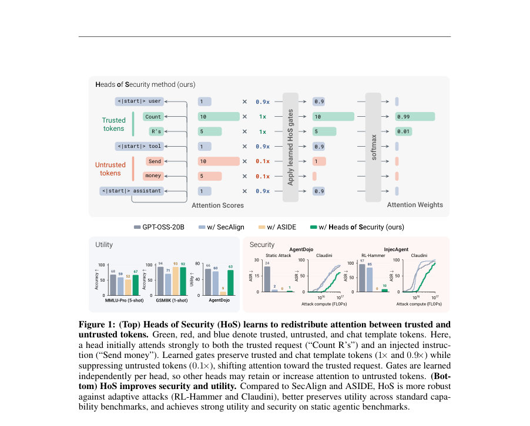
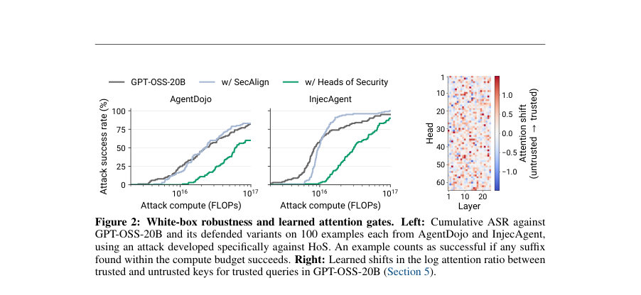
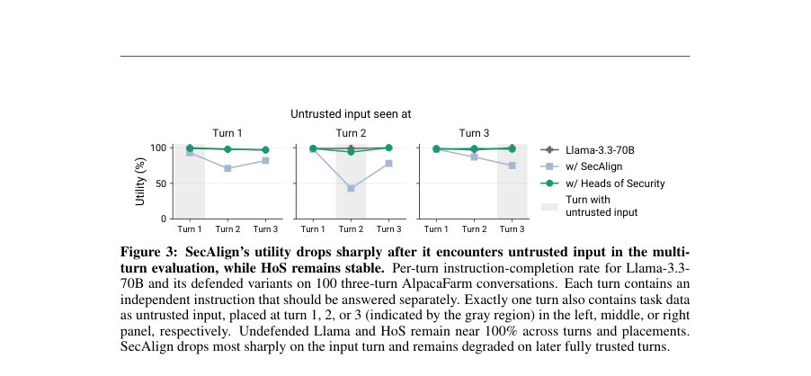

# Heads of Security: Learned Attention Gates Improve Prompt Injection Robustness

- **게시일:** 2026-10-28
- **arXiv:** [2610.37657v1](http://arxiv.org/abs/2610.37657v1) · [PDF](https://arxiv.org/pdf/2610.37657v1)
- **저자:** Igor Shilov, Xiaoxue Yang, Alexander Panfilov, Evgenii Kortukov, Matthieu Meeus, Peter Romov, Wojciech Samek, Jonas Geiping, Yves-Alexandre de Montjoye
- **분야:** cs.LG, cs.CL, cs.CR
- **선정 점수:** 5.99
- **선정 이유:** 최근성 1.4, 인용 영향 0.0 (인용 0회), 저자 영향 0.0 (최고 h-index 0), AI 주제 적합성 1.5, 개발자 관심 0.3, 학술 신호 0.3, 오픈 웨이트·주요 연구조직 신호 2.5

[← 2026-10-28 목록으로 돌아가기](../daily/2026-10-28.html)

<!-- paper-visuals:start -->
## 주요 Figure

> 원문 PDF에서 실제 Figure 캡션과 그림 영역이 함께 확인된 자료만 자동 추출했다.

*Figure · 원문 PDF 2쪽 · Figure 1: (Top) Heads of Security (HoS) learns to redistribute attention between trusted and*

*Figure · 원문 PDF 6쪽 · Figure 2: White-box robustness and learned attention gates. Left: Cumulative ASR against*

*Figure · 원문 PDF 7쪽 · Figure 3: SecAlign’s utility drops sharply after it encounters untrusted input in the multi-*

<!-- paper-visuals:end -->

## 한 문장 요약

HoS는 토큰별 신뢰 채널을 이용해 각 attention head에 소규모 게이트를 학습시켜 신뢰된 지시문과 외부(신뢰되지 않은) 데이터를 분리함으로써 프롬프트 인젝션에 대한 강건성과 원래 모델 유틸리티를 유지하는 아키텍처적 방어를 제안한다.

## 해결하려는 문제

LLM이 외부에서 제공되는 텍스트(예: 웹페이지나 도구 출력)에 포함된 공격자 지시문을 사용자/시스템 지시문으로 오인해 따르는 '간접 프롬프트 인젝션' 문제를 다룬다. 기존 방어(대규모 파인튜닝 기반 SecAlign, 임베딩 변환 기반 ASIDE 등)는 적응 공격에 취약하거나(공격 성공률이 높음), few-shot/다중 턴 등 학습 분포 밖 상황에서 성능이 크게 저하되는 한계가 있다. 연구 질문은 '작은 수의 per-head attention gate로 instruction–data 경계를 강제하면 모델이 외부 데이터를 읽되 외부 지시를 따르지 않도록 만들 수 있는가, 그리고 그 과정에서 유틸리티를 유지할 수 있는가'이다.

## 핵심 기여

- Heads of Security(HoS) 제안: 각 transformer head마다 쿼리 채널→키 채널(신뢰/비신뢰/템플릿)에 대한 학습 가능한 게이트 로그릿을 더해 softmax 전 로그잇을 채널 조건으로 조정하여 attention을 재분배하는 아키텍처적 방어를 제시함.
- 경량성 강조: HoS는 모델 가중치는 고정(frozen)한 채로 레이어×헤드×채널에 해당하는 수만개의 스칼라 게이트(예: Llama-3.3-70B 기준 46,080, GPT-OSS-20B 기준 18,432)만 학습하여 SecAlign(수백만~수억 파라미터) 및 풀 파인튜닝보다 훨씬 적은 추가 파라미터로 방어를 구현함.
- 광범위한 실험과 비교: 두 개의 오픈 가중치 모델(Llama-3.3-70B-Instruct, GPT-OSS-20B)에서 SecAlign++와 ASIDE와 비교하여 블랙박스(RL-Hammer)와 화이트박스(Claudini, autoresearch 강화) 적응 공격에 대한 강건성, 표준 유틸리티(다중선택, few-shot, multi-turn) 보존성, 에이전트형 벤치마크(AgentDojo 등)에서의 보안·유틸리티 트레이드오프를 평가함.
- 해석적 분석: 학습된 게이트의 분포, 레이어·헤드별 attention 이동(불신뢰→신뢰), 역할(roles) 인식 개선 및 가역적 ablation/그룹화(red heads/blue heads)을 통해 메커니즘을 제시함.

## 접근 방법

* HoS는 각 transformer layer의 각 attention head에 대해 채널(query channel → key channel)쌍마다 학습 가능한 게이트 로그릿 g를 도입한다.
* 게이트는 시그모이드(σ)로 0~1로 변환되어 softmax에 더해질 로그-스케일 보정(log σ(g))으로 작용한다(softmax 전 로그잇에 덧셈).
* 결과적으로 특정 head가 TRUSTED, UNTRUSTED, TEMPLATE(및 GPT-OSS의 경우 sink) 채널에 대해 상대적으로 얼마나 주의를 줄이거나 유지할지 학습한다.
* 학습은 base 모델 가중치를 고정하고 게이트들만 학습하며 SecAlign++의 학습 레시피를 따라 Direct Preference Optimization(DPO)과 주로 Alpaca계열의 preference 데이터(사용자 지시 + 인젝션 포함된 페어)를 사용한다.
* 추론 시 배포 환경에서 토큰별로 신뢰 채널을 외부(예: 도구 출력은 UNTRUSTED)에서 할당하고, 학습된 게이트가 attention logits을 재조정하여 신뢰 경계를 강제한다.

## 주요 결과

- 블랙박스 RL-Hammer(Adversarial RL) 결과: GPT-OSS-20B에 대해 가장 강한 공격자는 undefended에서 최고 ASR 97%, SecAlign에서 85%인 반면 HoS에서는 10%의 ASR을 기록함(논문 본문, Section 4.1, Table 1). Llama-3.3-70B에서도 undefended 99%, SecAlign 82%, HoS 1%로 보고됨.
- 화이트박스(Claudini, autoresearch 강화) 결과: HoS는 동일한 성공률(예: 50% ASR)에 도달하기 위해 대략 3× 더 많은 공격 계산(FLOPs)이 필요함. 구체적으로 AgentDojo에서 50% ASR 달성에 필요한 공격 계산은 HoS ≈ 6×10^16 FLOPs, 베이스·SecAlign ≈ 2.2–2.3×10^16 FLOPs; InjecAgent에서는 HoS ≈ 3.0×10^16 FLOPs, 베이스·SecAlign ≈ 8.5–9.5×10^15 FLOPs(논문 Figure 2, Section 4.1).
- 유틸리티 보존: 표준 벤치마크(ARC-C, GSM8K, MMLU, MMLU-Pro 등)와 prompting 설정에서 HoS는 기본 모델 성능에 근접하게 유지함. 예: GPT-OSS-20B의 5-shot MMLU-Pro 정확도는 base 68% vs HoS 67% (SecAlign 59%, ASIDE 52%); Llama-3.3-70B에서는 base 56% vs HoS 55% (SecAlign 16%)로 보고됨(Section 4.2, Table 2).
- 다중턴 안정성: Multi-turn AlpacaFarm에서 SecAlign는 신뢰되지 않은 입력이 등장한 턴 이후 유틸리티가 급락(예: 입력이 2턴에 등장할 때 SecAlign 유틸리티 43%)하고 이후 턴에도 회복되지 않는 반면, HoS와 base 모델은 거의 100%를 유지(Section 4.2, Figure 3).
- 에이전트형 벤치마크(AgentDojo, AgentDyn, WASP, LLMail-Inject): GPT-OSS-20B에서 HoS는 SecAlign을 Pareto-우위(AgentDojo, WASP) 또는 동등(AgentDyn, LLMail)으로 대체하며, ASIDE는 도구 호출 능력 상실로 인해 거의 0의 유틸리티를 보임(Section 4.3, Figure 4). Llama-3.3-70B의 AgentDojo 예: base 유틸리티 53.7% → SecAlign 67.0% (+13.3) → HoS 58.5% (+4.8); ASR는 base 23.1% → SecAlign 2.1% → HoS 0.9%(Table 3).

## 한계

- 저자가 명시한 한계: HoS는 지시문–데이터 분리를 강제하는 수단일 뿐, 어떤 소스를 '신뢰'로 분류할지 결정하지 못한다(즉, 신뢰 경계는 외부에서 공급되어야 함). 일부 합법적 작업(예: 외부 지시에 따라 소프트웨어 설치)은 엄격한 분리를 허용하지 않으므로 HoS는 전체 해결책이 아니다(Section 6).
- 저자가 명시한 한계: 실험에서는 동일한 제한된 학습 데이터(주로 단일 턴 Alpaca 스타일 preference 쌍)를 사용했고, 더 다양한 데이터(다중 턴, 다양한 템플릿 등)는 SecAlign과 HoS 모두를 개선할 수 있지만 본 논문에서는 학습 데이터가 고정되어 있다(Section 6).
- 저자가 명시한 한계: HoS는 표준 dense attention 구조에 기반하므로 선형 attention 계열 아키텍처와 직접적으로 호환되지 않는다(Section 6).
- 실험·범위에서 확인되는 제약: 평가는 두 개의 오픈모델(Llama-3.3-70B-Instruct, GPT-OSS-20B)에 국한되어 있어 다른 아키텍처/스케일의 모델로 일반화는 추가 검증이 필요하다. 또한 ASIDE 적응 과정에서 여러 설계 선택(회전 각도·학습 데이터·LoRA vs full finetune 등)에 민감했음을 저자가 보고하고 있어 비교 가능한 강력한 ASIDE 베이스라인 확보에 어려움이 있었다(Appendix K).

## 개발자 관점

- 적은 파라미터 오버헤드: HoS는 레이어×헤드×채널당 스칼라 게이트만 학습하므로(예: GPT-OSS-20B에 18,432, Llama-3.3-70B에 46,080) SecAlign이나 전체 파인튜닝에 비해 저장·배포 비용이 매우 낮다(Table 15, Section 3.3).
- 학습·재현성: 논문은 SecAlign++의 DPO 학습 레시피를 따르고 preference 쌍(사용자 지시 + 인젝션 포함)을 사용해 게이트만 학습하였다. 부속 정보(Appendix J)에 따르면 훈련은 8× H100(80GB)에서 실행되었고 게이트 초기값은 로그릿 1로 설정되어 초기엔 no-op임. 이러한 세부 설정을 그대로 재현하면 유사한 방어 특성을 얻을 수 있다(Appendix J).
- 배포 시 설계 고려사항: HoS는 도구 출력 등 외부 콘텐츠를 'UNTRUSTED'로 할당하는 외부 신뢰 라벨링 메커니즘이 필요하다. 따라서 시스템 설계 시 어떤 입력을 untrusted로 표기할지 정책·엔지니어링적으로 명확히 해야 한다.
- 복합 방어 권장: HoS는 instruction–data 분리의 한 프리미티브이므로 지시 계층(instruction hierarchy)이나 문맥적 무결성(contextual integrity)과 결합하여 사용하면 더 강건한 방어가 가능하다(Section 6).
- 모니터링과 적응성: 실험에서 HoS는 동일한 공격 예산 하에서 공격 난이도를 증가시키므로(화이트박스 공격이 더 많은 FLOPs를 요구) 실무에서는 공격자 적응에 대비해 공격 모니터링·재학습 루프(예: 주기적 게이트 재학습 또는 결합 방어)를 고려해야 한다(Section 4.1, Section 6).

**근거 범위:** 이 분석은 제공된 논문 PDF 본문(본문 및 부록 포함)의 텍스트를 근거로 작성되었다. 표 및 그림에서 직접 인용한 수치(예: ASR, FLOPs, 유틸리티 수치)는 본문·표·그림에 명시된 값을 사용했으며, 일부 표의 열 배치나 제목은 PDF 추출 과정에서 형식이 복잡하여 문맥(본문의 수치 서술)으로 확인해 보완하였다. 본문에 명시되지 않은 구현 세부사항이나 외삽된 수치는 생성하지 않았다.
