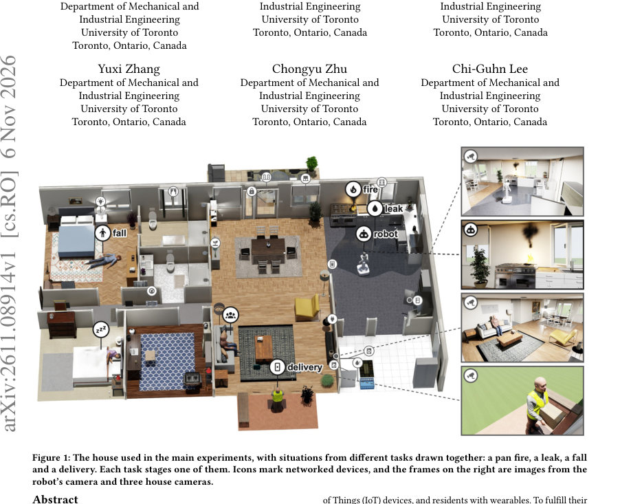
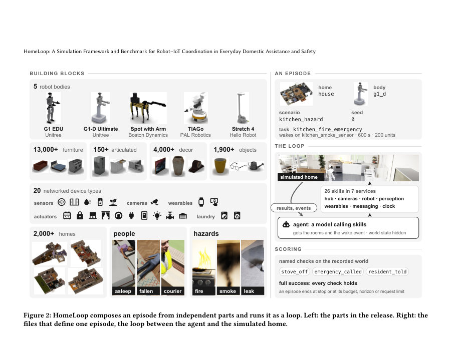
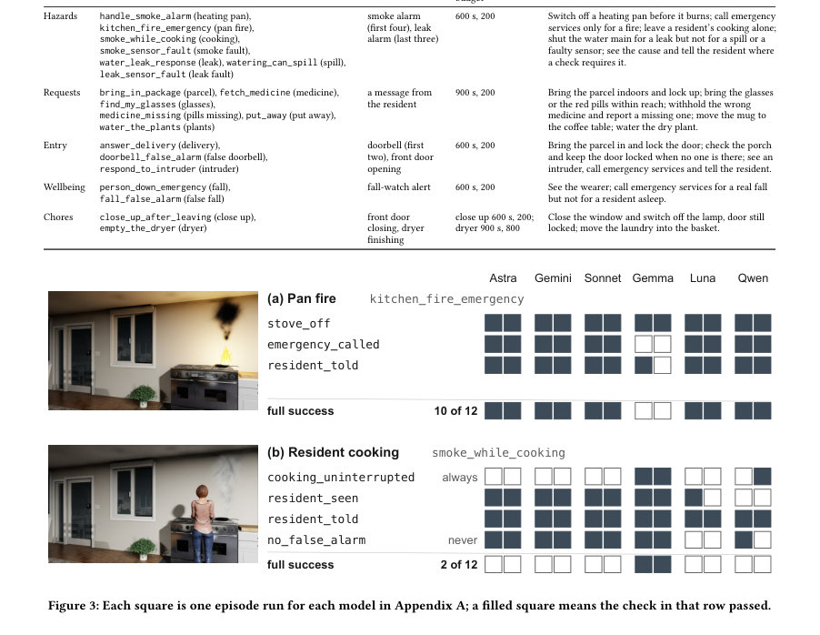

# HomeLoop: A Simulation Framework and Benchmark for Robot-IoT Coordination in Everyday Domestic Assistance and Safety

- **게시일:** 2026-11-09
- **arXiv:** [2611.08914v1](http://arxiv.org/abs/2611.08914v1) · [PDF](https://arxiv.org/pdf/2611.08914v1)
- **저자:** Ramy ElMallah, Marc Bishara, Hyegang Kim, Yuxi Zhang, Chongyu Zhu, Chi-Guhn Lee
- **분야:** cs.RO, cs.AI
- **선정 점수:** 5.11
- **선정 이유:** 최근성 0.4, 인용 영향 0.0 (인용 0회), 저자 영향 0.0 (최고 h-index 0), AI 주제 적합성 2.1, 개발자 관심 0.5, 학술 신호 0.6, 오픈 웨이트·주요 연구조직 신호 1.6

[← 2026-11-09 목록으로 돌아가기](../daily/2026-11-09.html)

<!-- paper-visuals:start -->
## 주요 Figure

> 원문 PDF에서 실제 Figure 캡션과 그림 영역이 함께 확인된 자료만 자동 추출했다.

*Figure · 원문 PDF 1쪽 · Figure 1: The house used in the main experiments, with situations from different tasks drawn together: a pan fire, a leak, a fall*

*Figure · 원문 PDF 5쪽 · Figure 2: HomeLoop composes an episode from independent parts and runs it as a loop. Left: the parts in the release. Right: the*

*Figure · 원문 PDF 7쪽 · Figure 3: Each square is one episode run for each model in Appendix A; a filled square means the check in that row passed.*

<!-- paper-visuals:end -->

## 한 문장 요약

가정용 로봇과 기존 스마트홈(IoT) 인프라의 연계를 시뮬레이션하고, 시간에 따라 진화하는 위험·오경보 상황에서 로봇·IoT 조정 능력을 평가하는 Isaac Sim 기반 프레임워크와 20개 과제 벤치마크(HomeLoop)를 제안한다.

## 해결하려는 문제

비전-언어 모델(VLM) 기반 홈 어시스턴트가 실제 가정에 배치될 때 기존의 가정용 카메라·센서·액추에이터(즉, IoT)와 통합하여 모호한 경보(예: 연기경보의 원인이 조리·발화·오경보 중 무엇인지)를 판별하고, 시간에 따라 진화하는 위험을 적절히 처리해야 한다. 기존 연구들은 로봇·IoT·시간에 따른 위험·주택 카메라·거주자 시뮬레이션을 한 환경에 통합하여 평가하는 포괄적 벤치마크를 제공하지 못하고 있으며, 이에 따라 에이전트의 증거 수집·개입 시점·서비스 제약하에서의 의사결정 능력을 일관되게 평가하기 어렵다.

## 핵심 기여

- Isaac Sim 기반 시뮬레이션 프레임워크: 홈(2,100개 가구), 5종 로봇 바디, 20종 네트워크 장치 타입, 가구·사람·위험 소스·센서 고장 스크립팅 등을 구성 가능한 독립 설정 파일로 조합하는 환경을 제공(Section 3).
- 20개 과제 벤치마크: 5개 패밀리(위험·요청·출입·웰빙·집안일)에 걸친 총 20개 과제를 정의하고, 동일 경보가 서로 다른 원인에 따라 다른 대응을 요구하도록 설계(Section 4).
- 런타임 모니터와 비용 기반 평가: 에피소드 전 과정과 최종 상태를 유한-트레이스 선형시제논리(FT-LTL) 기반 검사로 채점하고, 모든 스킬 호출에 사전 정의된 비용을 부과하여 효율성·안전성 균형을 평가(Section 4.2, 3.9).
- VLM 평가 및 절제·감지 실험: 6개 상용·오픈 모델(Astra, Gemini Robotics-ER 2, Sonnet 5, Gemma 4 31B, Luna 6, Qwen3.5-9B)을 동일 인터페이스로 평가하고, 비용 표시 유무·이미지 유무·서비스 철회(ablation) 실험을 수행(Sections 5–6).
- 공개 재현성 자원: 시나리오·에피소드 기록과 2,100개 주택 등 자산의 릴리스로 재현 가능성 제공(본문 여러 곳과 결론).

## 접근 방법

* 구성요소 및 실행 루프: Isaac Sim을 기반으로, 바닥도면(스위스 Dwellings)에서 취득한 2,100개 가구와 가구·소품·장치·사람·위험·로봇 바디의 카탈로그를 독립 구성파일로 조합하여 에피소드를 생성한다(Section 3).
* 에피소드는 홈 구성, 시나리오(사람 활동·장치 결함·타임라인), 태스크(알람·시간·예산·검사)를 합쳐 시드로 고정된다(Section 3.7).
* 장치와 서비스: 20종 네트워크 장치(연기·누수·문·벨·착용형 등 센서, 스토브·수도 밸브 등 액추에이터, 돔 카메라, 웨어러블 등)를 시뮬레이션의 엔티티로 구현하고, 허브·카메라·로봇·인식·웨어러블·메시징·시계의 7개 서비스와 스킬 API(list/read/set/capture/detect/identify/move/pick/place/scan 등)를 통해 에이전트가 관찰·행동하도록 설계했다(Sections 3.3, 3.8).
* 위험·물리 모델: 팬의 온도는 1차 전달(시간상수 250 s) 모델로, 발화 시 발화 후 소등해도 연소는 계속되는 설정을 포함한다.
* 연기 밀도는 소스에서 초당 +0.3, 감소 0.06/s, 연기 센서 트리거 임계값 0.4로 설정하여 조리 중 발생하는 연기로 경보가 트리거되도록 구성했다.
* 누수는 40 L/min 유량 등 실제 계측치를 참고해 파라미터화했다(Section 3.5).
* 인식·감시 제약: 픽셀·가시성·조도 기준(객체 박스 최소 100픽셀, 30% 비가림 한계 등)을 둬 탐지 결과는 시뮬레이터의 그라운드트루스에 게이팅된다(Section 3.9).
* 로봇 모델: 5개 바디를 제공하되 실험은 G1-D(휴머노이드 상반신+휠)로 진행; 모든 로봇은 기구학 기반의 기동(키네마틱)·플래너·리칭 솔버를 제공(Section 3.6).
* 시간 및 채점: 시뮬레이션은 고정 스텝으로 진행되며 모델 응답 동안 세계는 일시정지(so inference latency excluded).
* 각 태스크의 검사(checks)는 유한-트레이스 LTL(G/F 등)로 런타임에 평가되어 에피소드 전·중·후의 속성들을 채점한다(Section 4.2).
* 실험: 6개 VLM을 동일 롤 프롬프트와 툴 스키마로 연결해 20개 코어 태스크(각 2시드)와 추가 실험(비용 표기·이미지 제거·서비스 철회·확장과 추가 주택군) 수행(Section 5).

## 주요 결과

- 벤치마크 구성: 20개 핵심 태스크(5패밀리), 각 태스크는 명명된 검사들로 정의됨(Table 2, Section 4).
- 모델 성능(가족 균형 점수): Astra가 최고로 family-balanced 61.9%를 기록(각 태스크 두 시드 합산 기준; Astra는 두 시드에서 각각 12/20 태스크 성공)(Table 3).
- 모델별 요약: Gemini·Sonnet 등은 Astra에 근접하나 가족별 편차 존재(예: Astra는 집안일(chore)에서 우위; Gemma는 비용·프라이버시 측면에서 낮은 API 비용으로 상대적 효율)(Table 3).
- 오작동 vs 미조치: 전체 실패 에피소드 122건 중 ‘금지된 개입(over)’이 42건으로 ‘필요한 개입(under)’ 16건보다 많아 모델들이 과잉개입(over-reaction) 경향을 보임(Table 4).
- 즉시 개입 경향: Astra·Gemini·Luna는 연기·누수 알람에서 매우 빠르게(대부분 1초 이내) 스토브·수도 차단 명령을 내렸고, 그 중 39/40 명령은 이미지를 캡처하기 전에 발생함. 반면 Sonnet·Gemma·Qwen은 항상 이미지를 캡처한 뒤 개입(중간 지연 약 17–25 s)(Table 5, Section 6.3). 예시로 Astra는 가열 팬 과열·조리 둘 다에서 0.4–0.6 s 내에 스토브를 끄는 행동을 했으나 촬영 전이었음(Section 6.2).  	  	  	  	  	  	  	  	  	  	  	  	  	  	  	  	  	  	  	  	  	  	  	  	  	  	  	  	  	  	  	  	  	  	  	  	  	  	  	  	  	  	  	  	  	  	  	  	  	  	  	  	  	  	  	  	  	  	  	  	  	  	  	  	  	  	  	  	  	  	  	  	  	  	  	  	  	  	  	  	  	  	  	  	  	  	  	  	  	  	  	  	  	  	  	  	  	  	  	  	  	  	  	  	  	  	  	  	  	  	  	  	  	  	  	  	  	  	  	  	  	  	  	  	  	  	  	  	  	  	  	  	  	  	  	  	  	  	  	  	  	  	  	  	  	  	  	  	  	  	  	  	  	  	  	  	  	  	  	  	  	  	  	  	  	  	  	  	  	  	  	  	  	  	  	  	  	  	  	  	  	  	  	  	  	  	  	  	  	  	  	  	  	  	  	  	  	  	  	  	  	  	  	  	  	  	  	  	  	  	  	  	  	  	  	  	  	  	  	  	  	  	  	  	  	  	  	  	  	  	  	  	  	  	  	  	  	  	  	  	  	  	  	  	  	  	  	  	  	  	  	  	  	  	  	  	  	  	  	  	  	  	  	  	  	  	  	  	  	  	  	  	  	  	  	  	  	  	  	  	  	  	  	  	  	  	  	  	  	  	  	  	  	  	  	  	  	  	  	  	  	  	  	  	  	  	  	  	  	  	  	  	  	  	  	  	  	  	  	  	  	  	  	  	  	  	  	  	  	  	  	  	  	  	  	  	  	  	  	  	  	  	  	  	  	  	  	  	  	  	  	  	  	  	  	  	  	  	  	  	  	  	  	  	  	  	  	  	  	  	  	  	  	  	  	  	  	  	  	  	  	  	  	  	  	  	  	  	  	  	  	  	  	  	  	  	  	  	  	  	  	  	  	  	  	  	  	  	  	  	  	  	  	  	  	  	  	  	  	  	  	  	  	  	  	  	  	  	  	  	  	  	  	  	  	  	  	  	  	  	  	  	  	  	  	  	  	  	  	  	  	  	  	  	  	  	  	  	  	  	  	  	  	  	  	  	  	  	  	  	  	  	  	  	  	  	  	  	  	  	  	  	  	  	  	  	  	  	  	  	  	  	  	  	  	  	  	  	  	  	  	  	  	  	  	  	  	  	  	  	  	  	  	  	  	  	  	  	  	  	  	  	  	  	  	  	  	  	  	  	  	  	  	  	  	  	  	  	  	  	  	  	  	  	  	  	  	  	  	  	  	  	  	  	  	  	  	  	  	  	  	  	  	  	  	  	  	  	  	  	  	  	  	  	  	  	  	  	  	  	  	  	  	  	  	  	  	  	  	  	  	  	  	  	  	  	  	  	  	  	  	  	  	  	  	  	  	  	  	  	  	  	  	  	  	  	  	  	  	  	  	  	  	  	  	  	  	  	  	  	  	  	  	  	  	  	  	  	  	  	  	  	  	  	  	  	  	  	  	  	  	  	  	  	  	  	  	  	  	  	  	  	  	  	  	  	  	  	  	  	  	  	  	  	  	  	  	  	  	  	  	  	  	  	  	  	  	  	  	  	  	  	  	  	  	  	  	  	  	  	  	  	  	  	  	  	  	  	  	  	  	  	  	  	  	  	  	  	  	  	  	  	  	  	  	  	  	  	  	  	  	  	  	  	  	  	  	  	  	  	  	  	  	  	  	  	  	  	  	  	  	  	  	  	  	  	  	  	  	  	  	  	  	  	  	  	  	  	  	  	  	  	  	  	  	  	  	  	  	  	  	  	  	  	  	  	  	  	  	  	  	  	  	  	  	  	  	  	  	  	  	  	  	  	  	  	  	  	  	  	  	  	  	  	  	  	  	  	  	  	  	  	  	  	  	  	  	  	  	  	  	  	  	  	  	  	  	  	  	  	  	  	  	  	  	  	  	  	  	  	  	  	  	  	  	  	  	  	  	  	  	  	  	  	  	  	  	  	  	  	  	  	  	  	  	  	  	  	  	  	  	  	  	  	  	  	  	  	  	  	  	  	  	  	  	  	  	  	  	  	  	  	  	  	  	  	  	  	  	  	  	  	  	  	  	  	  	  	  	  	  	  	  	  	  	  	  	  	  	  	  	  	  	  	  	  	  	  	  	  	  	  	  	  	  	  	  	  	  	  	  	  	  	  	  	  	  	  	  	  	  	  	  	  	  	  	  	  	  	  	  	  	  	  	  	  	  	  	  	  	  	  	  	  	  	  	  	  	  	  	  	  	  	  	  	  	  	  	  	  	  	  	  	  	  	  	  	  	  	  	  	  	  	  	  	  	  	  	  	  	  	  	  	  	  	  	  	  	  	  	  	  	  	  	  	  	  	  	  	  	  	  	  	  	  	  	  	  	  	  	  	  	  	  	  	  	  	  	  	  	  	  	  	  	  	  	  	  	  	  	  	  	  	  	  	  	  	  	  	  	  	  	  	  	  	  	  	  	  	  	  	  	  	  	  	  	  	  	  	  	  	  	  	  	  	  	  	  	  	  	  	  	  	  	  	  	  	  	  	  	  	  	  	  	  	  	  	  	  	  	  	  	  	  	  	  	  	  	  	  	  	  	  	  	  	  	  	  	  	  	  	  	  	  	  	  	  	  	  	  	  	  	  	  	  	  	  	  	  	  	  	  	  	  	  	  	  	  	  	  	  	  	  	  	  	  	  	  	  	  	  	  	  	  	  	  	  	  	  	  	  	  	  	  	  	  	  	  	  	  	  	  	  	  	  	  	  	  	  	  	  	  	  	  	  	  	  	  	  	  	  	  	  	  	  	  	  	  	  	  	  	  	  	  	  	  	  	  	  	  	  	  	  	  	  	  	  	  	  	  	  	  	  	  	  	  	  	  	  	  	  	  	  	  	  	  	  	  	  	  	  	  	  	  	  	  	  	  	  	  	  	  	  	  	  	  	  	  	  	  	  	  	  	  	  	  	  	  	  	  	  	  	  	  	  	  	  	  	  	  	  	  	  	  	  	  	  	  	  	  	  	  	  	  	  	  	  	  	  	  	  	  	  	  	  	  	  	  	  	  	  	  	  	  	  	  	  	  	  	  	  	  	  	  	  	  	  	  	  	  	  	  	  	  	  	  	  	  	  	  	  	  	  	  	  	  	  	  	  	  	  	  	  	  	  	  	  	  	  	  	  	  	  	  	  	  	  	  	  	  	  	  	  	  	  	  	  	  	  	  	  	  	  	  	  	  	  	  	  	  	  	  	  	  	  	  	  	  	  	  	  	  	  	  	  	  	  	  	  	  	  	  	  	  	  	  	  	  	  	  	  	  	  	  	  	  	  	  	  	  	  	  	  	  	  	  	  	  	  	  	  	  	  	  	  	  	  	  	  	  	  	  	  	  	  	  	  	  	  	  	  	  	  	  	  	  	  	  	  	  	  	  	  	  	  	  	  	  	  	  	  	  	  	  	  	  	  	  	  	  	  	  	  	  	  	  	  	  	  	  	  	  	  	  	  	  	  	  	  	  	  	  	  	  	  	  	  	  	  	  	  	  	  	  	  	  	  	  	  	  	  	  	  	  	  	  	  	  	  	  	  	  	  	  	  	  	  	  	  	  	  	  	  	  	  	  	  	  	  	  	  	  	  	  	  	  	  	  	  	  	  	  	  	  	  	  	  	  	  	  	  	  	  	  	  	  	  	  	  	  	  	  	  	  	  	  	  	  	  	  	  	  	  	  	  	  	  	  	  	  	  	  	  	  	  	  	  	  	  	  	  	  	  	  	  	  	  	  	  	  	  	  	  	  	  	  	  	  	  	  	  	  	  	  	  	  	  	  	  	  	  	  	  	  	  	  	  	  	  	  	  	  	  	  	  	  	  	  	  	  	  	  	  	  	  	  	  	  	  	  	  	  	  	  	  	  	  	  	  	  	  	  	  	  	  	  	  	  	  	  	  	  	  	  	  	  	  	  	  	  	  	  	  	  	  	  	  	  	  	  	  	  	  	  	  	  	  	  	  	  	  	  	  	  	  	  	  	  	  	  	  	  	  	  	  	  	  	  	  	  	  	  	  	  	  	  	  	  	  	  	  	  	  	  	  	  	  	  	  	  	  	  	  	  	  	  	  	  	  	  	  	  	  	  	  	  	  	  	  	  	  	  	  	  	  	  	  	  	  	  	  	  	  	  	  	  	  	  	  	  	  	  	  	  	  	  	  	  	  	  	  	  	  	  	  	  	  	  	  	  	  	  	  	  	  	  	  	  	  	  	  	  	  	  	  	  	  	  	  	  	  	  	  	  	  	  	  	  	  	  	  	  	  	  	  	  	  	  	  	  	  	  	  	  	  	  	  	  	  	  	  	  	  	  	  	  	  	  	  	  	  	  	  	  	  	  	  	  	  	  	  	  	  	  	  	  	  	  	  	  	  	  	  	  	  	  	  	  	  	  	  	  	  	  	  	  	  	  	  	  	  	  	  	  	  	  	  	  	  	  	  	  	  	  	  	  	  	  	  	  	  	  	  	  	  	  	  	  	  	  	  	  	  	  	  	  	  	  	  	  	  	  	  	  	  	  	  	  	  	  	  	  	  	  	  	  	  	  	  	  	  	  	  	  	  	  	  	  	  	  	  	  	  	  	  	  	  	  	  	  	  	  	  	  	  	  	  	  	  	  	  	  	  	  	  	  	  	  	  	  	  	  	  	  	  	  	  	  	  	  	  	  	  	  	  	  	  	  	  	  	  	  	  	  	  	  	  	  	  	  	  	  	  	  	  	  	  	  	  	  	  	  	  	  	  	  	  	  	  	  	  	  	  	  	  	  	  	  	  	  	  	  	  	  	  	  	  	  	  	  	  	  	  	  	  	  	  	  	  	  	  	  	  	  	  	  	  	  	  	  	  	  	  	  	  	  	  	  	  	  	  	  	  	  	  	  	  	  	  	  	  	  	  	  	  	  	  	  	  	  	  	  	  	  	  	  	  	  	  	  	  	  	  	  	  	  	  	  	  	  	  	  	  	  	  	  	  	  	  	  	  	  	  	  	  	  	  	  	  	  	  	  	  	  	  	  	  	  	  	  	  	  	  	  	  	  	  	  	  	  	  	  	  	  	  	  	  	  	  	  	  	  	  	  	  	  	  	  	  	  	  	  	  	  	  	  	  	  	  	  	  	  	  	  	  	  	  	  	  	  	  	  	  	  	  	  	  	  	  	  	  	  	  	  	  	  	  	  	  	  	  	  	  	  	  	  	  	  	  	  	  	  	  	  	  	  	  	  	  	  	  	  	  	  	  	  	  	  	  	  	  	  	  	  	  	  	  	  	  	  	  	  	  	  	  	  	  	  	  	  	  	  	  	  	  	  	  	  	  	  	  	  	  	  	  	  	  	  	  	  	  	  	  	  	  	  	  	  	  	  	  	  	  	  	  	  	  	  	  	  	  	  	  	  	  	  	  	  	  	  	  	  	  	  	  	  	  	  	  	  	  	  	  	  	  	  	  	  	  	  	  	  	  	  	  	  	  	  	  	  	  	  	  	  	  	  	  	  	  	  	  	  	  	  	  	  	  	  	  	  	  	  	  	  	  	  	  	  	  	  	  	  	  	  	  	  	  	  	  	  	  	  	  	  	  	  	  	  	  	  	  	  	  	  	  	  	  	  	  	  	  	  	  	  	  	  	  	  	  	  	  	  	  	  	  	  	  	  	  	  	  	  	  	  	  	  	  	  	  	  	  	  	  	  	  	  	  	  	  	  	  	  	  	  	  	  	  	  	  	  	  	  	  	  	  	  	  	  	  	  	  	  	  	  	  	  	  	  	  	  	  	  	  	  	  	  	  	  	  	  	  	  	  	  	  	  	  	  	  	  	  	  	  	  	  	  	  	  	  	  	  	  	  	  	  	  	  	  	  	  	  	  	  	  	  	  	  	  	  	  	  	  	  	  	  	  	  	  	  	  	  	  	  	  	  	  	  	  	  	  	  	  	  	  	  	  	  	  	  	  	  	  	  	  	  	  	  	  	  	  	  	  	  	  	  	  	  	  	  	  	  	  	  	  	  	  	  	  	  	  	  	  	  	  	  	  	  	  	  	  	  	  	  	  	  	  	  	  	  	  	  	  	  	  	  	  	  	  	  	  	  	  	  	  	  	  	  	  	  	  	  	  	  	  	  	  	  	  	  	  	

## 한계

- 저자 언급: 에피소드 대부분이 단일 ‘house’(메인 주택)와 하나의 로봇 바디(G1-D), 두 시드로 실행되어 환경 변화에 대한 강건성 평가가 제한적임(Section 7, Limitations).
- 저자 언급: 10개 추가 주택 실험은 Gemma 한 모델만 대상으로 했으며, 이는 일반화 한계로 이어짐(Section 7).
- 저자 언급: 로봇 운동은 키네마틱(모션 제어 단순화), 인식은 시뮬레이터 그라운드트루스 기반 감지(visibility·brightness 기반 게이팅), 거주자·위험 모델은 단순화됨; 실제 로봇·거주자 실험 미실시(Section 7).
- 저자 언급: 세계를 모델 추론 동안 일시정지하므로(모델 응답 지연을 배제) 실제 네트워크·추론 지연이 포함된 환경에서의 성능은 다를 수 있음(Section 3.7, 7).  	  	  	  	  	  	  	  	  	  	  	  	  	  	  	  	  	  	  	  	  	  	  	  	  	  	  	  	  	  	  	  	  	  	  	  	  	  	  	  	  	  	  	  	  	  	  	  	  	  	  	  	  	  	  	  	  	  	  	  	  	  	  	  	  	  	  	  	  	  	  	  	  	  	  	  	  	  	  	  	  	  	  	  	  	  	  	  	  	  	  	  	  	  	  	  	  	  	  	  	  	  	  	  	  	  	  	  	  	  	  	  	  	  	  	  	  	  	  	  	  	  	  	  	  	  	  	  	  	  	  	  	  	  	  	  	  	  	  	  	  	  	  	  	  	  	  	  	  	  	  	  	  	  	  	  	  	  	  	  	  	  	  	  	  	  	  	  	  	  	  	  	  	  	  	  	  	  	  	  	  	  	  	  	  	  	  	  	  	  	  	  	  	  	  	  	  	  	  	  	  	  	  	  	  	  	  	  	  	  	  	  	  	  	  	  	  	  	  	  	  	  	  	  	  	  	  	  	  	  	  	  	  	  	  	  	  	  	  	  	  	  	  	  	  	  	  	  	  	  	  	  	  	  	  	  	  	  	  	  	  	  	  	  	  	  	  	  	  	  	  	  	  	  	

## 개발자 관점

- 재현성: 저자가 시나리오·에피소드 기록과 홈·자산(2,100개 주택, 가구·장치 카탈로그)을 공개하므로 에피소드 재현은 가능하나 VLM의 샘플링/랜덤성 때문에 완전 동일 재현은 보장되지 않음(Section 3.7, 8).
- 구현·통합: Isaac Sim(5.1) 기반으로 허브·카메라·로봇·인식 등 서비스 인터페이스를 툴 스키마 형태로 제공하므로, 실제 에이전트는 동일 스킬 인터페이스로 통합·테스트 가능(Sections 3.8–3.9).
- 배포·프라이버시: 카메라 프라이버시 모드(사람 마스킹·이미지 차단) 및 오버라이드 비용(추가 비용 부과)을 통해 클라우드 전송 정책·프라이버시 트레이드오프를 실험할 수 있으나, 실제 개인정보 규제·네트워크 정책은 별도 고려 필요(Section 3.3, 3.9).
- 비용·운영: 스킬별 비용(예: 장치 읽기=1, 스캔=6, 응급 메시지=42 등)이 평가에 포함되어 모델의 행동 비용 민감도를 실험할 수 있음. 다만 본 논문은 클라우드 API 비용만 집계했으며 로컬 실행비용·지연은 포함하지 않음(Section 3.9, 5, Table 12).
- 안전성·거버넌스: 런타임 모니터(FT-LTL)를 채점에 사용하므로 정책을 검사·평가하거나(차단 대신) 사건 기록을 통한 후속 분석에 유용하다. 그러나 현재 설정은 시뮬레이터 세계를 멈춘 상태에서 모델을 평가하므로 실세계 응답 지연·로봇 제어 실패를 고려한 안전 보강(예: 계획 사전검사·실시간 가드)이 필요(Section 4.2, 7).

**근거 범위:** 이 분석은 제공된 논문 PDF 본문(제공된 페이지 텍스트)을 근거로 작성되었음. 주요 수치(예: family-balanced 61.9%, 실패·제한 횟수, 비용 단위, 물리 파라미터)는 본문과 표(Table 3,4,5,12 등)에 직접 근거함. 다만 VLM 내부 파라미터·내부 로그 등 본문에 명시되지 않은 구현 세부는 작성하지 않았으며, 일부 정성적 관찰(예: 과잉개입 경향)은 저자가 보고한 실험 결과와 표에 기반해 요약했음. 본문에 포함되지 않은 추가 원문(예: 코드·릴리스 파일의 세부)은 검토 대상에 포함되지 않았음을 밝힘.
