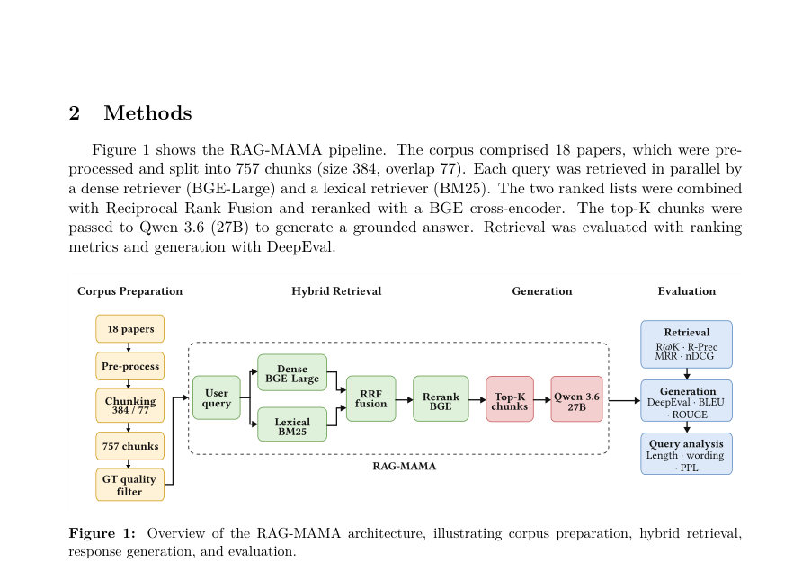
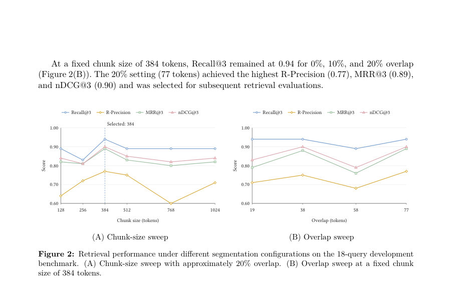

# How Ground Truth Shapes Retrieval Scores: Evidence-Aware Evaluation of a Retrieval-Augmented Generation System for Breast Lesions

- **게시일:** 2026-10-24
- **arXiv:** [2610.31606v1](http://arxiv.org/abs/2610.31606v1) · [PDF](https://arxiv.org/pdf/2610.31606v1)
- **저자:** Miguel Mochizuki Silva, Samuel Ismael, Mateus C. Dias, Thaís Gaudêncio, Yuri Malheiros, Barufaldi
- **분야:** cs.CL, cs.AI
- **선정 점수:** 6.86
- **선정 이유:** 최근성 0.8, 인용 영향 0.0 (인용 0회), 저자 영향 1.1 (최고 h-index 3), AI 주제 적합성 2.7, 개발자 관심 0.0, 학술 신호 0.8, 오픈 웨이트·주요 연구조직 신호 1.6

[← 2026-10-24 목록으로 돌아가기](../daily/2026-10-24.html)

<!-- paper-visuals:start -->
## 주요 Figure

> 원문 PDF에서 실제 Figure 캡션과 그림 영역이 함께 확인된 자료만 자동 추출했다.

*Figure · 원문 PDF 3쪽 · Figure 1: Overview of the RAG-MAMA architecture, illustrating corpus preparation, hybrid retrieval,*

*Figure · 원문 PDF 10쪽 · Figure 2: Retrieval performance under different segmentation configurations on the 18-query development*

<!-- paper-visuals:end -->

## 한 문장 요약

유방 병변 관리 문헌을 대상으로 증거-수준의 근거(ground-truth) 매핑을 도입해 RAG 시스템의 검색 점수 민감도를 분석하고, 하이브리드(밀집+BM25)+교차인코더 재순위 조합(384토큰·20% 중첩)을 선택해 소규모 18문서·18질문 개발 벤치마크에서 검색·생성 성능을 보고한다.

## 해결하려는 문제

임상 RAG 평가에서 통상 '정답 청크(chunk) 대 질의' 방식은 검색기 자체 성능과 정답 주석(coverage)이 혼재되어 평가 점수가 정답 주석의 범위에 민감하게 의존한다. 특히 중첩(chunk overlap) 분절이나 여러 청크가 동일 증거를 포함하는 경우, 대안적(동일 근거를 담은) 청크가 비관련으로 평가되어 과소평가가 발생할 수 있다. 본 연구는 증거(span) 수준에서 canonical evidence를 정의해 각 분절 설정에 매핑함으로써 이러한 평가 편향을 진단하고 검색·생성 컴포넌트를 분리 평가하는 방법론을 제시한다.

## 핵심 기여

- 증거(span) 수준의 canonical ground-truth를 청크 식별자와 독립적으로 정의하고, 각 분절(chunk size·overlap) 구성에 맞춰 자동 매핑하는 '증거-인식(evidence-aware)' 평가 프로토콜을 제안·적용했다.
- 밀집(BGE) 임베딩, BM25, Reciprocal Rank Fusion(RRF)와 BGE 교차인코더(re-ranker)를 결합한 모듈형 RAG 파이프라인(RAG-MAMA)을 설계·구현하고, 청크 크기(128–1024 tokens)와 중첩(0–20%)을 일변량으로 탐색했다.
- 소규모 18문서 코퍼스와 문서당 1개의 단순 Yes/No 또는 WH 질의(총 18질문) 개발 벤치마크를 구성하고, 분절·리트리버·재주석(curated ground-truth) 영향 분석을 수행해 검색 성능 민감도를 실험적으로 확인했다.
- 검색과 생성 평가를 분리 수행하고, 생성평가에는 qwen/qwen3.6-27b로 답변을 생성하고 deepseek-v4-pro(DeepEval)를 LLM 심사자로 사용한 모델 기반 지표 및 BLEU/ROUGE를 보고했다.
- 검토 과정에서 고등급 재주석을 반영해 인식된 증거 스팬과 허용된 청크 타깃 수를 증가시켰음에도 검색 순위는 변하지 않았음을 보여주어 평가 점수가 주석 범위에 민감함을 실증했다.

## 접근 방법

* 구성요소와 절차(본문 기준):
* 코퍼스: 사전선택한 30개 후보에서 심사 후 최종 18개 문서를 보존(사회 지침·lesion-specific 문헌 등), ASBrS 분류표 기준으로 스코프 게이트를 적용해 일부 병변(악성 등)은 고정된 디퍼럴 응답으로 처리.
* 선택된 18문서는 4개 계층(tiers)로 층화.
* 전처리·분절: PyMuPDF로 텍스트 추출·정규화(제어문자 제거·공백 병합 등), 참조 섹션 필터링, 고정 크기 chunking(여러 크기 실험).
* 기본 분절 후보는 384토큰·77토큰(20%) 중첩으로, 이 설정에서 757개 청크 생성(필터링 후 558개 검색 대상 저장).
* 노이즈 필터: 7개 특징 기반 분류기로 청크를 5개 카테고리로 분류하여 일부 청크 제외(구체적 파라미터는 본문에 기술되지 않음).
* 검색(Retrieval): 밀집 임베딩은 BAAI/bge-large-en-v1.5, BM25(생의학 인식 토크나이저) 사용.
* 밀집·BM25 순위를 RRF(k=50)로 결합(하이브리드 fetch multiplier=2, semantic cap=30).
* 결합 결과 최대 20 후보를 BAAI/bge-reranker-v2-m3 교차인코더로 재점수화(후보풀 20)하고 상위 K=3 반환.
* 증거 매핑과 주석: canonical evidence를 문장/스팬 수준으로 보존하고, 각 분절 구성마다 문자열 정규화(NFC·공백) 기반으로 완전 포함 여부를 검사해 해당 증거를 포함하는 모든 청크에 매핑.
* 연속 청크로 재구성해야 하는 경우 최소 연속 시퀀스를 탐색.
* 증거 경로는 대안(OR)과 보완(AND)을 구분하지만 본 벤치마크에서는 단일 청크 대안(OR)만 존재.
* 리트리버 비교(ablation): BM25 단독, 밀집 단독, RRF 하이브리드, RRF+교차인코더 네 가지를 동일 분절·주석으로 비교.
* 생성(Generation): qwen/qwen3.6-27b(27B)를 사용.
* 생성 실험은 별도 저장된 512토큰·102토큰 중첩 인덱스(560개 청크)를 사용해 Top-5 고정 검색 결과에 대해 K=1..5(생성 컨텍스트 깊이)로 비교.
* 각 청크는 최대 3500자(문자 단위)로 컷하여 컨텍스트 구성.
* 출력은 최대 2048토큰, 온도 0.3.
* 평가 지표: 검색은 Recall@3, R-Precision, MRR@3, nDCG@3(매크로 평균).
* 생성은 BLEU-1..4, ROUGE-1/2/L과 DeepEval의 Contextual Precision/Recall/Relevancy, Faithfulness, Answer Relevancy(심사자 모델: deepseek-v4-pro, threshold 0.5).
* 주의사항: 최종 주석 확대는 검색 순위를 고정한 상태에서 수행하여 점수 변화가 주석 변경에 기인함을 분리함.

## 주요 결과

- 데이터셋·벤치마크: 18문서 코퍼스, 문서당 1개 질의로 구성된 18-query 개발 세트. 초기 분절 384토큰·77토큰(overlap 20%)에서 757개 청크 생성(필터링 후 558개 검색 가능).
- 선택된 분절(384토큰·20% overlap)에서 분절 수평탐색 결과: 384토큰 설정이 최고 성능을 보였으며(Recall@3 = 0.94, R-Precision = 0.77, MRR@3 = 0.89, nDCG@3 = 0.90).
- 오버랩(같은 384토큰 기준) 실험: 0%, 10%, 20% 중 0%/10%/20%에서 Recall@3는 모두 0.94로 유지되었고, 20%(77토큰)가 R-Precision(0.77), MRR@3(0.89), nDCG@3(0.90)에서 최상이었다.
- 리트리버 ablation(주석 큐레이트 후): BM25 — Recall@3 0.89, R-Precision 0.61, MRR@3 0.72, nDCG@3 0.76. Semantic(밀집) — Recall@3 0.83, R-Precision 0.56, MRR@3 0.69, nDCG@3 0.73. Hybrid RRF — Recall@3 0.89, R-Precision 0.78, MRR@3 0.81, nDCG@3 0.83. Hybrid RRF + Reranker — Recall@3 0.94, R-Precision 0.94, MRR@3 0.94, nDCG@3 0.94 (모든 지표에서 최고).
- 그라운드-트루스(주석) 큐레이션 영향: 초깃값에서 증거 스팬 수가 25개였으나 큐레이션 후 37개로 증가했고, 허용된 청크 타깃은 36 → 51로 증가했음(검색 순위는 변하지 않음). 따라서 점수 변화는 주석 확대에 따른 것임을 확인함(순위 고정). 결과적으로 Hybrid+Reranker는 18질문 중 17질문에서 Top-3에 최소 하나의 허용 증거를 포함해 Recall@3 = 0.94 달성함(17/18). 단일 쿼리 변경은 Recall@3에 약 0.06 영향(본문 언급).

## 한계

- 저자가 명시한 한계: 데이터셋 규모가 작고(18문서·18질문) 동일 개발 벤치마크가 구성 선택(분절·리트리버 구성)과 평가에 모두 사용되어 과적합(튜닝 편향) 가능성이 높음; 주석 확장은 검색 결과 감사 중에 수행되어 선택된 구성에 유리할 수 있음; 생성 평가는 LLM 기반 심사자와 자동 지표에 의존했으며 인간(방사선과 전문의) 검증이 필요함; 노이즈 청크를 제외한 설계(노이즈 필터링)와 대체 지침(예: B3 lesion에서 vacuum-assisted excision 권고 문헌 제외)으로 인해 일반성에 제약이 있음.
- 본문에서 합리적으로 확인되는 추가 제약: 증거→청크 매핑은 문자열 정규화 및 포함 기준에 의존하므로 표기·형식 차이로 일부 근거가 누락될 수 있음(부분 포함은 단독 타깃으로 인정하지 않음). 분절·중첩 설정에 따라 청크 식별자가 달라지므로 동일 증거의 평가 결과가 분절 방식에 민감함. 사용된 컴포넌트(BGE 임베딩·BGE reranker·qwen3.6·deepseek 등)는 특정 공개/상업 모델 ID에 의존하므로 동일 환경 재현에 추가 접근·비용 요구가 있음.

## 개발자 관점

- 검색 평가 설계: 증거(span) 수준의 canonical 주석을 만들고 이를 모든 분절 구성에 매핑하면 중첩에 따른 '동일 근거의 비관련화' 문제를 완화할 수 있다. 매핑은 자동 매핑 후 고위험 상위 순위 청크를 감사(audit)해 수동 보완하는 프로세스가 필요하다.
- 분절 전략: 청크 크기(384 tokens)와 적당한 중첩(20%)이 본 실험에서 좋은 성능을 보였으나, 분절은 코퍼스·질의 유형에 따라 달라지므로 고정값으로 배포하기 전에 독립 검증이 필요하다. 문장·섹션 인식 분절도 추가 검토 대상임(저자 제안).
- 리트리버 구성: 밀집+BM25를 RRF로 결합하고 상위 후보를 교차인코더로 재순위하면 R-Precision·MRR·nDCG 개선에 유리하다(단, 비용·지연 증가). 재검증 없이 교차인코더만으로 결론 내리지 말고 교차 검증 권장.
- 평가 관행: 검색과 생성은 분리하여 평가하고, 생성 평가는 LLM 심사자뿐 아니라 사람전문가(방사선과) 평가를 반드시 포함해야 한다. 특히 임상 의사결정 관련 질의는 '증거의 임상 조건(예: 샘플링 적절성, 동반 소견)' 보존 여부를 인간이 확인해야 함.
- 운영·배포: 임상 보조로 배포할 경우 스코프 게이트(특정 병변군에 대해 고정 디퍼럴)를 도입해 잘못된 추천 위험을 줄이고, 검색 결과에 증거 출처·페이지 범위·문맥 메타데이터를 함께 노출해 사용자가 신속히 근거를 확인하도록 설계하라. 또한 대형 모델(qwen27B 등)과 교차인코더 사용은 비용·지연을 증가시키므로 인프라·비용 산정을 사전에 수행해야 한다.

**근거 범위:** 이 분석은 제출된 논문 PDF 본문(모든 페이지)을 근거로 작성했으며, 주요 수치(예: 검색·생성 지표, 청크·스팬 개수, 사용된 모델 ID 및 하이퍼파라미터)는 본문에 명시된 값만 사용했습니다. 논문에 자세히 기술되지 않은 구현 내부 파라미터(예: 노이즈 분류기의 세부 특성·임계값)나 외부 시스템의 구체적 하드웨어·추론 비용 등은 추정하지 않았습니다.
