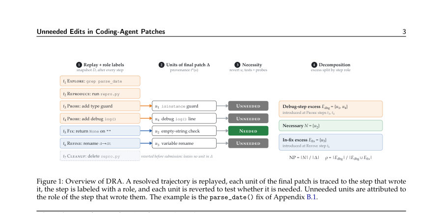
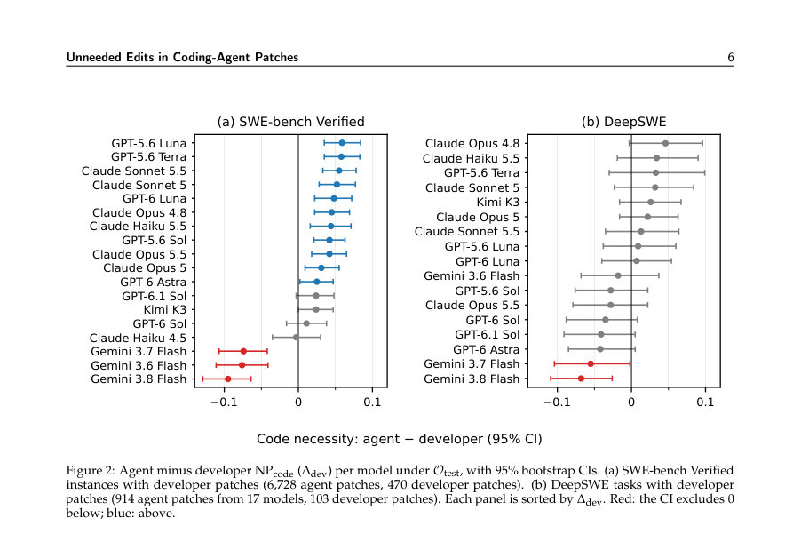
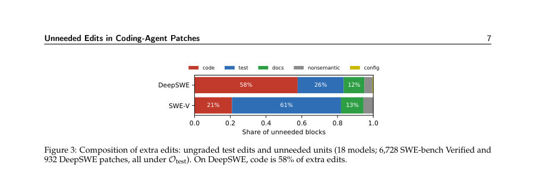

# How Much Do Coding Agents Over-Edit, and Why? An Empirical Study of Unneeded Edits in Repository-Level Agent Patches

- **게시일:** 2026-11-28
- **arXiv:** [2611.34875v1](http://arxiv.org/abs/2611.34875v1) · [PDF](https://arxiv.org/pdf/2611.34875v1)
- **저자:** Aakash Goel, Benjamin Steenhoek, Yu Hu
- **분야:** cs.SE, cs.AI
- **선정 점수:** 3.76
- **선정 이유:** 최근성 0.5, 인용 영향 0.0 (인용 0회), 저자 영향 0.0 (최고 h-index 0), AI 주제 적합성 2.2, 개발자 관심 0.8, 학술 신호 0.3, 오픈 웨이트·주요 연구조직 신호 0.0

[← 2026-11-28 목록으로 돌아가기](../daily/2026-11-28.html)

<!-- paper-visuals:start -->
## 주요 Figure

> 원문 PDF에서 실제 Figure 캡션과 그림 영역이 함께 확인된 자료만 자동 추출했다.

*Figure · 원문 PDF 3쪽 · Figure 1: Overview of DRA. A resolved trajectory is replayed, each unit of the final patch is traced to the step that wrote*

*Figure · 원문 PDF 6쪽 · Figure 2: Agent minus developer NPcode (∆dev) per model under Otest, with 95% bootstrap CIs. (a) SWE-bench Verified*

*Figure · 원문 PDF 7쪽 · Figure 3: Composition of extra edits: ungraded test edits and unneeded units (18 models; 6,728 SWE-bench Verified and*

<!-- paper-visuals:end -->

## 한 문장 요약

저자들은 Delta Residue Attribution (DRA)를 도입해 에이전트의 리포지토리 수준 패치에서 각 변경 블록의 작성 시점을 추적하고 해당 블록을 되돌려 테스트를 재실행해 그 블록이 테스트에 필요(needed)한지 판정함으로써 에이전트의 과도한 수정(over-editing)을 정량적으로 측정하고 원인을 분석했다.

## 해결하려는 문제

패치 크기(변경 라인 수)는 에이전트가 '과도하게 수정'했는지, 추가 변경이 실제로 필요한지, 어떤 종류의 변경인지, 변경이 궤적(trajectory)에서 언제 생겼는지를 알려주지 못한다. 기존 연구는 주로 함수 수준의 최소 수정이나 패치 크기 비교에 의존했으나, 저장소 수준(repository-level) 에이전트 패치에서 개별 변경 블록의 기원과 필요성을 추적하는 방법이 부족했다. 본문은 이 한계를 해결하기 위해 RQ1–RQ5(에이전트의 과도한 수정 정도 비교, 불필요한 편집의 성격, 편집이 궤적의 어느 단계에서 왔는지, 모델별 차이 및 해결률과의 관계, 자동 제거 가능성)를 제시한다.

## 핵심 기여

- Delta Residue Attribution (DRA) 방법 제안: 에이전트 궤적을 재실행(replay)해 최종 패치의 각 '단위(unit)'를 그 단위를 쓴 단계에 귀속시키고, 각 단위를 되돌려(task tests 재실행) 단위의 필요성(needed/unneeded)을 판정하는 파이프라인을 제시함.
- 대규모 블록 수준 실험: GitHub Copilot CLI로 생성된 7,660개의 해결된(resolved) 궤적(18개 모델, SWE-bench Verified 6,728개, DeepSWE 932개)에 DRA를 적용하고, 개발자 패치도 동일한 방식으로 등급화(calibrate)하여 비교 분석을 수행함.
- 불필요 편집의 구성과 기원 규명: SWE-bench Verified에서는 에이전트의 추가 라인 대부분이 테스트(61%)와 문서(13%)였고, DeepSWE에서는 추가 편집의 다수가 코드(58%)였음을 보고함. 불필요 코드의 대부분은 수정(fix) 단계에서 유입되며 디버그 단계는 거의 유입하지 않음을 발견함.
- 모델별 차이와 메트릭 제안: 코드 단위 필요성 지표 NPcode를 도입해 모델 간 차이를 정량화하고, SWE-bench Verified에서는 에이전트의 평균 NPcode가 개발자보다 높았으나(0.887 vs. 0.864), DeepSWE에서는 동등함(0.797 vs. 0.785)과 모델별 편차 및 해결률과의 상관관계를 보고함.
- 후처리(정리) 전략 평가: 에이전트 자기-감사(self-audit)와 테스트 기반 절삭(DRA + Oagent, Oagent+P2P)을 비교해 실전적 트레이드오프(정밀도·재현율·패치 보존율)를 제시하고, 벤치마크에 NPcode 보고를 권고함.

## 접근 방법

* DRA는 네 단계로 구성된다.
* 1) Replay: 에이전트 궤적의 파일 편집 호출을 원본(base) 상태에 순서대로 재적용해 각 라인에 마지막으로 쓴 단계(라인 수준 blame)를 기록하고, 재실행이 최종 제출 패치와 정확히 일치하는 궤적만 분석 대상에 남긴다.
* 2) Unitization & Provenance: 최종 패치를 파일별로 연속 변경 블록(변경 블록 사이 최대 한 줄의 동일 라인 허용) 단위로 분해하여 각 단위 u에 대해 해당 단위를 마지막으로 쓴 단계 t*(u)를 추정하고, 단위를 코드/테스트/문서/비문법적(주석·형식) 등으로 분류한다.
* 3) Step-role labeling: 단위 도입 단계를 역할(EXPLORE, REPRODUCE, PROBE, FIX, REFINE, CLEANUP)로 라벨링한다.
* 두 가지 결정 규칙이 먼저 적용되고 나머지는 LLM(논문에서 GPT-6.1 Sol) 판정기로 라벨링한다.
* 디버그 역할은 EXPLORE/REPRODUCE/PROBE로 묶인다.
* 4) Necessity grading: 각 단위를 하나씩 되돌린 상태(ST ⊖ u)를 만든 뒤 벤치마크의 작업 테스트(오라클 Otest: SWE-bench의 FAIL_TO_PASS 및 PASS_TO_PASS, DeepSWE는 태스크 자체 테스트)를 실행해 되돌렸을 때 테스트가 실패하면 그 단위를 'needed'로 표기(necessity precision NPO, 코드 단위에 한정한 값이 NPcode).
* 테스트 오라클의 맹점을 완화하기 위해 LLM이 작성한 행동 탐침(behavioral probes)을 추가해 강화된 오라클 O+를 구성하고, 여기서는 되돌림이 개발자 패치와 동일한 동작 변화를 보이면 'needed'로 복구한다.
* 또한 개발자 패치도 동일 절차로 등급화해 비교 기준으로 사용한다.
* 실험 코호트와 평가(재현성)를 위해 실행 컨테이너, replay 성공 필터링, 단위 되돌림 시 파싱/적용 불가 경우 처리 등 구현 세부 규칙을 논문에서 명시한다.

## 주요 결과

- 데이터: GitHub Copilot CLI로 얻은 7,660개 해결된 궤적(18개 모델): SWE-bench Verified 6,728 패치(30,265 유닛, 482 고유 인스턴스), DeepSWE 932 패치(26,209 유닛). SWE-bench Verified의 재실행 성공률은 96.7%.
- 패치 크기와 구성: 에이전트 패치는 라인 수로 보면 개발자 패치의 중앙값의 2.33배. 비테스트 파일만 보면 중앙값 비율 1.09, 코드 유닛만 보면 0.86(모델별 범위 존재). SWE-bench Verified에서 에이전트의 추가 라인 구성은 테스트 61%, 코드 21%, 문서 13%였고 DeepSWE에서는 코드 58%, 테스트 26%, 문서 12%였다.
- 코드 필요성(NPcode): SWE-bench Verified에서 평균 NPcode(agent)=0.887, 개발자 기준 0.864(개발자 패치에 대해 Otest는 33%의 코드 유닛을 unneeded로 분류했으나 O+로 강화하면 개발자 unneeded는 3%로 감소). 모델별로는 SWE-bench Verified에서 18개 모델 중 11개 모델이 개발자보다 적은 unneeded 코드를 남김. DeepSWE에서 평균 NPcode(agent)=0.797 vs developer=0.785(동등 수준). 평균적으로 에이전트 패치의 코드 유닛 중 약 11%가 unneeded.
- 행동 영향과 프로브: 행동 탐침으로 검사한 3,559개의 Otest-unneeded 에이전트 코드 유닛 중 3,151개(89%)가 되돌렸을 때 동작 변화를 보였음(즉 inert가 아니라 행동을 바꿈). 에이전트가 추가한 테스트는 주어진 변이(mutant) 1,962개 중 68.1%를 검출해 기존 테스트(같은 파일의 레거시)는 45.6%, 태스크 테스트는 77.1%를 검출함. 태스크 테스트가 놓친 버그의 22.7%는 에이전트가 추가한/강화한 테스트로 잡혔음.
- 편집 기원: 전체 잔여(residue)에서 디버그 단계 기여율 ρ=0.257이지만 대부분은 테스트 파일 조각임. 코드 잔여만 보면 디버그-유래 유닛은 154/3,987로 매우 소수(ρcode=0.039). 수정(FIX) 단계가 unneeded 코드의 83%를 집필. 즉 디버깅 출력·스크립트가 최종 패치에 남는 경우는 드물다(찾아낸 잔여의 대부분은 수정보다 revision과 refinement 과정에서 들어감). ρcode ≈ 0.039(DeepSWE에서는 0.037).  

참고 통계: '디버그가 쓴 코드 잔여 154/3,987 단위' 등 수치 확인 가능함(본문 표·문장).

## 한계

- 저자가 밝힌 한계: 1) 필요성 판단은 오라클에 의존하므로 Otest가 놓치는 행동을 NP가 unneeded로 잘못 판정할 수 있음(오라클 의존성). 2) 행동 탐침(probes)은 LLM(GPT-6.1 Sol)이 작성하므로 탐침 자체의 한계/편향 존재. 3) 단위를 한 번에 하나씩 되돌려 판정하므로 상호 의존하는 쌍이나 블록 내 혼합된 필요성이 오판될 수 있음(단위 상호작용 문제). 4) 연구는 '해결된(resolved)' 궤적만 다루었고 실패 궤적의 과도수는 미분석. 5) 역할 라벨링은 LLM 간 교차검증만 수행했을 뿐 인간 감사는 없음(LLM-대-LLM agreement으로 검증). 6) 디버그-공유(ρ) 결과는 코드 잔여 154개에 기초해 안정성이 제한적임. 7) 돌연변이(mutant) 실험은 271 인스턴스 대상이며 범위 제한. 8) 재현 가능성 요구로 일부 궤적(3.3% SWE-bench 재실행 불일치, DeepSWE의 33.4% 패치에 provenance 누락)이 제외됨. 9) 주로 Copilot CLI 하나의 하네스에서 실험되었음.
- 추론에 근거한/실험 범위에서 드러나는 한계(분리 기술): 1) O+에 LLM 기반 프로브를 사용하므로 오라클 강화가 인간 기준과 어떻게 일치하는지(사람 리뷰어의 판단) 추가 검증 필요. 2) 단위 정의(연속 행 블록 병합)는 그레뉼러리티에 민감해 NPcode 값이 단위 설계에 따라 달라질 수 있음. 3) SWE-bench Verified의 잠재적 오염(contamination) 및 벤치마크 일반화 가능성(다른 하네스나 공개 궤적에 대한 재현성) 제한. 4) 개발자 기준(developer patch)이 항상 '최소' 또는 최적의 기준이 아니며 특히 SWE-bench Pro에서 개발자 패치가 테스트 최소성을 만족하지 못해 기준으로서 약함.

## 개발자 관점

- 평가 지표: 벤치마크 평가는 해결률(resolve rate) 외에 코드 단위 필요성 지표 NPcode(개발자 패치 기준과 함께)를 보고해야 한다. 패치 크기 비교 시 테스트와 코드 편집을 분리해 제시할 것.
- 하네스/흐름 설계: 에이전트가 자체 테스트를 실행하는 경우(또는 저장소의 PASS_TO_PASS 테스트가 있는 경우) DRA 유사한 '테스트 기반 절삭'을 배치 후(post-generation)에서 자동으로 적용하면 unneeded 코드를 상당 부분 제거할 수 있으나(재현율 높음) 일부 필요한 코드를 잘못 제거할 위험(정밀도 저하)이 있으므로 반드시 전체 태스크 테스트 또는 리뷰로 검증해 롤아웃할 것.
- 자기-감사(self-audit) 활용: 에이전트에게 자기 패치의 각 훅을 정당화하게 하는 방식은 높은 정밀도(65.7%)로 잘못된 제거를 적게 일으키지만 재현율이 낮아(unneeded의 ~35%만 검출) 단독 수단으로는 부족하므로 테스트 기반 절삭과 병용 추천.
- 모델 훈련/데이터: 과도한 수정 대부분이 수정(fix) 단계에서 발생하므로 학습 시 '편집 최소성'을 직접 학습 신호로 포함하거나 훈련 데이터에서 테스트에 필요하지 않은 단위를 제거해(edit-aware fine-tuning, trajectory pruning) 모델을 경향적으로 덜 과도하게 만들 것.
- 운영 및 재현: DRA를 적용하려면 재실행 가능한(라인 수준 blame을 복원할 수 있는) 궤적 로깅, 컨테이너화된 테스트 환경, 단위 되돌림 및 테스트 자동화, 행동 탐침 생성(LLM 또는 프로퍼티 기반 테스트) 파이프라인이 필요하다. 배포 시 자동 절삭 기능은 false positive에 대비해 보수적으로 설계하고, '패치가 여전히 풀 테스트를 통과하는지'를 확인하는 안전 게이트를 둘 것.

**근거 범위:** 이 분석은 제공된 논문 PDF 본문(본문 및 부록 포함)의 텍스트를 근거로 작성되었음. 본문에 명시된 수치와 실험 절차를 그대로 인용했으며, 표나 부록의 세부 수치(모델별 CI, 일부 코호트 크기 등)는 PDF에 제시된 것을 따랐음. PDF에서 일부 수치가 부록에 흩어져 있어 요약 문장에서는 핵심 수치만 발췌했으며, 인간 평가 결과(예: 리뷰어 합의 여부) 같은 추가적인 실험은 본문에서 예비 단계로 제시되었으므로 본 보고서에서는 '구현·제언' 차원으로 정리함.
