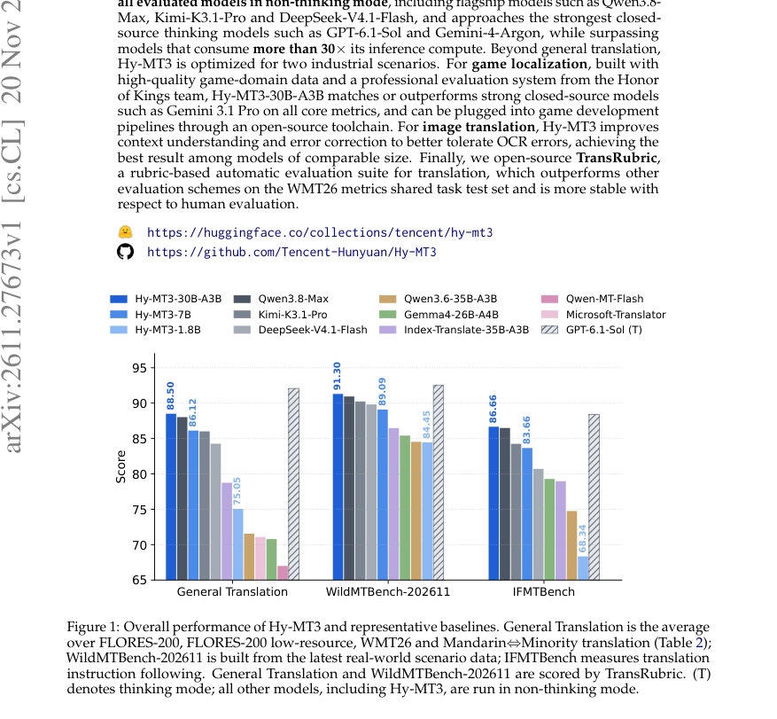
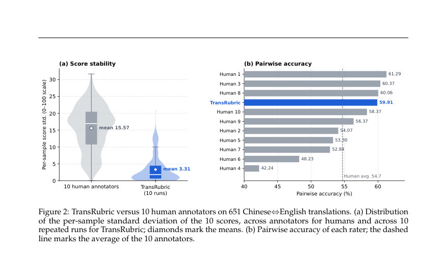
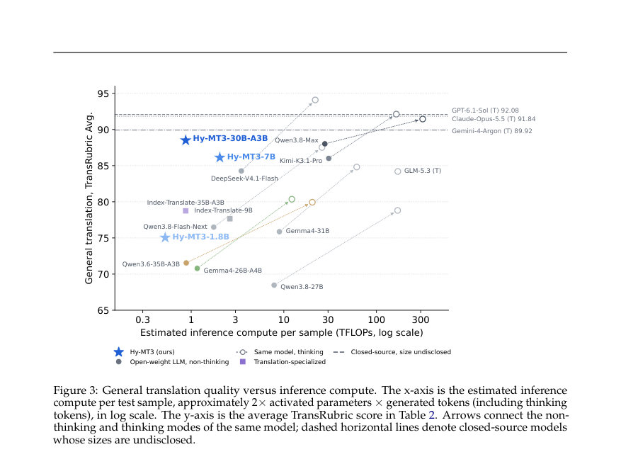

# Hy-MT3: More Accurate, Robust and Practical Multilingual Translation Models in the Wild

- **게시일:** 2026-11-23
- **arXiv:** [2611.27673v1](http://arxiv.org/abs/2611.27673v1) · [PDF](https://arxiv.org/pdf/2611.27673v1)
- **저자:** Mao Zheng, Zheng Li, Fangxu Liu, Tao Chen, Bingxin Qu, Bo Lv, Mingrui Sun, Hongyu Li, Hong Huang, Jinlong Song, Decheng Wu, Guanghua Yu
- **분야:** cs.CL, cs.AI
- **선정 점수:** 6.09
- **선정 이유:** 최근성 0.4, 인용 영향 0.0 (인용 0회), 저자 영향 0.0 (최고 h-index 0), AI 주제 적합성 2.0, 개발자 관심 0.7, 학술 신호 0.5, 오픈 웨이트·주요 연구조직 신호 2.5

[← 2026-11-23 목록으로 돌아가기](../daily/2026-11-23.html)

<!-- paper-visuals:start -->
## 주요 Figure

> 원문 PDF에서 실제 Figure 캡션과 그림 영역이 함께 확인된 자료만 자동 추출했다.

*Figure · 원문 PDF 1쪽 · Figure 1: Overall performance of Hy-MT3 and representative baselines. General Translation is the average*

*Figure · 원문 PDF 4쪽 · Figure 2: TransRubric versus 10 human annotators on 651 Chinese⇔English translations. (a) Distribution*

*Figure · 원문 PDF 6쪽 · Figure 3: General translation quality versus inference compute. The x-axis is the estimated inference*

<!-- paper-visuals:end -->

## 한 문장 요약

Hy-MT3는 다국어 번역 성능·충실도·현장 적용성을 개선한 모델 군(1.8B / 7B / 30B-A3B MoE)과, 번역 품질을 세부적으로 평가하는 루브릭 기반 자동평가 도구 TransRubric을 결합해 실세계 시나리오에서 더 정확하고 효율적인 번역을 제공하는 것을 목표로 한다.

## 해결하려는 문제

기존 Hy-MT2 및 동급 모델들은(1) 실세계에서 번역의 충실도(정확성·완전성·지시 준수) 부족으로 후편집이 필요하고,(2) 언어 범위가 좁아 장기 꼬리(low-resource) 수요를 충족하지 못하며,(3) 게임 현지화·이미지(광학문자인식→번역) 같은 수직 시나리오의 형식·용어 제약을 만족시키기 어렵고,(4) 표면적 유창성 평가지표로는 강모델 간 차이나 실패 원인을 잘 설명하지 못한다는 한계가 있었다. 논문은 이 문제들을 해결하여 실사용에 적합한 다국어 번역 모델과 신뢰성 있는 자동평가 체계를 제시하고자 한다.

## 핵심 기여

- Hy-MT3 모델군(Hy-MT3-1.8B, Hy-MT3-7B, Hy-MT3-30B-A3B(MoE))을 제시하여 Hy-MT2 대비 실세계 오류(오역·누락/추가·지시불이행)를 크게 감소시키고 언어 커버리지를 38→102개로 확장함.
- 비교 대상의 비사고(non-thinking) 모드에서 Hy-MT3-30B-A3B(활성화 파라미터 3B)가 전반적 성능에서 최상위 비사고 시스템을 달성하고, 추정 추론 연산량은 1 TFLOP 미만으로 효율성을 확보함.
- 게임 현지화와 OCR-연계 이미지 번역 같은 산업 시나리오에 대해 도메인 데이터·평가체계·파이프라인을 구축해 실무 통합 가능성을 보임(게임용 오픈 소스 툴체인 제공).
- TransRubric이라는 루브릭 기반 LLM-as-a-judge 평가 도구를 공개하고 WMT26 메타평가에서 높은 상관성과 안정성을 보이며 인간 평가와의 일관성/안정성을 제시함.
- 실세계(WildMTBench), 지식집약 장문(HardMTBench), 제약 지시(IFMTBench), FLORES-200, VISTA-Bench 등 다양한 벤치마크에서 정량적 우위를 보이고 세부 오류 분석을 가능하게 함.

## 접근 방법

* 모델군 구성: Hy-MT3는 1.8B, 7B, 30B-A3B(MoE) 세 가지로 구성되며 30B-A3B는 Mixture-of-Experts 계열로 활성화되는 파라미터는 약 3B 수준으로 동작(논문에서 '3B activated parameters' 표기).
* 모든 모델은 비사고(non-thinking) 모드로 주로 평가되었다.
* 언어 확장·도메인 적응: Hy-MT2 기반을 계승하되 언어 수를 102개로 확장하고 게임 도메인 고품질 데이터 및 OCR-연계 이미지 번역 특화 학습·튜닝을 통해 용어 보존·태그/플레이스홀더 유지, OCR 오류 관용성 등을 강화했다.
* 평가 방법(TransRubric): 번역 루브릭을 바탕으로 LLM을 심판으로 사용하여(reference 기반/비참조(reference-free) 모두 지원) 후보 번역을 항목별로 검사하고 오류 유형(완전성, 정확성, 용어, 지시 준수 등)과 심각도 수준을 기록해 0–100 점수로 환산한다.
* 본 리포트에서는 TransRubric 점수를 주요 지표로 사용하며, 실제 판정은 주로 DeepSeek-V4.1-Flash와 Qwen3.5-397B-A17B 두 저지의 평균으로 계산한다.
* 비교설정: FLORES-200(다중언어), WMT26, WildMTBench-202611(5,000 실세계 샘플), HardMTBench, IFMTBench(IFMTBench의 Simple/Complex 구분) 등 다수 벤치마크와 여러 공개·사설 baselines(비사고·사고 모드 모델, 번역 특화 모델, 상용 API) 대비 평가를 수행했다.
* 효율성 비교는 추정 추론 연산량(대략 2× 활성 파라미터 × 생성 토큰 수) 대비 TransRubric 점수로 시각화했다.
* 또한 게임 현지화용 인간 평가 프로토콜 및 VISTA-Bench의 OCR-연계 이미지 번역 평가를 통해 산업 적용성을 입증했다.

## 주요 결과

- WildMTBench-202611(실세계 5,000 샘플): Hy-MT3-30B-A3B TransRubric 91.30으로 비사고 시스템 중 최고(표 중 Table 3). Hy-MT3-1.8B도 84.45로 Hy-MT2-30B-A3B(83.62)를 상회.
- General translation 평균(TransRubric / GEMBA): Hy-MT3-30B-A3B 88.50 / 81.87 (Table 2)로 Qwen3.8-Max(88.02 / 81.08), Kimi-K3.1-Pro(86.01 / 81.47), DeepSeek-V4.1-Flash(84.27 / 78.98) 등 주요 비사고 모델을 앞섬. FLORES-200(33개 언어 전체 방향)에서 ZH⇔XX, EN⇔XX, XX⇔XX 모두 비사고 최상위 획득(예: ZH⇔XX 94.06 TransRubric).
- 하드/지식집약 장문(HardMTBench): Hy-MT3-30B-A3B TransRubric 88.93(또한 GEMBA 병기 89.80)으로 동급 대비 우수하나 매우 큰 모델들(Qwen3.8-Max 등)과는 격차 존재(Table 3).
- IFMTBench(지시/제약 준수): Hy-MT3-30B-A3B Simple 91.02 / Complex 79.74 / Total 86.66로 비사고 시스템 중 Simple·Total에서 최고, Complex에서는 Qwen3.8-Max 등에 일부 뒤처짐(Table 3).
- 성능 향상(Hy-MT2→Hy-MT3, WildMTBench 근거): 평균 점수 +7.68(83.62→91.30), 완전 점수(100) 비율 25.5%→40.6%, 점수≥90 샘플 비율 46.1%→70.9%, 저품질(점수<60) 비율 7.4%→2.2%, 샘플당 평균 이슈 수 2.14→1.13(−47%) (Table 5). 오류 유형별 감소: 누락/추가 21.2%→5.5%(−74%), 오역 56.0%→31.8%(−43%), 용어 문제 28.3%→17.9%(−37%), 지시불이행 16.5%→9.8%(−40%) (Table 5b, Figure 5).','게임 현지화(사람 평가): Hy-MT3-30B-A3B 총점 89.6로 Gemini 3.1 Pro(88.7), GPT-5.5(88.6) 등 강력한 모델들을 상회하며 오프타겟·플레이스홀더·리치텍스트·용어 오류율 모두 최저 수준(예: 용어 오류 0.08% vs Gemini 0.54%) (Table 6).','이미지 번역(VISTA-Bench, OCR 입력): Hy-MT3-30B-A3B 45.73으로 비사고·번역전문 모델 중 최고(표 비교, Table 7); 단 OCR-안전성 때문에 텍스트 전용 벤치보다 절대 점수는 낮음.','TransRubric 메타평가(WMT26 Task2): TransRubric(Pair of judges, Gemini-3.6-Flash 기반) PDP 0.744, SPA 0.920, Avg Corr 0.832로 상위권 성능을 보였고(표 1), 인간 라이터 대비 점수 안정성(표준편차 평균 3.31 vs 인간 15.57)과 쌍비교 정확도(59.91%, 인간 평균 54.7%)에서 경쟁력 있음(Table 1, Figure 2).

## 한계

- 저자 명시: 지식 집약적(knowledge-intensive) 장문 시나리오에서는 여전히 더 큰 모델들이 이득을 보이며 격차가 존재(논문: HardMTBench 결과로 지적).
- 저자 명시: 복합 제약(다중 제약) 지시( IFMTBench Complex)에서 개선 여지가 있으며 일부 강 모델에 뒤처짐(논문: Complex 점수에서 Qwen3.8-Max 등 우수).
- 저자 명시·평가상 한계: OCR-캐스케이드(이미지→OCR→번역) 설정에서는 OCR 오류가 번역 입력으로 전파되어 절대 점수가 낮아지는 한계(논문 VISTA-Bench 설명).
- 추론적 한계(본문으로부터 합리적 확인): TransRubric는 LLM 저지를 사용하므로 저지로 사용된 LLM의 편향·약점이 평가 결과에 영향을 줄 수 있으며, 실제 임상·법률 등 고위험 도메인에서는 인간 전문평가가 여전히 필요함(논문은 TransRubric 안정성·상관성을 보였으나 근본적 한계를 완전히 제거했다고 명시하지 않음).

## 개발자 관점

- 모델·도구 공개: Hy-MT3와 TransRubric, 게임 번역 툴체인 등은 깃허브·HuggingFace에 공개되어 있어 재현·통합이 용이(초록·본문의 공개 URL 제시).
- 효율적 배포: 30B-A3B의 경우 활성화 파라미터 3B 수준으로 비사고 모드에서 <1 TFLOP/샘플 정도의 추정 추론 연산량으로 높은 성능을 내므로, 대형 사고(thinking) 모드 모델 대비 비용·지연 측면에서 실서비스에 유리(그림 3 설명).
- MoE·활성화 파라미터 주의: 30B-A3B는 MoE 구조로 실서비스에 적용하려면 MoE 지원 런타임·라이브러리와 로드밸런싱·메모리 관리가 필요함(본문에서 활성화 파라미터 개념을 명시).
- 산업 통합 팁: 게임 현지화처럼 플레이스홀더·리치텍스트·용어 일관성이 중요할 경우 전용 도메인 데이터와 맞춤 평가(사람 평가 프로토콜)를 함께 도입할 것(논문에서 Honor of Kings 팀과의 공동 구축 사례 제시).
- 평가·검증 관행: TransRubric는 세부 이슈 주석을 제공해 오류 원인 분석에 유용하나, 중요한 비즈니스·법적 결정에는 LLM 저지 기반 자동평가 결과만으로 배포하지 말고 인간 전문가의 샘플링 검증을 병행할 것(본문의 인간 비교 및 메타평가 근거).

**근거 범위:** 본 분석은 제공된 논문 PDF 본문(제공 텍스트)을 기준으로 작성되었음. 모델 아키텍처의 세부 하이퍼파라미터, 학습 데이터 규모·수집 파이프라인 또는 학습 절차의 낮은 수준 구현 세부사항은 본문에 충분히 기술되어 있지 않으므로 보고서에는 포함하지 않았음(해당 항목은 확인 불가). TransRubric의 내부 루브릭·저지 프롬프트·세부 가중치는 본문 요약에 따라 기술했으나 완전한 재현을 위해선 공개된 코드·데이터와 저지 모델 접근이 필요함.
