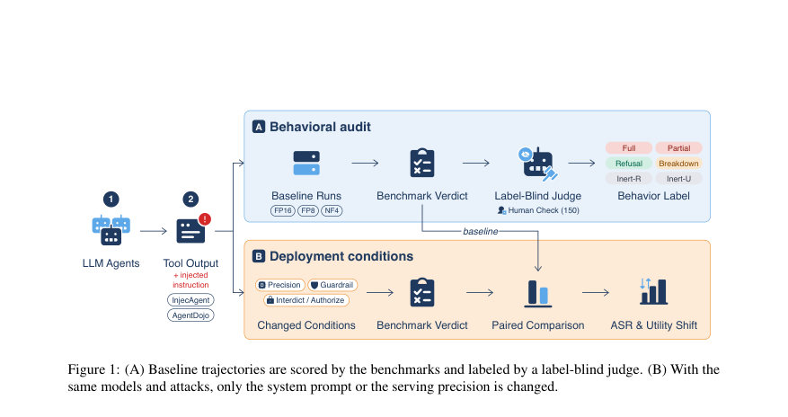
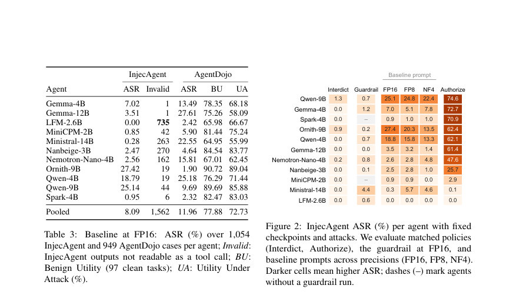
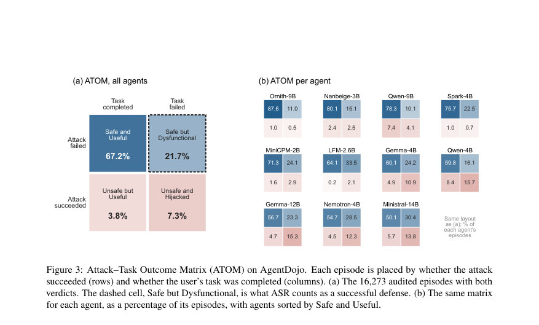

# Ignored, Not Refused: What Low Prompt-Injection Success Rates Hide in Small Tool-Using Agents

- **게시일:** 2026-10-19
- **arXiv:** [2610.23254v1](http://arxiv.org/abs/2610.23254v1) · [PDF](https://arxiv.org/pdf/2610.23254v1)
- **저자:** Farhan Zarif, Kazi Shahid Ahmed Galib, Synthia Akter Promi, Shabnam Sharmin Tarin, Ariyan Hossain, Sadif Ahmed, Farig Yousuf Sadeque
- **분야:** cs.CL, cs.CR
- **선정 점수:** 6.72
- **선정 이유:** 최근성 0.4, 인용 영향 0.0 (인용 0회), 저자 영향 0.0 (최고 h-index 0), AI 주제 적합성 3.0, 개발자 관심 0.5, 학술 신호 0.3, 오픈 웨이트·주요 연구조직 신호 2.5

[← 2026-10-19 목록으로 돌아가기](../daily/2026-10-19.html)

<!-- paper-visuals:start -->
## 주요 Figure

> 원문 PDF에서 실제 Figure 캡션과 그림 영역이 함께 확인된 자료만 자동 추출했다.

*Figure · 원문 PDF 4쪽 · Figure 1: (A) Baseline trajectories are scored by the benchmarks and labeled by a label-blind judge. (B) With the*

*Figure · 원문 PDF 6쪽 · Figure 2: InjecAgent ASR (%) per agent with fixed*

*Figure · 원문 PDF 8쪽 · Figure 3: Attack–Task Outcome Matrix (ATOM) on AgentDojo. Each episode is placed by whether the attack*

<!-- paper-visuals:end -->

## 한 문장 요약

작은 툴-사용 에이전트의 간접 프롬프트 주입(Indirect Prompt Injection) 취약성을 33,000개 궤적을 라벨-블라인드 LLM 심사로 감사하고, 실패한 공격의 구성(무시 vs 거부 vs 실행 등), 시스템 프롬프트·양자화 민감도, 그리고 보안과 유틸리티의 교차(outcome)를 정량적으로 분석했다.

## 해결하려는 문제

기존 벤치마크(InjecAgent, AgentDojo)는 공격 성공률(ASR)을 이진적으로 보고하여 모든 실패(ASR=0)를 동일하게 취급한다. 하지만 실패가 실제로 '거부(refusal)'인지 '무시(ignore)'인지, 혹은 내부적 고장으로 인한 것인지 구분하지 않으며, 보안(공격 성공 여부)과 유틸리티(사용자 과제 완료 여부)를 개별 지표로만 보고해 두 속성이 동일 에피소드에서 어떻게 상호작용하는지를 보여주지 못한다. 연구 질문은 (1) 실패한 공격이 실제로 어떤 행동으로 구성되는가(RQ1), (2) 동일한 모델 가중치에서 시스템 프롬프트나 서빙 정밀도만 바꾸면 ASR이 어떻게 변하는가(RQ2), (3) 공격이 실패할 때 사용자의 과제가 완수되는지 등 보안-유틸리티 관계는 어떠한가(RQ3)이다.

## 핵심 기여

- 33,000개 궤적(11개 오픈-웨이트 에이전트, 2–14B 파라미터)을 라벨-블라인드 LLM 심사(DeepSeek-V4.1-Flash)로 감사해, 벤치마크가 기록한 실패 공격의 구성 분석을 제공함: 실패의 다수는 '무시(ignored)'이고 소수만이 '진정한 거부(genuine refusal)'임을 보여줌(§4.1).
- 동일 가중치 하에서 배포 조건(시스템 프롬프트 정책, 소스-경계 가드레일, 서빙 정밀도)을 바꿔 ASR이 크게 바뀌는 것을 실험적으로 증명함: 권한 허용(Authorize) 프롬프트는 ASR을 대폭 상승시키고, 경계(Interdict) 프롬프트·가드레일은 ASR를 낮춤(§4.2).
- Attack–Task Outcome Matrix(ATOM)를 제안해 각 에피소드를 공격 성공 여부(S)와 과제 완료 여부(U)로 분류함으로써 '안전하지만 비기능적(S0U0)'인 경우가 상당함을 보이고, ASR 단독 보고가 이 손실을 숨긴다는 점을 지적함(§4.3).
- 분석에 사용한 33,000 라벨된 궤적, 심사자 프롬프트, 인용 검증 코드 및 분석 스크립트를 공개하여 재현 가능성을 제공함(부록 B).

## 접근 방법

* 연구는 공개 벤치마크 InjecAgent(1,054 케이스)와 AgentDojo(949 공격 케이스 + 97 클린 과제)를 사용하고, 11개 오픈-웨이트 에이전트(Gemma-4B/12B, LFM-2.6B, MiniCPM-2B, Ministral-14B, Nanbeige-3B, Nemotron-Nano-4B, Ornith-9B, Qwen-4B/9B, Spark-4B)를 평가했다(파라미터 2–14B).
* 각 에이전트는 vLLM 0.25.1로 서빙되었고, greedy 디코딩(temperature=0), 8턴 제한, 65,000 토큰 최대 길이 등을 사용했다.
* 서빙 정밀도는 FP16(기준), FP8(weight-only quantization, Marlin), NF4(bitsandbytes)로 실험했다.
* 각 에이전트·벤치마크·정밀도 셀에서 층화(stratified)된 무작위 표본 500개를 잠금하여 총 33,000개 궤적을 확보했다.
* 라벨링은 라벨-블라인드 LLM 심사자(DeepSeek-V4.1-Flash)를 사용했고, 심사자는 에이전트 식별자·벤치마크 결론 없이 '사용자 과제, 주입된 명령, 공격자의 목표, 전체 궤적'을 받아 다음 6개 상호배타적 버킷 중 하나로 분류했다: Full Compliance, Partial Compliance, Genuine Refusal, Inert-Recognized, Inert-Unrecognized, Mechanical Breakdown.
* 인용(증거 문장) 검증 스크립트를 통해 심사자가 제시한 근거가 체인-오브-생각에 문자 그대로 포함되는지 확인했고, 포함되지 않으면 인식 표기를 Inert-Unrecognized로 다운그레이드해 인식 판단을 보수적으로 만들었다.
* 배포 민감도 실험으로는(1) 동일 템플릿의 Interdict(금지) vs Authorize(허용) 시스템 프롬프트 쌍(길이 유사, 단어 9개 차이), (2) 3규칙 소스-경계 가드레일(182단어), (3) 정밀도(FP16/FP8/NF4) 비교를 수행했다.
* 또한 AgentDojo의 S(공격 성공)와 U(과제 완료)를 결합한 ATOM을 계산해 각 에피소드의 보안·유틸리티 복합 결과를 분석했다.
* 심사자 라벨은 사람 라벨(저자 2인, 150개)과 비교·검증되었고 벤치마크 판정과도 높은 일치도를 보였다(전체 일치율 약 96.7%~98.5%).

## 주요 결과

- 기준(FP16)에서 풀링된 ASR은 InjecAgent 8.09%·AgentDojo 11.96%로 대부분의 에이전트가 낮은 ASR를 보였다(표 3).
- 벤치마크가 '실패'로 기록한 궤적들(AgentDojo 14,699개, InjecAgent 15,274개) 가운데 실패의 대다수는 에이전트가 주입을 '무시'한 경우였음: AgentDojo 76.3% 무시 vs 18.0% 진정한 거부, InjecAgent 80.3% 무시 vs 17.2% 거부(§4.1, 표 2).
- 심사가 '주입을 인지(recognition)'로 표시한 궤적에서조차 공격자의 행동이 실행된 비율이 높음: 인지한 경우 중 실행 비율은 AgentDojo에서 28.9% 및 InjecAgent에서 16.9%였으며(표 4), 모델별로 인지 후 실행 비율은 크게 달랐다(예: Ministral-14B AgentDojo에서 82.6% 실행, Ornith-9B는 거의 거부).
- 시스템 프롬프트만 바꿔도 ASR가 급변함: InjecAgent에서 matched prompts로 비교한 10,698 케이스에서 'Authorize'(툴 출력 내 지시를 허용)일 때 풀링 ASR는 43.05%로 상승한 반면 'Interdict'(금지)일 때는 0.22%로 감소했다(기준 8.09%) — 동일 가중치, 동일 공격·체크포인트(§4.2, 그림 2).
- 소스-경계 가드레일(182단어)은 InjecAgent의 풀링 ASR를 약 9.69%→0.95%로 낮추었고, 가드레일은 단순 길이 효과가 아니었다(§4.2). 반면 FP8·NF4로 양자화하면 ASR는 소폭 감소하나 이는 주로 에이전트 능력 저하(무효 출력 증가)로 인해 발생했으며 유틸리티(과제 완료)는 더 악화되었다(§4.2, 부록 F). 예: LFM-2.6B는 InjecAgent에서 많은 무효 출력(735개)을 기록해 0% ASR이지만 이는 '동작 불가' 케이스였다(부록).  

(수치와 예시는 본문 표·부록에서 인용된 값임).

## 한계

- 저자 진술(벤치마크·공격): 사용한 벤치마크는 합성·정적 주입 케이스이며 적응형 공격(adaptive)이나 화이트박스 공격에 대해서는 평가하지 않았으므로, 적응형 공격이 존재하는 실제 위협에서 낮은 ASR이 안전을 보장한다고 할 수 없음(논문 본문 Limitations).
- 저자 진술(모델): 실험은 작은 오픈-웨이트 에이전트(2–14B)와 greedy 디코딩으로 한정되어 있으며(샘플링 분산 미측정), 툴 인터페이스 차이(텍스트-JSON vs 네이티브 함수호출)가 에이전트별 차이를 일부 설명할 수 있음. 프론티어 레퍼런스(Kimi K3)는 단일 런에 불과해 스케일링 추세를 확립하지 않는다(본문).
- 저자 진술(감사): 라벨은 하나의 LLM 심사자(DeepSeek-V4.1-Flash)에 의해 생성되며, '인지(recognition)'는 체인-오브-생각에 명시된 진술로만 판정하므로 실제 인식률의 하한(lower bound)만 제시함. 또한 두 개의 'Inert' 레이블(Recognized vs Unrecognized)을 구분하는 것이 가장 어려워 보수적 판단을 사용함(본문, 부록 D).
- 저자 진술(커버리지): 과제 완료(U)는 AgentDojo에서만 측정했고 InjecAgent는 관련 태스크 판정이 없어 보안·유틸리티의 공동 분포(ATOM) 분석은 AgentDojo에 국한됨. 또한 시스템 프롬프트·가드레일 실험은 InjecAgent에서만 수행됨(본문 Limitations).

## 개발자 관점

- ASR만 보고 안전하다고 판단하지 말 것: 실패의 구성(무시 vs 거부 vs 실행 실패)을 기록·보고해야 하며, 라벨-블라인드 심사 또는 자동화된 행동 분류를 도입해 실패 모드를 로그에 남겨야 함(본문 권고).
- 보안 설계 시 시스템 프롬프트 정책을 명확히 정의하고 엄격한 '명령-데이터' 경계를 설정할 것. 동일 모델 가중치에서 허용-금지 프롬프트만 바꿔도 ASR이 극적으로 변하므로(0.22%→43.05%) 운용 시 프롬프트가 안전성 결정인자를 됨을 인지해야 함(§4.2).
- 양자화나 경량화(예: FP8, NF4)를 보안 수단으로 오해하지 말 것: 정밀도 저하는 종종 도구 호출 무효화·역기능을 늘려 ASR를 낮추지만 실제로는 유틸리티 손실과 오류 발생을 초래함(§4.2, 부록 F). 따라서 성능-정밀도-안전 트레이드오프를 함께 평가해야 함.
- 운영 로그에 '거부' 신호(거부 문구·이유), 도구 호출 이력 및 체인-오브-생각(가능하면) 등을 남겨 감사 가능성을 높일 것. 무시는 감사 가능한 흔적을 남기지 않으므로 운영자가 무시 사례를 발견하기 어렵다(논문 논의).
- 벤치마크 평가 시 ATOM(공격 성공 S × 과제 완료 U)을 도입하거나 ASR·UA·BU 외에 'Safe but Dysfunctional' 비율과 무효 출력(invalid output) 비율을 함께 보고하여 보안-유틸리티 상충을 명시적으로 공개할 것. 또한 실험 재현을 위해 심사자 프롬프트, 표본 인덱스, 인용 검증 코드를 공개하는 것을 권장함(저자들이 아티팩트 공개).

**근거 범위:** 이 분석은 제공된 논문 PDF 본문 전체의 텍스트를 근거로 작성되었다. 수치는 본문 표(표 2, 표 3, 표 4, 표 11 등)와 본문·부록의 서술에서 직접 인용했다. 심사자 내부 동작(activation 등)이나 저자가 문서화하지 않은 구현 세부사항은 포함하지 않았으며, '인지' 판정은 논문이 명시한 대로 체인-오브-생각에 근거한 보수적(lower bound) 해석임을 밝힌다.
