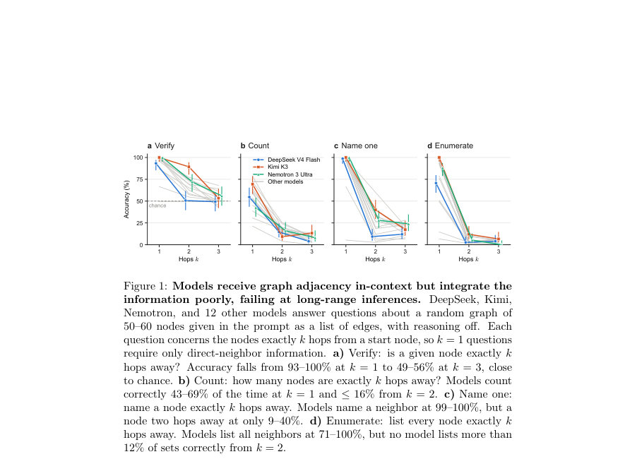
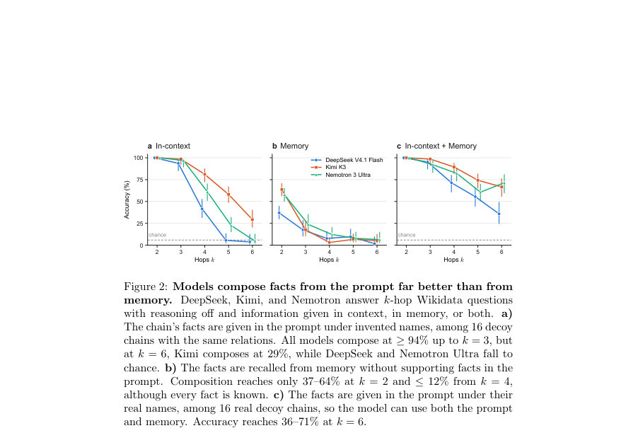

# ImplicitHop: Evaluating knowledge integration across context and memory

- **게시일:** 2026-11-02
- **arXiv:** [2610.41169v1](http://arxiv.org/abs/2610.41169v1) · [PDF](https://arxiv.org/pdf/2610.41169v1)
- **저자:** Alexander Detkov, Dashiel Karish, Matthew Oleynikov, Matt Thomson
- **분야:** cs.AI
- **선정 점수:** 5.91
- **선정 이유:** 최근성 0.4, 인용 영향 0.0 (인용 0회), 저자 영향 0.0 (최고 h-index 0), AI 주제 적합성 3.0, 개발자 관심 0.7, 학술 신호 0.8, 오픈 웨이트·주요 연구조직 신호 1.1

[← 2026-11-02 목록으로 돌아가기](../daily/2026-11-02.html)

<!-- paper-visuals:start -->
## 주요 Figure

> 원문 PDF에서 실제 Figure 캡션과 그림 영역이 함께 확인된 자료만 자동 추출했다.

*Figure · 원문 PDF 4쪽 · Figure 1: Models receive graph adjacency in-context but integrate the*

*Figure · 원문 PDF 5쪽 · Figure 2: Models compose facts from the prompt far better than from*

<!-- paper-visuals:end -->

## 한 문장 요약

두 가지 자연어 벤치마크(합성 무작위 그래프와 Wikidata 기반 지식 체인)를 도입해 '홉(hop)' 깊이에 따라 문맥(in-context)과 사전학습된 기억(weights)에 저장된 정보의 통합·추론 능력을 비교·정량화했다.

## 해결하려는 문제

대형 언어모델(LLM)은 개별 사실을 기억하거나 문맥에서 제공된 정보를 답변하는 능력은 갖추더라도, 여러 사실을 결합해 장거리(다중 홉) 함의를 전파·추론하는 능력(지식 통합)이 취약할 수 있다. 기존 평가는 종종 단일 홉 또는 개별 사실에 초점을 맞추며, 문맥 기반 통합과 모델 가중치에 저장된 지식의 통합 역량을 홉 깊이별로 체계적으로 비교하는 작업이 부족했다. 따라서 연구 질문은 '홉 수(추론 깊이)에 따라 모델이 문맥과 가중치에서 주어진 정보를 얼마나 잘 결합하여 새로운 결론을 도출하는가'이다.

## 핵심 기여

- 두 가지 보완적 자연어 벤치마크 제안: (1) 제어 가능한 합성 무작위 그래프(정확한 k-홉 질문을 통해 추론 깊이를 조절), (2) 실제 지식 그래프(Wikidata) 기반의 지식 조합 벤치마크.
- 합성 그래프 벤치에서는 그래프 생성(G(n,p) with target mean degree d⋆=3), 정언적 자연어 프롬프트(정점 목록·간선 목록) 및 verify/count/name one/enumerate의 4×4 서브태스크 그리드를 제시해 다양한 출력 수준과 스케일을 분리 평가.
- Wikidata 벤치에서는 k=1..6 길이의 사실 체인을 샘플링하고(각 길이당 200 체인), 문맥(in-context with invented names + 16 decoy chains), 모델 메모리(가중치에서 사실), 두 조건 결합 등으로 평가해 문맥·기억 소스별 합성 능력을 비교. 메모리 조건에서는 각 1-홉 사실이 모델의 가중치에 존재함을 사전에 확인함.
- 대규모 실험(15개의 공개 모델, reasoning off, 파라미터 범위 0.8B–2.8T)을 통해 홉 수 증가에 따른 정확도 급락을 정량화하고, 문맥에 제공된 정보가 가중치 기반 기억보다 다중 홉 합성에서 훨씬 우수하다는 실증적 발견을 제시. (예: 그래프에서 k=1 이웃 명명 99–100% → k=2 9–40%)

## 접근 방법

* 데이터셋·문제 설정
* 합성 그래프: G(n,p) Erdos–Rényi 모델을 사용하되 각 그래프의 목표 평균 차수 d⋆=3으로 p를 설정.
* 그래프 크기 n은 [nmin,nmax]에서 균등 샘플링.
* 정점은 무작위 두문자 레이블(특정 문자 제외)로 표기.
* 각 인스턴스는 '무향 그래프임'을 명시하고 정점 목록과 엣지 목록(예: "Edges: AB-CD, YE-LY, ...") 형태의 자연어 프롬프트로 모델에 제시.
* 합성 그래프의 서브태스크: k∈{0,1,2,3}에 대해 verify/count/name one/enumerate의 네 작업으로 4×4 구성(단, k=0은 특별취급하여 전체 정점 집합 대상).
* Wikidata 체인: 30개의 단일값 관계(예: director, founder, father, birth year)를 사용해 실제 엔티티로부터 랜덤워크로 길이 k=1..6의 체인을 샘플링.
* 비연속 엔티티 간 직접 연결이 있거나 이전 엔티티 이름이 후속 엔티티에 등장하는 체인은 제거.
* 각 k에 대해 200 체인 수집.
* 평가 조건: (A) Facts provided in-context: 사실들을 프롬프트에 제시하되 엔티티에 '발명된 이름(invented names)'을 부여하고 같은 관계를 가진 16개의 decoy 체인을 섞어 모델이 관련 체인을 따라가도록 강제.
* (B) Facts in memory: 사실들을 모델 가중치에 저장된 것으로만 가정하되, 해당 체인을 사용하기 전에 모델이 각 1-홉 사실에 대해 올바르게 답하는지 확인(모델이 1-홉 사실을 알지 못하면 그 체인은 평가에서 제외).
* (C) Both: 실제 이름으로 문맥에 제시해 문맥과 메모리 둘 다 사용 가능하게 함.
* 평가 및 모델군
* 15개의 공개 모델(예: DeepSeek, Kimi, Nemotron 포함), 'reasoning off' 설정과 체인오브소트(Chain-of-Thought)를 사용하지 않는 'implicit' 평가 방식을 채택.
* 합성 그래프·Wikidata 질문을 자연어로 제시하고 모델의 텍스트 응답을 정답 기준으로 채점.
* 재현 요소
* 합성 그래프는 전역 시드(0)와 그래프 인덱스에서 파생된 시드로 생성되어 재현성 보장.
* Wikidata 체인은 각 길이당 200개, in-context에는 16개의 decoy 체인 혼합 등 실험적 세부사항이 명시됨.

## 주요 결과

- 합성 그래프 결과(그래프 크기 예시: 50–60 노드, d⋆=3): k=1(이웃 정보)에서 대부분 모델이 높은 성능을 보이나 k≥2에서 정확도가 급락. 구체적 수치: 'name one'에서 k=1: 99–100% → k=2: 9–40% → k=3: 12–24% (Figure 1c). 'verify'는 k=1에서 93–100%에서 k=3에 49–56%로 감소(Figure 1a). 'count'는 k=1에서 43–69%이나 k≥2에서 ≤16%(Figure 1b). 'enumerate'는 k=1에서 71–100%이나 k≥2에서 ≤12%(Figure 1d). 이러한 패턴은 0.8B–2.8T 범위의 15개 모델 전반에서 일관되게 관찰됨.
- Wikidata 결과: 문맥(in-context)에서 주어진 사실을 모델이 합성하는 성능이 가중치 기반 기억보다 현저히 우수.
- In-context: '모든 모델이' k=3까지는 ≥94%의 합성 정확도를 보였고(또는 k=2에서 모든 모델 100%라고 본문에서 기술), Kimi의 경우 k=3:99%, k=4:81%, k=5:58%, k=6:29%로 점진적 감소를 보임(가령 DeepSeek와 Nemotron은 k=5 또는 k=6에서 우연 수준에 근접). (Figure 2a)
- Memory(가중치): k=2에서 모델들은 37–64%의 합성 정확도를 보였으나 k=4부터는 ≤12%로 급락(Figure 2b), 즉 '모든 사실을 알고 있음에도' 다중 홉 합성에 실패.
- Context + Memory: 실제 이름을 사용해 문맥과 메모리를 함께 허용하면 k=6에서 정확도가 36–71%까지 상승하는 반면, context만 단독일 때는 4–29%, memory만 단독일 때는 2–6% 수준으로 보고되어(그림 2c) 문맥과 메모리의 결합이 일부 도움이 됨을 시사함.
- limitations-1 (author-stated) :
- 논문 본문에서 명확히 밝힌 제한사항으로는 평가가 'reasoning off' 설정(체인 오브 소트 미사용)과 공개 모델 집단에 대해 수행되었다는 점이 있다. 저자들은 이 결과가 '현행 모델들의 근본적 한계'를 정량화한다고 주장하지만, 평가 대상(오픈 모델, 체인오브소트 비활성)과 조건이 결과 해석에 영향이 있음을 본문에서 명시한다.

## 한계

- 평가는 공개 모델(15개)에 한정되며 폐쇄형·대형 상용 모델(예: 내부 튜닝/특수 디코더 설정을 가진 모델)에 일반화된다는 보장이 없음(본문에서 평가 대상 범위가 제한됨).
- Wikidata 체인은 최대 k=6까지, 합성 그래프는 k≤3에서 서브태스크를 설계하는 등 실험 범위가 제한적이며 다른 그래프 토폴로지(예: 높은 평균차수, 군집성 높은 그래프)나 더 긴 체인에 대해서는 결과가 보고되지 않음.
- 모든 실험은 chain-of-thought 및 도구 호출(검색·추론 체인 확장 등)을 사용하지 않는 설정에서 수행되어, 체인오브소트나 외부 도구를 포함한 실제 운영 환경에서의 성능은 평가되지 않음.
- 합성 그래프는 Erdos–Rényi G(n,p) 모델(d⋆=3)만 사용하였고, 자연어로 제시된 그래프 서술 방식(정점·간선 리스트)과 프롬프트 길이가 성능에 미치는 영향은 한정적으로만 분석됨.

## 개발자 관점

- 재현성·데이터 생성: 합성 그래프는 전역 시드(0) 및 그래프 인덱스 기반 시드로 생성되어 재현 가능함. Wikidata 체인은 길이별 200 체인, in-context 조건 시엔 각 사례마다 16개의 decoy 체인을 섞는 방식이 재현의 핵심임. 구현 시 이 세부사항을 그대로 적용해야 동일한 난이도 분포를 얻을 수 있음.
- 평가 조건 설계: '메모리에 존재하는지'를 보장하려면(모델의 가중치에서 사실을 회수하는지 확인) 사전 검증 단계가 필요함(논문은 해당 1-홉 사실을 모델이 맞힐 때만 해당 체인을 사용). 이 절차를 재현해야 메모리/문맥 비교가 유효함.
- 프롬프트 설계·규모: 문맥 내 사실 제공은(특히 '발명된 이름' 사용과 다수의 decoy 포함) 모델이 정확히 체인을 따라가도록 강제하는 효과가 있어 실제 시스템에서는 단기적인 행동 제어나 에이전트 지시 시 문맥 제공이 더 신뢰할 수 있음. 다만 긴 프롬프트(여러 체인+decoy)는 토큰 비용과 처리시간을 증가시킴.
- 계산·비용 관점: 복합 사실을 모델 가중치로 영구적으로 통합(continual learning)하기보다, 단기적·깊은 추론이 필요할 때는 문맥으로 제공하는 것이 현재 모델들에서 효율적(정확도 및 개발 복잡도 측면). 다만 문맥 길이가 커지면 latency 및 토큰 비용이 상승하므로 시스템 설계 시 균형 필요.
- 안전성·신뢰성: 모델이 단일 홉 사실을 알고 있음에도 다중 홉 조합에서 실패하므로, 정책·의사결정에 모델의 불충분한 통합 능력을 반영해 실패 모드(잘못된 합성 추론)를 감지하고 사람 검토나 추가 도구(검색, 체인 검증)를 도입해야 함.

**근거 범위:** 이 분석은 제공된 논문 PDF(페이지 1–6)의 본문과 그림 캡션을 기반으로 작성되었음. 초록은 보조로 사용했으며, 일부 실험·추가 세부사항(예: 전체 모델 목록, 하이퍼파라미터, 코드 공개 여부)은 PDF 본문에 명시되지 않거나 부록이 제공되지 않아 확인할 수 없었음. 따라서 언급된 수치와 절차는 본문에 명시된 내용에 한정하여 보고함.
