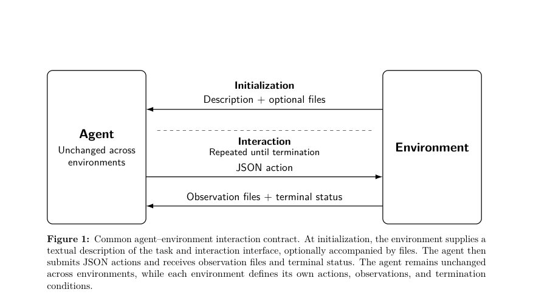
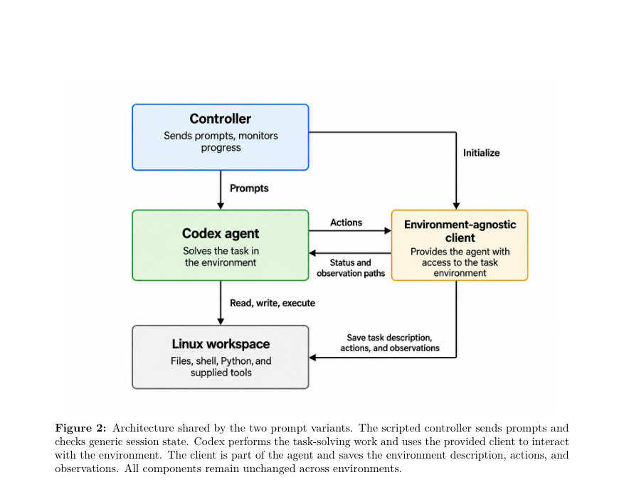
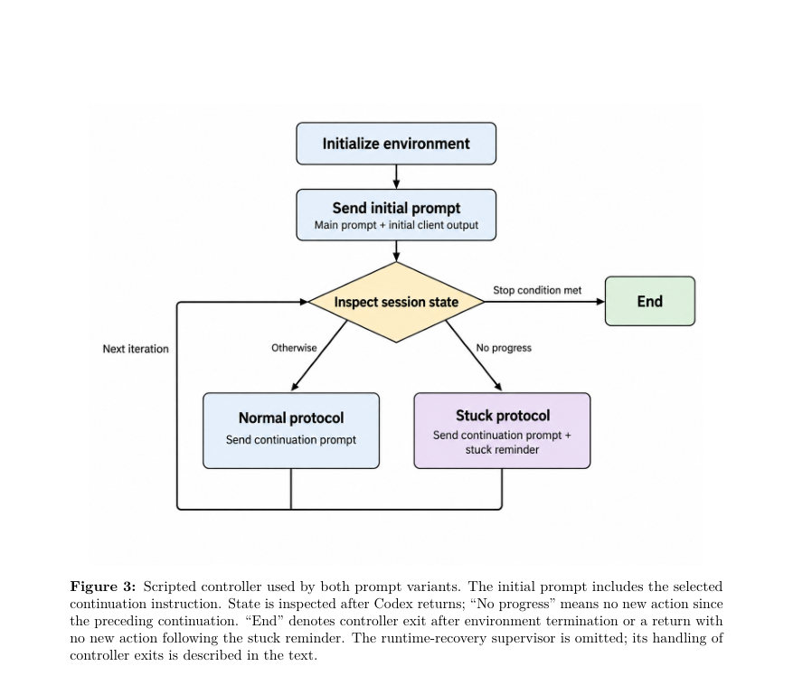

# Improving Environment-Agnostic Coding Agents: The Role of Scaffolding

- **게시일:** 2026-10-17
- **arXiv:** [2610.22289v1](http://arxiv.org/abs/2610.22289v1) · [PDF](https://arxiv.org/pdf/2610.22289v1)
- **저자:** Sergey Rodionov
- **분야:** cs.AI
- **선정 점수:** 4.96
- **선정 이유:** 최근성 0.8, 인용 영향 0.0 (인용 0회), 저자 영향 0.0 (최고 h-index 0), AI 주제 적합성 2.7, 개발자 관심 0.8, 학술 신호 0.8, 오픈 웨이트·주요 연구조직 신호 0.0

[← 2026-10-17 목록으로 돌아가기](../daily/2026-10-17.html)

<!-- paper-visuals:start -->
## 주요 Figure

> 원문 PDF에서 실제 Figure 캡션과 그림 영역이 함께 확인된 자료만 자동 추출했다.

*Figure · 원문 PDF 6쪽 · Figure 1: Common agent–environment interaction contract. At initialization, the environment supplies a*

*Figure · 원문 PDF 7쪽 · Figure 2: Architecture shared by the two prompt variants. The scripted controller sends prompts and*

*Figure · 원문 PDF 8쪽 · Figure 3: Scripted controller used by both prompt variants. The initial prompt includes the selected*

<!-- paper-visuals:end -->

## 한 문장 요약

환경별 맞춤화 없는(환경-agnostic) 코딩 에이전트의 간단한 안내문 변경과 최소한의 스크립트 제어가 일부 벤치마크에서 성능을 향상시키며, 여전히 환경별로 공급된 절차(스캐폴딩)가 유의미한 이점을 제공함을 실험적으로 규명하고 EnvTraverse 프레임워크와 베이스라인을 제시한다.

## 해결하려는 문제

LLM 기반 코딩 에이전트는 모델 능력 향상으로 스스로 유용한 절차를 구성할 수 있게 되어 개발자가 제공하는 환경별 스캐폴딩의 이점이 약화될 가능성이 있다. 본문은 (1) 환경-특화 엔지니어링을 추가하지 않고 환경-agnostic(unchanged implementation) 에이전트를 여러 환경에서 개선할 수 있는지, 그리고 (2) 동일한 모델·도구·정보를 가진 상태에서 안내·제어의 변화가 왜 성능을 바꿀 수 있는지를 규명하는 문제를 다룬다.

## 핵심 기여

- EnvTraverse라는 공통 상호작용 계약과 실행 프레임워크를 제시하고, 환경-agnostic 에이전트의 평가용 오픈 소스 베이스라인을 제공함.
- 단 한 문장(continuation instruction) 변경(Stop-and-report)을 통해 ARC-AGI-3 및 AGI Maze에서 평균 성능을 개선할 수 있음을 실험적으로 보임(환경-agnostic 개선 사례 제시).
- ARC-AGI-3 전용 스캐폴딩(레벨/시도 단위 조직·리셋 관리)을 가진 참조 에이전트(twma_v1.61)와의 비교를 통해 환경별 절차가 여전히 성능 격차를 만들고, 간단한 스크립트 리셋 제어(Controlled_RESET)가 이 격차의 일부(약 34–60%)를 회복함을 보임.
- AGI Maze에서의 튜토리얼(사전 경험)이 모델·추론 예산에 따라 성능을 향상시키기도 하고 악화시키기도 함을 보여, 단순한 경험 축적이 항상 유익하지 않음을 관찰함.
- 성능 향상은 대체로 토큰 기반 추론 비용 증가와 동반되며, 실험은 정보·절차의 더 나은 사용과 추가/재분배된 추론을 분리하지 못함을 명확히 함.

## 접근 방법

* EnvTraverse 프레임워크 아래 동일한 에이전트 코드·컨트롤러·클라이언트·워크스페이스(변경 없음)를 ARC-AGI-3, AGI Maze, Terminal-Bench 2.1에 연결해 평가함.
* 에이전트 구조는 스크립트형 컨트롤러(간단한 세션관리와 재시작·스택 복구 포함), Codex 기반의 코딩 에이전트(관찰 읽기, 코드 작성·실행, 환경 액션 제출), 환경-agnostic 클라이언트(환경과의 JSON 액션/관찰 입출력), 지속적 워크스페이스로 구성됨.
* 비교 대상은 Baseline(continuation: "Continue working until you have completed your task.")과 Stop-and-report(continuation: "...proceed confidently.
* If you encounter ...
* stop and report it back ...") 두 프롬프트 변형뿐이며, 유일한 차이는 continuation 문자열임.
* 추가로 ARC-AGI-3 진단을 위해 (a) twma_v1.61(텍스트형 참조; 레벨·시도 조직 및 컨트롤을 명시), (b) Controlled_RESET(Stop-and-report에 리셋 권한을 컨트롤러로 이전하여 Codex가 RESET을 호출하지 못하게 함) 변형을 평가함.
* 모델·추론 설정은 GPT-5.5 (high, xhigh) 및 GPT-5.6-sol (xhigh, max)로 고정하고, 각 조건은 3개의 평가 블록 반복으로 측정함.
* 성능 지표로 ARC-AGI-3는 RHAE, AGI Maze는 RHAE70(bench max_steps의 70%를 참조 예산으로 사용하는 변형), Terminal-Bench는 검증자 보상(%)을 사용하며, 추론 비용은 논문에 명시된 정규화된 토큰 비용 공식을 사용함.

## 주요 결과

- ARC-AGI-3: Stop-and-report은 네 가지 모델–추론 설정 모두에서 Baseline보다 평균 RHAE를 개선함(개선 폭 논문 요약 기준 1.37–7.29 퍼센트포인트). 표 1의 예시: GPT-5.5 high에서 Baseline RHAE 27.57 → Stop-and-report 34.86; GPT-5.6-sol max에서 Baseline 89.59 → Stop-and-report 90.96. Controlled_RESET와 twma_v1.61(전용 스캐폴딩 참조)은 추가 이득을 제공하며, twma_v1.61이 가장 높음(예: GPT-5.6-sol max에서 twma_v1.61 RHAE 97.86).
- ARC-AGI-3 진단: Stop-and-report 대비 Controlled_RESET은 twma_v1.61과의 격차 중 약 34–60%를 회복함(본문에서 해당 범위 명시). 성능 향상은 일반적으로 토큰 기반 비용 증가와 동반됨(표 1에 비용(M) 수치 병기; 예: GPT-5.5 high에서 Baseline 비용 9.36M → Stop-and-report 14.19M → twma_v1.61 64.09M 등).
- AGI Maze: Stop-and-report은 단일 미로와 튜토리얼-세트(커리큘럼) 양쪽에서 모든 평가 구성에서 Baseline보다 평균 RHAE70을 증가시킴(개선 폭 0.37–4.95 퍼센트포인트). 다만 튜토리얼의 효과는 모델·추론 예산에 따라 달라져, GPT-5.5 구성에서는 튜토리얼이 RHAE70를 감소시키고 GPT-5.6-sol xhigh에서는 증가시킴. 토큰 비용은 모든 비교에서 증가함(약 7–39% 범위).
- Terminal-Bench 2.1: Stop-and-report은 소폭 혼재된 변화를 보였음(예: 네 구성에서 Baseline 대비 변화 범위 −1.50에서 +2.25 포인트). GPT-5.6-sol 구성에서 평균 검증 보상은 약 84–87% 수준으로 실제 실무형 터미널 과제도 해결 가능함을 보임. 또한 일부 GPT-5.6-sol 실행에서 보안 관련 오류가 발생해 복구 실패 및 중단 사례(논문 부록에 요약) 관찰됨.

## 한계

- 저자가 명시한 한계: 실험은 정보·절차의 더 나은 사용과 추가되거나 재분배된 추론(추론량 증가)이 성능 향상에 기여하는 정도를 분리하지 못함(실험 설계상 두 효과를 분리하지 않음).
- 저자가 언급한 제약: 성능 향상은 토큰 기반 비용 증가와 함께 오며, 환경-agnostic 구현이 모든 환경에서 성공을 보장하지 않음.
- 본문에서 확인되는 추가 제약(저자 구분): twma_v1.61 참조는 여러 구조적 차이를 포함하므로(레벨·시도 조직, 텍스트 월드모델 요구 등) 개별 구성요소의 기여를 개별적으로 분리하지 못함; Controlled_RESET은 환경(ARC-AGI-3) 특정 개입임(일반성 제한).
- 평가 관련 제약: 각 조건은 세 번의 평가 블록 반복으로 요약되며(통계적 유의성 검정 미제공), 결과는 보고된 실행 정책과 모델–추론 설정에 한정됨(동일 비용 조건에서의 성능 우위는 주장하지 않음).

## 개발자 관점

- 프롬프트 설계의 작은 변화(예: '문제가 생기면 중단해 보고하라')가 여러 환경에서 평균 성능을 올릴 수 있으나 토큰 비용이 상승하므로 비용-성능 균형을 고려해야 한다.
- 환경별 규약(예: RESET 관행)을 컨트롤러(스크립트)로 명시적으로 구현하면 에이전트가 같은 정보를 스스로 활용할 때보다 안정적으로 이득을 얻을 수 있음 — 따라서 복잡한 환경에서는 일부 제어 로직을 에이전트 외부에 두는 것이 실용적이다.
- EnvTraverse와 같은 통일된 상호작용 계약(JSON actions + 관찰 파일)은 여러 벤치마크에서 동일 구현을 재사용하며 비교하는 데 유용하므로 벤치마크 통합·재현성에 권장된다(저자 제공 코드 깃허브 공개).
- 튜토리얼·사전경험은 항상 유익하지 않음 — 모델·추론 예산에 따라 성능을 떨어뜨릴 수 있으므로 커리큘럼 적용 전 사전 실험을 권장한다.
- 운영적 권고: 복구(supervisor) 메커니즘과 전체 평가 단위의 'all-or-nothing' 재실행 정책은 기술적 중단으로 인한 편향을 줄이는 데 필요함. 또한 보안 필터링(예: GPT-5.6-sol에서의 사이버보안 플래그)으로 인해 실행이 중단될 수 있으므로 로그·재시도 한계와 실패 모드를 모니터링해야 한다.

**근거 범위:** 이 분석은 제공된 논문 PDF 본문(본문과 부록 포함)에 근거하여 작성되었으며, 표와 본문에 명시된 수치와 서술을 그대로 인용하였다. 저자가 제공한 표와 문장(예: RHAE 변화 폭, 비용 수치, '34–60% 회복' 등)을 근거로 정리했으며, 저자가 직접 언급하지 않은 내부 구현 세부사항이나 통계적 유의성 판단은 생성하지 않았다. 부가적으로 구현·환경 제약(예: 보안 오류, 복구 규칙)은 부록 표와 본문 설명을 기반으로 보고하였다.
