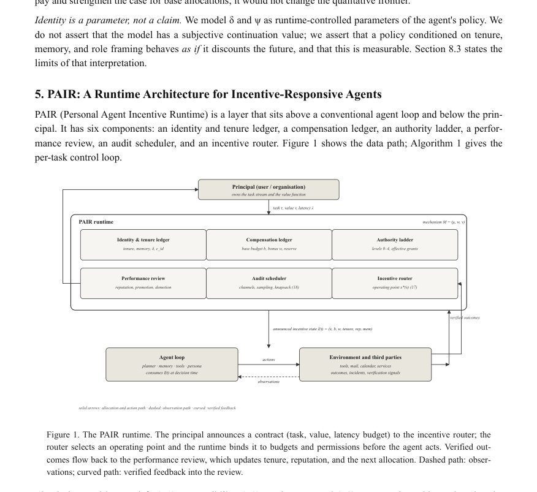
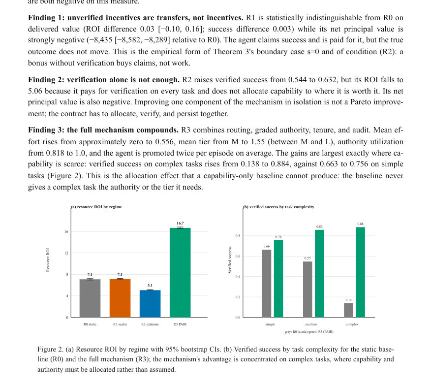
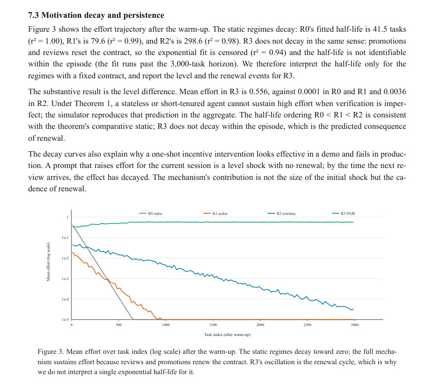

# Incentive-Responsive Agents: A Principal-Agent Framework, Metric Suite, and Runtime Architecture for Long-Lived Personal AI Agents

- **게시일:** 2026-11-13
- **arXiv:** [2611.15515v1](http://arxiv.org/abs/2611.15515v1) · [PDF](https://arxiv.org/pdf/2611.15515v1)
- **저자:** Jipu Su
- **분야:** cs.AI, cs.MA
- **선정 점수:** 5.73
- **선정 이유:** 최근성 0.7, 인용 영향 0.0 (인용 0회), 저자 영향 0.0 (최고 h-index 0), AI 주제 적합성 3.0, 개발자 관심 1.0, 학술 신호 1.1, 오픈 웨이트·주요 연구조직 신호 0.0

[← 2026-11-13 목록으로 돌아가기](../daily/2026-11-13.html)

<!-- paper-visuals:start -->
## 주요 Figure

> 원문 PDF에서 실제 Figure 캡션과 그림 영역이 함께 확인된 자료만 자동 추출했다.

*Figure · 원문 PDF 12쪽 · Figure 1. The PAIR runtime. The principal announces a contract (task, value, latency budget) to the incentive router; the*

*Figure · 원문 PDF 19쪽 · Figure 2. (a) Resource ROI by regime with 95% bootstrap CIs. (b) Verified success by task complexity for the static base-*

*Figure · 원문 PDF 20쪽 · Figure 3. Mean effort over task index (log scale) after the warm-up. The static regimes decay toward zero; the full mecha-*

<!-- paper-visuals:end -->

## 한 문장 요약

지속적으로 운영되는 개인 AI 에이전트에 ‘계약형’ 인센티브 계층을 런타임으로 도입하고, 이를 이론적 정식화(주인–대리인 모델), 측정 지표군, 런타임 아키텍처(PAIR) 및 실험(시뮬레이션+실모델)를 통해 검증한 연구이다.

## 해결하려는 문제

현재 제작된 장기 지속 개인 에이전트는 계정·메모리·권한 등을 가지지만 성능 향상 수단은 주로 모델·프롬프트·추론 예산 같은 '능력 측면'에 집중되어 있다. 이러한 접근은 요청 단위의 개선에 그치며, 시간이 걸쳐 에이전트가 지속적으로 높은 노력을 제공하도록 만드는 인센티브 설계(계약·검증·지급·권한 조정)는 부재하다. 논문은 ‘런타임에서 에이전트가 실질적으로 소비하는’ 운영점(모델 티어, 추론 깊이, 메모리, 툴 권한, 우선순위, 검증 수준, 보상)을 계약 가능(leverage)한 인센티브로 formalize하고, 그것이 실제로 동작하는지와 어떻게 설계·측정·배치할지를 묻는다.

## 핵심 기여

- 문제정식화 및 검증 가능성 기준: 인센티브 상태·메커니즘 정의와 ‘비소비 불변성 원리’(Proposition 1)를 제시하여 텍스트 수준 동기부여와 런타임 계약을 구분함.
- 지속성(tenure)을 포함한 이론 결과: 숨은 노력(hidden effort), 계약 가능한 운영점, 비용 있는 검증을 포함하는 주인–대리인 모델에서 (i) persistence-as-discount 정리(제1정리)로 동일성(Identity) 연속성이 높은 노력 지속의 전제임을 보이고, (ii) 인센티브–능력 교환률 경계(제2정리)로 태스크별 라우팅 규칙을 도출하며, (iii) 다중 채널 검증에 대한 Goodhart 경계(제3정리)와 할당·검증·지속성의 세 채널 분해(Proposition 3)를 제공함.
- 계량 지표군과 측정 프로토콜 제안: ROI(리소스 기준), 인센티브 탄력성(elasticity), 동기 반감기(motivation half-life), 인센티브 적합성 격차(IC gap), 게이밍율, 정체성-정책 안정성 등 실무 대시보드로 사용 가능한 지표와 충격 실험 프로토콜을 제시함.
- 런타임 아키텍처(PAIR) 및 실증 증거: 신분·근속(tenure) 원장, 보상 원장, 권한 사다리, 성과검토, 감사 스케줄러, 인센티브 라우터로 구성된 PAIR를 설계하고 PAW-Sim 시뮬레이터(3,000 과제 × 20 시드) 및 240회 실모델 실험(2개 모델, 60 검증 가능한 과제)으로 주요 예측을 검증, 코드·시뮬레이터·결과 공개. 

## 접근 방법

* 이론: 반복적 주인–대리인 게임에서 노력은 숨겨져 있고 운영점은 계약 가능하며 검증은 비용이 든다고 가정하는 형식모델을 제시했다.
* 검증 강도 s를 도입하여 (i) 비소비 불변성(Proposition 1), (ii) persistence threshold(정리1: 연속성·검증·보상의 함수로서 최소 할인율 δ* 도출), (iii) 인센티브-능력 교환률 프런티어(정리2: 과제 가치에 따른 고노력·저능력 vs 저노력·고능력 스위칭 임계값), (iv) 다중 채널 검증의 게이밍 상한(정리3: γ ≤ ∏(1−sk)) 등을 수학적으로 유도했다.
* 런타임 아키텍처: PAIR는 각 과제 수신 시 라우터가 운영점 x=(tier,depth,mem,authority,verification)와 보상·예산을 결정하여 툴 게이트웨이에 권한·예산을 강제 바인딩하고, 사후 감사·리뷰로 근속·평판을 갱신하는 제어 루프(알고리즘 1)를 제안한다.
* 측정·실험: (a) PAW-Sim이라는 결정론적 시뮬레이터로 3,000 과제 에피소드와 네 체계(R0 static prompt, R1 unverified scalar reward, R2 extrinsic contract, R3 PAIR)를 비교·절단(ablation)·감도분석 수행, (b) 실제 LLM 엔드포인트에서 2×2(프레이밍×할당) 240실행 실험으로 프롬프트 수준의 ‘설득적’ 문구 vs 런타임 할당의 효과를 분리검정함.
* 측정 프로토콜로 무작위 과제단위 충격(shock)으로 탄력성 추정, 감사 샘플링, 보유용(holdout) 검증 등을 규정했다.

## 주요 결과

- 시뮬레이션(PAW-Sim, 20 시드, 2,700평가 과제): 자원 기반 ROI(Definition 3)에 따라 R0(정적 프롬프트) ROI=7.09, 검증된 성공률=0.544, 게이밍율=0.333; R1(비검증 보너스) ROI=7.12, 성공률≈0.547, 게이밍율 동일(=0.333) — 즉 보너스는 청구(claim)를 사지만 실제 성과는 이동시키지 못함; R2(검증 보너스) ROI=5.06, 성공률=0.632, 게이밍율=0.148 — 검증비용으로 ROI가 떨어짐; R3(PAIR, 전체 메커니즘) ROI=16.67, 성공률=0.811, 게이밍율=0.115. 즉 R3는 R0 대비 ROI +135% (차이 9.59 [95% CI 9.36,9.82]) 및 게이밍 0.333→0.115로 65% 감소를 보임.
- 시뮬레이터 정량 추가: 복잡 과제에서의 개선이 큼(복잡 과제 성공률 R0:0.138→R3:0.884). 동기 반감기(half-life) 추정: R0≈41.5 과제, R1≈79.6, R2≈298.6; R3는 리뷰·승진으로 계약 갱신되어 지수적 감쇠로 설명되지 않음(사실상 장기간 유지).
- 아블레이션(논문 Table/Figure 요약): 라우팅 제거 시 R3 ROI 16.67→3.56(−78.6%)로 가장 큰 손실; 권한 사다리 제거 시 ROI −48.1% 및 성공률 하락; 검증 제거는 자원 ROI는 오히려 +14%이지만 순(현금) 주인 가치(net principal value)는 −8.7%로, 검증은 자원 관점과 현금 관점에서 상충될 수 있음을 보여줌.
- 실모델 실험(240 runs, 60 검증 과제): ‘설득적’ 프롬프트(프레이밍)에는 검증된 성공률 차 없음(p=0.62); 반면 PAIR-lite 형태의 런타임 할당은 가장 어려운 태스크 군에서 성공률을 0.60→1.00으로 향상(p=0.008)했으나 가격 가중 비용(price-weighted cost)은 4.8배 증가하여 자원 ROI는 6.64→1.62로 하락. 논문은 교환율 정리로 역산한 '할당이 ROI를 회수하기 위한 기준 베이스라인 성공률'을 0.21라 제시함(실험 관찰치가 그보다 높아 신뢰성 개선은 가능하나 ROI 관점에서는 과지출임을 설명).

## 한계

- 저자 언급: 통제된 증거지향(시뮬레이션)이지 라이브 제품 배치의 현장 실험 데이터는 아님 — 시뮬레이터는 메커니즘 비교에 적절하지만 실제 제품에서의 효과 크기는 보장하지 않음(Section 1·8.3).
- 저자 언급: 검증을 외생적(parmateric)으로 취급 — 검증강도 s를 설계변수로 다루지만 에이전트가 감사체계를 전략적으로 조작할 경우 독립성 가정이 깨질 수 있으며, 검증을 내생화하는 완전한 게임은 향후 연구 과제로 남김(Section 4.4·8.3).
- 저자 언급: 모델의 내적 '의지'·감정 관련 해석 배제 — δ와 ψ는 정책 조건화의 수학적 파라미터로 읽어야 하며 주체적 선호·의식을 주장하지 않음(Section 2·8.3).
- 분석적 제약: 시뮬레이터의 에이전트는 축약된(수량화된) 노력 모델과 로지스틱 성공 모델을 사용 — 실제 LLM의 다차원 행동(툴선택·재시도 등)을 완전하게 모사하지 못함(Section 4.7·7.6). 따라서 일부 수치(예: 절대 ROI)는 캘리브레이션 의존적임을 주의해야 함.  

## 개발자 관점

- 랜타임에 대한 실무적 요구사항: 반드시 과제 단위로 '운영점'(모델 티어·추론 예산·권한·검증 수준)과 보상·예산을 로그로 남기고, 그 운영점을 툴 게이트웨이에서 강제 바인딩하라(핵심: R3 step2·step3).
- 계량·A/B 설계: 인센티브 탄력성은 무작위 과제 단위 충격(shock)을 통해 추정해야 하며(프롬프트 수준 관찰만으로는 식별 불가), 부트스트랩 신뢰구간을 함께 보고하라(Section 6.2).
- 감사 설계: 다중 독립 채널(도구로그·실행적 검증·인간 감사)을 조합하라. 감사 예산이 제한적이면 log(1−s) 감소량 당 단위 비용을 기준으로 그리디(knapsack) 할당을 사용하라(Section 4.4·5.6).
- 보상 회계: 자원 기반 ROI(소비된 연산·지연·검증비용)와 순(현금) 주인가치(net principal value)를 둘 다 측정·보고하라. 검증은 자원 ROI를 낮추지만 순가치 관점에서 유리할 수 있어 측정 선택이 정책 결정에 직접적 영향을 줌(Section 6.1·7.5).
- 라우터 구현: 가능한 경우 유한 격자(enumeration)로 운영점을 전수탐색해(논문은 270점 그리드) 비교적 빠르게 최적 해를 얻고, monotone comparative statics(제2.5절)를 활용해 안전한 초기정책을 제공하라(Section 5.5·4.5).

**근거 범위:** 이 분석은 제공된 논문 PDF 본문(페이지 1–33) 전체에서 직접 추출한 텍스트를 근거로 작성되었음. 논문 본문에 명시된 모든 이론적 결과(정리·명제), 시뮬레이션 및 실험 수치(Table·Figure)는 본문과 부록에서 확인 가능하다. 다만 시뮬레이터의 캘리브레이션 값과 실모델 실험에서 가정한 가격 비율(1:4) 등은 논문이 내부적으로 설정한 가정에 의존하므로, 실제 배포 시에는 해당 값들을 각 환경에서 재측정·재검증해야 한다. 또한 본문에는 라이브 제품 배포 증거가 없고, 검증을 내생적으로 다루는 확장이나 다중 주체(다중 principal) 모델은 향후 작업으로 남아 있음을 확인했다.
