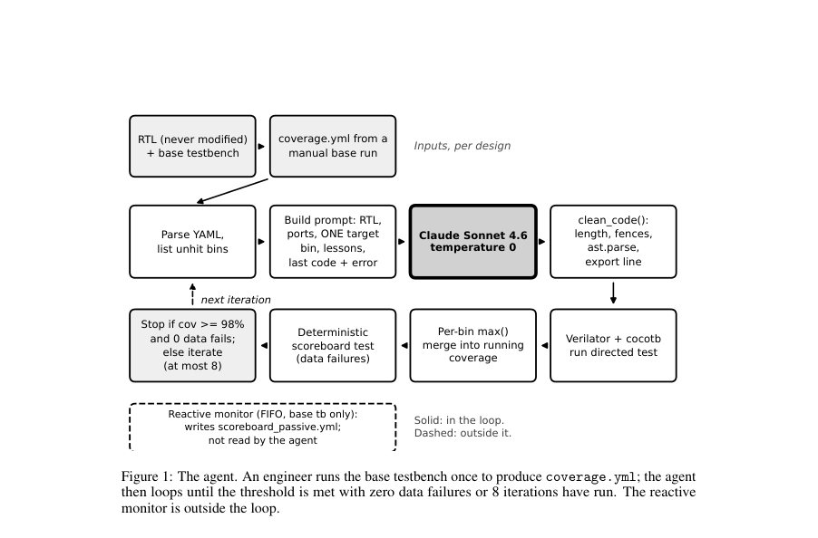

# Independent Data-Integrity Verification for LLM-Driven Functional Coverage Closure in Hardware Design

- **게시일:** 2026-10-16
- **arXiv:** [2610.21570v1](http://arxiv.org/abs/2610.21570v1) · [PDF](https://arxiv.org/pdf/2610.21570v1)
- **저자:** Venkata Krishna Kumar Vedantam
- **분야:** cs.AR, cs.AI, cs.SE
- **선정 점수:** 6.04
- **선정 이유:** 최근성 1.1, 인용 영향 0.0 (인용 0회), 저자 영향 0.0 (최고 h-index 0), AI 주제 적합성 3.0, 개발자 관심 0.5, 학술 신호 0.9, 오픈 웨이트·주요 연구조직 신호 0.6

[← 2026-10-16 목록으로 돌아가기](../daily/2026-10-16.html)

<!-- paper-visuals:start -->
## 주요 Figure

> 원문 PDF에서 실제 Figure 캡션과 그림 영역이 함께 확인된 자료만 자동 추출했다.

*Figure · 원문 PDF 2쪽 · Figure 1: The agent. An engineer runs the base testbench once to produce coverage.yml; the agent*

<!-- paper-visuals:end -->

## 한 문장 요약

시뮬레이터가 출력한 cocotb-coverage YAML을 읽어 LLM(Claude Sonnet 4.6)에게 설계-무관한 단일-목표 cocotb 테스트를 생성하게 하고, 별도한 결정론적 스코어보드와(및 FIFO에 한해 리액티브 모니터)로 데이터 무결성을 독립 검증하면서 기능 커버리지를 닫는 소형 에이전트를 제시한다.

## 해결하려는 문제

기존 방법의 한계: 기능 커버리지가 특정 상태가 도달했음을 보일 뿐 그 경로상의 데이터가 올바른지는 보장하지 못한다는 점은 오래된 문제이다. LLM 기반 테스트 생성은 커버리지를 달성하더라도 생성된 자극(stimulus)의 데이터 무결성이나 모델의 자체 보고를 신뢰할 수 없으며, 무작위 자극으로는 도달하기 어려운 최종 커버리지 빈(리셋-타이밍 코너, CDC 등)을 닫는 데 사람이 쓴 지시형 테스트가 필요하다. 연구 질문: LLM 루프에서 커버리지(시뮬레이터가 내보낸 리포트)와 데이터 무결성(스코어보드/모니터)을 분리해 독립적으로 검증하면서, 설계-무관적 에이전트가 실제 RTL들에서 기능 커버리지를 닫을 수 있는가?

## 핵심 기여

- 시뮬레이터가 내보낸 cocotb-coverage YAML만을 신뢰 소스로 삼고 LLM의 자체 보고를 신뢰하지 않는, 커버리지-클로저 에이전트 설계 및 구현
- LLM이 생성한 테스트의 데이터 무결성은 별개의 결정론적 스코어보드(LLM 자극은 검증 루프의 데이터 실패 카운트에 포함되지 않음)와 설계별 리액티브 모니터로 독립 검증하도록 한 분리된 검증 흐름 제시
- 단일 설계-무관 에이전트가 아키텍처가 서로 다른 세 개의 RTL(비동기 FIFO, UART 송신기, AHB2APB 브리지)에서 부족한 기능 커버리지를 8회 반복 예산 내에 100%로 끌어올린 실험적 증거 제시
- 스코어보드 유효성을 보이기 위해 14개의 삽입 결함(fault-injection) 테스트를 작성해 모두 검출됨을 보고
- 리액티브 모니터가 저자의 기존 base 테스트벤치의 CDC(클럭 도메인 교차) 버그를 발견한 사례 보고

## 접근 방법

* 에이전트 아키텍처와 실행 절차는 다음과 같다.
* 입력으로는 각 설계의 RTL 소스 디렉토리, 수작업으로 작성된 base cocotb 테스트벤치, 그리고 수동으로 한 번 돌려 생성한 coverage.yml(cocotb-coverage YAML)이 필요하다.
* 주요 루프(최대 8회 반복): (1) coverage.yml을 파싱해 미도달(unhit) 빈 목록을 만든다.
* (2) 이번 이터레이션의 단일 목표 빈 하나를 선택(목표는 순환 방식으로 선택)한다.
* (3) 프롬프트를 구성하는데 RTL 소스, RTL에서 추출한 포트 목록, 목표 빈 이름, 최대 12개의 미도달 빈, 영속적 LESSONS.md의 최근 교훈(최대 5개), 이전 테스트 코드와 그 시뮬레이션 에러를 포함한다.
* (4) Claude Sonnet 4.6(temperature=0, max_tokens=8000)에 directed cocotb 테스트 생성을 요청한다.
* (5) clean_code() 검사(길이, 마크다운 펜스 제거, Python ast.parse로 구문 검사, 모듈 수준의 coverage-export 라인 제거(빈 파일 작성 방지), 테스트 내부에 coverage export 호출 추가 등)를 수행한다.
* (6) Verilator + cocotb로 테스트 시뮬레이션을 실행하고, 성공 시 새 커버리지를 기존 누적 결과에 per-bin max()로 합쳐 UCIS의 union-merge 아이디어처럼 유지한다.
* (7) 별도의 결정론적 스코어보드 검사를 고정 자극으로 수행해 데이터 실패 수를 산출(이 검사는 LLM이 생성한 자극으로는 수행하지 않음).
* 중지 규칙: 누적 커버리지가 98% 이상이고 데이터 실패가 0이면 중지, 아니면 최대 8회 반복 후 중지.
* 추가 구성요소로 FIFO에만 연결된 리액티브 모니터가 있어 DUT 신호를 실시간 관찰하며 scoreboard_passive.yml을 작성하되 에이전트는 이를 읽지 않는다.
* 단일-빈 목표 지정은 모델의 집중을 돕기 위한 설계적 선택이며, 모델은 여전히 다른 빈들을 맞출 수 있다(soft instruction).

## 주요 결과

- 데이터셋/대상: 세 가지 소형 RTL 설계(Async FIFO: 36 functional bins, UART TX: 18 bins, AHB2APB: 46 bins)와 각 설계의 수동 base 테스트벤치로부터 시작한 coverage.yml
- 클로저 성과(로그된 12개 실행들에서의 요약): 모든 기록된 실행이 8-반복 예산 내에서 최종 100% 커버리지를 달성함. 구체적 수치: Async FIFO는 기본 91.7% (33/36) → 100%; UART TX는 기본 88.9% (16/18) → 100%; AHB2APB는 기본 67.4% (31/46) → 100% (표 1). 에이전트는 각각의 설계에서 base 테스트벤치가 놓친 빈들을 FIFO 3개, UART 2개, AHB2APB 15개(각각 전체의 약 8%, 11%, 33%) 채움.
- 반복 횟수: 12개 실행 중 10개는 4회 이하의 모델 호출로 완료되었고, 가장 느린 실행은 8회가 필요했음(세부 이터레이션 수는 체크포인트 노트에 따름).
- 스코어보드 유효성: 삽입 결함 14건(FIFO 5, UART 4, AHB2APB 5)을 만든 자가-테스트에서 모든 결함을 스코어보드가 검출함(14/14 검출).
- 실제 버그 발견: 리액티브 모니터가 base FIFO 테스트벤치의 CDC 버그(읽기 enable이 쓰기 클럭으로 구동되어 간헐적 추가 읽기 및 데이터 불일치 초래)를 찾아내어 테스트벤치 수정 후 12/100/1000 랜덤 시드에서 FIFO 스코어보드 실패가 0으로 관측됨(데이터 무결성 검증). 또한 LLM이 생성한 한 개의 FIFO 테스트에 수동으로 모니터를 붙여 463/463 체크가 통과함(단일 수동 점검).

## 한계

- 저자가 명시한 한계 — (i) 루프 내에서 LLM이 생성한 테스트의 데이터 무결성은 자동으로 독립 검증되지 않음(리액티브 모니터는 아직 LLM-생성 테스트에 연결되지 않음); 단일 테스트만 수동 점검됨. (ii) 세 설계와 체크포인트별로 기록한 총 12개의 로그만 있고 반복 재현 실험, 신뢰구간, pass@k 등이 없음(고정 버전 반복 실험 부재). (iii) 비교 기준(baseline) 부재: 무작위 리시딩, 스크립트 전략, 다른 LLM 시스템 등과의 비교가 없음; 또한 single-bin 목표, LESSONS.md, clean_code() 등의 구성요소에 대한 ablation이 없음. (iv) 단일 모델 사용(Claude Sonnet 4.6). (v) base 테스트벤치는 설계별로 사람이 작성했으므로 에이전트 입력이 완전 자동 생성된 것은 아님. (vi) clean_code()가 출력물을 거부하면 반복이 건너뛰어지고 모델에 거부 이유가 전달되지 않음.
- 본문에서 확인되는 추가 제약 — 로그는 여러 체크포인트에서 온 실행을 섞어 보고하여 '한 버전의 에이전트에 대한 다회 반복'을 대체하지 못함, LESSONS.md의 이전 세션 잔재가 있으면 실행이 교착(stall)할 수 있음(저자는 이를 관찰해 파일을 지우고 실행했음), 그리고 리액티브 모니터가 LLM-생성 자극에 자동으로 적용되지 않아 커버리지-종결 테스트들의 일반적 데이터 무결성 비율을 측정하지 못함.

## 개발자 관점

- 재현성: 코드와 에이전트는 공개 저장소에 있음(논문에 GitHub 링크 제시). 재현하려면 설계별 RTL, 사람이 작성한 base cocotb 테스트벤치, 그리고 그 base 테스트벤치로부터 생성한 coverage.yml이 필요하다(에이전트는 coverage.yml이 없으면 중지한다).
- 검증 파이프라인 설계: 커버리지(시뮬레이터 리포트)와 데이터 무결성(별도 스코어보드/모니터)을 분리해 독립적으로 측정하는 것이 중요하다; LLM 출력은 항상 독립 검증을 거쳐야 한다(모니터를 LLM-생성 테스트에도 자동 연결할 필요 있음).
- 구현상 주의점: clean_code() 단계에서 모듈 수준의 coverage-export 라인 제거와 테스트 내부로의 export 추가 같은 엔지니어링적 예외 처리가 필수다 — 이 예외 처리가 없으면 Codespaces에서 빈 커버리지 파일이 생성되는 문제를 겪음. 또한 clean_code()가 거부한 경우 모델에 피드백을 주어 재시도하도록 하는 개선이 필요함(현재는 이터레이션을 건너뜀).
- 실행 비용과 운영: 한 느린 FIFO 실행(7회 모델 호출)에서 입력 약 64k 토큰·출력 21k 토큰으로 대략 $0.5 수준의 비용이 들었다고 보고됨(저자 제시 수치, Sonnet 4.6의 리스트 가격 기준). 대규모/반복 실험 시 토큰 비용 고려 필요.
- 추가 개발 권장 작업: 모니터를 모든 생성 테스트에 자동 연결해 coverage-closing 테스트가 데이터 검사에서 거부되는 비율을 측정, 모니터의 거짓 양성(false alarm) 검사(리셋-중심 테스트에 대한 오경보 여부), 고정 에이전트 버전에 대해 반복 실험과 랜덤-시드 기반 baseline 비교, single-bin 타깃의 효과에 대한 ablation, 실패한 테스트에 대한 제한된 자동 수리(bounded repair) 단계 구현.

**근거 범위:** 이 분석은 제공된 논문 PDF 본문(페이지 1–5)에 기반해 작성되었다. 표와 본문에 명시된 수치(테스트별 빈 수, 기본/최종 커버리지, 삽입 결함 검출 결과, 모델 토큰·비용 예시 등)는 본문 그대로 인용했다. 로그된 실행들이 여러 체크포인트에 걸쳐 수집되었다는 점과 반복 재현 실험 부재 등은 본문에서 직접 언급된 사항이다. 본문에 명시되지 않은 추가 반복 통계나 평균/분산 정보는 생성하지 않았다.
