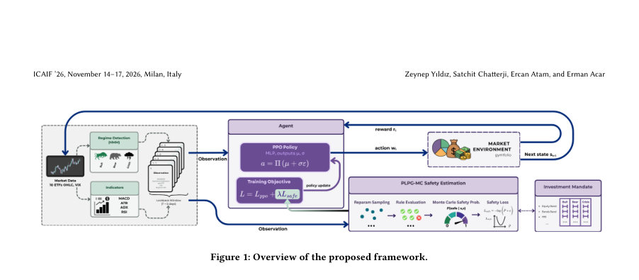
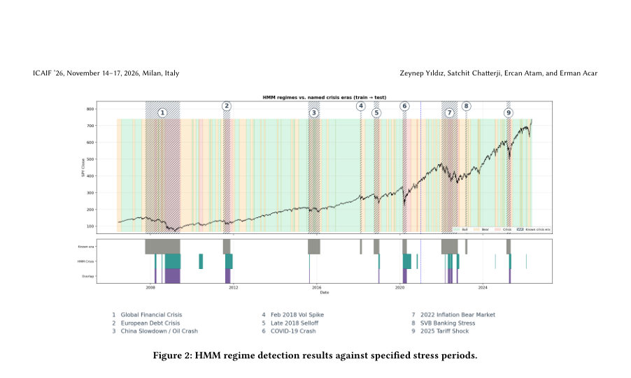
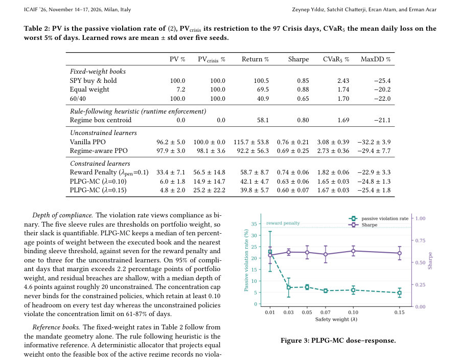

# Internalizing Investment Mandates: A Neurosymbolic RL Approach to Portfolio Allocation

- **게시일:** 2026-11-15
- **arXiv:** [2611.17329v1](http://arxiv.org/abs/2611.17329v1) · [PDF](https://arxiv.org/pdf/2611.17329v1)
- **저자:** Zeynep Yıldız, Satchit Chatterji, Ercan Atam, Erman Acar
- **분야:** cs.LG
- **선정 점수:** 4.43
- **선정 이유:** 최근성 0.5, 인용 영향 0.0 (인용 0회), 저자 영향 0.0 (최고 h-index 0), AI 주제 적합성 2.6, 개발자 관심 0.8, 학술 신호 0.6, 오픈 웨이트·주요 연구조직 신호 0.0

[← 2026-11-15 목록으로 돌아가기](../daily/2026-11-15.html)

<!-- paper-visuals:start -->
## 주요 Figure

> 원문 PDF에서 실제 Figure 캡션과 그림 영역이 함께 확인된 자료만 자동 추출했다.

*Figure · 원문 PDF 2쪽 · Figure 1: Overview of the proposed framework.*

*Figure · 원문 PDF 4쪽 · Figure 2: HMM regime detection results against specified stress periods.*

*Figure · 원문 PDF 6쪽 · Figure 3: PLPG-MC dose–response.*

<!-- paper-visuals:end -->

## 한 문장 요약

연속형 포트폴리오 할당에서 정책의 실행 행동이 투자 규정(레짐 조건 규칙)을 만족할 확률을 재매개화된 몬테카를로로 추정해 PPO 손실에 더하는 PLPG-MC라는 뉴로심벌릭 규제항을 도입해 사후 교정 없이 배포 시 규정 준수를 크게 개선한다.

## 해결하려는 문제

기관 투자 포트폴리오는 레짐(시장 상태)별로 적용되는 가중치 밴드 등 기호적 규정(투자 명세서)에 따라 운용되어야 하나, 기존의 심층 강화학습 에이전트는 수익 극대화를 목표로 하므로 규정 위반을 자주 발생시키며(예: 일일 단위의 hard constraint를 보장하지 못함), PLPG 같은 기존 뉴로심벌릭 방법은 이산 행동 공간을 전제로 하여 연속적 포트폴리오 할당 문제로 직접 확장되지 못한다. 연구 질문은 연속 행동 공간에서 정책이 스스로 실행한 행동이 규정을 만족할 확률을 미분가능하게 추정·학습시켜, 추론 시 추가적 교정 없이(런타임 실드 없이) 준수를 내재화할 수 있는가이다.

## 핵심 기여

- 연속 행동 공간에 적용되는 PLPG 영감의 안전성 목적함수(PLPG-MC)를 제안하여, 정책이 실제 실행하는 행동의 규정 만족 확률을 재매개화된 몬테카를로 샘플링으로 추정하고 이를 PPO 손실에 더함.
- 실제 실행되는 확률(P(safe | πθ, s))을 K=8개의 reparameterized 샘플로 추정하고, 규칙별 여유(slack)를 클리핑(m=0.02)하고 𝛽=50인 로지스틱으로 완화한 후 규칙들의 곱(로그합)으로 미분 가능한 안전 점수를 구성함.
- σ 경로의 안전성 그라디언트가 전체 탐색을 붕괴시키지 않도록 sigma-detach(stop-gradient)와 straight-through 클램프를 사용해 분산 축소 경로를 차단하는 설계를 제시함.
- 레짐-조건적(세 상태: Bull, Bear, Crisis) 6개 규칙으로 구성된 대표적 투자 명세서를 실험적으로 검증하고, PLPG-MC가 포리오폴리오의 규정 준수를 크게 개선함을 보임(배포 시 결정론적 평균행동에 대한 수동 감사 기준).
- 규정 기하(레짐별 안전집합의 겹침)가 정책의 레짐 민감성과 규정 준수에 미치는 영향을 분석하고, 규정 겹침(safe-harbor effect)이 레짐 의존적 재배분을 억제함을 보고함.

## 접근 방법

* 환경 · 관측 · 행동: gymfolio 기반의 일간 재조정 포트폴리오 환경을 사용하고, 10개 ETF(5주식: SPY, QQQ, IWM, XLF, XLE; 3채권: TLT, IEF, LQD; 2원자재: GLD, SLV)에 대해 원시 행동 a∈R10을 대각 가우시안 πθ(a\|s)=N(μθ(s), diag(σθ^2))으로 모델링한다.
* 실행 시 Π 연산으로 각 좌표를 [0,1]로 클램프하고 합으로 나누어 정규화하여 실행 가중치 w∈Δ9를 얻고, 규정(명세서)은 실행 가중치 w와 관찰된 레짐 z(s)로 판정된다.
* 레짐 검출: HMM(3상태, 두 성분 가우시안 혼합 방출)을 사용해 레짐 라벨(Bull, Bear, Crisis)을 전방 필터링으로 디코드하고(one-hot으로 관측에 포함), 디코드된 라벨만 정책에 공급한다.
* 규칙 처리: 규칙별로 측정값 g_r(w)를 정의하고, 임계값 τ_r(z)에 대해 슬랙 slack_r(w,z)=τ−g 또는 g−τ로 정의한 뒤 슬랙을 margin m=0.02로 클리핑(slack_eff)하고 𝛽=50인 시그모이드로 완화하여 규칙별 안전 확률 P_r∝sigm(𝛽 slack_eff_r)로 만든다.
* 전체 안전성은 규칙들의 곱의 로그(log P(safe\|w,z))로 표현된다.
* 연속행동 처치: 정책의 실제 실행 행동이 안전할 확률 P_πθ(safe\|s)=E_{ε∼N(0,I)}[P(safe\|Π(μθ(s)+σθ⊙ε), z)]을 K개의 재매개화 샘플 w_k=Π(μθ(s)+σθ⊙ε_k)으로 몬테카를로 추정(bP(s)=1/K Σ_k P(safe\|w_k,z), K=8).
* σθ에 대한 안전 그라디언트는 stop-gradient로 차단하여(σ-detach) 분산 축소로 인한 탐색 붕괴를 방지하고, 클램프는 straight-through 기법으로 처리한다.
* 안전 손실은 L_safe(s)=−log bP(s)로 정의하고, 최종 학습 목표는 PPO 손실 LPPO(θ)에 λ L_safe(θ)을 더한 L(θ)=LPPO(θ)+λ L_safe(θ)다.
* 배포·평가: 학습된 정책은 결정론적 평균 μθ를 통해 w_t=Π(μθ(s_t))로 실행되고(런타임 교정 없음), 수동 감사(passive audit)로 PV(%) = 100*(# 위반 일수 / T_test) 등으로 측정한다.

## 주요 결과

- 데이터 및 평가: 일간 데이터 2005-06-01∼2026-05-11 중 학습은 2005-06-01∼2020-12-31, 테스트(배포 감사)는 2021-01∼2026-05; 에피소드 길이 63일, 관측 윈도우 6일(6×44 피처), 학습 예산 1.5×10^6 스텝, 5개 시드 {0,42,67,123,420} 평균·표준편차 보고.
- 주요 준수 결과(PV, 결정론적 배포 평균행동에 대한 수동 감사): 무제약 학습(준비된 PPO)들은 PV 96.2±5.0% 및 97.9±3.0%로 사실상 매일 위반; 보상 패널티(λ_pen=0.1)는 PV 33.4±7.1%; PLPG-MC는 λ=0.10에서 PV 6.0±1.8% 및 λ=0.15에서 PV 4.8±2.0%로 크게 개선(표 2).
- 수익·위험 지표(테스트 기간 전체 누적 반환·Sharpe·CVaR5·MaxDD): Vanilla PPO 115.7±53.8% 반환, Sharpe 0.76±0.21, CVaR5 3.08±0.39%, MaxDD −32.2±3.9%; Regime-aware PPO 반환 92.2±56.3%, Sharpe 0.69±0.25, CVaR5 2.73±0.36%; Reward Penalty 반환 58.7±8.7%, Sharpe 0.74±0.06, CVaR5 1.82±0.06%; PLPG-MC(λ=0.10) 반환 42.1±4.7%, Sharpe 0.63±0.06, CVaR5 1.65±0.03%, MaxDD −24.8±1.3%; PLPG-MC(λ=0.15) 반환 39.8±5.7%, Sharpe 0.60±0.07, CVaR5 1.67±0.03%, MaxDD −25.4±1.8% (Table 2).
- 준수의 깊이 및 특성: PLPG-MC는 규정에 안전 영역 여유를 더 두며(실행 책의 바인딩 임계값까지 중앙값 약 10 퍼센트포인트 거리, 보상 패널티 약 7pp, 무제약 1–3pp), 집중도(HHI) 규칙은 제약된 정책에서 거의 바인딩되지 않음(PLPG-MC는 모든 테스트 일자에서 최소 0.10의 헤드룸 유지).
- 레짐별 잔여 위반: 잔여 위반은 주로 Crisis(위험) 상태에 집중되며 Crisis의 경우 주로 주식(Max equity) 캡 위반에 귀속됨; 레짐 전환 초반(첫 3일) 위반율이 안정시보다 크게 높아 탐지기 지연이 전체 Crisis 잔여의 약 1/3을 차지함(본문 수치 예: Bull 진입 시 22.3% vs 안정 7.5%, Crisis 진입 25.6% vs 안정 12.4%).

## 한계

- 저자 언급: 제안한 목적함수는 시그모이드 완화(𝛽=50)와 몬테카를로 로그의 조합을 사용하므로 Jensen 불평등으로 인한 편향(몬테카를로 로그가 아래쪽으로 편향)을 가지며, PLPG의 이산적 정식화에서 얻는 목적함수 등가성·수렴보장은 연속 확장에서는 유지되지 않음.
- 저자 언급: 잔여 위반이 약 4.8%에서 멈추며 그 중 약 1/3은 HMM 기반 레짐 검출기의 지연(전이 초반 집중된 위반)으로 설명되며, 나머지는 위기(Crisis) 권역 책에서의 내부화 미흡으로 남음.
- 저자 언급: 탐색·분산 문제 — 학습에서 엔트로피 항으로 로그표준편차가 약 σθ≈1.5에 머물러 실행 행동이 노이즈 지배적이므로(탐색 우선) μθ에 대한 수익 그라디언트가 약화되어 슬리브(안전구간) 내부에서 평균이 충분히 분화되지 못함. 또한 확률적 샘플링은 높은 엔트로피에서 위반을 증가시키기 때문에 보장된 것은 결정론적 탐욕 정책(평균 행동)임.
- 저자 언급: 실험 범위의 한계 — 단일 자산 우주(10개 ETF), 단일(디자인된) 명세서, 단일 테스트 윈도우를 사용하고, 거래비용·슬리피지·마켓임팩트를 0으로 설정했으므로 절대 수익 수치는 낙관적이며 본 연구는 규정 내재화 가능성에 집중함(프로덕션 준비 전략 아님).

## 개발자 관점

- 재현을 위한 핵심 하이퍼·구성: 행동 머리는 원시 R10에 대해 대각가우시안 πθ(μθ(s), σθ); 실행 연산 Π는 각 좌표를 [0,1]로 클램프 후 합으로 정규화하여 w∈Δ9를 얻음; σθ의 그라디언트는 안전 항에서 stop-gradient로 차단(sigma-detach); 클램프에는 straight-through 그래디언트를 통과시킴.
- 안전성 추정 설정: K=8 샘플, 𝛽=50(시그모이드 온도), margin m=0.02; 안전 손실 L_safe(s)=−log(1/K Σ_k P(safe|w_k,z)); 최종 목표 L=LPPO+λ L_safe(θ)이며 λ의 도즈-반응에서 λ≥0.05 근처부터 PV가 플래토에 안착하고 논문은 λ=0.15를 운영점으로 사용함.
- 학습·PPO 설정(재현용): 학습 예산 1.5×10^6 스텝, MLP 정책, lr=1e-4, 2048 스텝/롤아웃, 배치 256, 10 에포크/업데이트, γ=0.99, GAE λ=0.95, 클립 0.2, 엔트로피 계수 0.01, 시드 5개(0,42,67,123,420).
- 배포·감사 관행: 정책 평가는 결정론적 평균 μθ로 실행된 w_t=Π(μθ(s_t))에 대해 수행(런타임 교정 없음). 프로덕션에서는 런타임 실드가 여전히 필수이나 PLPG-MC는 기본 정책이 규정을 더 잘 지키도록 하여 실드의 빈도·왜곡을 줄여준다.
- 디자인/배포 권장사항: (i) 레짐별 안전집합 교차 여부를 사전 점검하여 'safe-harbor'에 의한 레짐 무감응을 방지할 것, (ii) 레짐 검출기의 지연이 잔여 위반에 기여하므로 더 빠른/견고한 레짐 추론(또는 posterior를 관측에 포함) 도입을 고려할 것, (iii) 거래비용·슬리피지를 포함한 실험을 통해 실제 수익·회전비용 트레이드오프를 검증할 것, (iv) 규정 임계값을 상태의 함수로 만들거나 CVaR 같은 분포적 규제를 도입하면 확장 가능성 있음(본문에서 제안된 확장).

**근거 범위:** 이 분석은 제공된 논문 PDF 본문(페이지 1–9)의 텍스트를 근거로 작성되었으며, 표(예: Table 1, Table 2)와 본문 서술의 수치를 그대로 인용하였습니다. 구현의 세부 저수준(예: 네트워크 층 구성의 정확한 크기 등)이나 PDF에 명시되지 않은 추가 실험 세팅은 재구성하지 않았습니다.
