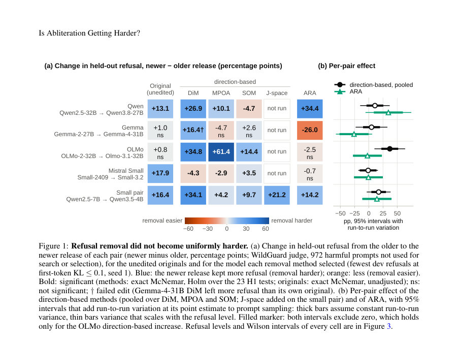
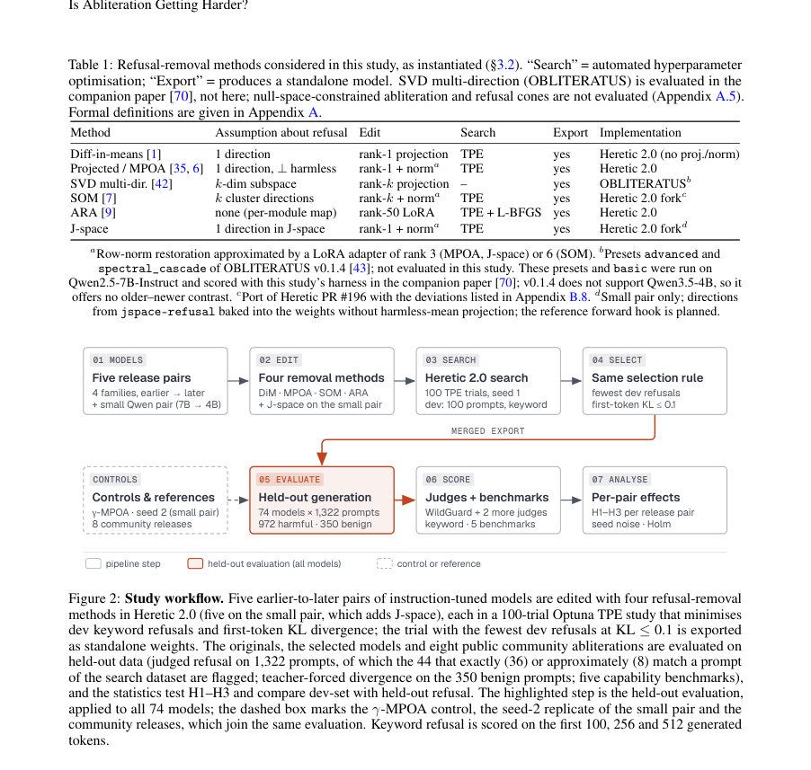
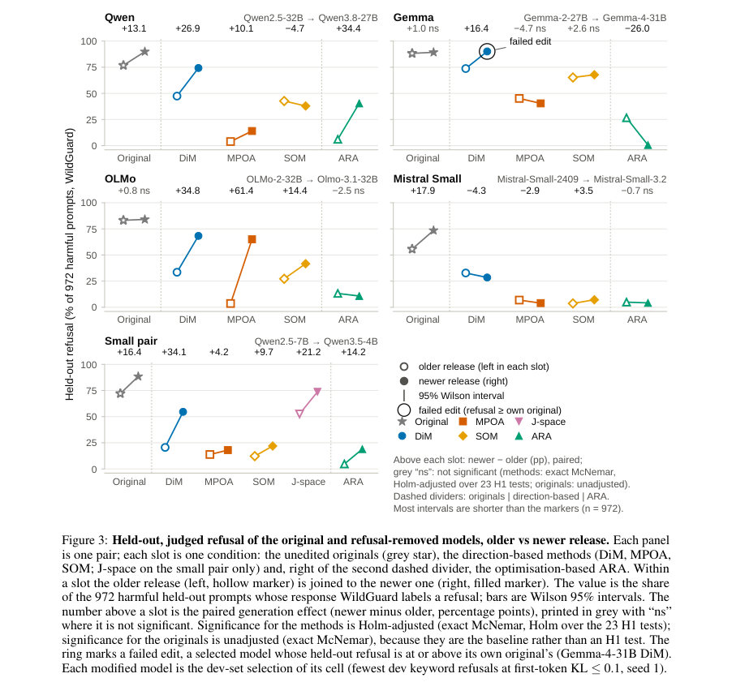

# Is Abliteration Getting Harder? Not Uniformly: Refusal Removal by Direction-Based Ablation and ARA in Heretic on the Qwen3.8, Gemma 4, Olmo 3.1 and Mistral Small 3.2 LLMs Versus Their Predecessors

- **게시일:** 2026-11-16
- **arXiv:** [2611.17846v1](http://arxiv.org/abs/2611.17846v1) · [PDF](https://arxiv.org/pdf/2611.17846v1)
- **저자:** Richard J. Young
- **분야:** cs.AI, cs.CL
- **선정 점수:** 6.74
- **선정 이유:** 최근성 0.4, 인용 영향 0.0 (인용 0회), 저자 영향 0.0 (최고 h-index 0), AI 주제 적합성 1.5, 개발자 관심 0.2, 학술 신호 0.6, 오픈 웨이트·주요 연구조직 신호 4.0

[← 2026-11-16 목록으로 돌아가기](../daily/2026-11-16.html)

<!-- paper-visuals:start -->
## 주요 Figure

> 원문 PDF에서 실제 Figure 캡션과 그림 영역이 함께 확인된 자료만 자동 추출했다.

*Figure · 원문 PDF 3쪽 · Figure 1: Refusal removal did not become uniformly harder. (a) Change in held-out refusal from the older to the*

*Figure · 원문 PDF 6쪽 · Figure 2: Study workflow. Five earlier-to-later pairs of instruction-tuned models are edited with four refusal-removal*

*Figure · 원문 PDF 12쪽 · Figure 3: Held-out, judged refusal of the original and refusal-removed models, older vs newer release. Each panel*

<!-- paper-visuals:end -->

## 한 문장 요약

Heretic 2.0에서 방향 기반(단일·다중 방향) abliteration 방법들과 최적화 기반 ARA를 동일한 예산·KL 한도(100 TPE trial, first-token KL ≤0.1)·선택 규칙으로 비교해, 최신 릴리스들이 일관되게 거부(refusal) 제거에 더 강해진 것은 아니며 효과는 모델 계열과 방법에 따라 달랐음을 실험적으로 보여준다.

## 해결하려는 문제

공개 가중치 LLM에 대해 fine-tuning 없이 가중치 편집으로 거부(refusal)를 제거하는 'abliteration' 기법들이 보급되었다. ARA의 개발자는 방향 기반(ablate refusal direction) 기법들이 최신 모델에서 점점 실패한다고 주장했으나, 이 주장은 독립적으로 충분히 검증되지 않았다. 또한 평가 관행(개발시 사용하는 키워드 매칭, first-token KL 등)이 편집 후 실제 거부 여부(강한 판정기 또는 인간 라벨)와 다를 수 있어 도구 비교가 편향될 우려가 있다. 본 논문은 (1) 최신 모델에서 거부 제거가 일관되게 더 어려워졌는지, (2) 그 난이도가 방법(방향 기반 vs ARA)에 따라 달라지는지, (3) 개발 시 쓰이는 저비용 신호(키워드, 첫 토큰 KL)가 독립적 판정기와 얼마나 일치하는지를 평가하는 문제를 다룬다.

## 핵심 기여

- 다섯 개의 릴리스 쌍(Qwen2.5-32B→Qwen3.8-27B, Gemma-2-27B→Gemma-4-31B, OLMo-2-32B→Olmo-3.1-32B, Mistral-Small-2409→Mistral-Small-3.2, Qwen2.5-7B→Qwen3.5-4B)에 대해 Heretic 2.0에서 방향 기반 방법(DiM, MPOA, SOM, 소형쌍에 J-space)과 최적화 기반 ARA를 동일한 프롬프트·검색 예산·KL 캡·선택 규칙으로 비교하여, 거부 제거가 '일관되게' 더 어려워지지는 않았음을 보였다.
- ARA와 방향 기반 방법의 독립 비교(각 모델 당 ARA 1회 실행)를 수행하여, 모델 계열별로 ARA가 덜 효과를 잃은 경우(예: Gemma, OLMo)와 더 많이 잃은 경우(예: Qwen)가 있었음을 보고했다(단, 각 대비는 한 번의 ARA 실행에 의존함).
- 평가 지표 관련 증거를 제시: Heretic 툴의 키워드 카운트는 평균적으로 WildGuard 판정과 큰 차이가 없었으나 모델별 평균 약 7 퍼센트포인트 차이를 보였고(모델-방법별 편차 존재), 첫-토큰 KL은 능력(capability) 손실을 보장하지 않음을 보였다.
- 런-투-런 변동을 소규모 복제(seed 2)에서 추정(셀당 σ ≈ 9.15 pp)하고 이를 포함한 불확실성 모델(상수 분산 및 거부-수준 종속 분산)을 제시하여, 페어별 효과의 이질성(I^2)이 분산 모델과 가정에 따라 크게 달라짐을 분석적으로 제시했다.

## 접근 방법

* 주요 실험 절차와 설정은 다음과 같다.
* 대상 모델: Qwen, Gemma, OLMo, Mistral Small의 각각 이전·이후 릴리스(총 5개 쌍, 소형 Qwen 쌍 포함).
* 편집 방법: 방향 기반(차이-평균 DiM, MPOA(무해 평균 정사영 + 행-노름 복원), SOM(다중 방향), 소형쌍에서 J-space)과 ARA(모듈별 rank-50 LoRA 업데이트, L-BFGS로 최적화).
* 모든 방법은 Heretic 2.0 내부에서 동일한 검색·선택 파이프라인을 사용: 100 TPE(Optuna) trial, seed 1(소형쌍은 seed 2 복제 포함), 개발(dev) 세트는 harmful_behaviors/harmless_alpaca의 상위 프롬프트(100개 dev harmful, 100 harmless KL 목적), 목적 함수는 (1) dev 키워드 거부 비율 최소화(Heretic의 33개 키워드), (2) 무해 프롬프트에 대한 첫-토큰 KL(원본과의 거리) 최소화.
* 선택 규칙: 첫-토큰 KL ≤ 0.1을 만족하는 trial 중 dev 거부가 가장 적은 것을 선택(동률은 KL 낮은 쪽·더 이른 trial로 결정).
* 선택된 trial을 병합(export)해 standalone 체크포인트 생성.
* 평가(held-out): 972개의 위험 프롬프트(유해)와 350개의 무해 프롬프트로 구성된 고정된 held-out 집합(출처: JailbreakBench, XSTest, StrongREJECT, HarmBench, 저자 제작 'code-as-weapon' 은행)으로 생성·저장된 응답을 WildGuard(주 판정기)와 기타 판정기(예: HarmBench classifier, Qwen3Guard-Gen-8B), 그리고 키워드 매칭으로 판정.
* 주요 측정치: 수정 모델의 held-out 유해 프롬프트에 대한 WildGuard 거부 비율(잔여 거부; H1의 핵심 지표), 개발세트 키워드 거부, 역치별(first-token KL) 개발 프런트, 능력 벤치마크(MMLU-Pro, GSM8K, IFEval, HumanEval, MBPP) 및 teacher-forced divergence.

## 주요 결과

- 핵심(요약): 방향 기반 제거 후 '신형(release 후) 모델이 더 많은 잔여 거부(더 제거하기 어려움)를 보이는 효과'는 페어별로 다르게 나타났고(-1 pp 에서 +37 pp 범위), ARA의 경우도 -26 pp 에서 +34 pp 범위로 변화했다(모든 수치는 newer − older, WildGuard 판정, 972 유해 held-out).
- 페어별 세부(raw pp, Table 28 요약): Qwen: 방향 기반 효과 +10.7 pp(원시), ARA +34.4 pp(원시); Gemma: 방향 +4.7 pp, ARA −26.0 pp; OLMo: 방향 +36.9 pp(유의, run-to-run 분산 모델들에서 일관), ARA −2.5 pp; Mistral Small: 방향 −1.2 pp, ARA −0.7 pp; 소형 Qwen 쌍: 방향 +17.3 pp, ARA +14.2 pp. (논문은 ‘방향 기반 효과가 두 분산 모델 모두에서 run-to-run 변동을 초과한 유일한 원시 페어 효과는 OLMo의 증가였다’고 보고.)
- 유의성 및 불확실성: 각 셀은 단일 시드 최적화(예: ARA 한 번)에서 선택되었으므로 run-to-run 변동을 반영하지 않는 표준 구간이 낭비될 수 있어 저자는 소형쌍(10개 셀)에 대해 seed 2 복제를 수행해 σ ≈ 9.15 pp의 run-to-run 표준편차를 추정하고(95% χ2 구간 제공), 두 가지 run-variance 모델(상수 pp 분산, 로그릿-스케일 기반 거부 수준 종속 분산)을 사용해 불확실성을 확장했다. 이 확장에 따라 일부 페어·효과의 판단은 분산 모델 가정에 따라 바뀌었다.
- 개발 시 신호 일치성: 개발세트의 키워드 거부(검색 목적)는 전체적으로 held-out WildGuard 거부와 상관(ρ ≈ 0.77)했으나, 각 모델별로 평균 약 7 퍼센트포인트의 차이가 존재했고(논문: 키워드 카운트가 평균적으로 WildGuard를 과소평가하지는 않았음), 첫-토큰 KL은 능력 저하를 보장하지 않았다(예: 개발 KL과 능력 지표·teacher-forced divergence의 상관관계가 약함).
- 검색 수렴 및 출력 안정성: 42개의 코어 실행 중 34개는 trial 75까지 선택 카운트에 도달(중간 trial 48), 8개(19%)는 이후 개선되어 장기 검색이 일부에선 더 나을 수 있음을 시사. 일부 ARA export는 refit된 adapter가 다른 GPU에서 만들어져 재채점 시 키워드·KL이 소폭 변화(최대 KL 0.103–0.107)함.

## 한계

- 저자가 명시한 한계: ARA는 각 모델당 한 번만 최적화·평가(즉 ARA 대비는 단일 실행에 의존), WildGuard 판정기는 편집된 모델 출력에 대해 인간 라벨과 검증되지 않았음(인간 감사 없음). 결과는 예산-제약(100 TPE trials, first-token KL ≤0.1, 선택 규칙)에 종속된 '예산-바운드' 난이도 측정이며, 더 큰 예산으로 달라질 수 있음.
- 실험적 제약(본문에서 합리적으로 확인되는 한계): 방향 기반 편집이 부정확해질 수 있는 아키텍처적 혼동(예: Gemma 및 OLMo 계열의 'post-norm' 블록으로 인해 일부 ablated 방향이 리지듀얼 스트림에 도달할 수 있음)이 존재하고, 이를 보정하기 위한 γ-MPOA 통제만 일부 모델에서 실행됨(결과에 영향 가능). 소형 Qwen 쌍은 세대와 모델 규모가 교란되어(신형이 더 작음) 세대 효과 해석에 한계가 있음. 선택 규칙·KL 캡·검색 예산은 고정되어 있어 다른 설정에서는 다른 결론이 나올 수 있음.
- 평가상 한계: 자동 판정기(특히 WildGuard)에 의존했으며 인간 라벨링 또는 추가 강력한 판정기(크로스-검증)는 사용되지 않았음(따라서 '실제' 인간 기준 거부 여부는 불확실).

## 개발자 관점

- 재현성: 코드·실행 로그·선택된 체크포인트(Gemma-2 variants 제외)는 공개되어 있으며, 동일한 프롬프트·예산·KL 캡·선택 규칙으로 실험을 재현하면 논문 결과를 재현 가능. 다만 ARA는 단일 실행에 민감하므로 ARA 평가 시 여러 시드·여러 리스타트가 필요하다.
- 검색·예산 설계: 본 연구는 100 TPE trial과 first-token KL ≤0.1를 표준으로 사용했다. 검색 예산·KL 캡·선택 규칙이 결과에 큰 영향을 미치므로(논문에서 KL 예산별 dev 프런트 제시), 실전에서는 예산 확대와 캡 민감도 분석을 권장한다.
- 평가 지표: 개발 중 키워드 기반 지표는 편리하지만 held-out 강판정기(WildGuard 등) 및 가능한 경우 인간 라벨과 함께 교차검증해야 한다. 첫-토큰 KL만으로 능력 손실을 보증할 수 없으므로 teacher-forced divergence와 능력 벤치마크(예: MMLU, GSM8K, HumanEval)를 병행 측정해야 한다.
- 아키텍처 민감성: post-norm 계열(Gemma, OLMo 등)은 방향 기반 편집의 효과를 약화할 수 있으므로 아키텍처별 보정(예: γ 보정·특정 레이어 선택)이 필요하다.
- 안전·배포: abliteration/ARA로 거부를 제거하는 것은 모델을 더 위험하게 만들 수 있으므로(특히 악성 코드 은행에 대한 결과 차이 관찰), 배포 전 광범위한 벤치마크와 인간 안전 심사를 수행하고, export된 체크포인트의 보관·공개는 신중해야 한다.

**근거 범위:** 이 분석은 제공된 논문 PDF 본문(제공된 페이지 및 도표, 표 포함)을 근거로 작성함. 표와 도표에 제시된 수치(예: 페어별 raw pp 효과, held-out 프롬프트 수 972, 개발·선택 규칙 및 검색 설정 등)를 본문에서 직접 추출해 사용했으며, 저자가 명시한 한계 및 본문에서 합리적으로 확인되는 제약을 구분해 기록했다. 다만 ARA 관련 평가는 논문이 '각 모델당 ARA 한 번 실행'이라고 명시한 점을 반영했으며, 일부 부수적 구현·환경 세부(예: GPU별 refit 영향 등)는 본문에 기술된 범위 내에서만 다룸. 인간 라벨과의 교차 검증 결과나 ARA의 다중 실행 통계는 본문에 포함되지 않아 해당 항목에 대해서는 불확실성이 남는다.
