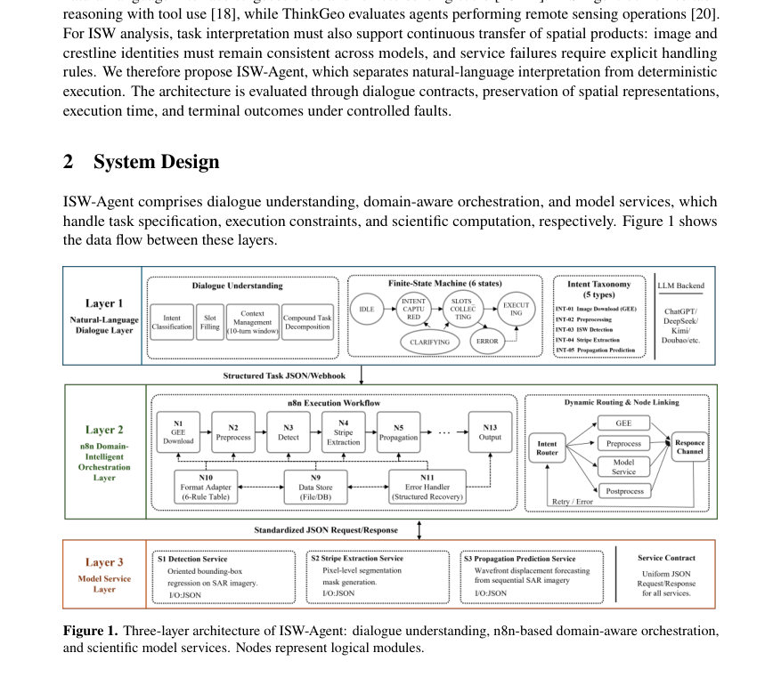
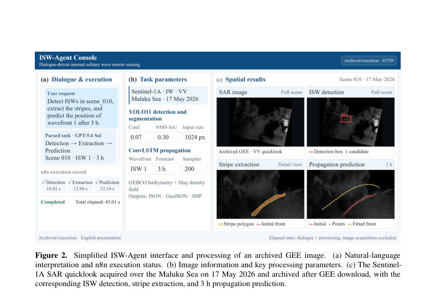
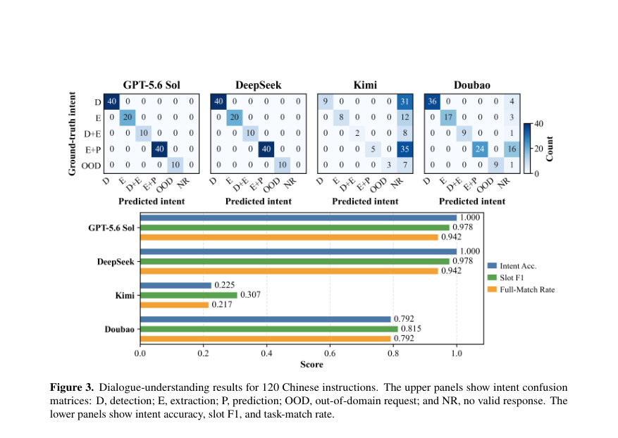

# ISW-Agent: Integrating LLM-Driven Dialogue with n8n Workflow for Internal Solitary Wave Remote Sensing Image Processing

- **게시일:** 2026-10-16
- **arXiv:** [2610.21502v1](http://arxiv.org/abs/2610.21502v1) · [PDF](https://arxiv.org/pdf/2610.21502v1)
- **저자:** Hao Zhang, Hengrui Liu, Lina Sun, Junmin Meng
- **분야:** cs.AI
- **선정 점수:** 6.21
- **선정 이유:** 최근성 1.1, 인용 영향 0.0 (인용 0회), 저자 영향 0.0 (최고 h-index 0), AI 주제 적합성 3.0, 개발자 관심 0.2, 학술 신호 0.3, 오픈 웨이트·주요 연구조직 신호 1.6

[← 2026-10-16 목록으로 돌아가기](../daily/2026-10-16.html)

<!-- paper-visuals:start -->
## 주요 Figure

> 원문 PDF에서 실제 Figure 캡션과 그림 영역이 함께 확인된 자료만 자동 추출했다.

*Figure · 원문 PDF 2쪽 · Figure 1. Three-layer architecture of ISW-Agent: dialogue understanding, n8n-based domain-aware orchestration,*

*Figure · 원문 PDF 5쪽 · Figure 2. Simplified ISW-Agent interface and processing of an archived GEE image.*

*Figure · 원문 PDF 6쪽 · Figure 3. Dialogue-understanding results for 120 Chinese instructions. The upper panels show intent confusion*

<!-- paper-visuals:end -->

## 한 문장 요약

자연어 지시를 LLM으로 해석하고 n8n 워크플로우와 과학적 모델(탐지, 스트라이프 추출, ConvLSTM 기반 전파 예측)로 연결해 내부 고유파(ISW) 원격탐사 이미지부터 예측까지 연속 처리하는 ISW-Agent 아키텍처를 제안하고 평가한다.

## 해결하려는 문제

ISW 원격탐사 파이프라인은 영상 취득, 탐지, 스트라이프 추출, 전파 예측으로 나뉘어 있으며 각 단계 간 입력·출력 형식, 좌표 참조, 파라미터 전달이 불일치해 수동 데이터 전송과 추가 전처리·검증이 필요하다. 기존 워크플로우 플랫폼은 자연어 작업 지정과 도메인 규칙 처리가 제한적이며, LLM 기반 해석 결과를 결정적 실행과 일관된 공간 표현으로 연속 이관하는 방법이 부족하다.

## 핵심 기여

- LLM(중국어 프롬프트)로부터 명시적 작업 계약 τ = (I, S, D, P, O)를 생성해 의도·공간·데이터·모델 파라미터·출력 요구를 구조화하고, 이를 n8n 기반 라우팅과 중앙 컨트롤러로 결정적 실행에 연결한 ISW-Agent 아키텍처를 제안했다.
- 도메인 인식 오케스트레이션을 도입해 GEE 이미지 아이덴티티와 좌표계 일관성, 형상·파일 가독성 검사 등 단계별 출력 검증을 수행하고, 서비스 장애에 대해 최대 3회 재시도를 적용해 일시적 오류를 복구하도록 설계했다.
- 모델 서비스 캡슐화를 통해 단일 YOLO11n-seg 네트워크로 탐지와 스트라이프 분할을 수행하고, 스트라이프를 전처리(전수 픽셀 벡터화, 스켈레톤화, 주경로 추출, 200점 재표본화)하여 ConvLSTM(2층, 64 은닉 채널) 기반 점단위 전파속도·방위 예측기로 이어지게 구현했다.
- 대화 이해, 공간 충실도(마스크→벡터 변환의 IoU), 워크플로우 실행시간(50장 장면의 중앙값 48.04 s) 및 제어된 결함 주입(3,408회) 실험으로 시스템 거동을 정량적으로 평가했다.
- 결함 분리(ablation)를 통해 재시도가 일시적 서비스 장애 234건을 복구했고 출력 검증이 구조적 결함 234건을 거부했으며, 그러나 소스 이미지 불일치나 누락 피처 같은 콘텐츠 결함 61건은 검출하지 못함을 보여 후속 검증 필요성을 규정했다.

## 접근 방법

* 구성요소: (1) 대화 이해 계층: OpenAI 호환 LLM(GPT-5.6 Sol 등)에 단일 중국어 프롬프트를 사용해 자연어 요청을 작업 계약 τ=(I,S,D,P,O)로 변환하고, 실행 가능/명확화 필요/거부로 분류한다.
* (2) 도메인 인식 오케스트레이션( n8n + 중앙 컨트롤러): Webhook으로 요청을 받고 컨트롤러가 자산 레지스트리에서 D를 보충하고 P·O를 고정 구성에서 제공하며, 단계별 종속성·입력 가용성·출력 검증(파일 가독성, 가역 아핀 변환, WGS84 CRS, 지오메트리 유효성, 피처 수 일치 등)을 검사한다.
* 서비스 오류(429,503,타임아웃)는 최대 3회 재시도(대기시간 증가)로 복구를 시도하고, 각 서비스 호출은 300 s 데드라인을 둔다.
* (3) 모델 서비스: YOLO11n-seg(Conv, C3k2, SPPF, C2PSA 결합, 다중 스케일)로 박스·이진 마스크 생성(inference size 1024, confidence 0.07, NMS IoU 0.30 기본).
* 마스크는 전수 픽셀 벡터화로 유효 폴리곤 생성, 스켈레톤화·주경로 추출로 크레스트라인을 얻어 200점으로 재표본화.
* 각 점은 (lon, lat, depth, p1, p2) 특징을 가지며, 두 층 ConvLSTM(64 채널)로 인접 점 관계를 모델링해 점별 속도 v_i와 방위 θ_i를 출력한다.
* 구면 변위 연산 G로 Δt 후 좌표를 계산하고, 10 km 해안 제외·참조점 대비 40 km 거리 제약·유효점 가중 스플라인 후처리로 예측 전면을 생성한다.

## 주요 결과

- 대화 이해: 120개 중국어 지시(12 카테고리)를 모든 백엔드에 동일 프롬프트로 제출. GPT-5.6 Sol과 DeepSeek은 각 120 유효 응답을 반환했고 의도·실행 결정은 모두 정답과 일치, 엄격한 작업 일치(strict task-match) 113/120 = 94.2%, 슬롯 마이크로 평균 F1 = 0.978. Kimi와 Doubao는 각각 27/120, 95/120 유효 응답(주로 rate-limit·접근거부·타임아웃)이며, 유효 응답 내 strict match는 26/27과 95/95.
- 공간 충실도: 21개 분할 마스크(12장면)를 전수 픽셀 벡터화→래스터화하여 IoU 측정한 결과, 전수 픽셀 벡터화는 모든 21개에서 IoU = 1(원본 마스크 범위 보존). 기본 도출(최대 160 정점 샘플)에서는 14개 유효하지 않은 폴리곤과 중앙값 IoU 0.682를 보였음.
- 임계치 민감도(108회 추론): NMS IoU=0.30에서 confidence 0.07→0.25로 증가 시 전체 후보 수가 21→5로 감소(표 3). NMS 증가 시 후보 유지가 늘어남.
- 엔드투엔드 실행시간(50 Sentinel-1 장면, 다운로드된 이미지 기준, 언어 해석·온라인 다운로드 제외): 39장면이 탐지·추출·3h 예측 완료, 중앙값 총처리시간 48.04 s(IQR 47.08–49.92 s). 각 단계 중앙값 시간: 탐지 20.10 s, 추출 14.16 s, 예측 13.41 s. 나머지 11장은 빈 추출로 조기종료(중앙값 37.94 s).
- 결함 주입(852 조건×4 설정 = 3,408 n8n 실행): 전이적 장애(234건)는 제한된 재시도로 모두 복구되었고, 구조적 결함 234건은 출력 검증으로 모두 거부되었음. 출력 검증 제거 시 구조적 결함이 수용되어 오류 수용이 61→295로 증가. 그러나 콘텐츠 결함(39개의 잘못된 장면 출력 + 22개의 피처 누락, 총 61건)은 네 구성 모두에서 검출되지 않았음(파일·지오메트리 검사로는 검출 불가).

## 한계

- 저자가 명시한 한계: (1) 탐지·스트라이프 추출은 기존 YOLO11 모델을 재사용했으며 정확도와 지역간 전이성은 완전한 학습기록과 독립 지역 어노테이션으로 추가 평가가 필요하다. (2) 120개 테스트 지시는 사전정의 규칙으로 생성되어 실제 사용자의 다양성, 장기 대화, 복합 작업을 충분히 대표하지 못하므로 독립 사용자 과제가 필요하다. (3) 워크플로우 성능 평가는 말루쿠 해역 이미지, 직렬 타이밍, 제어된 결함 실험 중심으로 수행되었으며 지역별·동시 사용자·장기 운영 성능은 추가 정량화가 필요하다.
- 본문 실험범위에서 드러나는 제약(합리적 확인): (a) 평가 데이터는 단일 지역(말루쿠 해역, 50장면)과 Sentinel-1 IW VV에 한정되어 있어 다른 해역·센서·편파 조건으로의 일반화가 제한된다. (b) 시스템은 콘텐츠 수준(출처 일치, 예상 피처 집합)의 불일치에 대한 검증을 포함하지 않아 잘못된 소스나 누락 피처를 탐지하지 못한다(테스트에서 61건 미검출). (c) 탐지·추출 서비스가 각 호출마다 별도 프로세스로 가중치 로딩·이미지 읽기를 수행해 레이턴시가 커지므로 실시간·대량 동시 처리에는 최적화 필요.

## 개발자 관점

- 대화 해석과 결정적 실행을 분리하고 중앙 컨트롤러로 파라미터 보완·검증·재시도를 관리하면 LLM의 자유로운 응답을 워크플로우 요구사항에 맞게 제약할 수 있다.
- 출력 검증(파일 가독성, CRS/아핀 변환 가역성, 지오메트리 유효성, 피처 수 일치 등)은 구조적 결함을 차단하는 데 필수적이며, 특히 마스크→벡터 변환 시 전수 픽셀 기반 벡터화가 영역 보존에 중요하다.
- 일시적 서비스 오류(HTTP 429/503, 타임아웃)는 제한된 재시도(최대 3회)로 상당 부분 복구되므로 재시도 메커니즘을 포함해야 연속성 향상에 효과적이다.
- 레이턴시 최적화를 위해 모델 가중치 로딩·이미지 접근을 호출당 반복하지 않도록 프로세스 재사용·배치화·메모리 캐싱을 고려해야 하며, 하드웨어(예: NVIDIA RTX 4080 SUPER)와 소프트웨어(n8n, Ultralytics, PyTorch 버전) 구성은 성능에 영향을 준다.
- 워크플로우에 소스-이미지 아이덴티티 확인과 예상 피처 집합 검증(예: 원본 이미지 해시·메타데이터 비교, 피처 이름·수 검증)을 추가해야 콘텐츠 수준의 오류(잘못된 장면, 피처 누락)를 탐지할 수 있다.

**근거 범위:** 이 분석은 제공된 논문 PDF 본문(페이지 1–12)의 텍스트에만 근거해 작성되었다. 모든 수치(예: 120 지시, 엄격 일치 94.2%, 슬롯 F1 0.978, 50 장면 중 39 완료, 중앙값 48.04 s, 3,408 결함 실행, 재시도로 복구된 234건, 검증으로 거부된 234건, 미검출된 콘텐츠 오류 61건 등)는 본문에서 직접 보고된 값이다. PDF에 없는 구현·학습 세부사항(예: 학습 데이터 크기, 학습 하이퍼파라미터 등)은 추정하지 않았다.
