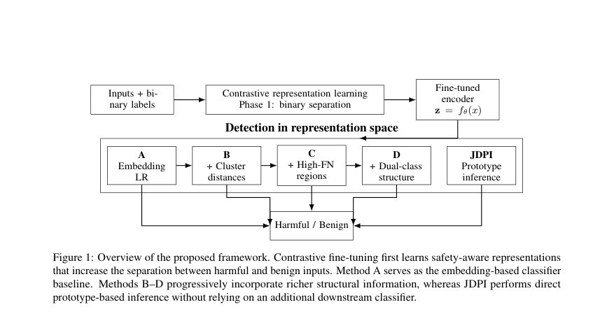
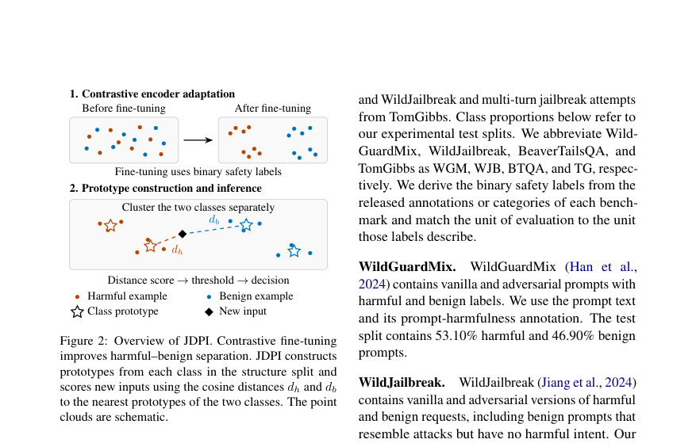
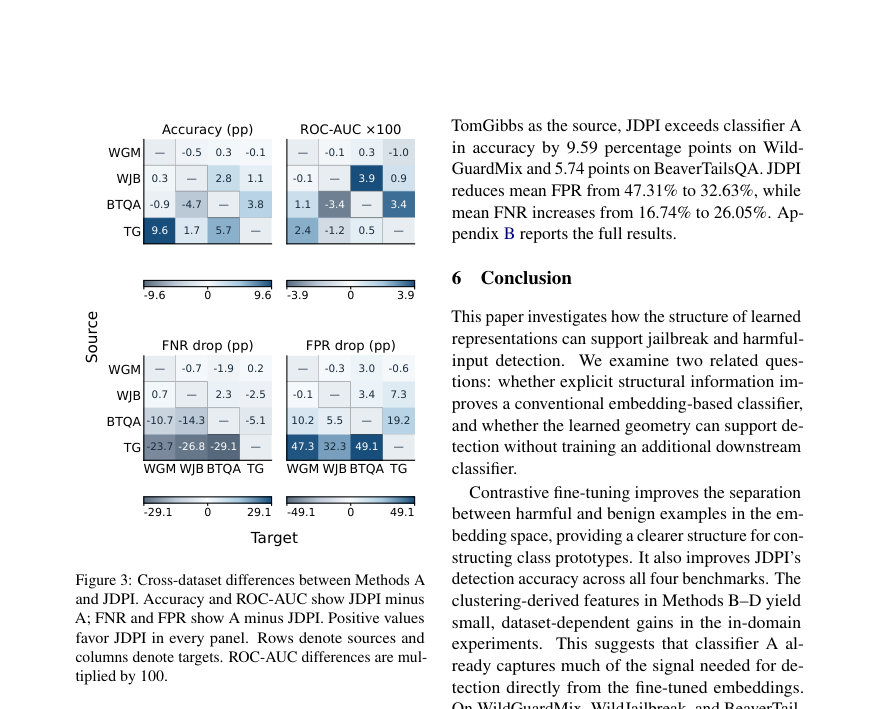

# Jailbreak Detection on Large Language Models via Contrastive Prototype Structures

- **게시일:** 2026-11-19
- **arXiv:** [2611.24936v1](http://arxiv.org/abs/2611.24936v1) · [PDF](https://arxiv.org/pdf/2611.24936v1)
- **저자:** Yan Qiu, Yuanyuan Li
- **분야:** cs.CL
- **선정 점수:** 6.09
- **선정 이유:** 최근성 1.3, 인용 영향 0.0 (인용 0회), 저자 영향 0.0 (최고 h-index 0), AI 주제 적합성 2.0, 개발자 관심 0.6, 학술 신호 1.0, 오픈 웨이트·주요 연구조직 신호 1.2

[← 2026-11-19 목록으로 돌아가기](../daily/2026-11-19.html)

<!-- paper-visuals:start -->
## 주요 Figure

> 원문 PDF에서 실제 Figure 캡션과 그림 영역이 함께 확인된 자료만 자동 추출했다.

*Figure · 원문 PDF 4쪽 · Figure 1: Overview of the proposed framework. Contrastive fine-tuning first learns safety-aware representations*

*Figure · 원문 PDF 5쪽 · Figure 2: Overview of JDPI. Contrastive fine-tuning*

*Figure · 원문 PDF 8쪽 · Figure 3: Cross-dataset differences between Methods A*

<!-- paper-visuals:end -->

## 한 문장 요약

이 논문은 이진 안전 레이블로 contrastive 학습으로 임베딩을 적응시켜 유해/비유해 클래스별 프로토타입을 구성하고, 입력을 프로토타입까지의 거리로 판정하는 JDPI(Jailbreak Detection with Prototype Inference)를 제안하여 추가 다운스트림 분류기 없이도 경쟁력 있는 탈옥(jailbreak) 탐지를 달성함을 보인다.

## 해결하려는 문제

기존의 분류기 기반 안전 탐지 워크플로는 세부 카테고리 분류에 집중하면서 유해 의도(intent)를 직접 포착하지 못하거나, 다운스트림 분류기 학습을 위한 별도 레이블 분할을 필요로 해 라벨 효율성과 일반화(특히 교차-데이터셋 전이)에서 제약이 있다. 논문은 유해/비유해 입력이 표현 공간에서 기하학적 구조를 형성하는지, 그리고 그 구조를 이용해 추가 분류기 없이 직접 기하학적 추론(프로토타입 거리 기반)으로 탐지가 가능한지를 평가한다.

## 핵심 기여

- JDPI라는 방법을 제안: contrastive로 적응한 문장 임베딩 공간에 대해 유해/비유해 클래스별로 별도 클러스터를 구성하고, 입력을 가장 가까운 클래스 프로토타입까지의 거리 비교로 판정하는 프로토타입 추론 방식을 도입함.
- contrastive 적응(CoSENTLoss 기반)을 통해 유해/비유해 분리를 향상시키고, 동일 인코더로 임베딩 기반 분류기(A)와 구조 기반 특징(B–D), 그리고 프로토타입 추론(E, JDPI)를 비교 분석함.
- 네 가지 벤치마크(WildGuardMix, WildJailbreak, BeaverTailsQA, TomGibbs)와 멀티턴 리플레이, 교차-데이터셋 전이를 포함한 광범위한 실험으로 JDPI의 성능, 라벨 효율성, 전이 강건성을 평가함.
- 데이터셋별 적응 시 공개된 Llama Guard 3-8B(태스크 미파인튜닝)보다 ROC-AUC에서 큰 폭으로 우수함을 보이고(데이터셋별 0.173–0.310 AUC 향상), 멀티턴에서는 누적 사용자 히스토리를 활용하면 대화 수준 정확도가 개선됨을 보고함.
- 유해 서브클러스터 정제(반복적 클러스터링 및 재학습) 실험을 통해 '유해 내부 구조'를 더 선명히 만드는 것이 전역 유해/비유해 분리와 항상 일치하지 않음을 분석함(즉, 서브클러스터 분리는 항상 이진 탐지 성능 향상으로 이어지지 않음).

## 접근 방법

* 전반 구조: (1) contrastive representation learning으로 인코더(fθ)를 적응시켜 유해/비유해 분리를 키움.
* 학습은 CoSENTLoss를 사용하며, 유해–유해와 비유해–비유해 쌍을 positive, 유해–비유해 쌍을 negative로 처리한다.
* (2) 구조를 이용한 탐지: 동일 임베딩을 쓴 여러 방법을 비교한다.
* Method A는 임베딩에 선형 로지스틱 분류기를 학습하는 베이스라인(σ(w^T z + b)).
* Methods B–D는 해로운 클러스터 중심까지의 거리(dh), high-FN(높은 false-negative) 영역 통계, benign 구조 및 고급 교차-클래스 통계 등을 특징으로 추가해 분류 성능 개선을 시도한다.
* JDPI(Method E)는 구조-분할(structure split)에서 클래스별로 독립적으로 K-means로 클러스터(프로토타입 집합 Ph, Pb)를 만들고, 입력 z에 대해 각 클래스의 가장 가까운 프로토타입까지의 코사인 거리 dh(z), db(z)를 계산한 뒤 온도 T가 있는 소프트맥스 pE = exp(-dh/T) / (exp(-dh/T)+exp(-db/T))로 유해 점수를 얻어 임계치 τE로 판정한다.
* 하이퍼파라미터(클러스터 K∈{4..12} 선택은 코사인 실루엣 점수 기준, T와 τ는 검증세트에서 탐색) 및 학습 세부: 인코더는 all-mpnet-base-v2 사용, contrastive fine-tuning Phase1(5 epoch 등) 및 선택적 Phase2 반복 정제(유해 서브클러스터 재분류 및 재학습)를 실행.
* 데이터 분할은 structure(인코더 적응/프로토타입 구성), training(분류기 학습용), validation(임계치/온도 선택), test(최종 평가)으로 구성되어 있으며, JDPI는 다운스트림 분류기 학습용 별도 training 분할을 사용하지 않아 라벨 효율성을 확보한다.

## 주요 결과

- 도메인 내(in-domain) 성능(같은 fine-tuned 인코더 사용): WildGuardMix에서 A(임베딩 분류기) 정확도 94.43% vs JDPI 94.13%, AUC 0.9874 vs 0.9860. WildJailbreak에서 A 95.54% vs JDPI 95.24%, AUC 0.9906 vs 0.9900. BeaverTailsQA에서 A 82.24% vs JDPI 80.48%, AUC 0.8938 vs 0.8772. (표 2)
- TomGibbs 멀티턴 비교(데이터셋 적응된 JDPI vs Llama Guard 3-8B): JDPI 정확도 89.73% vs LG3 77.90%, ROC-AUC 0.9637 vs 0.6540(표 4). (단, LG3는 태스크 미파인튜닝 없음)
- TomGibbs any-turn(대화 중 어느 턴이라도 탐지하면 차단) 리플레이: 현재 턴만 사용할 때 JDPI 정확도 77.23%, FNR 6.34%, FPR 51.22% vs 분류기 A 정확도 63.39%, FNR 0.00%, FPR 100.00%. 누적 히스토리 사용 시 JDPI 정확도 89.29%, FNR 4.23%, FPR 21.95% vs A 63.39% FNR 0.00% FPR 100.00% (표 3).
- 라벨 효율성: JDPI는 다운스트림 분류기 학습에 필요한 별도 레이블 분할을 생략해 데이터셋별로 65.9–75.0% 적은 레이블로 모델 개발(표 8: 예, WildGuardMix에서 A는 51,846개 라벨 사용 대비 JDPI는 15,846개로 69.4% 절감).
- 교차-데이터셋 전이: 12개 방향 평균에서 JDPI는 분류기 A보다 평균 정확도 +1.59 백분포포인트, 평균 ROC-AUC +0.0055를 달성(본문). 전체 12방향 평균으로는 A 정확도 70.33% vs JDPI 71.92%, AUC 0.7639 vs 0.7694(표 6 요약). 다만 전이에서 JDPI는 평균 FPR을 A(47.31%)보다 낮게(32.63%) 유지하는 대신 평균 FNR은 더 높아지는(26.05% vs A의 16.74%) 트레이드오프를 보임(표 7).

## 한계

- 저자 명시 한계: JDPI는 다운스트림 분류기를 제거하지만 contrastive 적응, 클래스별 프로토타입 구성, 검증 기반 파라미터 선택을 위해 이진 레이블이 여전히 필요하다. (라벨 의존성 제거 안 됨). 또한 온도와 임계치 탐색은 유한한 후보 집합에서 수행되며, 파라미터 민감도·학습 시간·클러스터 구성·거리 척도에 대한 완전한 분석은 이루어지지 않음. 교차-데이터셋 전이에서 성능은 소스-타깃 쌍에 따라 크게 달라진다.
- 본문에서 확인되는 실험적 제약(분석적 한계): (1) JDPI는 교차-도메인 전이에 대해 FPR을 낮추는 반면 FNR을 크게 올리는 트레이드오프를 보였음(평균 FNR A:16.74% → JDPI:26.05%; FPR A:47.31% → JDPI:32.63%). (2) 일부 설정(BeaverTailsQA)에서는 동일 인코더 기준으로 JDPI가 분류기 A보다 정확도·AUC가 낮아(예: 정확도 -1.76pp, AUC -0.0166) 모든 상황에서 대체가 적합하지 않음을 시사함. (3) 유해 서브클러스터 정제는 해로운 내부 클러스터 실루엣을 높였지만 전역적 유해/비유해 분리 또는 JDPI의 ROC-AUC를 항상 개선하지 않았음(즉, 정제 목적과 이진 탐지 목적의 불일치 가능성).

## 개발자 관점

- 재현성 핵심: 논문 구현은 all-mpnet-base-v2 문장 인코더, CoSENTLoss 기반 contrastive fine-tuning, K-means(K∈{4..12}, 코사인 실루엣 기준)으로 구성된 프로토타입 파이프라인을 따르며, 구조 split(인코더 적응/프로토타입 구성)과 validation split(온도 T, 임계치 τ 선택)을 명확히 분리해야 함.
- 라벨/데이터 전략: JDPI는 다운스트림 분류기 학습용 별도 레이블 분할을 생략해 라벨 비용을 줄일 수 있으나 contrastive 적응을 위한 이진 레이블은 필요하므로 라벨링 파이프라인을 유지해야 함. (Table 8의 라벨 절감 수치 참고).
- 배포·운영: 런타임에서는 nearest-prototype 거리 계산과 소프트맥스 판정으로 분류기보다 경량화된 추론이 가능하나, 서비스에 적용하기 전에 검증세트 기반 임계치/온도 튜닝을 통해 예상 FPR/FNR 트레이드오프를 명확히 설정해야 함. 특히 크로스-도메인 사용 시 FNR 상승 가능성을 고려한 보완 전략(예: 보수적 임계치, 추가 후처리, 사용자 히스토리 누적)을 검토해야 함.
- 멀티턴·문맥 활용: TomGibbs 실험에서 누적 사용자 히스토리를 사용하면 대화 수준 성능이 현저히 개선되므로 멀티턴 환경에서는 현재 턴 뿐 아니라 누적 히스토리를 특징으로 포함하는 정책을 권장함.
- 하이퍼파라미터·구성 민감도: Kmeans 초기화, K 선택, 거리척도(코사인 vs 유클리드), 온도 T·임계치 그리드 등이 성능에 영향이 크므로 검증세트에서 꼼꼼한 탐색과 모니터링이 필요하며, 유해 서브클러스터 정제는 전역 분리 목표와 충돌할 수 있어 다운스트림 검증 기준으로 정제 정지 조건을 설정하라.

**근거 범위:** 이 분석은 제공된 논문 PDF 본문(페이지와 표 포함) 전반을 근거로 작성되었다. 본문에 명시된 표(표 1–12), 그림 및 본문 문장들을 직접 인용·요약했으며, 확인되지 않은 구현 세부사항이나 본문에 없는 수치는 생성하지 않았다. PDF에서 부록(예: 추가 하이퍼파라미터 표 및 체크포인트별 수치)이 포함된 페이지까지 활용하였고, 제공된 텍스트 범위 내 숫자·문구를 근거로 분석 신뢰도가 높다.
