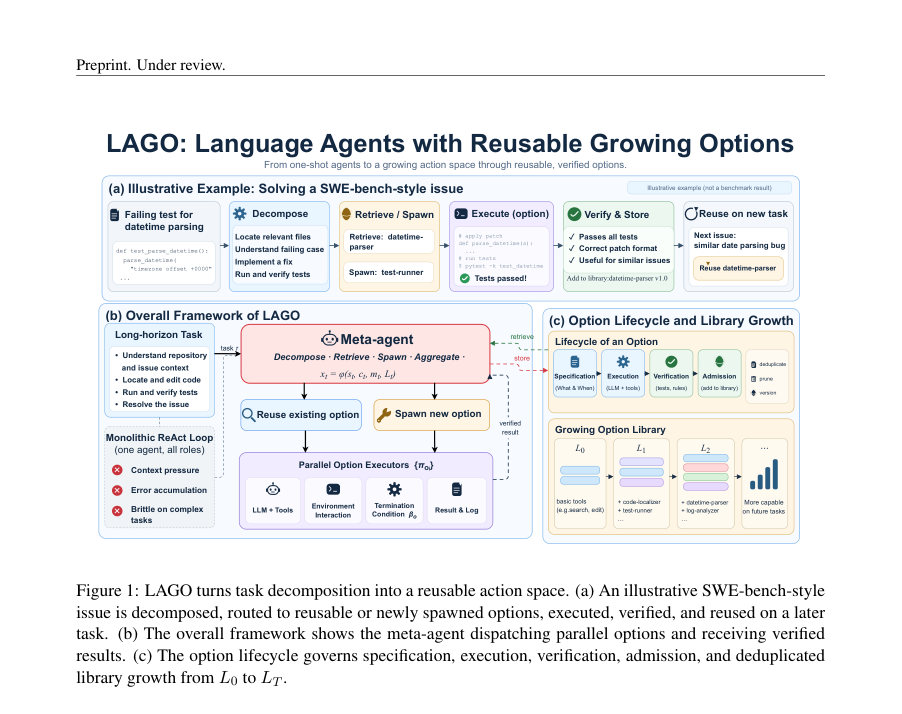
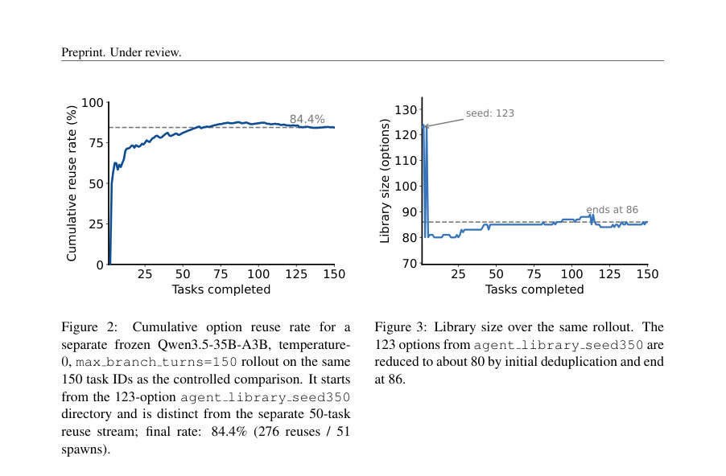
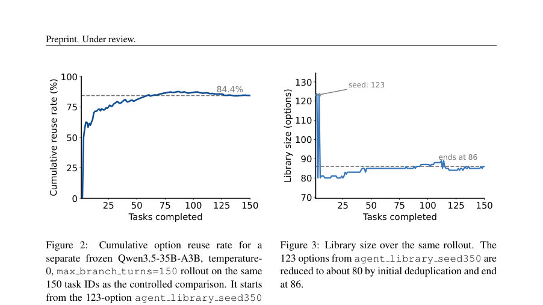

# LAGO: Language Agents with Reusable Growing Options

- **게시일:** 2026-10-15
- **arXiv:** [2610.19843v1](http://arxiv.org/abs/2610.19843v1) · [PDF](https://arxiv.org/pdf/2610.19843v1)
- **저자:** Yuran Wu, Mengkang Hu, Qionglin Qiu, Fanqing Meng, Qiguang Chen, Yuhang Zhou, Qiudan Zhang, Xu Wang
- **분야:** cs.AI, cs.MA
- **선정 점수:** 6.53
- **선정 이유:** 최근성 1.1, 인용 영향 0.0 (인용 0회), 저자 영향 0.0 (최고 h-index 0), AI 주제 적합성 2.2, 개발자 관심 0.6, 학술 신호 0.8, 오픈 웨이트·주요 연구조직 신호 1.9

[← 2026-10-15 목록으로 돌아가기](../daily/2026-10-15.html)

<!-- paper-visuals:start -->
## 주요 Figure

> 원문 PDF에서 실제 Figure 캡션과 그림 영역이 함께 확인된 자료만 자동 추출했다.

*Figure · 원문 PDF 3쪽 · Figure 1: LAGO turns task decomposition into a reusable action space. (a) An illustrative SWE-bench-style*

*Figure · 원문 PDF 9쪽 · Figure 2: Cumulative option reuse rate for a*

*Figure · 원문 PDF 9쪽 · Figure 3: Library size over the same rollout. The*

<!-- paper-visuals:end -->

## 한 문장 요약

LAGO는 언어 기반 하위-에이전트들을 '옵션'으로 취급해 메타에이전트가 재사용 가능한 에이전트-옵션 라이브러리를 성장시키고(스폰·검증·중복제거·보관) 이를 통해 장기 과제를 분해·위임·검증하여 반복적 하위문제를 효율적으로 해결하는 프레임워크다.

## 해결하려는 문제

단일 에이전트의 ReAct형 단일 궤적(분해·실행·검증을 한 에이전트가 모두 담당)은 장기·복잡 과제에서 문맥 과부하, 오류 누적, 검증 부재 등으로 취약하다. 기존 다중 에이전트 파이프라인은 역할 고정·수동 설계로 인해 이전에 성공한 하위능력을 자동으로 획득·검증·재사용하지 못한다. 본문은 (1) 언제 기존 옵션을 재사용하고 언제 새 옵션을 생성할지, (2) 생성된 옵션을 어떻게 검증·입적(admit)·중복 제거·가지치기할지, (3) 라이브러리 성장과 복잡도 제약을 어떻게 관리할지에 초점을 맞춘다.

## 핵심 기여

- 언어 에이전트를 '옵션'(spec, intra-option 정책 πo, 종료조건 βo, 검증자 vo)의 형식으로 공식화하여 메타-행동공간에 추가한 점.
- 스폰(spawn), 입적(admission), 중복제거(deduplication), 가지치기(prune), 버전관리(versioning)를 포함하는 '성장 가능한(agent-option) 라이브러리' 설계로, 학습 가중치 업데이트 없이 과제 스트림에서 옵션을 누적·재사용하도록 한 점.
- 메타-에이전트가 결정상태 xt=ϕ(st,ct,mt,Lt)를 사용하고 행동공간을 원시도구(Aprim)와 라이브러리 옵션 O(Lt)의 합집합으로 다루는 계층적 제어 구조를 제시한 점.
- SWE-bench Verified(500-task)에서 frozen Qwen3.5-35B-A3B를 메타·실행자 모두로 쓰는 단일-시도(temperature=0, 공식 Docker 평가기) 프로토콜에서 실험을 수행하고, 동일한 정책·온도·과제 ID·평가기로 mini-SWE-agent·Terminus 2를 재실행해 통제된 비교를 제공한 점.
- 컴포넌트 소거실험(분해 비활성화, 재사용 내용 셔플, 라이브러리 비활성화)과 교차-모델 분석을 통해 분해 품질과 라이브러리의 재사용성이 성능에 미치는 영향에 대한 실증적 근거를 제시한 점.

## 접근 방법

* 아키텍처: 메타-에이전트(분해·옵션 검색·스폰·집계·입적·거버넌스)와 여러 병렬 실행자(각각 LLM+도구 루프)를 구분한 2-레벨 구조.
* 에이전트-옵션은 튜플 o=(speco, πo, βo, vo)로 정의되며, speco는 역할·목표·허용 도구·입출력 계약·제한을, πo는 내부 도구-호출 루프 기반 정책을, βo는 종료조건(성공·실패·제한 도달), vo는 결과 검증자를 뜻함.
* 결정상태와 행동공간: xt=ϕ(st,ct,mt,Lt), At = Aprim ∪ O(Lt).
* 스폰/입적 규칙: spawn(spec)→onew; admit(onew)=1[vtask(onew)≥θtask ∧ novelty(onew,Lt)≥θnov].
* 라이브러리 거버넌스는 중복병합, 가지치기, 버전기록 포함.
* 목표는 스트림 전체에서 Success(τi)+λQuality(τi) 합을 최대화하되 −ρ\|LT\|로 라이브러리 크기 페널티를 둠.
* 구현·추론 세부: 주요 실험에서는 메타·실행자 모두 가중치 고정(frozen Qwen3.5-35B-A3B)으로 단일-시도(temperature=0)·공식 Docker 평가기를 사용.
* 메타에이전트 SFT(옵션): 보조 실험으로 Qwen3-30B를 QLoRA(4-bit)로 성공 분해 트레이스에 대해 fine-tune하여 분해 품질을 높인 비교를 수행함.

## 주요 결과

- 주요 절대 성능: SWE-bench Verified 전체 500-task에서 frozen Qwen3.5-35B-A3B를 메타·실행자 모두로 사용한 LAGO는 단일-시도 공식 Docker 평가기 기준으로 58.6% 해결률을 기록(논문 본문).
- 통제 비교(같은 frozen Qwen3.5-35B-A3B, temperature=0, single attempt, 동일 150-task 서브셋): mini-SWE-agent 49.3%, Terminus 57.3%, LAGO 60.3% (Table 1).
- 컴포넌트 소거(고정 50-task): 전체 LAGO 30/50(60.0%); 분해 비활성화 26/50(52.0%, −4); 재사용 내용 셔플 28/50(56.0%, −2); 라이브러리 비활성화 24/50(48.0%, −6). (Table 2)
- 라이브러리 재사용 통계(50-task 스트림, Table 3): 메타별로 Spawn/Reuse 수와 재사용 비율 제시 — 예: Qwen3-SFT(메타) with DeepSeek(실행자): Spawn=31, Reuse=197, 재사용율 86.4%, 평균 Reuse/task=3.94. (본문 표 표기 기준)
- 150-task 롤아웃(별도 실행)에서 누적 재사용률 84.4% (276 reuses / 51 spawns)와 라이브러리 크기 변동: 시드 123 옵션 → 초기 중복제거 후 약 80 → 최종 86 옵션(그림 2,3). 65,536-token context가 ablation에서 사용됨(본문).  

## 한계

- 저자가 명시한 한계: (1) 통제 비교는 150-task 하위집합(n=150)이라 통계적 불확실성(약 ±8 percentage point)이 있어 오직 충분히 큰 차이만 의미있게 읽어야 함. (2) 재사용이 얼마나 성능 향상에 '원인'인지 완전히 분리·증명하지 못함(재사용 빈도는 측정했으나, 전송된 기술(skill) 대 일반 프롬프트 스캐폴딩 분리 미완). (3) 메타에이전트 미세조정(SFT)은 선택적 확장으로, 더 많은 데이터가 필요하고 과다-규격화(over-specification)로 인한 회귀 가능성이 있음. (4) 검증자 설계는 과제 의존적이며 보다 일반적 검증이 필요함. (5) 라이브러리 초기화(시드)를 평가와 분리해야 함—초기화가 오염을 유발할 수 있음(본문 명시).
- 본문에서 합리적으로 확인되는 제약: (6) 일부 실험(소거·교차모델)은 50-task 수준으로 노이즈가 큼; 결과 해석은 과제·모델에 의존적임. (7) 통제 비교는 가중치·온도·과제 ID·평가기를 고정했으나 context window(문맥 예산)와 추론 예산은 동등화하지 않아 제공된 스캐폴드 차이의 일부는 이로 인한 영향과 섞여 있음(본문 설명). (8) 재사용·스폰·중복제거·라우팅·병렬 vs 순차 실행 등의 구성요소는 본 논문에서 개별적으로 완전 분리·인과검증되지 않음.

## 개발자 관점

- 재현·배포: 평가 프로토콜(동일 모델·온도·과제ID·공식 평가기)을 공유해 스캐폴드 간 통제비교가 가능하므로 재현 시 동일 조건을 엄격히 고정해야 함(본문에서 저자들이 수행).
- 라이브러리 거버넌스 중요: 입적 규칙(admit), novelty 기준, 중복병합(deduplication), 가지치기(prune), 버전관리 필요. 시드 라이브러리 분리·검증을 통해 평가 오염을 방지해야 함(본문 권고).
- 검증자 설계: 각 옵션에 대해 자동화된 테스트·형식검사·과제-수준 검증자(vtask) 설계가 성능·안전성에 핵심적이며, 검증 임계치(θtask·θnov)를 신중히 설정해야 함(논문의 입적 규칙 근거).
- 분해(메타) 대 실행자(옵션) 균형: 분해 품질이 성능에 영향을 줄 수 있으므로 메타-프롬프트·SFT 데이터 구축(검증 포함)과 분해의 '정밀도 vs 포괄성' 균형을 모니터링해야 함(본문 사례: SFT가 일부 회귀 유발).
- 운영·비용 고려: 본문은 가중치 고정 실험을 사용해 프레임워크 영향만 평가했으나 실제 서비스 환경에서는 옵션 생성·검증·대규모 재사용 추적·대용량 문맥(예: 65k 토큰) 처리를 위한 인프라(대용량 컨텍스트, vLLM 등) 요구가 생김—이 부분은 설계 시 고려해야 함(본문에 사용된 구성요소 근거).

**근거 범위:** 이 분석은 제공된 논문 PDF 본문(본문 텍스트, 표, 그림 캡션, 부록의 메서드·실험 세부사항)을 근거로 작성되었다. 표와 그림의 열 헤더·약어(예: Table 3의 칼럼 레이블)는 PDF에 제시된 값을 그대로 사용하였고, 일부 해석(예: Table 3의 열을 'Spawn, Reuse, Reuse Rate, Reuse/task'로 이해한 점)은 PDF 표의 순서와 문맥을 바탕으로 합리적으로 도출한 것이다. 본문 외부의 미발표 구현·비용·추가 메트릭은 포함하지 않았다.
