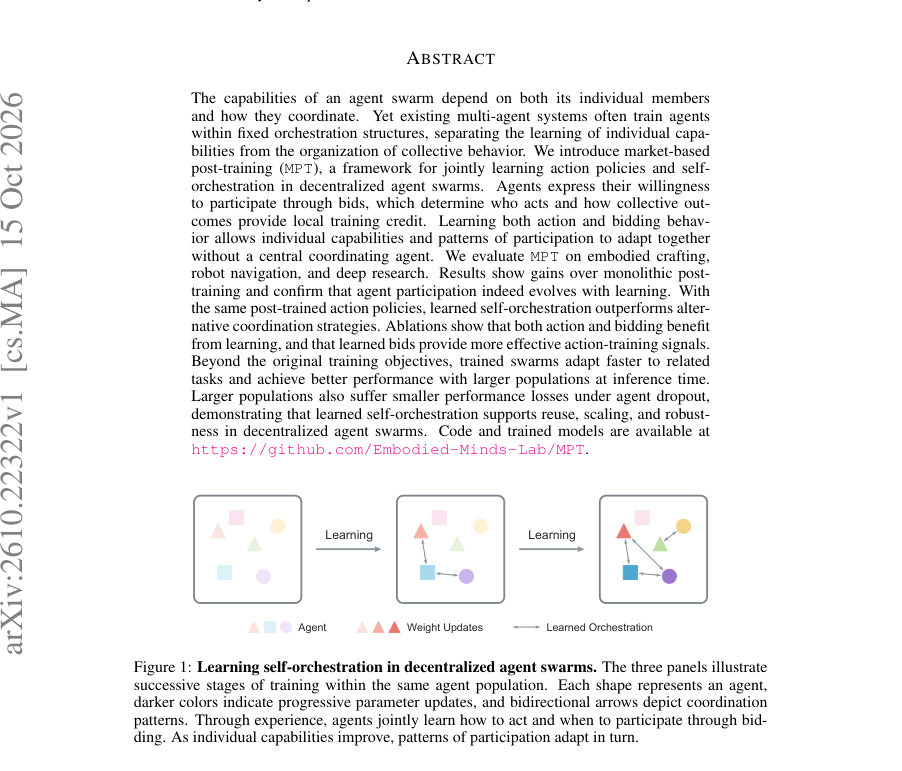
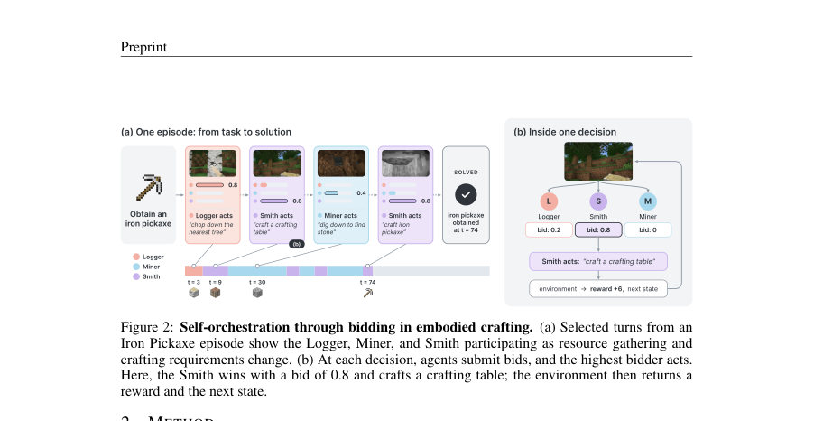
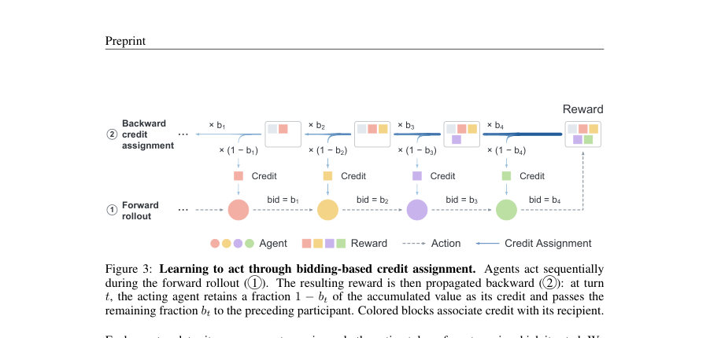

# Learning Self-Orchestration in Decentralized Agent Swarms

- **게시일:** 2026-10-18
- **arXiv:** [2610.22322v1](http://arxiv.org/abs/2610.22322v1) · [PDF](https://arxiv.org/pdf/2610.22322v1)
- **저자:** Guowei Xu, Zhenting Qi, Amani Kiruga, Himabindu Lakkaraju, Yilun Du
- **분야:** cs.MA, cs.AI, cs.CL
- **선정 점수:** 4.24
- **선정 이유:** 최근성 0.5, 인용 영향 0.0 (인용 0회), 저자 영향 0.0 (최고 h-index 0), AI 주제 적합성 2.7, 개발자 관심 0.8, 학술 신호 0.3, 오픈 웨이트·주요 연구조직 신호 0.0

[← 2026-10-18 목록으로 돌아가기](../daily/2026-10-18.html)

<!-- paper-visuals:start -->
## 주요 Figure

> 원문 PDF에서 실제 Figure 캡션과 그림 영역이 함께 확인된 자료만 자동 추출했다.

*Figure · 원문 PDF 1쪽 · Figure 1: Learning self-orchestration in decentralized agent swarms. The three panels illustrate*

*Figure · 원문 PDF 3쪽 · Figure 2: Self-orchestration through bidding in embodied crafting. (a) Selected turns from an*

*Figure · 원문 PDF 4쪽 · Figure 3: Learning to act through bidding-based credit assignment. Agents act sequentially*

<!-- paper-visuals:end -->

## 한 문장 요약

에이전트들이 각자 입찰(bid)로 참여 의지를 표현하고, 입찰값으로 누가 행동할지와 보상 크레딧 배분을 연계하여 행동 정책과 자체 오케스트레이션을 공동으로 학습하는 시장기반 사후학습(MPT) 프레임워크를 제안한다.

## 해결하려는 문제

기존 다중 에이전트 시스템은 에이전트별 행동 능력 학습과 에이전트 간 오케스트레이션을 분리해 고정된 순서 혹은 중앙 조정자 아래에서 학습하는 경우가 많다. 그러나 누가 어느 시점에 행동하느냐는 궤적과 경험 분배(학습 신호)를 결정하므로 참여 패턴과 개별 능력은 상호 의존적이다. 논문은 분산된(agent-wise) 환경에서 중앙 조정자 없이 에이전트들이 언제 행동할지(self-orchestrate)를 행동 정책과 함께 경험으로 공동 학습할 수 있는지를 해결하려고 한다.

## 핵심 기여

- 시장기반 사후학습(MPT)이라는 프레임워크를 도입하여 분산 에이전트 군집이 행동 정책과 자체 오케스트레이션(입찰)을 공동으로 학습하도록 설계했다.
- 입찰을 통해 턴 할당(turn allocation)과 역방향 크레딧 전파를 연계하여 에이전트별 로컬 학습 크레딧을 정의하고, 행동 학습(REINFORCE)과 입찰 학습(카운터팩추얼 비교 + Bradley–Terry 손실)을 결합했다.
- Minecraft 기반의 Embodied Crafting, 로봇 내비게이션(VLN-CE R2R) 및 문서 탐색(Deep Research) 세 환경에서 단일(모놀리식) 포스트트레이닝 대비 성능 향상과 오케스트레이션의 학습 가능성을 실험적으로 보였다.
- 학습된 오케스트레이션이 동일한 행동정책을 사용할 때 다른 추론 시 협력 전략(Round-Robin, AgentNet, Graph-of-Agents)보다 우수함을 보였고, 학습된 입찰이 크레딧 할당에서도 이득을 준다는 소거(ablation) 실험을 제시했다.
- 학습된 에이전트 군집이 관련 과제로 더 빠르게 적응하고(재사용성), 추론 시 인구 수를 늘려도 성능이 개선되며(확장성), 에이전트 드롭아웃에도 더 강건함을 보인다는 사실을 실험적으로 확인했다.

## 접근 방법

* MPT는 각 에이전트 i가 상태 hi,t로부터 행동과 실수치 입찰 bi를 생성하는 분산 구조를 따른다.
* 매 턴 에이전트들은 봉인 입찰(sealed bid)을 제출하고 최댓값 입찰자가 행동을 수행한다.
* 입찰 bt는 역방향으로 보상을 전달할 때 t에서 누적값 vt의 일부(bt)를 이전 행동자에게 넘기는 비율로 사용된다(정의: vt = ˆrt + bt+1 vt+1, ˜rt = (1 − bt) vt, vT+1 = 0).
* 이렇게 전달된 ˜rt가 그 턴에서 행동한 에이전트의 로컬 학습 크레딧이 된다.
* 행동 정책 학습은 각 에이전트가 자신이 행동한 턴들 Wi에 대해 REINFORCE(편향 보정용 per-agent mean baseline)로 업데이트한다.
* 입찰 학습은 'contested' 턴(2순위 입찰자가 0이 아닌 경우)에 대해 시점 복원(replica)으로 카운터팩추얼 분기(최초 분기 + 최대 3번 재샘플링으로 runner-up이 행동하도록 유도)를 수행하고, 두 분기에서 종단까지의 환경 보상 합을 비교하여 더 좋은 입찰 응답을 선호하는 Bradley–Terry 기반의 쌍선호 손실로 학습한다.
* 학습 절차는 SFT(cold start)로 역할별 시연으로 초기화한 뒤 포스트트레이닝을 수행하며, 학습 내에서 행동 업데이트 4회에 대해 입찰 업데이트 1회를 교대로 수행한다.
* 실험에서는 각 환경에서 3개 역할의 에이전트(예: Logger/Miner/Smith 등)를 사용했고, 입찰 및 행동 생성·카운터팩추얼 롤아웃을 포함한 전체 LLM 연산을 학습 FLOPs에 포함시켜 비교했다.

## 주요 결과

- 주요 학습 곡선(학습 FLOPs에 대한 성능): Embodied Crafting에서 MPT 최종 평균 에피소드 보상 ≈ 41 vs 모놀리식 RL ≈ 20; Robot Navigation에서 MPT ≈ 0.9 vs 모놀리식 ≈ 0.3; Deep Research에서 MPT 정답률 ≈ 27% vs 모놀리식 ≈ 6% (Figure 5).
- 홀드아웃 평가(각 항목은 mean ± SE, 각 인스턴스당 3회 반복): Embodied Crafting: RL 20.3 ± 4.1 vs MPT 41.5 ± 5.9; Robot Navigation: RL 0.52 ± 0.14 vs MPT 1.23 ± 0.18; Deep Research: RL 9.0 ± 2.1% vs MPT 21.0 ± 4.1% (Table 1).
- Iron Pickaxe(Embodied Crafting)에서 동일한 포스트트레인된 행동정책을 사용한 추론 전략 비교: MPT 평균 보상 41.5, Graph-of-Agents 25.4(최강 대안), Round-Robin 23.8, AgentNet 20.9로 MPT가 Graph-of-Agents 대비 63.4% 상대 개선을 달성(표 2, 본문).
- 행동과 입찰의 기여 분리 실험: post-trained 행동·입찰 둘 다 사용 시 평균 41.5, 입찰만 후학습(행동 초기) 21.5, 행동만 후학습(입찰 초기) 27.2, 초기 초기(둘 다 초기) 15.4로 둘 다 학습된 경우가 가장 우수(표 2 오른쪽).
- 크레딧 소거(ablation): Round-robin(턴 순환) 학습 곡선은 거의 개선이 없고 약 15 보상 수준에 머무름, 무작위 크레딧(random credit) 실험은 약 31까지 도달, MPT는 약 42에 도달하여 학습된 입찰이 효율적인 크레딧 신호임을 시사(Figure 7).  (본문 수치 근사).  
(재사용) Iron Pickaxe로 학습된 체크포인트에서 Torch와 Stone Bricks로 계속 학습시 MPT가 더 빠르게 적응: 적응 FLOPs ≈ 1e18 부근에서 Torch: 사회(약 35) vs 단일(약 17), Stone Bricks: 사회(약 38) vs 단일(약 19) (Figure 8).  
(확장성) 추론 시 에이전트 수를 3→12로 확장하면 pass@3이 모든 마일스톤에서 증가: Wooden Pickaxe 약 78%→97%, Stone Pickaxe 약 69%→94%, Furnace 약 66%→91% (Figure 9).  
(강건성) 추론 시 에이전트 드롭아웃 실험: 드롭아웃 확률 p = 0.9에서 12-에이전트 집단의 평균 에피소드 보상 약 33 vs 3-에이전트 약 19로 대규모 집단이 드롭아웃에 대해 더 잘 버팀(Figure 10).

## 한계

- 저자가 명시한 한계: (1) MPT는 행동과 입찰 학습 모두를 위해 외부에서 검증된(객관적) 에피소드 보상에 의존하므로 주관적이거나 신뢰할 수 없는 피드백이 주어지는 환경에서는 효과성이 제한될 수 있다. (2) 입찰 업데이트는 동일한 환경·에이전트 상태에서의 카운터팩추얼 롤아웃을 필요로 하므로 되돌릴 수 없는 실세계 상호작용에서는 적용이 어렵다. (3) 계산 자원 제약으로 연구에서는 10B 파라미터를 넘는 다수 모델이나 훨씬 큰 에이전트 집단의 공동 훈련을 탐색하지 못했다.
- 본문 실험·설정에서 확인되는 추가 제약: 실험 대부분이 에피소드 단위의 검증 가능한(verified) 보상이 있는 과제에 국한되고, 실제로 보고한 주요 실험은 역할이 3개인 구성(각 역할별 모델 크기와 아키텍처는 본문에 명시됨)으로 제약되어 있어 더 복잡한 역할 분화나 더 이질적인 모델 집단에 대한 일반화는 미확인이다.
- 크레딧 전파 설계상 첫 번째 행동자의 전달분은 폐기(discard)되므로(정의상) 앞쪽 초기 행동들에 대한 학습 신호 손실이 발생할 수 있으며, 이는 특정 작업에서는 바람직하지 않을 수 있다.

## 개발자 관점

- 재현을 위해서는 각 에이전트별 SFT(cold start)로 역할별 시연으로 초기화해야 하며, 논문은 각 에이전트가 자신 역할의 시연으로 SFT를 수행했다고 명시한다(예: Deep Research에서 SEARCHER/OPENER/FINDER 시연 분리).
- 입찰 학습을 위해 환경 상태 복원·분기(카운터팩추얼 롤아웃)를 지원하는 환경 인터페이스가 필요하다. 이는 시뮬레이터 기반 또는 상태 복원이 가능한 환경에서 구현하기 쉬우나, 복원 불가능한 실세계 로깅 데이터에는 직접 적용하기 어렵다.
- 학습 FLOPs 계산 시 모든 에이전트의 입찰 생성, 행동 생성, 카운터팩추얼 롤아웃, 파라미터 업데이트를 포함해야 하므로 비용 산정 시 LLM 호출 비용이 급증한다. 구현·배포 시 GPU(논문은 H200 사용)·CPU 자원 배치와 검색 서비스(Deep Research) 분리 등 인프라 고려가 필요하다.
- 입찰-행동 학습을 같은 파라미터에 대해 번갈아 업데이트(논문은 행동 4스텝 : 입찰 1스텝)하기 때문에 최적화 안정성(학습률, 배치 크기, 엔트로피 항 등)과 스케줄 튜닝이 중요하다.
- 추론 시 확장성 측면에서 학습된 에이전트를 복제하여 인구 수를 늘리는 방식으로 성능 향상을 얻을 수 있으나, 복제 시 동일 정책이 많아지는 효과와 중복 비용을 고려해야 한다. 드롭아웃에 대한 내성은 확장 시 장점으로 작용한다는 점을 염두에 둘 것(운영적 가용성 개선).  
코드와 체크포인트가 공개되어 있어 실무 적용 시 레퍼런스 구현을 확인하고, 환경 복원/카운터팩추얼 구성 및 학습 FLOPs 계산 방식을 재현하는 것이 핵심이다.

**근거 범위:** 이 분석은 제공된 논문 PDF 본문(메인 본문 및 부록에서 추출 가능한 텍스트)을 기반으로 작성되었다. 본문에 보고된 수치와 그래프의 값은 논문 문서에서 제시된 근사치(또는 표의 평균±SE)를 사용했으며, 세부 하이퍼파라미터와 일부 구현 세부사항은 부록(Table 5 등)에 기재되어 있으나 본 분석에서는 저자가 본문·부록에 직접 명시한 항목만을 근거로 서술했다. (추가적인 구현·실험 세부 사항이나 원시 코드의 미세한 차이는 공개된 코드베이스에서 확인하는 것이 권장된다.)
