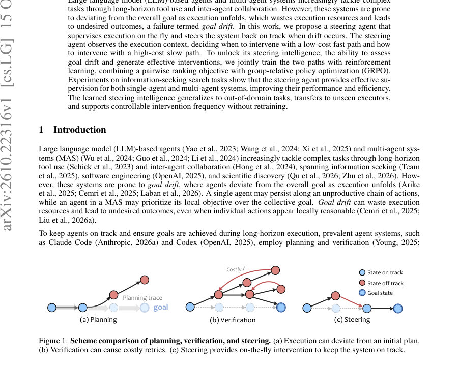
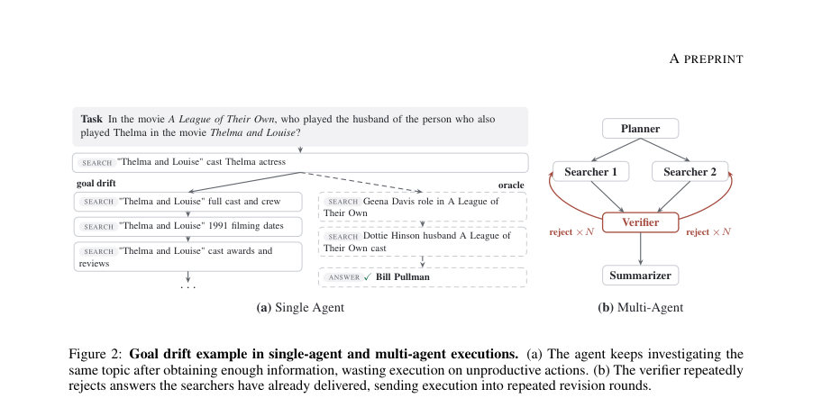
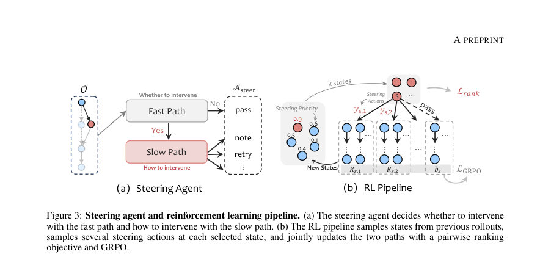

# Learning to Steer LLM Agents and Multi-Agent Systems

- **게시일:** 2026-10-18
- **arXiv:** [2610.22316v1](http://arxiv.org/abs/2610.22316v1) · [PDF](https://arxiv.org/pdf/2610.22316v1)
- **저자:** Leyang Shen, Yaxin Gong, Yang Zhang, Chenxiao Fan, Jiakai Wang, Dong Wang, Yang Liu, Fuli Feng, Chun Kai Ling, Tat-Seng Chua
- **분야:** cs.LG, cs.AI, cs.MA
- **선정 점수:** 4.34
- **선정 이유:** 최근성 0.5, 인용 영향 0.0 (인용 0회), 저자 영향 0.0 (최고 h-index 0), AI 주제 적합성 3.0, 개발자 관심 0.6, 학술 신호 0.3, 오픈 웨이트·주요 연구조직 신호 0.0

[← 2026-10-18 목록으로 돌아가기](../daily/2026-10-18.html)

<!-- paper-visuals:start -->
## 주요 Figure

> 원문 PDF에서 실제 Figure 캡션과 그림 영역이 함께 확인된 자료만 자동 추출했다.

*Figure · 원문 PDF 1쪽 · Figure 1: Scheme comparison of planning, verification, and steering. (a) Execution can deviate from an initial plan.*

*Figure · 원문 PDF 4쪽 · Figure 2: Goal drift example in single-agent and multi-agent executions. (a) The agent keeps investigating the*

*Figure · 원문 PDF 5쪽 · Figure 3: Steering agent and reinforcement learning pipeline. (a) The steering agent decides whether to intervene*

<!-- paper-visuals:end -->

## 한 문장 요약

길게 진행되는 실행에서 목표에서 벗어나는 'goal drift'를 실시간으로 감지·교정하는 외부 감독자(steering agent)를 제안하고, 저비용의 fast 경로(yes/no 우선순위 판단)와 고비용의 slow 경로(사고흐름 기반 개입 생성)를 공유 LLM으로 구성하여 페어와이즈 랭킹 손실과 그룹-상대 PPO(GRPO)를 결합한 강화학습으로 공동 학습시켜 단일/다중 에이전트 검색 과제에서 성능·효율·전이성을 개선한다.

## 해결하려는 문제

LLM 기반 단일 에이전트 및 다중 에이전트 시스템은 장기적 도구 사용과 상호협업 과정에서 실행이 전체 목표에서 점차 벗어나는 'goal drift'가 발생한다. 기존의 계획(planning)과 사후검증(verification)은 각각 실행 중 이탈을 막지 못하거나(계획) 사후 보완이 비용이 많이 들고 되돌릴 수 없는 결과를 초래할 수 있다(검증). 따라서 실행 중(on-the-fly)에 목표 이탈을 실시간으로 판단하고 효과적으로 개입하는 감독 메커니즘이 필요하다. 본 연구는 언제 개입할지(효율적인 판단)와 어떻게 개입할지(효과적 교정)를 동시에 다루는 steering agent의 학습 가능성을 묻는다 (RQ1–RQ3).

## 핵심 기여

- 단일-및 다중 에이전트 환경에서 발생하는 goal drift 문제를 규명하고, 실행 중 실시간 감독(steering)의 필요성을 제시함.
- 저비용의 fast 경로(단일 토큰 yes/no로 steering priority 추정)와 고비용의 slow 경로(Chain-of-thought 기반 개입 생성)를 공유 LLM으로 구성한 steering agent 아키텍처를 제안함.
- fast 경로를 위한 pairwise ranking 손실과 slow 경로를 위한 그룹-상대 정책 최적화(GRPO, PPO 변형)를 결합한 RL 파이프라인을 설계하여 두 경로를 공동 학습함.
- 검색 기반 정보탐색 QA(ASearcher-Base-35k로 학습, 7개 in-domain 벤치마크 및 3개 out-of-domain)에 대한 광범위한 실험을 통해 단일/다중 에이전트에서 성능·효율 향상, 전이성(미지의 executor로 전이), 및 개입 빈도 조절 가능성을 보임.
- 프롬프트·롤아웃·하이퍼파라미터·평가지표(토큰 F1 및 LLM-as-a-Judge)와 함께 구현·평가 세부사항을 공개하여 재현성을 지원함.

## 접근 방법

* 문제 형식화: 실행 중인 에이전트 시스템을 환경으로 보는 POMDP에서 steering agent는 관찰 ot = O(g, s_t)을 읽고 행동 at ∈ A_steer = {pass} ∪ A_int를 내보낸다.
* 아키텍처: 하나의 LLM(파라미터 θ)을 공유하여 fast/slow 두 경로로 분리.
* Fast 경로는 단일 포워드 패스로 Pfast(ot)를 입력받아 'yes'/'no' 토큰의 로그-오즈 zθ(ot)를 계산하고 σ(z)로 steering priority vθ(ot)∈(0,1)을 얻는다 (Eq.3).
* 우선순위와 임계치 τ의 차이에 대해 소프트 스레숄드 pt = σ(logit(v) - logit(τ))로 slow 경로 진입 확률 It∼Bernoulli(pt)를 샘플링한다 (Eq.4).
* Slow 경로는 Pslow(ot)를 입력으로 체인-오브-생각(reasoning) rt와 개입 action at를 오토리그레시브하게 생성한다 (Eq.5).
* 두 경로를 결합해 전체 정책 πθ(at\|ot)를 구성한다 (Eq.6).
* 학습 알고리즘: executor는 고정(frozen)하고 steering agent만 파인튜닝한다.
* 학습 파이프라인은 (1) unsteered rollout으로 상태 은행(state bank) 수집, (2) 각 상태에 대해 fast 경로로 우선순위 계산, (3) m 라운드 동안 최대 k개 상태 선택(확률 ε_sel로 탐험), (4) 선택된 상태당 G개의 slow-path 출력을 샘플링하여 각 개입을 적용하고 각 분기에서 N번의 executor 연속롤아웃을 수행해 평균 보상 ¯R_{s,j}와 baseline b_s(= unsteered 평균)을 계산(Eq.7).
* Fast 경로 학습: 상태의 학습적 우선순위 q(s)= (1/G) Σ_j \|¯R_{s,j} - b_s\|를 계산하고, 같은 과제 내 평가 상태 집합 S에서 pairwise ranking 손실 L_rank를 적용해 zθ 순서를 맞춘다 (Eq.8–9).
* Slow 경로 학습: 그룹 내(steered outcomes + baseline) 정규화를 이용한 GRPO 방식 적용.
* 각 행동의 이점 A_act_{s,j} = (¯R_{s,j} - mean(U_s)) / std(U_s)로 계산하고, 각 토큰에 PPO 형태의 클립 손실 L_GRPO를 적용 (Eq.10–11).
* 최종 손실 L = L_GRPO + L_rank로 파라미터 θ를 업데이트한다 (Eq.12).
* 구현·학습 세부: steering backbone은 Qwen3-8B로 초기화, executor는 Qwen2.5-7B-Instruct(frozen).
* 학습은 AdamW(learning rate 2e-5), batch 64, 300 steps.
* ASearcher-Base-35k로 학습.
* 롤아웃 하이퍼파라미터: m=2, k=3, ε_sel=0.25, G=4, N=2.
* 보상은 예측 답안의 토큰 F1에 'trajectory-format indicator'를 곱한 값(모든 executor turn이 정확한 action tag를 커밋하면 1, 아니면 0).
* 추론 시 fast-path 임계치 τ로 개입 빈도를 조절해 배포 시 비용/성능을 트레이드오프할 수 있음.

## 주요 결과

- 단일-에이전트(7개 in-domain 벤치마크 평균, 토큰 F1): No Intervention 평균 42.70. Zero-shot Steering 평균 44.54 (+1.84)로 약간 개선(#Act 1.11, Turns 6.5). RL로 학습된 Steering 평균 49.36 (+6.66)로 가장 큰 향상(#Act 0.93, Turns 6.2). (Table 1)
- 비교: Planning(RL) 평균 45.91 (+3.21, #Act 1.00, Turns 8.8), Verification(RL) 평균 44.87 (+2.17, #Act 1.08, Turns 6.8). Filtered Behavior Cloning은 Steering과 비교해 성능이 낮음. (Table 1)
- Out-of-domain(온라인 검색 API): Frames Avg@4 No 26.46 → Steering w/ RL 36.32. GAIA Avg@4 No 16.75 → 23.79. xBench-DeepSearch Avg@4 동일(49.50)이나 Pass@4 65.00 → 72.00. 즉 RL-steering이 일부 실세계 검색 과제로 일반화됨. (Table 2)
- 전이성: steering agent를 Qwen2.5에서 학습한 뒤 미지의 executors로 전이시 RL-steering은 Llama-3.1-8B에서 +15.78, Mistral-7B에서 +12.01, Phi-4(14B)에서 +5.92 F1 포인트 향상(각 executor의 No Intervention 대비). Zero-shot 전이는 작음. (Table 3)
- 개입 빈도 제어: fast-path 임계치로 배포 시 개입 빈도를 조절 가능. RL-steering은 모든 빈도에서 총 이득이 가장 크고, 낮은 빈도에서 '개입당 이득'이 가장 크도록 우선순위를 학습함(그림 4). 최고 빈도에서는 총 이득이 최대 17.11 포인트로 보고됨(본문). (Figure 4, Sec 4.3 설명). NOTE: '17.11' 수치는 본문에서 제시된 최대치임—표에 직접 나열된 수치와 그래프의 언급을 따름.
    
    다중 에이전트: 5-role pipeline(TacoMAS 변형). No Intervention 평균 42.49. Zero-shot steering(목표 빈도 25% turns)은 평균을 41.44로 낮춤(-1.04), 반면 RL-steering은 같은 조건에서 평균 46.39 (+3.90, #Act 2.67, Turns 10.4). 강제로 모든 handoff에 개입시키면 zero-shot이 큰 성능 저하(-7.14)와 높은 비용(Turns 24.1)을 유발하지만, RL-steering은 매 handoff 조건에서 평균 47.83 (+5.34, #Act 6.00, Turns 11.9)를 달성함. 즉 저해상도(거친 관찰 공간)에서는 steering이 더 어려우나 RL로 학습하면 성능 개선 가능. (Table 4)
    
    비용·지연: fast path와 slow path는 동일한 prefill 비용(약 0.2s)을 공유. fast path 전체 평균 지연 약 0.27s(12 concurrent requests/GPU 기준), slow path는 평균 약 30s를 소요하며 평균 생성 토큰 수는 약 1.8k 토큰임(측정 환경 및 동시성 명시). 따라서 fast-slow 분리는 모니터링 빈도와 개입 비용을 실용적으로 분리함. (Appendix B.2, Figure 6)
    
    하이퍼파라미터 민감도: 롤아웃 구성(m,k,G,N)을 바꾸면 목표 개입 빈도(예: 15%, 50%, 100%)에서 성능 변동이 있으며, 본문에서 제시된 기본 설정은 다양한 구성 중 안정적인 성능을 제공함(Appendix B.1, Figure 5).

## 한계

- 저자(본문) 언급: 다중 에이전트에 대해 낮은 관찰 해상도(인터-에이전트 handoff 수준)로 감독하는 것은 더 어렵다. zero-shot 감독은 오히려 성능을 악화시킬 수 있으며, RL 학습이 필요함 (Sec 4.4, Table 4).
- 본문에서 합리적으로 확인되는 제약: 실험이 주로 정보탐색/검색 기반 QA 과제(A̲Searcher-Base-35k 학습, 7개 in-domain + 3개 out-of-domain)와 5역할 MAS 템플릿에 국한되어 있어 다른 종류의 장기 계획/도구 사용 작업(예: 코드 생성·로봇 제어·과학적 탐색)으로의 일반화는 추가 검증이 필요함.
- 학습·평가에서 executor를 고정(frozen)하였으므로 steering의 효과는 executor의 기본 능력에 의존한다. 즉 executor 자체의 결함이나 제한은 steering으로 완전히 보완되지 않을 수 있음.
- 실행 비용: slow path는 평균 30초 및 약 1.8k 토큰을 생성하여 실운영에서 비용과 지연이 높다. 높은 개입 빈도는 실제 비용을 크게 증가시킬 수 있음(Appendix B.2). 또한 RL 기반 롤아웃(각 스텝에서 다수의 분기와 연속평가 N)을 수반하므로 학습 비용이 크다(구현상 부담).

## 개발자 관점

- 재현성: 본문과 부록에 프롬프트 템플릿(단일/다중 에이전트 fast/slow/plan/verify)과 학습 하이퍼파라미터(AdamW lr=2e-5, batch=64, steps=300, m=2,k=3,G=4,N=2,ε_sel=0.25)를 명시해 실제 재현에 필요한 핵심 요소가 제공됨(Appendix A).
- 인터페이스 설계: steering agent의 관찰 공간 O(g,s)와 개입 행동 공간 A_int는 시스템 사양에 맞게 설계되어야 함(예: 단일 에이전트의 세부 실행 단계 노출 vs MAS의 핸드오프 노출). 배포시에는 fast-path 임계치 τ를 통해 개입 빈도를 런타임에서 조절할 수 있어 비용-성능 트레이드오프를 운영상 제어 가능함.
- 학습 전략: fast 경로는 pairwise ranking(우선순위 예측)에, slow 경로는 그룹 정규화 기반 GRPO(PPO 변형)에 각각 특화된 손실을 적용하여 '언제 개입할지'와 '어떻게 개입할지'를 동시에 학습시키는 것이 핵심임(섞어서 업데이트하는 L = L_GRPO + L_rank).
- 비용·지연 고려: fast-path는 실시간 모니터링에 적합(약 0.27s), slow-path는 고비용(약 30s, 대규모 토큰 생성)으로 배치형·선택적 개입에 적합함. 따라서 프로덕션에서는 fast-path를 빈번히 실행하고 slow-path는 우선순위가 높은 상태에만 허용하도록 설정하라.
- 데브옵스·안전성: multi-agent 환경에서는 개입 행동(예: reject/retry/note)이 시스템의 협업 흐름을 바꿀 수 있으므로 액션 디자인과 재시도 정책(예: 최대 재시도 횟수 등)을 명확히 정의해야 함(부록 A.4). 또한 RL 학습 시 부정적 샘플을 버리는 오프라인 BC보다 온라인 RL(본 논문 방식)이 더 효과적임을 확인했으므로, 품질이 낮은 샘플 처리를 신중히 설계할 것(Filtered BC 비교).

**근거 범위:** 이 분석은 제출된 논문 PDF 본문 전체(및 부록)를 근거로 작성되었다. 표와 수치, 알고리즘 식(식 번호) 및 프롬프트·하이퍼파라미터는 본문·부록에 명시된 내용을 그대로 인용하였다. 다만 하드웨어 세부(정확한 GPU 모델 등)는 PDF에 명시되지 않거나 일부 성능 측정(예: 지연은 '12 concurrent requests per GPU'와 평균값만 명시)에서 환경 의존성이 있으므로 그 밖의 인프라 관련 세부는 문서에 따라 달라질 수 있다.
