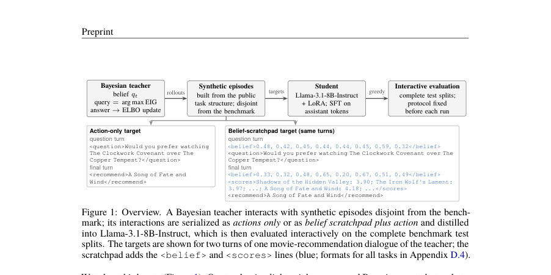
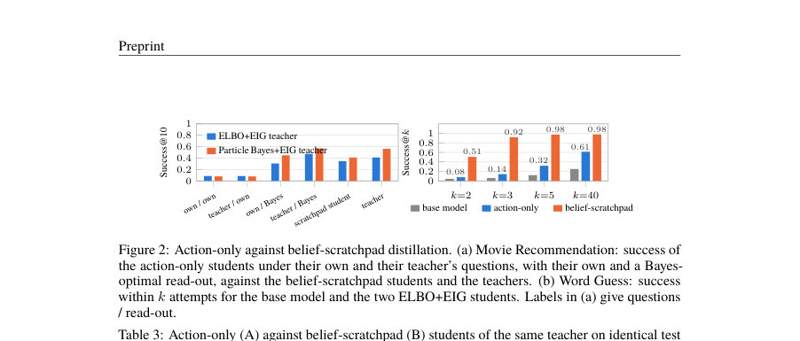
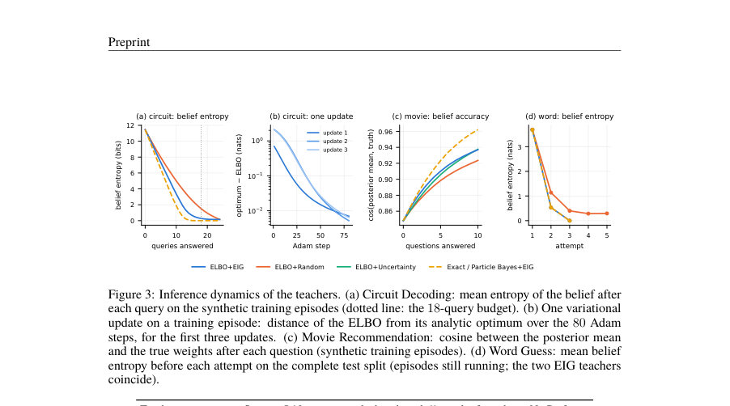

# Learning What to Ask and What to Believe: Distilling a Variational Bayesian Agent into Language Models

- **게시일:** 2026-11-03
- **arXiv:** [2611.01245v1](http://arxiv.org/abs/2611.01245v1) · [PDF](https://arxiv.org/pdf/2611.01245v1)
- **저자:** Baichuan Li, Yanling Chang, Alfredo Garcia
- **분야:** cs.LG
- **선정 점수:** 4.13
- **선정 이유:** 최근성 0.5, 인용 영향 0.0 (인용 0회), 저자 영향 0.0 (최고 h-index 0), AI 주제 적합성 2.6, 개발자 관심 0.5, 학술 신호 0.6, 오픈 웨이트·주요 연구조직 신호 0.0

[← 2026-11-03 목록으로 돌아가기](../daily/2026-11-03.html)

<!-- paper-visuals:start -->
## 주요 Figure

> 원문 PDF에서 실제 Figure 캡션과 그림 영역이 함께 확인된 자료만 자동 추출했다.

*Figure · 원문 PDF 2쪽 · Figure 1: Overview. A Bayesian teacher interacts with synthetic episodes disjoint from the bench-*

*Figure · 원문 PDF 7쪽 · Figure 2: Action-only against belief-scratchpad distillation. (a) Movie Recommendation: success of*

*Figure · 원문 PDF 18쪽 · Figure 3: Inference dynamics of the teachers. (a) Circuit Decoding: mean entropy of the belief after*

<!-- paper-visuals:end -->

## 한 문장 요약

변분 베이지안 정보탐색(ELBO 업데이트 + EIG 질의선택) 교사(agent)의 상호작용을 합성 에피소드로 생성해 Llama-3.1-8B-Instruct에 LoRA 기반 SFT로 증류하여, 질의 정책과 명시적 신념(scratchpad)을 학습시켜 대화형 추론 문제 성능을 대폭 향상시킨다.

## 해결하려는 문제

대화형 추론(interactive inference) 과제는 숨겨진 잠재 상태에 대한 불확실성을 추적하고(turnwise belief update), 다음에 물어볼 질의가 가져올 정보가 최대가 되도록(EIG) 질문을 선택하며 최종 결정을 내려야 한다. 기존 거대 언어모델(LLM)은 명시적 신념 유지와 정보가치 기반 질의선택 메커니즘을 제공하지 못해 Multi-Turn Puzzles 같은 벤치마크에서 성능이 매우 낮다. 본 논문은 변분 베이지안 정보탐색(ELBO 기반 순차적 변분 추론 + EIG 질의선택)을 비신경형 교사로 사용해 그 행동과 교사의 신념 상태를 8B LLM으로 증류할 수 있는지 검증한다.

## 핵심 기여

- 변분 베이지안 순차 필터(q_t)를 ELBO(증거하계)로 갱신하고 현재 신념 하에서 기대정보획득(EIG)을 최대화하는 저비용(non-neural) 교사(ELBO+EIG)를 설계·검증하여 세 가지 상호작용 추론 과제(연속, 구조적 이진, 유한 기호)를 대상으로 정확·입자 기반 참조와 비교·검증함.
- 합성 에피소드(벤치마크 테스트와 분리)에서 교사의 상호작용을 생성하고 Llama-3.1-8B-Instruct + LoRA로 미세조정하여 행동(action-only)과 교사의 중간 신념(belief-scratchpad)을 재현하도록 증류함으로써 학생(student)이 질의정책과 결정을 학습하게 함.
- 행동만 모방(action-only)한 학생과 교사의 신념을 노출한 학생을 비교하여, 최종 결정이 상호작용 기록 이상의 계산을 필요로 할 때 신념 스크래치패드가 결정 성능을 크게 개선함을 실험적으로 입증함.
- 교사 구성요소(질의 규칙: EIG vs random/uncertainty, 추론 정확도: 변분 vs exact/particle, 교사 유형: 베이지안 vs LLM)를 통제된 조건에서 비교하여 질의 규칙이 학생 성능에 가장 일관된 영향력을 갖고, 추론의 더 높은 충실도가 반드시 더 나은 증류 학생으로 이어지지 않음을 보임.
- 학습된 능력이 과제별로 특화되어 있음을 보이고(leave-one-task-out 실험에서 전이 실패), 70B LLM을 교사로 쓴 경우 베이지안 교사보다 약한 학생이 생성됨을 보고함.

## 접근 방법

* 교사: 매 턴 관측 y_t을 받으면 변분가족 Q에서 다음을 최적화하여 신념 q_t를 업데이트한다: q_t = arg max_{q∈Q} E_q[log p(y_t \| θ, a_t)] − D_{KL}(q ∥ q_{t−1}).
* 이는 streaming variational Bayes 형태로 이전 posterior를 prior로 사용한다.
* 질의 선택은 현재 신념 하의 기대정보획득(EIG)을 계산해 at+1 ∈ arg max_a EIG_t(a)를 선택한다.
* EIG은 범주형 가족에서는 정확 계산, 연속(가우시안) 가족에서는 posterior 샘플 64개로 몬테카를로 근사한다.
* 과제별 변분 가족: Movie Recommendation은 범위 변환된 평균-필드 가우시안(로그틱 변환)과 Bradley–Terry 연속성(τ=0.1)으로 관측 모델을 부드럽게 처리, Circuit Decoding은 문법으로 열거된 가능한 진리표 전체에 대한 범주형 분포, Word Guess는 어휘 전체에 대한 범주형(정확 posterior 포함).
* 데이터 및 증류: 벤치마크의 공개 구조로부터 테스트와 겹치지 않게 합성 에피소드 생성(트레인/밸리드/홀드아웃), 교사의 턴별 상호작용을 직렬화하여 두 가지 타깃 형식(action-only 또는 belief-scratchpad + action)으로 저장.
* 학생: Llama-3.1-8B-Instruct에 LoRA 어댑터를 붙여 assistant 토큰만 대상으로 next-token prediction (SFT)으로 학습.
* 평가: 각 조건마다 평가 프로토콜(프롬프트, 그리디 디코딩, 파싱 규칙)을 사전에 고정하고 공개된 전체 테스트셋에서 인터랙티브 평가 수행.
* 통계: 동일 에피소드에 대한 페어드 비교(맥네마, 페어드 부트스트랩, Wilcoxon)로 유의성 판단.

## 주요 결과

- 주요 벤치마크(완전한 테스트 스플릿)에서 증류된 belief-scratchpad 학생은 base Llama-3.1-8B 대비 크게 향상함. Circuit Decoding: Success@18 베이스 0.000 → 학생 0.927 (교사 1.000); 벤치마크 회로별 정확도(%) 베이스 0.7 → 학생 97.4 → 교사 100.0. Movie Recommendation: 벤치마크 점수(100×(1−정규화순위)) 베이스 50.4 → 학생 90.0 → ELBO+EIG 교사 92.9; Success@10 베이스 0.032 → 학생 0.345 → 교사 0.410. Word Guess: 평균 시도 횟수 베이스 31.97 → 학생 3.37 → 교사 2.29; Success@3 베이스 0.060 → 학생 0.917 → 교사 1.000.
- 두 과제에서 벤치마크에 보고된 최강 언어모델보다 우수함: Circuit 회로 정확도 학생 97.4% vs 보고된 Gemini 2.5 Pro 39.8%; Movie 점수 학생 90.0 vs Gemini 84.3.
- action-only 대비 belief-scratchpad의 효과: Circuit에서는 action-only 학생도 이미 강해(0.920 → 0.927으로 소폭 개선) 질의된 비트가 답 자체인 경우라면 행동만으로 충분하나, Movie와 Word에서는 scratchpad가 큰 폭 개선을 가져옴(예: Movie Success@10 action-only 0.085 → scratchpad 0.345, Word 평균 시도 19.2 → 3.4).
- 교사 구성요소 비교: 질의 규칙(random→EIG)은 학생 성능에 가장 큰 일관된 향상을 줌(예: Circuit +0.420, Movie +0.169, Word +0.205(성공@3 기준)). 변분→정확/입자 추론은 과제에 따라 효과가 달라 Movie에서 유리(+0.064)하지만 Circuit에서는 오히려 악영향(-0.277). LLM(70B) 교사 사용은 베이지안 교사 대비 학생 성능을 크게 떨어뜨림(예: Circuit −0.920).
- 교사와 학생의 질의전파: 학생은 교사의 질의 정책을 상당 부분 모방함(특히 회로 과제에서는 EIG-optimal 비율 근접). 하지만 연속(영화) 과제에서는 학생이 참조 EIG 최대값에 도달하는 빈도가 낮아 일부 질문을 반복하거나 질의 품질에서 격차가 남.

## 한계

- 저자 언급: 학습된 능력은 과제별로 특화되어 단일 태스크 분포 밖으로의 제로샷 전이가 거의 없음(leave-one-task-out에서 전이 실패).
- 저자 언급: 교사는 명시적 가설공간과 우도(likelihood)를 필요로 하므로 현실적 적용에서 모델링 비용과 사전 지식이 요구됨.
- 저자 언급: 실험은 하나의 학생 백본(Llama-3.1-8B-Instruct), 하나의 학습 시드, 그리디 디코딩, 결정론적 응답자만 사용했으므로 시드 강건성 및 다양한 디코딩 설정에 대한 일반성은 주장하지 않음.
- 저자 언급: Movie 관측모델의 결정론적 규칙을 ELBO 계산을 위해 Bradley–Terry 로그리스틱(τ=0.1)으로 부드럽게 처리한 설계적 선택이 있으며 이로 인해 실제 응답자 규칙과 불일치(예: 이미 답한 영화쌍 재질의 가능성)가 존재함(교사 일부가 같은 쌍을 재질문함). 이는 구성적 제약임(본문·부록 참조).

## 개발자 관점

- 신념을 노출(belief-scratchpad)하면 학생이 단순 행동 모방 이상의 계산(예: 가중치 회귀→argmax)을 학습하므로, 최종 판단이 내부 추론을 요구하는 과제에는 신념 표기를 타깃으로 포함하라.
- 교사 설계 요구사항: 교사는 명시적 가설 공간과 우도 모델을 필요로 하므로 과제 모델화(문법으로 가능한 진리표 열거, 영화 속성·우도 모델 등)를 먼저 준비해야 한다. Movie의 경우 Bradley–Terry 부드러움(τ=0.1)과 범위 변환 등을 맞춰야 ELBO 계산이 안정적이다.
- 학습 비용·실행: 교사 롤아웃은 상대적으로 저렴(회로·단어 합성 에피소드 당 CPU 시간 소량; 영화는 에피소드당 약 3.3s, 입자 참조는 훨씬 비쌈 ≈66 CPU-시간). 학생 학습은 LoRA + SFT로 수행해 파라미터·코스트 절감 가능. 평가 시간은 조건에 따라 크며(movie scratchpad는 에피소드당 ~120s) 배포 전 평가 비용을 고려해야 한다.
- 품질·안정성: Word Guess에서 약 2% 정도의 복구 불가능한 '북키핑(bookkeeping)' 오류가 발생하므로 실전 시스템에서는 신념 상태의 일관성 검사와 신뢰도(confidence) 표기·수정 메커니즘을 추가하라.
- 교사 선택: 단순히 더 큰 LLM 교사로 대체하는 것은 항상 성능 향상을 담보하지 않으며, EIG와 같은 정보가치 기반 질의 규칙을 갖춘 베이지안 교사가 더 나은 증류 성능을 줄 수 있다. 따라서 교사 역량(질의 규칙·신념 형식)을 설계 기준으로 삼아야 한다.

**근거 범위:** 이 분석은 사용자 제공 논문 PDF 본문(주요 본문과 부록 일부에서 추출된 텍스트)을 기반으로 작성되었다. 본문에 명시된 표(Table 2, Table 3, Table 4)와 해당 본문 설명의 수치·설계(예: τ=0.1, 몬테카를로 64샘플 등)를 그대로 인용하였다. 부록의 세부 하이퍼파라미터·코드·추가 수치(일부 실행 시간·환경)는 본문과 부록 일부에서 확인할 수 있었으나, 제공된 PDF가 잘려있거나 전체 코드·데이터가 공개되지 않은 항목은 직접 재현되지 않았으므로 구현 세부사항(예: 학습률 등)은 본문에 명시된 경우만 인용했다.
