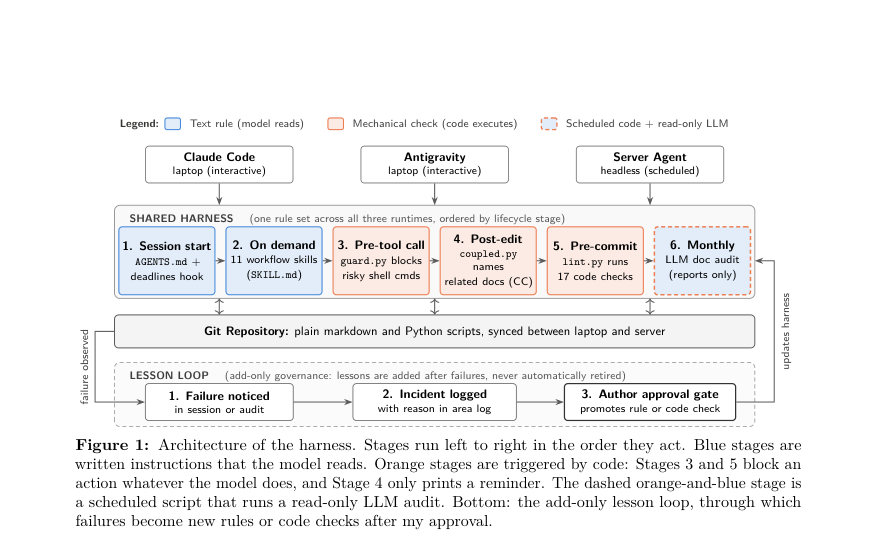
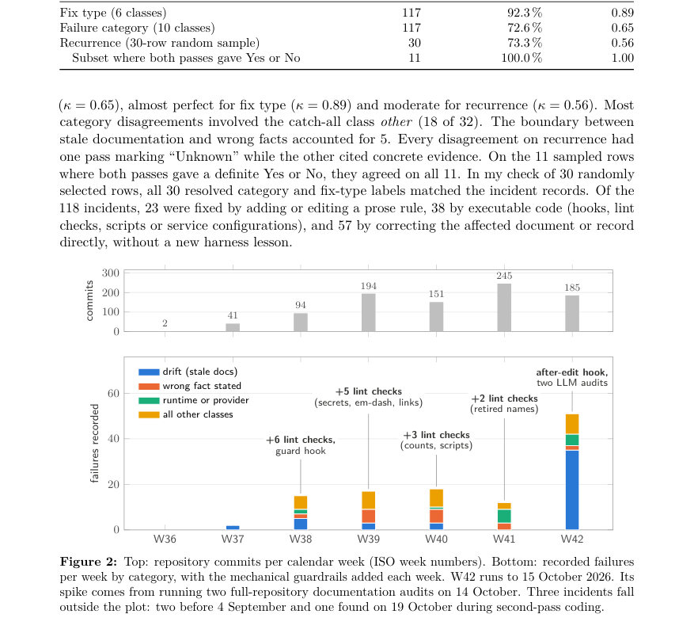
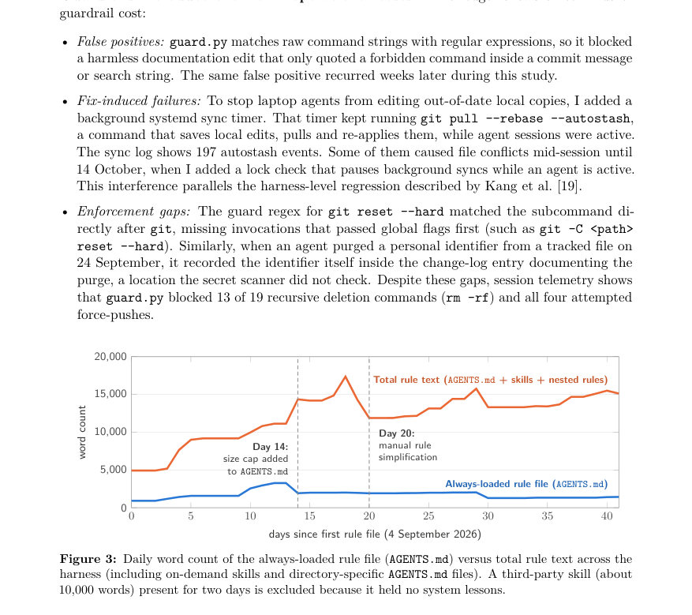

# Lessons Outlive Their Failures: A Case Study of Rules for AI Coding Agents

- **게시일:** 2026-10-26
- **arXiv:** [2610.32578v1](http://arxiv.org/abs/2610.32578v1) · [PDF](https://arxiv.org/pdf/2610.32578v1)
- **저자:** Hassan Hassanzadeh Aliabadi
- **분야:** cs.SE
- **선정 점수:** 3.94
- **선정 이유:** 최근성 0.4, 인용 영향 0.0 (인용 0회), 저자 영향 0.0 (최고 h-index 0), AI 주제 적합성 2.4, 개발자 관심 0.6, 학술 신호 0.6, 오픈 웨이트·주요 연구조직 신호 0.0

[← 2026-10-26 목록으로 돌아가기](../daily/2026-10-26.html)

<!-- paper-visuals:start -->
## 주요 Figure

> 원문 PDF에서 실제 Figure 캡션과 그림 영역이 함께 확인된 자료만 자동 추출했다.

*Figure · 원문 PDF 4쪽 · Figure 1: Architecture of the harness. Stages run left to right in the order they act. Blue stages are*

*Figure · 원문 PDF 7쪽 · Figure 2: Top: repository commits per calendar week (ISO week numbers). Bottom: recorded failures*

*Figure · 원문 PDF 8쪽 · Figure 3: Daily word count of the always-loaded rule file (AGENTS.md) versus total rule text across the*

<!-- paper-visuals:end -->

## 한 문장 요약

한 개발자가 6주간 개인 저장소에서 운영하는 에이전트 하니스(AGENTS.md, 스킬, 훅, 린트)를 관찰·실험해 118건의 에이전트 실패를 장부화하고 LLM 문서 감사와 과거 실패 재재생(replay)을 통해 '하니스 규칙이 실패보다 오래 지속된다'는 현상을 실증적으로 탐구했다.

## 해결하려는 문제

기존 연구는 하니스 구성을 스냅샷이나 짧은 벤치마크 실행에서만 관찰하는 경향이 있으며, 하니스에 추가된 교훈(프로즈 규칙·실행 가능한 검사)이 모델 업그레이드 이후에도 여전히 필요한지, 혹은 반복되는지에 대한 장기적·실험적 증거가 부족하다. 본 논문은 (1) 어떤 실패들이 발생하고 반복되는지, (2) 자동화된 LLM 문서 감사가 얼마나 많은 문서 부패(drift)를 찾는지, (3) 과거의 수정이 모델 버전에 따라 실패 재발을 막는지 여부를 조사한다.

## 핵심 기여

- 118건의 에이전트 실패 장부(ledger)를 구축·코딩하고 일일 규칙 텍스트 성장량을 추적함(두 차례 LLM 코딩 패스와 불일치 해결 포함).
- 월간 LLM 문서 감사의 성능을 47개 실제 취약 문장(ground-truth)과 20개 주입된 오류에 대해 벤치마킹하여 감사의 재현율과 정밀도를 제시함.
- 과거 실패 5건을 골라 각각 '수정 전(Condition A)'과 '수정 적용(Condition B)'의 독립 git 클론에서 여러 모델로 재생(replay)한 실험을 수행하여 실행 가능한 검사와 프로즈 규칙의 효과를 비교함.
- 하니스 규칙·검사의 성장 패턴(AGENTS.md와 총 규칙 텍스트 단어수 변화), 검사(guard) 운용 비용(오탐·간섭 등)과 모델 업그레이드에 따른 교훈의 수명에 관한 실무적 시사점을 제시함.

## 접근 방법

* 단일 사례(자기기록적) 설계로 세 연구 질문에 대응하는 3중 방법을 사용했다.
* 시스템은 단일 개인의 마크다운·파이썬 저장소이며 6단계 하니스(1.세션 시작: AGENTS.md 및 데드라인 훅, 2.온디맨드 SKILL.md들, 3.사전 툴 훅 guard.py, 4.편집 후 훅 coupled.py, 5.사전 커밋 lint.py(17개 검사), 6.월간 LLM 문서 감사)로 구성된다.
* RQ1: git 커밋 로그·영역 변경 로그·일지·감사 리포트를 검색해 실패 장부(행당 실패)를 구성하고 두 차례 LLM 코딩(Claude Sonnet 5.5, Claude Opus 5.5)으로 코드북 기준 라벨링·재현 여부 판정, 일별 규칙 텍스트 단어수 집계.
* RQ2: 2026-10-14 스냅샷을 복제해 47개 실제 stale 항목과 20개 주입 오류(7종)를 포함한 답안키로 세 모델(Claude Haiku 5.5, Sonnet 5.5, Opus 5.5)에 대해 각 3회씩 월간 감사 실행, 재현율·정밀도 측정.
* RQ3: 다섯 과거 실패 시나리오에 대해 수정 직전 상태(A)와 수정만 적용한 상태(B)를 별도 클론으로 준비해 각 조건에서 헤드리스로 3회씩 Sonnet 5.5에서 재생(총 30 runs), 추가로 em-dash와 시간추정 시나리오를 Sonnet 4.5, Sonnet 5, Gemini 3.8 Flash에서 교차실험.
* 운영 텔레메트리로 훅·차단 카운트도 집계.

## 주요 결과

- 실패 장부: 총 118건 기록(기간 2026-09-04 ~ 2026-10-15 기준, 일부 사건은 앞뒤 포함). 카테고리별: 문서 부패(Drift) 48건(40.7%), 에이전트의 잘못된 사실 진술 20건(16.9%), 런타임·프로바이더 실패 14건(11.9%), 기타 14건(11.9%), 동기·동시성 6건, 파괴적 위험 행동 6건, 규칙 위반 4건, 비밀·프라이버시 위험 4건, 형식 오류·크래시 2건. 재현판정은 ‘재발함’ 39건, ‘재발하지 않음’ 8건, ‘불명/기간부족’ 71건.
- 규칙 성장: 항상 로드되는 AGENTS.md 단어수는 916→최대 3,543→사이즈 캡 도입 후 1,435(종료일 기준). 전체 규칙 텍스트(AGENTS.md+스킬+중첩 규칙)는 4,921단어에서 최고 17,366단어로 증가했다가 수동 정리로 11,877단어로 감소 후 최종 15,122단어로 회복. 즉 규칙은 지속적으로 축적됨.
- LLM 문서 감사(RQ2): Claude Sonnet 5.5 단일 감사 평균 재현율은 49.6%(3회 평균, 런별 22~25/47), 세 회 합산으로는 63.8% (30/47). Claude Haiku 5.5 평균 재현율 26.2% (런간 변동 큼). Claude Opus 5.5 평균 41.1% (파일 읽기는 Haiku 서브에이전트에 위임). 전체 9회 실행에서 일부 항목(12/47)은 모든 런에서 누락됨. 주입된 오류 검출은 더 잘 됨(평균 재현율: Haiku 65.0%, Sonnet 80.0%, Opus 83.3%). 정밀도는 매우 높아 각 런별 0.93~1.00(전체 9런에 대해 오탐 8건).
- 재생(RQ3) Sonnet 5.5 결과: 5개 시나리오 중 에이전트가 4개 과제를 완료함. 그중 '스킬 개수 미갱신(stale skill counts)'은 수정 없을 때 3/3 재발, 수정(사전 커밋 린트 체크) 적용 시 0/2 재발(세 번째 B 런은 데드라인 포커스 규칙으로 작업 거절). 다른 세 시나리오는 수정 전후에 모두 재발하지 않았음(0/3 vs 0/3).
- 교차 모델 재생: em-dash 시나리오에서 Sonnet 4.5는 1/3(Condition A)에서 커밋에 도달한 em-dash를 작성했고 Sonnet 5의 한 B런은 에이전트가 em-dash를 초안으로 작성했으나 사전커밋 린트가 커밋을 거부하고 에이전트가 즉시 수정해 커밋함. Sonnet 5.5·Gemini 3.8 Flash는 테스트된 런에서 em-dash를 쓰지 않음. 런타임 추정 시나리오에서 Sonnet 4.5는 과다 추정(≥2×)을 보였고(Condition A 2/3, B 2/3) prompt 규칙은 효과가 없었음; Gemini 3.8 Flash는 많은 런에서 데드라인 포커스 규칙으로 작업을 거절했고 실행된 런들에서는 과다 추정이 관찰되지 않음. 또한 guard.py는 rm -rf 명령 19건 중 13건을 차단했고, 모든 강제 푸시(4건)를 차단함. 배경 동기화가 autostash를 197회 발생시켜 세션 중 충돌을 유발하는 간섭이 있었음.

## 한계

- 저자 명시 한계: 단일 사용자·단일 저장소 사례로 일반화 불가(연구자 설계·로그 정책·수정 선택이 데이터에 영향).
- 저자 명시 한계: 연구자가 로그 정책을 설계하고 수정·라벨링·검증을 주도하여 기대 편향 가능성(맹검 2차 코딩과 주입 오류로 완화).
- 저자 명시 한계: 관찰 기간이 6주로 짧음; 최종주에 고쳐진 사건들은 7일 재발판정 기준에 못 미쳐 'Unknown'으로 표기됨. 14 Oct에 집중된 대규모 감사일이 결과에 큰 영향을 미침(드리프트 건수 급증).
- 저자 명시 한계: 실험은 각 조건 3회 실행으로 표본 수가 작아 통계적 유의성을 주장할 수 없음(예: Fisher p~0.10 수준 사례 있음). LLM이 측정 도구(코딩·감사·에이전트 재생)로 다중 역할을 하여 측정 자체의 불확실성 존재. Ground-truth 키가 완전하지 않음(감사에서 추가로 발견된 진짜 stale 진술이 있었음).

## 개발자 관점

- 문서·구조적 불변량(invariants)은 코드화된 검사(사전커밋 체크 등)로 강제하라: 저장소에 존재하는 파일·카운트·경로 같은 항목은 정량적 검사로 방어해야 드리프트를 막을 수 있다.
- 하니스 규칙은 모델 버전과 생성 날짜를 메타데이터로 기록하고 주기적 재검증(replay) 일정을 두어, 모델 업그레이드 후 불필요해진 규칙을 자동 또는 반자동으로 은퇴시켜라(자동화된 '교훈 폐기' 프로세스 권장).
- 새 규칙·검사를 배포하기 전에 회귀검사와 운영 영향 검사를 통과시켜라(오탐, 다른 훅과의 간섭, 백그라운드 작업과 충돌 여부 등). 예: 정규식 기반 가드의 오탐을 줄이기 위한 컨텍스트-민감 매칭 도입과 동기화 락(lock) 추가.
- 문서 감사는 유용하지만 단일 LLM 패스는 드리프트의 절반가량만 찾는다. 감사는 여러 모델/런을 병렬로 돌리거나, git 히스토리·디렉토리 구조 검사와 결합해 운영해야 한다. 주입 오류 테스트를 통해 감사의 민감도 유형별 차이를 평가하라.
- 은퇴 테스트로서의 카운터팩추얼 git 재생은 저비용·실용적이다: 과거 커밋을 클론해 수정 전·후를 재생해 규칙의 필요성을 검증하고, 자동화함으로써 하니스 축적을 관리할 것.

**근거 범위:** 본 분석은 제공된 논문 PDF 본문(페이지 1–16)에 근거해 작성했다. 주요 수치(예: 118건, 48건·40.7% drift, 재현율·정밀도 수치, 규칙 단어수 변화, 재생 실험 표)는 본문 표·본문 서술에서 직접 추출했다. 본문 외부의 추가 구현 세부사항이나 통계적 해석은 임의로 생성하지 않았으며, 저자가 명시적으로 언급한 한계 및 본문에서 합리적으로 확인되는 제약들을 구분해 기술했다.
