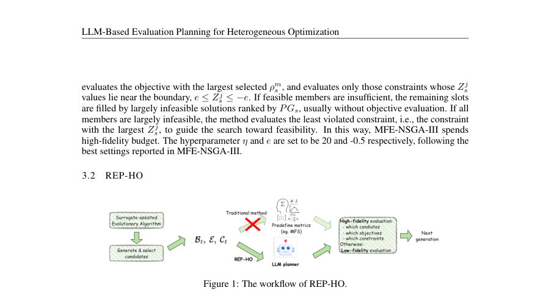
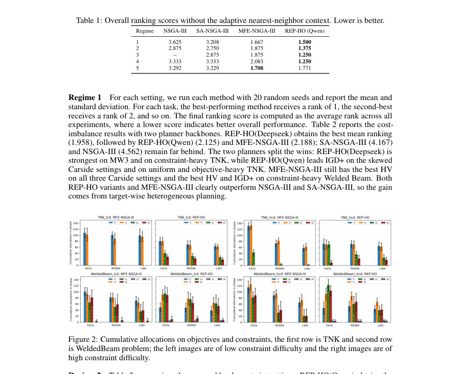
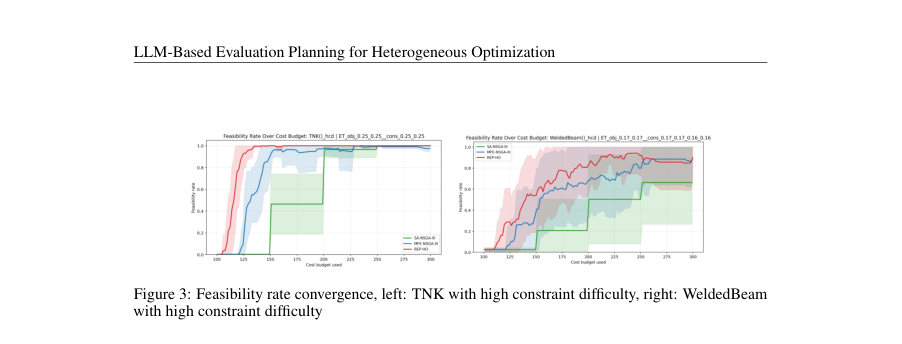

# LLM-Based Evaluation Planning for Heterogeneous Optimization

- **게시일:** 2026-10-20
- **arXiv:** [2610.24855v1](http://arxiv.org/abs/2610.24855v1) · [PDF](https://arxiv.org/pdf/2610.24855v1)
- **저자:** Nian Ran, Sebastian Brulin, Markus Olhofer, Mauricio A. Álvarez, Richard Allmendinger
- **분야:** cs.LG
- **선정 점수:** 5.50
- **선정 이유:** 최근성 0.5, 인용 영향 0.0 (인용 0회), 저자 영향 0.0 (최고 h-index 0), AI 주제 적합성 2.9, 개발자 관심 0.0, 학술 신호 0.5, 오픈 웨이트·주요 연구조직 신호 1.6

[← 2026-10-20 목록으로 돌아가기](../daily/2026-10-20.html)

<!-- paper-visuals:start -->
## 주요 Figure

> 원문 PDF에서 실제 Figure 캡션과 그림 영역이 함께 확인된 자료만 자동 추출했다.

*Figure · 원문 PDF 5쪽 · Figure 1: The workflow of REP-HO.*

*Figure · 원문 PDF 7쪽 · Figure 2: Cumulative allocations on objectives and constraints, the first row is TNK and second row*

*Figure · 원문 PDF 9쪽 · Figure 3: Feasibility rate convergence, left: TNK with high constraint difficulty, right: WeldedBeam*

<!-- paper-visuals:end -->

## 한 문장 요약

대규모 언어모델(LLM)을 고정 휴리스틱 대신 세대별 평가 계획 수립(planner)으로 사용해 이종(heterogeneous) 다목적 제약 최적화에서 어떤 후보의 어떤 목적·제약을 고충실도(고비용)로 평가할지 동적으로 결정하는 REP-HO를 제안하고, 근접 고충실도 이력(Adaptive Nearest-Neighbor Context)을 추가해 안정성과 성능을 향상시킨다.

## 해결하려는 문제

다목적 제약 최적화에서 목적 및 제약마다 평가비용과 충실도(신뢰도)가 다를 때(heterogeneous evaluation) 어떤 후보(solution)의 어떤 목표(objective)와 어떤 제약(constraint)을 고충실도로 평가해 예산을 효율적으로 쓸지 결정하는 문제이다. 기존 SOTA 방법(MFE-NSGA-III 등)은 혼합-충실도 선택을 수작업으로 설계한 지표(heuristic metric)와 규칙·하이퍼파라미터에 의존하므로 적응성·일반성이 제한된다.

## 핵심 기여

- LLM 기반 평가 계획자 REP-HO 제안: 서로게이트 정보(예측·불확실성·비용·예산 등)만을 입력받아 세대별로 후보-대상(target: 목적/제약)-충실도 할당을 JSON 형태로 출력하는 방식으로 수작업 규칙을 대체함.
- 정보 통제된 비교 설정 설계: MFE-NSGA-III와 동일한 서러게이트 기반 백본·생성·예산·후보 집합을 유지하고, LLM이 MFS(혼합충실도 지표)를 직접 보지 못하도록 하여 동일 정보하에서 규칙 기반과 직접 비교함.
- Adaptive Nearest-Neighbor Context(ANNC): 각 후보에 대해 최대 3개의 인접 고충실도 인필 포인트 요약을 프롬프트로 제공하는 간단한 맥락 보강을 도입해 안정성과 성능을 향상시킴.
- 광범위한 실험: 비용 불균형, 제약 난이도, 서러게이트 충실도(상·하), 예산 수준, 목적 간 갈등의 다섯 규범(regimes)에서 REP-HO(Qwen, Deepseek 변형)를 평가하여 적응적 배분 행동과 경쟁력 있는 성능을 보였음.

## 접근 방법

* 전체적으로는 MFE-NSGA-III의 서러게이트 보조 진화 최적화 백본을 유지하되, 세대별(target allocation) 결정만 LLM으로 대체한다.
* 핵심 구성은 다음과 같다: (1) LLM 상태(It)는 현재 예산상태 Bt(소비시간 Tt, 초기 DOE 비용 τ, 총예산 Tmax 등), 대상별 고충실도 비용 테이블 E, 표시된 후보 배치 Ct(각 후보의 설계 변수 x, 서러게이트 예측 ˆf/ˆg, 불확실도 σ, surrogate 기반 비지배 확률 Pm_s, 제약 Z-score Zj_s, 이미 HF 평가 여부 h), 및 출력 규격 R을 포함한다.
* (2) 프롬프트 템플릿은 문제별 간단 소개와 고정된 정보 필드만 변경하며, MFS 점수는 주지 않음.
* (3) LLM 액션(at(s))은 각 후보별로 고충실도 평가를 요청할 목적 집합 Os ⊆ {f1..fM}와 제약 집합 Gs ⊆ {g1..gJ}을 JSON으로 반환한다.
* 빈 집합 허용.
* (4) LLM 호출은 배치 크기 10 후보(인구 N=50이면 세대당 5회 호출)로 수행하고, 호출 백본으로 Qwen3.5-35B-A3B(“Qwen”)과 DeepSeek-V4-Flash(“Deepseek”)를 사용했다.
* (5) ANNC: 각 후보에 대해 최근 역사적 고충실도 인필 중 최대 3개를 RMS 거리 기반으로 제공(거리 기준: ≤1.5*d1, d1=정규화 설계 공간에서의 최단 거리), 인접 이력의 HF 값만 보여주어 LLM의 지역 비교·추론을 돕는다.
* (6) 실행 시 반환된 JSON을 파싱하여 요청된 후보-대상들만 실제 고충실도 평가하고 나머지는 서러게이트 값 유지.

## 주요 결과

- 평가 지표 및 설정: 최종 비지배 유효 근사집합 A에 대해 IGD+ (작을수록 좋음)와 Hypervolume(HV, 클수록 좋음) 사용. 기본 예산 Tmax=300(시간 단위, 모든 목표·제약을 HF로 평가하면 1 단위), 실험은 20개의 랜덤 시드로 수행. 비교군: NSGA-III(모두 HF), SA-NSGA-III(서러게이트 보조, 균일 HF), MFE-NSGA-III(혼합충실도 지표 기반).
- 주요 정량 결과 및 관찰: (본문 표 기준) - REP-HO 변형들은 다섯 규범 전체에서 평균 순위(mean ranking)에서 경쟁력 있게 나타났다. 예를 들어 Regime 1(비용 불균형)에서 평균 통합 순위(IGD+/HV 기준): NSGA-III 4.562, SA-NSGA-III 4.167, MFE-NSGA-III 2.188, REP-HO(Qwen) 2.125, REP-HO(Deepseek) 1.958로 두 REP-HO 변형이 상위권을 차지함(Table 2).
- 세부 규범별: (본문 요약) - Regime 2(제약 난이도): REP-HO(Qwen)가 평균 순위 2.000으로 1위, REP-HO(Deepseek) 2.062로 근접함(Table 3). - Regime 3(서러게이트 충실도): REP-HO(Qwen)가 평균 순위 1.750으로 우수, Deepseek 2.125, MFE 2.188(Table 4). - Regime 4(예산 변화): REP-HO(Deepseek) 평균 순위 1.889로 최고, REP-HO(Qwen) 2.167(Table 5). - Regime 5(목적 갈등): REP-HO(Deepseek) 평균 순위 1.958로 최고, MFE 2.062, REP-HO(Qwen) 2.708(Table 6).
- 적응적 행동 관찰: LLM 계획자는 예산이 부족할 때 제약(제약 HF 평가)을 우선하는 경향을 보였고(예: Tmax=200에서 초기 세대의 제약 할당 비율 증가), 서러게이트 신뢰도가 변하면 어떤 제약에 예산을 더 할당할지 재분배하는 행동을 보였다(서러게이트 LF-HF Spearman 상관이 낮아지면 제약별로 HF 예산 재분배).
- ANNC 효과: 원본 REP-HO에 ANNC를 추가하면 결정의 안정성·성능이 개선되었다고 보고(본문에서 ANNC 추가 후 더 나은 안정적 결과 언급).

## 한계

- 저자가 명시한 한계 및 위험: (본문 'Broader Impacts'와 AI Use Statement) LLM 기반 플래너는 불투명한(opaque) 결정 행동을 보일 수 있어 모든 행동을 포괄적으로 평가하기 어렵고, 의사결정의 해석성·안전성 문제가 존재한다고 저자가 명시함.
- 본문·실험에서 확인되는 제약(저자가 직접적으로 주장하지 않은 관찰 한계): 실험은 공개 벤치마크(예: TNK, MW3, WeldedBeam, Carside, ZDT1, Kursawe, BNH, OSY)와 인위적으로 설계된 다섯 규범에 한정되어 있어 실제 대규모 실험비용·물리 실험·복잡 산업 문제로의 일반화는 본문 범위를 벗어난다. 또한 서러게이트 패밀리와 예산 기본값(Tmax 등)을 고정하고 있어 다른 서러게이트 모델·더 큰 차원의 문제·비동기 평가 시간 등에 대한 거동은 추가 검증이 필요하다.
- 시스템적 의존성 한계: REP-HO는 외부 호스팅 LLM(Qwen3.5, DeepSeek)을 사용하며 'reasoning-effort=none' 같은 호출 파라미터에 의존한다(재현 가능성에는 긍정적이나, 다른 모델·설정에서 성능 변동 가능). 또한 실험별 토큰·지연(평균 wall-clock 약 200–293s)과 API 비용이 존재(Appendix E).

## 개발자 관점

- 재현성: 저자는 익명 코드 저장소(링크 본문에 기재)를 공개했으며, 프롬프트 템플릿과 호출 파라미터(예: reasoning-effort=none)를 고정해 실험 재현을 지원함(본문 Appendix A).
- 프롬프트·입출력 인터페이스: LLM에 전달되는 상태는 엄격히 제한된 구조(Bt,E,Ct,R)이며, 반환은 JSON 형식의 per-candidate 선택 리스트(목적 목록, 제약 목록)여야 함. 이 구조를 지키면 LLM 종류를 바꿔도 파이프라인 호환이 쉬움.
- 비용·지연 고려: 전체 실험당 LLM 토큰 비용은 평균적으로 REP-HO(Qwen) 약 $0.102 ± 0.054, REP-HO(Deepseek) 약 $0.089 ± 0.052(평균입출력토큰 기반 추정, Table 17). 호출 수·토큰 수·대기시간(평균 wall-clock 200–300s)으로 운영비용 및 병렬화 전략을 설계해야 함.
- 안전·검증: LLM 결정은 불투명하므로 운영 시 로그(선택된 후보·대상·서러게이트 상태)와 정책 감시(예산 소모·제약 검토 등)를 두어 이상 행동을 탐지·롤백할 필요가 있음.
- 성능 안정화: ANNC(최대 3개 이웃 HF 포인트, 거리 기준 ≤1.5*d1) 같은 소규모 맥락 보강은 성능·안정성 향상에 기여하므로 실무 적용 시 지역적 고충실도 요약을 포함하는 것이 권장됨.

**근거 범위:** 논문 PDF 본문(제공된 페이지와 부록 포함)을 근거로 작성함. 표(Table 1–17), 본문 설명(방법·프롬프트 템플릿·ANNC), 및 Appendix의 비용·토큰·재현성 설명을 직접 참조했다. 코드·실행 로그의 세부 내부 구현이나 추가 실험(제공되지 않은 문제군)에 대한 내용은 PDF에 없으므로 기술하지 않았으며, 표의 수치와 주장만을 본문에서 인용·요약했음을 밝힌다.
