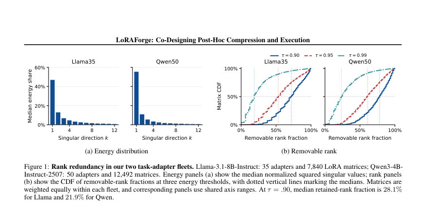
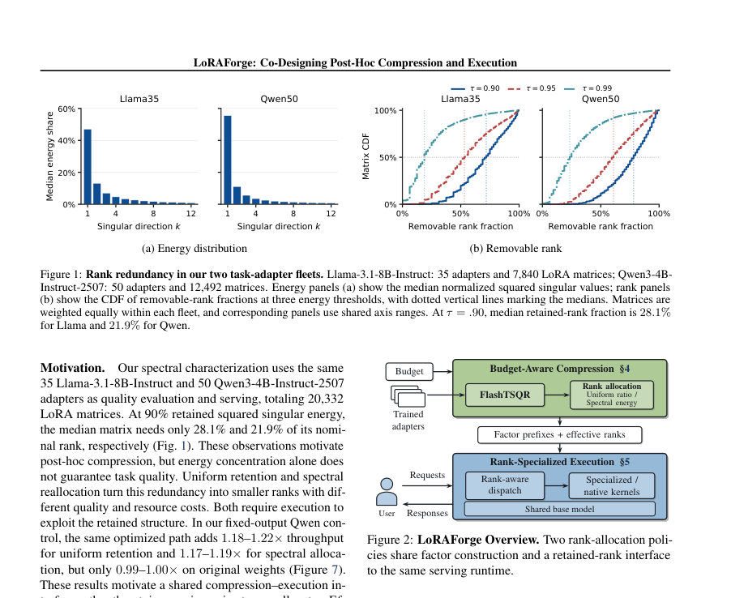
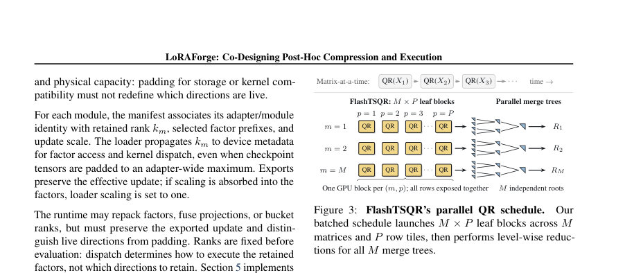

# LoRAForge: Co-Designing Post-Hoc Compression and Execution for Efficient Multi-LoRA Serving

- **게시일:** 2026-11-03
- **arXiv:** [2611.01256v1](http://arxiv.org/abs/2611.01256v1) · [PDF](https://arxiv.org/pdf/2611.01256v1)
- **저자:** Shenghui Li, Thiemo Voigt
- **분야:** cs.LG, cs.AI
- **선정 점수:** 5.23
- **선정 이유:** 최근성 0.5, 인용 영향 0.0 (인용 0회), 저자 영향 0.0 (최고 h-index 0), AI 주제 적합성 1.5, 개발자 관심 0.5, 학술 신호 0.3, 오픈 웨이트·주요 연구조직 신호 2.5

[← 2026-11-03 목록으로 돌아가기](../daily/2026-11-03.html)

<!-- paper-visuals:start -->
## 주요 Figure

> 원문 PDF에서 실제 Figure 캡션과 그림 영역이 함께 확인된 자료만 자동 추출했다.

*Figure · 원문 PDF 3쪽 · Figure 1: Rank redundancy in our two task-adapter fleets. Llama-3.1-8B-Instruct: 35 adapters and 7,840 LoRA matrices; Qwen3-4B-*

*Figure · 원문 PDF 3쪽 · Figure 2: LoRAForge Overview. Two rank-allocation poli-*

*Figure · 원문 PDF 4쪽 · Figure 3: FlashTSQR’s parallel QR schedule.*

<!-- paper-visuals:end -->

## 한 문장 요약

이미 훈련된 다수의 LoRA 어댑터(멀티-로라)를 대상으로, 행렬 요인화의 일괄화된 GPU 연산(FlashTSQR)과 유지된 랭크(retained-rank) 표현을 결합해 배치 재압축과 랭크 특화 실행(직렬/병렬 커널, 디스패치)을 공동 설계하여 저장·로딩·추론 비용을 줄이고 처리량을 높인다.

## 해결하려는 문제

기존 멀티-LoRA 서빙은 많은 어댑터를 하나의 베이스 모델과 공유할 수 있으나 어댑터 수가 증가하면 GPU 저장공간·로드·실행 오버헤드가 커진다. 사후 재압축(SVD/스펙트럼 방법)은 파라미터 수를 줄이지만 작은 랭크가 자동으로 서비스 속도 향상으로 이어지지 않는다(패딩, 팩터 접근, 일반 커널의 비효율). 또한 수천 개 모듈을 독립적으로 재압축하면 준비 비용이 크다. 따라서 대규모 함대에 대해 (1) 재압축을 효율적으로 배치 실행하고, (2) 재압축으로 얻은 작은 랭크를 실제 서빙에서 효율적으로 활용하는 방법이 필요하다.

## 핵심 기여

- 보유 예산 기반(fleet-level) 압축 파이프라인 설계 및 보존된-랭크(retained-rank) 인터페이스 제안: 정렬된 팩터 프리픽스와 각 모듈의 유효 랭크를 명시해 로더·디스패치·커널이 이를 유지하도록 규정함.
- FlashTSQR: 수천 개의 Tall-Skinny 팩터를 대상으로 모듈·행 타일 병렬화를 활용하고 삼각 병합·암시적 Q 적용을 통해 중간 저장을 줄여 GPU에서 팩터 구성(QR+코어 대각화)을 가속하는 새로운 원시 연산을 개발·제시함.
- 두 가지 랭크 할당 정책 제시: 균일 유지 비율(LoRAForge-U)과 스펙트럴 에너지 기반 예산 할당(LoRAForge-S)을 정의하고, 비용-민감한 접두사 선택(에너지 대비 파라미터 비용 우선순위)을 구현함.
- 랭크 특화 실행: 유효 랭크를 보존한 채로 축소(shrink)와 확장(expand)에 대해 직접 감소 기반 커널(짧은 디코드 배치)과 RowExpand(스레드 소유 가중치 행 + 공유 Z 타일) 등 특수 커널 및 단계·랭크·형상 인지 디스패치를 설계하여 작은 랭크에서 실제 성능을 끌어냄.
- 포괄적 평가: 85개 공개 어댑터(35 Llama, 50 Qwen)에 대해 재압축 비용, 작업(quality) 손실, GPU(MI250X, GH200)에서의 서빙 성능을 측정하여 재압축·실행 설계의 실효성 입증.

## 접근 방법

* 전체 파이프라인은 (1) 보존된-랭크 계약(retained-rank contract)으로 정렬된 팩터 프리픽스와 각 모듈의 유효 랭크 km을 명시하고, 로더가 패딩된 체크포인트에서도 km을 장치 메타데이터로 전파하도록 요구한다.
* (2) 랭크 할당은 두 정책을 지원한다: LoRAForge-U는 각 모듈의 원래 랭크 r를 공통 분모 d로 나눈 균일 유지(um = max(1, ⌊r/d⌋) 형태)로 예산 PU를 정하고, LoRAForge-S는 그 예산 PU를 스펙트럼 에너지를 최소화하는 정수 최적화(논리적으로는 그리디한 에너지/파라미터 비율 ηm,j = σ^2/(din+dout)로 선택)로 재분배한다.
* (3) 팩터 구성에서는 FraQ의 한쪽 좌표 표현과 TSQR을 바탕으로 FlashTSQR를 구현한다: 작은 차원에 대해 thin QR를 수행해 R을 얻고 H=R·Y를 만들며 H H^T의 고유분해로 스펙트럼을 얻어 균형화된 팩터 F,T를 계산한다(첫 k 방향이 정확한 k-트렁케이트 SVD를 재구성).
* FlashTSQR는 M개의 행렬을 각 P개의 행 타일로 분할해 MP개의 리프 블록을 병렬로 띄운 뒤 레벨별 삼각 병합을 수행해 배치 재압축을 가속한다.
* (4) 서빙에서는 유효 랭크 정보를 이용해 두 가지 유형의 shrink 커널(직접 감소형과 랭크-인지된 CSGMV)과 RowExpand 확장 커널을 제공한다.
* RowExpand는 각 스레드가 B의 한 행을 레지스터에 로드해 T개의 토큰에 재사용하고 공유된 Z 타일을 사용해 토큰×출력 재사용을 극대화한다.
* (5) 디스패치는 단계(prefill/decode), 랭크, 형상(토큰 수 등)에 따라 네이티브 경로 또는 특수 커널을 선택하도록 고정하여 실행 성능을 최적화한다.

## 주요 결과

- 플릿 전체 재압축(팩터 구성)에서 FlashTSQR는 GH200에서 FraQ 대비 Qwen50 전체 플릿 구성 시간을 5.55s→2.44s로 단축(중앙값), 2.28× 가속을 달성했고 Llama35는 3.93s→2.06s로 1.91× 가속을 보고함(Section 6.3, Figure 5).
- MI250X 전체-플릿 실험(보충결과)에서 FlashTSQR는 stabilized FraQ 대비 Qwen50을 19.8s→8.37s(2.37×), Llama35를 14.6s→8.08s(1.81×)로 줄였음(Appendix B.8, Fig.18).
- 서빙 성능: 동일한 랭크-바닥(1/12, rank-floored spectral exports)을 사용한 상태에서 LoRAForge-S는 MI250X에서 Original(기존 네이티브)의 토큰 처리량 대비 1.59×, GH200에서 1.92×를 달성함(Section 6.4, Fig.6).
- 공유 런타임(랭크 특화 실행)의 효과: 고정 작업(fixed-work) Qwen 제어에서 공유 런타임은 균일·스펙트럴 압축양상에서 각각 1.17–1.22×의 처리량 향상을 제공했으나 원본(압축하지 않은)에서는 0.99–1.00×로 이득이 거의 없었음(Fig.7).
- 품질-자원 균형: 85개 어댑터에 대한 전체 작업 품질 평가(Table 1)에서 1/12 예산일 때 LoRAForge-S(스펙트럴, 랭크 바닥 적용)는 Qwen 평균 점수를 Original(70.21) 대비 69.41로 약 0.80점 감소, Llama는 Original(71.13) 대비 69.93로 약 1.20점 감소함. 같은 예산에서 CTS(공유-기반 JD-Full)보다 더 작은 평균 품질 하락을 보고함(Section 6.2, Table 1).

## 한계

- 저자가 명시한 한계: (1) 스펙트럴 에너지가 어댑터별 품질 보장이나 공정성(fairness)을 보장하지 않음(본문 Section 6.7 및 Appendix B.13). (2) 파라미터 예산은 지연(latency)이나 물리적 메모리를 직접적으로 보장하지 않음(본문). (3) 제시된 배포 및 성능 평가는 두 하드웨어(MI250X, GH200)와 특정 런타임(SGLang 기반)에 국한되며 보편적 이식성은 보장되지 않음. (4) 전체 파이프라인의 공동 최적화(품질-지연 목적의 공동 탐색)와 준비(압축) 비용의 서비스 수명에 대한 상각(amortization)은 향후 작업으로 남음(Section 6.7, Appendix B.13).

## 개발자 관점

- 보존된-랭크 계약을 구현해 '유효 랭크' 메타데이터를 로더/런타임에 전파하면 패딩된 체크포인트에서도 어떤 방향이 실제로 살아있는지 보장할 수 있다(팩터 접근·디스패치에서 필수).
- 플릿 규모 재압축은 개별 라이브러리 호출 대신 모듈·타일 단위의 배치를 사용해 QR/SVD 호출을 합치면 대폭 가속된다(FlashTSQR 설계와 병렬 병합 트리 참조).
- 서빙 측면에서는 작은 랭크와 짧은 토큰 배치에 대해 직관적이지만 표준 매트릭스곱 타일이 비효율적일 수 있으므로 (1) 직감축소형 shrink 커널(토큰당 스레드 그룹)과 (2) RowExpand(스레드 당 가중치 행 레지스터 보관 + 공유 Z 타일)를 제공해 토큰-대-출력 재사용을 활용해야 한다.
- 실전 배포 권고: 랭크 바닥(ℓm)을 설정하고 스펙트럴 재할당의 그리디 선택(에너지/파라미터 우선순위)을 사용하되, 일부 어댑터에서 큰 품질 저하가 발생할 수 있으므로 어댑터별 회귀 검사와 보수적 바닥 설정을 권장함(Appendix B.11 표와 설명).
- 재현·안정성: GPU 고유의 고유값/고유벡터 솔버, 정밀도(예: FP32/BF16-FP32 누적) 및 넓은 랭크(또는 실패) 대체 경로를 준비해야 함. 또한 FlashTSQR와 같이 백엔드별 최적화가 성능에 크게 영향하므로 HIP/CUDA 구현의 성능 차이를 검증해야 한다.

**근거 범위:** 본 분석은 제공된 논문 PDF 본문(본문, 그림, 표, 부록에 명시된 수치와 설명)을 기반으로 작성되었음. 품질 및 성능 수치(예: 재압축 시간, 처리량 배수, Table 1의 점수)는 본문과 도표에서 직접 발췌함. '약 7.7%의 파라미터 유지'와 같은 일부 비율 수치는 논문 초록에 언급된 값으로 본문에 동일한 형태로 반복된 위치가 제한적이므로 초록 근거임을 유의해야 함. 또한 부록의 구현·플랫폼별 세부(예: GPU 솔버 내역)는 본문과 부록 일부에서 확인되었으나 전체 소스·실험 코드는 제공된 증거 아카이브를 통해 추가 검증이 가능함.
