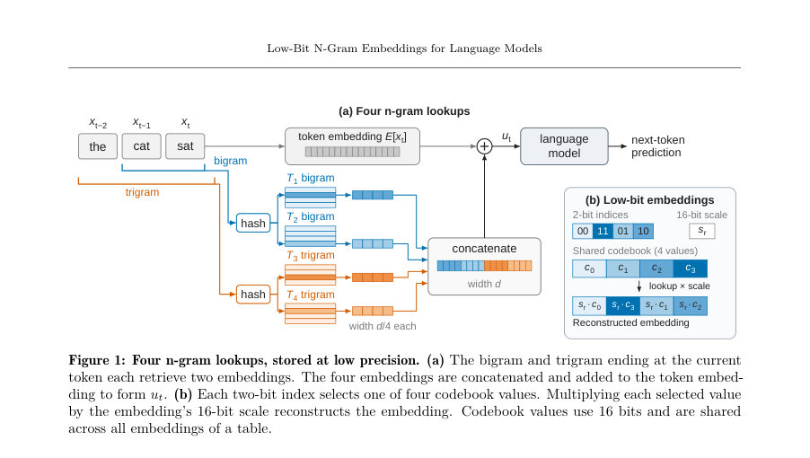
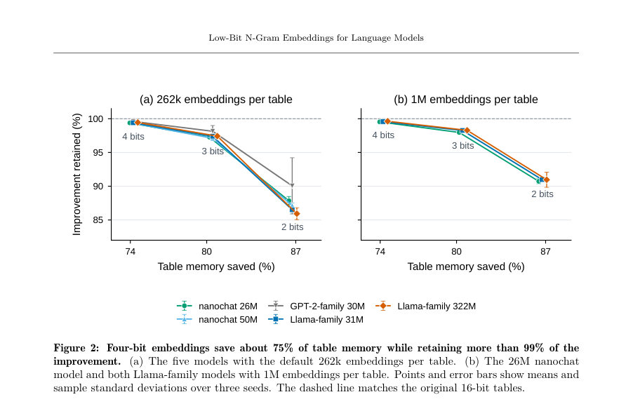
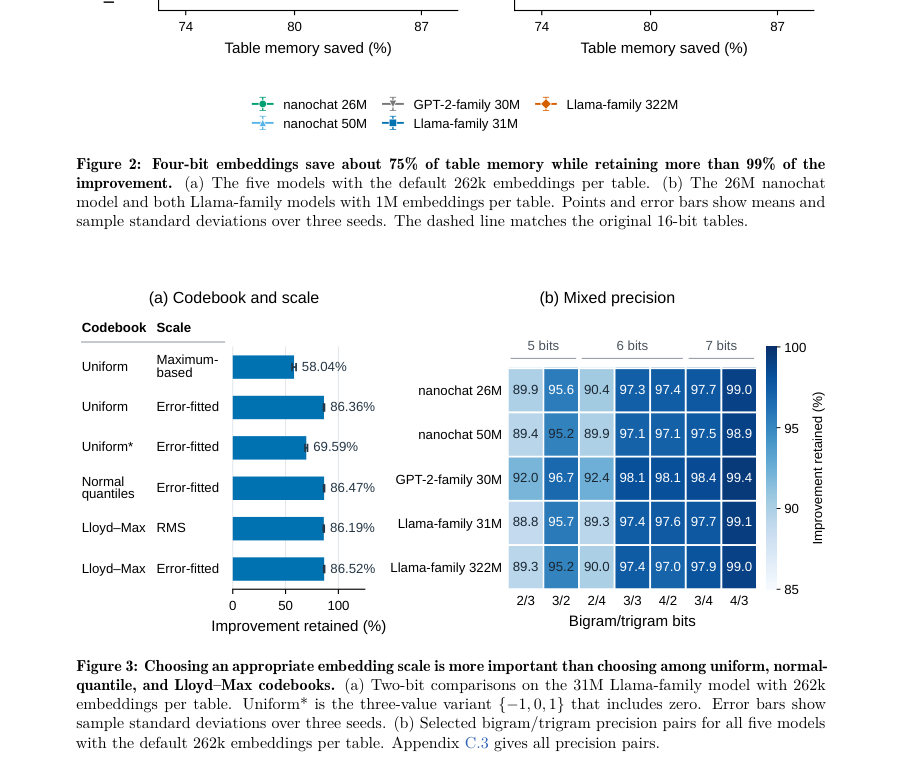

# Low-Bit N-Gram Embeddings for Language Models

- **게시일:** 2026-10-24
- **arXiv:** [2610.31646v1](http://arxiv.org/abs/2610.31646v1) · [PDF](https://arxiv.org/pdf/2610.31646v1)
- **저자:** Stephen Chung, Wenyu Du
- **분야:** cs.CL, cs.AI
- **선정 점수:** 8.09
- **선정 이유:** 최근성 0.8, 인용 영향 0.0 (인용 0회), 저자 영향 1.3 (최고 h-index 7), AI 주제 적합성 1.5, 개발자 관심 0.2, 학술 신호 0.3, 오픈 웨이트·주요 연구조직 신호 4.0

[← 2026-10-24 목록으로 돌아가기](../daily/2026-10-24.html)

<!-- paper-visuals:start -->
## 주요 Figure

> 원문 PDF에서 실제 Figure 캡션과 그림 영역이 함께 확인된 자료만 자동 추출했다.

*Figure · 원문 PDF 2쪽 · Figure 1: Four n-gram lookups, stored at low precision. (a) The bigram and trigram ending at the current*

*Figure · 원문 PDF 5쪽 · Figure 2: Four-bit embeddings save about 75% of table memory while retaining more than 99% of the*

*Figure · 원문 PDF 5쪽 · Figure 3: Choosing an appropriate embedding scale is more important than choosing among uniform, normal-*

<!-- paper-visuals:end -->

## 한 문장 요약

n-gram 임베딩 테이블을 각 컴포넌트에 대해 b-비트 인덱스 + 임베딩별 16비트 스케일 + 공유 코드북(2^b 값) 구조로 저정량화하여 테이블 메모리를 크게 줄이면서(예: 4비트로 약 75% 절감) 원래 테이블이 제공하던 성능 개선을 거의 보존하는 방법을 제안하고 실험적으로 검증한다.

## 해결하려는 문제

최근 언어모델들은 bigram/trigram 등 n-gram 임베딩 테이블을 추가해 성능을 올리지만, 가능한 n-gram 조합 수가 방대해 임베딩 테이블이 막대한 메모리를 차지한다(예: DeepSeek-V4.1-Flash의 Engram에 수십억 파라미터 할당). 본 논문은 이러한 테이블의 메모리 비용을 줄이면서 테이블이 제공하는 성능 향상(검증 손실/퍼플렉시티 개선)을 유지할 수 있는지, 또한 절약한 메모리를 재투자해 성능을 더 향상시킬 수 있는지를 조사한다.

## 핵심 기여

- 다양한 모델(nanochat, GPT-2 계열, Llama 계열)에서 n-gram 임베딩 테이블을 저(低)비트로 저장하여 테이블 메모리를 크게 줄이되 성능 손실을 거의 보존할 수 있음을 실험적으로 보여줌(예: 4비트는 약 74–75% 메모리 절감에 원래 개선의 >99% 보존).
- 코드북 구성(균등, 정규분위, Lloyd–Max)과 임베딩 스케일(max/RMS/오차 적합) 및 bigram/trigram 간 혼합 정밀도 할당을 체계적으로 비교해 실무적 선택 가이드를 제시함(스케일 선택이 코드북 선택보다 중요).
- 짧은 파인튜닝으로 매우 낮은 비트(1–2비트)에서 발생하는 성능 저하를 상당 부분 회복할 수 있음을 보이고, 저비트로 절감된 메모리를 더 많은 임베딩으로 재투자하면 원래 16비트 표보다 더 나은 성능을 얻을 수 있음을 실증함(예: 1M 임베딩 × 2비트가 원래 개선의 122–126% 돌파하며 전체 테이블 메모리는 절감).
- 대형 공개 모델(DeepSeek-V4.1-Flash, Qwen3.8-Flash-Next)에 동일한 압축을 적용해 47–55% 테이블 메모리 절감과 퍼플렉시티 변화가 작음을 보여 실제 모델에도 적용 가능함을 입증함.
- 학습·추론 시 구현 세부(임베딩별 16비트 스케일, 공동 코드북, BF16 복사본을 유지한 채 전방에서 양자화, 역전파는 straight-through estimator 등)를 제시하여 실무 적용이 가능한 절차를 제공함.

## 접근 방법

* 아키텍처 및 저장 포맷: 기존 Over-Tokenized Transformer 스타일의 n-gram 구성(각 위치에 대해 두 개의 bigram 테이블과 두 개의 trigram 테이블을 사용, 총 4개 테이블, 각 테이블 행은 d/4 차원 임베딩)을 유지하면서 각 임베딩 컴포넌트를 b비트 인덱스로 저장하고 임베딩마다 16비트 스케일 sr를 추가로 저장한다.
* 인덱스는 공유 코드북(c0..c_{2^b-1})을 참조하고 복원은 ˆw_{ri} = s_r * c_{q_{ri}}로 수행한다.
* 코드북 후보로 균등(uniform), 정규분위(normal-quantile), 학습된 Lloyd–Max를 비교하고 스케일은 최대값 매칭(max), RMS, 오차(fitted) 중 선택하여 비교한다.
* 해싱/조회: 토큰 ID 기반으로 k^{(2)}_t = x_t + B x_{t-1}, k^{(3)}_t = x_t + B x_{t-1} + B^2 x_{t-2} (B = V+1, V=8192)로 키를 만들고 모듈로 연산을 통해 테이블 주소 선택(기본 m=262,141, 1M 실험에 m=1,048,573).
* 학습·추론 절차: (i) 사전학습 후 테이블을 양자화하여 평가, (ii) 양자화 후 짧은 파인튜닝으로 성능 회복 실험, (iii) 저비트 임베딩을 전처부터 사용하는 저비트 학습(전방에서 양자화, BF16 복사본으로 역전파에 straight-through 사용, 초기 업데이트 동안 코드북 재적합) 등 여러 시퀀스를 비교함.

## 주요 결과

- 전처리 모델(From-scratch) 실험(5개 모델: nanochat 26M/50M, GPT-2 30M, Llama 31M/322M; 기본 테이블 크기 262k 임베딩/테이블): 4비트 압축은 테이블 메모리 사용을 약 26%로 줄여 약 74–75% 메모리 절감하면서 원래(16비트) 테이블이 준 검증 손실 개선의 >99%를 유지(예: Llama 31M에서 개선의 99.4% 보존). (Table 3)
- 2비트의 경우 테이블 메모리 사용이 ~13–13.5%로 약 86–87% 절감되나 개선 유지율은 모델별로 85.9–91.0%로 하락(예: Llama 322M에서 2비트는 85.9% 유지). (Table 3)
- 코드북·스케일 비교: 2비트 실험에서 임베딩 스케일 선택이 코드북 선택보다 중요함. 오류-적합(error-fitted) 스케일을 쓰면 Uniform/Lloyd–Max/Normal-quantile 간 성능 차이는 매우 작고(약 86.36–86.52% 유지), 반면 uniform+maximum-based 스케일은 성능이 크게 저하(예: 58.04%). 따라서 기본 설정은 Lloyd–Max 코드북 + error-fitted 스케일로 채택. (Section 3.3, Figure 3a, Table 5)
- bigram/trigram 혼합 정밀도: 동일 메모리 예산에서 bigram에 더 많은 비트를 할당하는 편이 개선 보존에 유리함(예: 4비트 bigram + 3비트 trigram은 77–78% 메모리 절감에서 개선의 98.9–99.4% 유지). (Figure 3b, Figure 8)
- 대형 모델 평가: DeepSeek-V4.1-Flash와 Qwen3.8-Flash-Next에 Lloyd–Max+error-fitted로 압축 적용 시 4비트는 테이블 메모리 약 46–55% 절감(논문 전반에서 47–55% 범위 표기)하면서 WikiText-2 퍼플렉시티 증가는 DeepSeek에서 +1.26% (선택 설정은 +1.11% 보고), Qwen은 거의 변화 없음(예: Qwen WikiText +0.95%). PTB/C4 등 다른 평가에서도 선택된 혼합 정밀도 설정은 퍼플렉시티 변화를 1.2% 미만으로 유지. (Section 3.4, Table 6, Figures 4/9/10). 다운스트림( HellaSwag / ARC-Challenge / WinoGrande) 평균 정확도 변화는 DeepSeek에서 −0.93%, Qwen에서 −0.27%로 크게 악화되지 않음(개별 태스크 신뢰구간 확인). (Figure 5, Table 7).

## 한계

- 저자가 명시한 한계: 논문 본문에서 실험을 여러 아키텍처와 공개 대형 모델에 적용해 일반성을 확인했으나, 별도의 '한계' 섹션에서 광범위한 제약을 명시적으로 정리하지는 않음. AI 사용(자율 에이전트 rStation 결과 재현) 및 재현 가능성을 위해 코드·설정 링크를 제공함.
- 본 논문에서 합리적으로 확인되는 제약: (1) 실험은 V=8192 어휘, 특정 해싱 스킴(키 수식 및 주소 = mod m / m+2 등), 기본 테이블 크기(262,141 또는 1,048,573)에 기반하며 이들 하이퍼파라미터와 다른 어휘/해싱/주소 체계에 대한 일반화는 추가 검증이 필요함. (2) 보고된 수치는 '테이블 메모리'만을 대상으로 하며 전체 모델 메모리·추론 지연·호스트-가속기 전송 비용 등 시스템적 비용은 상세히 다루지 않음(본문에서 테이블 메모리 기준으로만 백분율 계산). (3) 일부 결과(예: 1비트로 전처리부터 학습한 경우 성능 유지)는 모델/데이터/해싱에 따라 편차가 크며 일관성 검증이 더 필요함(표준편차로 변동성 표기됨). (4) DeepSeek/Qwen 압축은 원래 테이블이 FP8로 저장된 환경에서의 비교로, 다른 모델·포맷 또는 실환경 배포에서의 성능·정합성 영향은 추가 평가 필요.

## 개발자 관점

- 실무 권장 설정: Lloyd–Max 코드북 + error-fitted 임베딩 스케일을 기본으로 사용하고, 먼저 4비트를 시도하라 — 4비트는 약 74–75% 테이블 메모리 절감과 >99% 개선 보존을 제공해 실무에서 '안전한' 절감옵션임.
- 혼합 정밀도: 동일 예산에서 bigram에 더 많은 비트를 할당하는 것이 대체로 유리하다(예: 4비트 bigram + 3비트 trigram은 높은 개선 보존). 모델별로 민감도가 다르므로 작은 탐색(그리드) 권장.
- 절약된 메모리 재투자: 메모리를 더 많은 임베딩 수로 재투자하면 성능을 개선할 수 있음(예: 262k→1M로 늘리고 2비트 사용 시 원래 개선의 122–126% 달성하면서 전체 테이블 메모리는 약 52–54%만 사용). 따라서 배포시 단순 압축만 고려하지 말고 테이블 크기 재조정도 함께 고려하라.
- 학습/파인튜닝 실무 팁: 저비트 전방 양자화 시 BF16 복사본을 유지하고 역전파에는 straight-through estimator를 쓸 것. 코드북은 초반 업데이트에서 자주(예: 처음 100 업데이트마다), 이후에는 덜 자주(예: 매 25 업데이트) 재적합하면 안정적임(본문 구현). 파인튜닝(예: 262k 테이블에 대해 381 업데이트, 배치 32, lr=원래의 0.1 배로 warmup 20 등)으로 압축 후 손실을 상당 부분 회복 가능.
- 구현·배포 주의: 논문은 테이블 메모리 절감(인덱스 비트 + 16비트 스케일 + 공유 코드북)을 기준으로 평가하므로 전체 모델 메모리/추론 지연/IO 비용(특히 대형 테이블을 호스트에서 서빙할 때)까지 포함한 엔지니어링 평가가 필요하다. 또한 코드북·스케일을 BF16로 저장한다는 점을 염두에 둘 것.

**근거 범위:** 이 분석은 제공된 논문 PDF 본문(본문 및 부록 A–C의 텍스트, 표, 그림)을 근거로 작성했습니다. 제시된 수치(메모리 절감 비율, 개선 유지율, 퍼플렉시티/정확도 변화 등)는 본문 표와 그림에서 직접 인용했습니다. 구현·환경(하드웨어·실제 배포 성능 영향) 관련 상세 비용·레이턴시 평가는 본문에서 테이블 메모리 기준으로만 보고되어 있어 그 밖의 시스템 비용은 추가 평가가 필요합니다.
