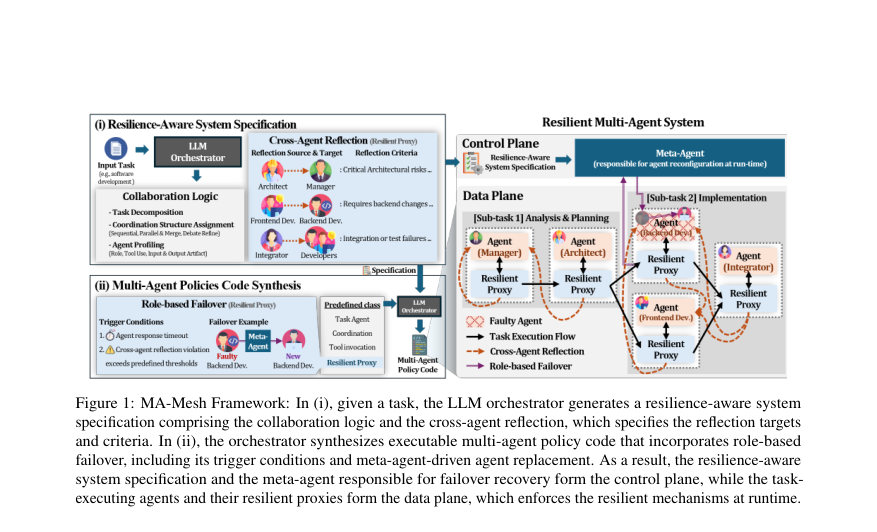
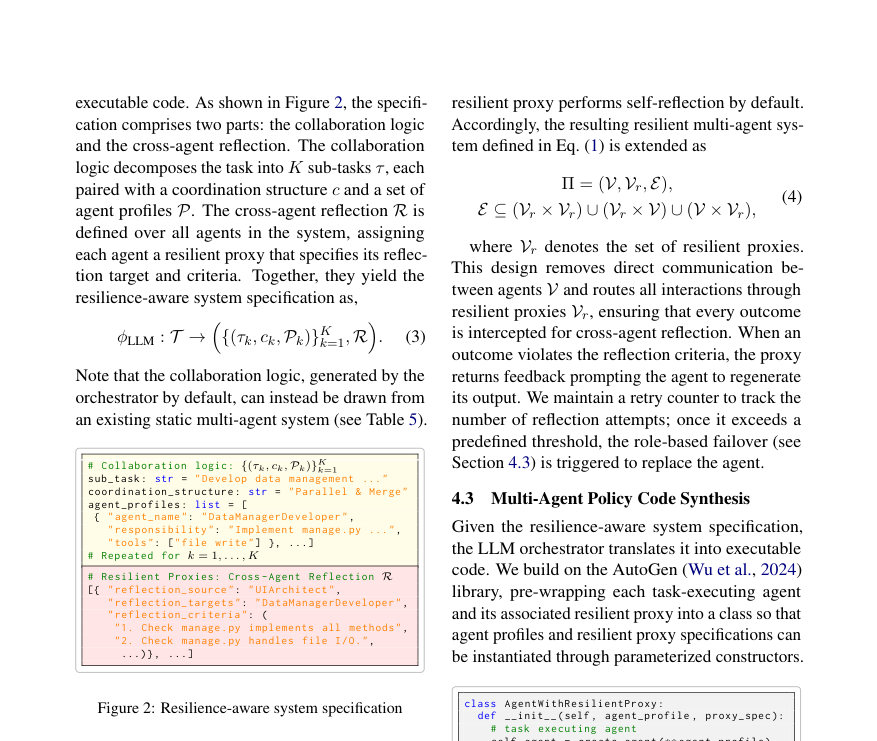
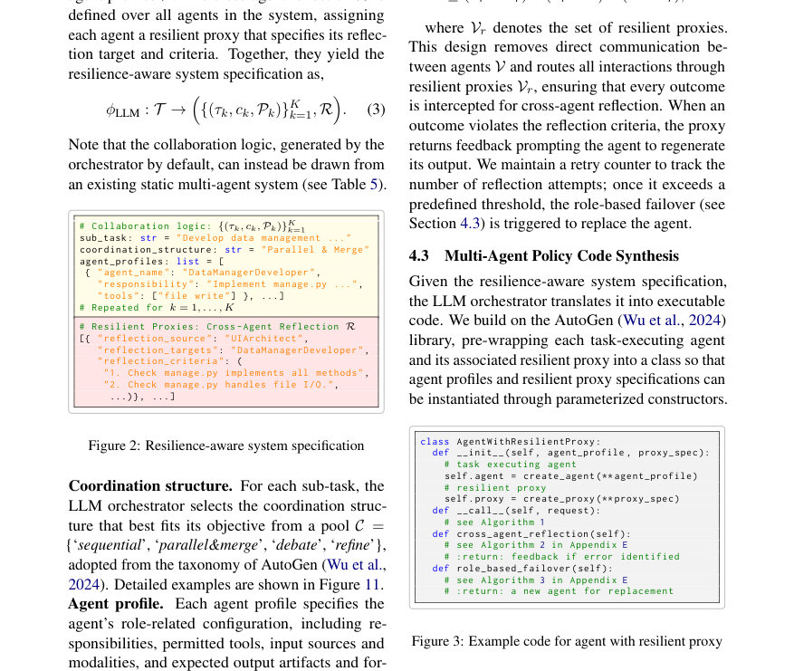

# MA-Mesh: Resilient Multi-Agent Collaboration via Role-based Self-Healing

- **게시일:** 2026-11-05
- **arXiv:** [2611.06389v1](http://arxiv.org/abs/2611.06389v1) · [PDF](https://arxiv.org/pdf/2611.06389v1)
- **저자:** JunYong Lee, Woo Kyung Kim, Honguk Woo
- **분야:** cs.AI
- **선정 점수:** 5.00
- **선정 이유:** 최근성 1.1, 인용 영향 0.0 (인용 0회), 저자 영향 0.0 (최고 h-index 0), AI 주제 적합성 2.8, 개발자 관심 0.8, 학술 신호 0.3, 오픈 웨이트·주요 연구조직 신호 0.0

[← 2026-11-05 목록으로 돌아가기](../daily/2026-11-05.html)

<!-- paper-visuals:start -->
## 주요 Figure

> 원문 PDF에서 실제 Figure 캡션과 그림 영역이 함께 확인된 자료만 자동 추출했다.

*Figure · 원문 PDF 3쪽 · Figure 1: MA-Mesh Framework: In (i), given a task, the LLM orchestrator generates a resilience-aware system*

*Figure · 원문 PDF 4쪽 · Figure 2: Resilience-aware system specification*

*Figure · 원문 PDF 4쪽 · Figure 3: Example code for agent with resilient proxy*

<!-- paper-visuals:end -->

## 한 문장 요약

MA-Mesh는 서비스메시 구조에서 영감을 받아 LLM 오케스트레이터가 생성한 협업 로직 위에 역할 기반의 self-healing 계층(교차 에이전트 성찰 + 역할 기반 페일오버)을 합성하여 다중 에이전트 시스템의 런타임 내 복원력(resilience)을 자동화하고 실행 코드로 합성하는 프레임워크이다.

## 해결하려는 문제

기존 LLM 기반 다중 에이전트 시스템은 주로 정상(명목) 조건을 전제로 설계되어 부분적 실패나 실행 불확실성에 대한 체계적 복원성(resilience) 모델을 갖추지 못했고, 오류 교정에 의존하는 ad-hoc 방식은 런타임에서의 역할 재구성·대체와 같은 근본적 복구를 제공하지 못한다. 본 논문은 이러한 한계 하에서 어떻게 역할 인식(role-aware) 기반의 감지와 동적 대체로 런타임 복원성을 보장할 수 있는지 묻는다.

## 핵심 기여

- 서비스메시(service mesh) 구조를 차용해 협업 로직(collaboration logic)과 복원성 정책(resilience policy)을 분리하고, 역할 기반의 self-healing 계층을 기존 협업 패턴 위에 코드로 합성하는 MA-Mesh 프레임워크를 제안함.
- 교차 에이전트 성찰(cross-agent reflection)을 통해 에이전트가 동료의 산출물도 역할 관점에서 평가하도록 하고, 반복된 성찰 실패나 응답 타임아웃 시 역할 기반 페일오버(role-based failover)를 통해 메타 에이전트가 대체 에이전트를 생성·할당하도록 하는 복구 메커니즘을 도입함.
- 오케스트레이터가 내리는 구조화된 'resilience-aware system specification'을 실행 가능한 다중 에이전트 정책 코드로 합성하는 파이프라인(오케스트레이션 → 스펙 생성 → AutoGen 기반 코드 합성 및 resilient proxy 인스턴스화)을 구현함.
- 소프트웨어 개발(GUI/Web), 도구 사용(GAIA), 과학적 추론(GPQA-Diamond) 등 다양한 벤치마크와 클라우드 네이티브 테스트베드(AIOpsLab)에서 기존 방법들보다 유의하게 높은 정확도와 결함 감지 성능을 보임.
- 기존 다중 에이전트 협업 패턴(MetaGPT, RTADev 등)에 MA-Mesh를 오버레이하여 향상 가능함을 보이며, 비용·지연 관점에서도 실무적 오버헤드가 크지 않음을 실험적으로 제시함.

## 접근 방법

* MA-Mesh는 두 단계로 구성된다.
* (1) LLM 오케스트레이터(ϕLLM)가 주어진 과제 T를 입력으로 받아 구조화된 'resilience-aware system specification'을 생성한다.
* 이 스펙은 작업 분해(서브태스크 τk), 서브태스크별 협업 구조(c ∈ {sequential, parallel&merge, debate, refine}) 및 각 역할의 에이전트 프로파일(Pk)을 포함하고, 각 에이전트에 연결된 resilient proxy의 교차 성찰 규칙(R)을 정의한다.
* (2) 생성된 스펙을 바탕으로 오케스트레이터는 AutoGen 기반의 실행 가능한 파이썬 코드로 스펙을 합성한다.
* 합성된 코드에서 각 에이전트는 sidecar처럼 동작하는 resilient proxy를 갖는다.
* resilient proxy는 (i) cross-agent reflection: 지정된 reflection_targets에 대해 역할별 평가 기준(reflection_criteria)을 적용해 피드백을 생성하고 필요한 경우 재생성(retry)을 요구하며, (ii) role-based failover: 응답 타임아웃 또는 반복된 성찰 실패 시 메타 에이전트에게 대체 에이전트 재구성·초기화를 요청한다.
* 실행 절차는 Algorithm 1(프록시 루프)과 Algorithm 2·3(성찰 및 페일오버)로 기술되어 있으며, 프록시는 재시도 카운터·타임아웃·최대 성찰 횟수 등의 하이퍼파라미터를 이용해 동작한다.
* 제안 구현은 gpt-4.1-mini를 기본 LLM으로 사용했고, 필요시 o4-mini나 gemini-3-flash 등으로 성능-비용 트레이드오프를 실험했다.

## 주요 결과

- 평가 데이터셋: GUI Dev., Web Dev. (저자 확장 소프트웨어 개발 벤치마크), GAIA(도구사용), GPQA-Diamond(과학적 고난이도 QA).
- 비교 대상: 단일 에이전트(CoT), 정적·자동화 다중 에이전트(MetaGPT, RTADev, LLM-Debate, AgentVerse, EvoMAC), 복원성 기반 C+I(Challenger+Inspector).
- 메인 결과 요약: MA-Mesh는 전체 상황에서 최고 성능을 보였음. 'vanilla'(정상) 설정에서 C+I 대비 평균 정확도(accuracy) 6.71 퍼센트포인트(pp) 향상(본문 서술). 시스템 불확실성 4가지(Agent Chaos, Prompt Chaos, I/O Chaos, Compound Chaos)에 대해 MA-Mesh가 C+I보다 평균 각각 39.13 pp, 25.60 pp, 20.39 pp, 44.92 pp 높은 정확도를 기록했다(본문 §5.2). 논문 초록에는 '평균 32.51 pp 향상'이라는 요약도 제시됨.
- 탐지 성능: Detection Recall(DR)에서 C+I 대비 평균 0.36 향상(본문 서술). 예컨대 GUI Dev. 벤치마크의 Agent Chaos에서 MA-Mesh DR=1.00(완벽 검출)인 반면 C+I는 낮은 DR(예: 0.38 등)을 보임(Table 1).
- 구체적 수치 예시: Web Dev. 벤치마크에서 MA-Mesh(바닐라) Acc=59.68±1.84%, Agent Chaos에서 53.98±1.55% (DR=1.00), Compound Chaos에서 49.76±0.32% (DR=0.91) (Table 1). GUI Dev.에서도 MA-Mesh(바닐라) 75.29±4.34%, Agent Chaos 71.05±1.64% (DR=1.00) 등(Table 1). GAIA/GPQA-Diamond에서도 유의미한 개선 관찰(Table 1).  또한 MA-Mesh로 기존 시스템을 증강하면 MetaGPT에 평균 +43.74 pp, RTADev에 평균 +29.42 pp 성능 향상을 확인함(Table 5).  클라우드 네이티브 테스트베드(AIOpsLab)에서 Stress/Disk/Network Chaos 조건하에 MA-Mesh가 LLM-Debate 및 C+I보다 높은 정확도와 DR을 기록함(Table 9).

## 한계

- 저자가 명시한 한계: (1) 현재 설계에서는 성찰용(resilient proxy) 또는 에이전트의 추론 모델을 정적으로 할당하며, 과제 난이도나 런타임 상황에 따라 동적으로 더 강력한 추론 모델을 할당하는 기능은 구현되어 있지 않음(본문 Limitations). (2) resilient proxy와 meta-agent의 가용성은 위협 모델 밖으로 가정되어 있으며, 이들 자체의 실패는 인프라 수준의 복구에 맡긴다고 명시함.
- 본문 실험·설계에서 합리적으로 확인되는 제약(저자가 직접 명시하지 않은 한계로 구분): (a) MA-Mesh는 오케스트레이터가 생성한 스펙과 프롬프트 품질에 의존하므로 오케스트레이터 실패나 잘못된 스펙 생성 시 성능 저하가 발생할 수 있음(스펙 생성에 관한 상세 프롬프트는 Appendix G에 제시되어 있으나 오케스트레이터의 실패 대비책은 한정적임). (b) 대체 에이전트는 원본 입력만 전달되고 상태(이전 내부 상태)는 재설정되는 설계로, 상태-의존적 작업에서의 원활한 복구 보장이 제한적일 수 있음(본문 E.2 role_based_failover 설명). (c) 실험은 주로 LLM API 기반 환경(gpt-4.1-mini 등)에서 수행되었고, 오프라인·비동기·에지 환경 등 다양한 배포 환경에서의 일반성은 추가 검증이 필요함.

## 개발자 관점

- 구현·재현: 논문은 오케스트레이터 프롬프트, 스펙 형식, AutoGen 기반의 코드 합성 방식 및 알고리즘(Algorithm 1–3)을 본문과 부록에 상세히 제시하여 재현 가능성을 높임. 저자들은 스펙→코드 합성(AgentWithResilientProxy 클래스 예시)과 오케스트레이터 프롬프트를 공개할 계획이라고 명시함(부록 G).
- 배포·운영: MA-Mesh 설계는 서비스메시의 control/data plane 분리를 차용하여 각 에이전트를 Kubernetes Pod로 배치하고 resilient proxy를 sidecar처럼 구성하는 클라우드 네이티브 배포에 자연스럽게 맞음(실험에서 AIOpsLab + Chaos Mesh 사용). 따라서 쿠버네티스 환경에서의 롤아웃·모니터링·인프라 복원성과 연동하기 쉬움.
- 비용·지연 트레이드오프: resilient proxy가 추가되지만 논문 실험에서는 MA-Mesh의 총 API 비용이 C+I보다 낮고(RTADev와 유사), 전체 wall-clock도 더 짧음(Table 6, Table 14). 다만, 성찰 프록시에 더 강력한 LLM(o4-mini, gemini-3-flash, gpt-5.4 등)을 사용하면 정확도·검출성능은 향상되나 API 비용과 지연이 증가하므로 실전 배포 시 비용-지연 최적화를 위해 proxy LLM 선택을 동적으로 조정하는 설계가 필요함(논문도 향후 연구로 제안).
- 재구성·확장성: MA-Mesh는 기존 협업 패턴(MetaGPT, RTADev 등)에 오버레이 가능하며, 스펙 기반 코드 합성으로 다양한 coordination structure(sequential, parallel&merge, refine, debate)를 혼합해 사용할 수 있어 확장성이 높음(Table 5, Fig.12).
- 안전성·평가: chaos engineering(Agent/Prompt/I-O Chaos)과 adversarial attack 시나리오를 평가 파이프라인에 포함시켜 방어 메커니즘을 검증한 점은 실무적 보안·신뢰성 평가에 유용함. 다만, 프록시·메타에 대한 공격·가용성(assumed available) 위협은 별도 보완이 필요함.

**근거 범위:** 이 분석은 제공된 논문 PDF 본문(메인 텍스트 및 부록 포함)을 근거로 작성되었으며, 본문에 표기된 실험 결과(Tables 1–9, 14–16 등), 알고리즘(Algorithm 1–3) 및 부록의 구현·프롬프트 정보를 직접 인용·요약했습니다. 부록의 상세 코드·프롬프트는 PDF에 포함되어 있으나 실제 공개 코드·데모의 실행 결과나 추가 실험 세부(예: 랜덤 시드별 분산, 전체 DF1 값 등)는 PDF에 제시된 것만을 근거로 요약했고, PDF에 없거나 명확히 기술되지 않은 구현 내부 파라미터나 배포 스크립트는 가정하지 않았습니다.
