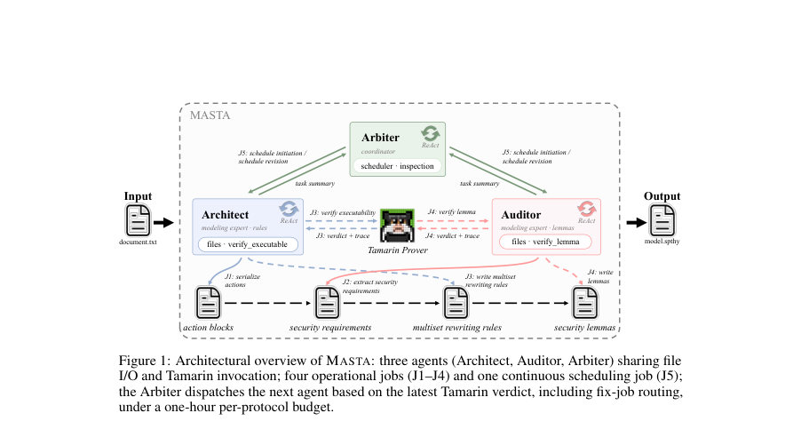
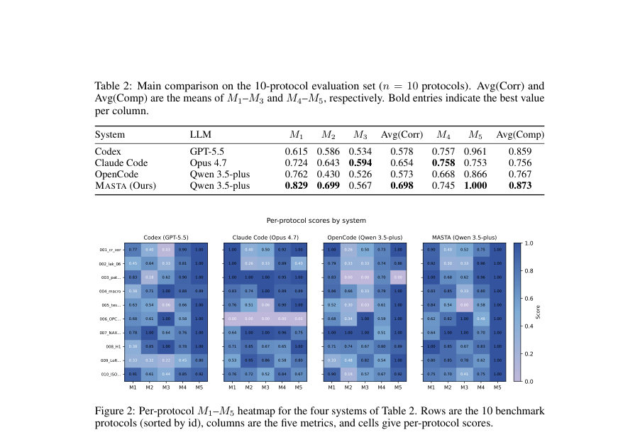

# MASTA: A Feedback-Scheduled Multi-Agent System for End-to-End Tamarin Modeling and Analysis

- **게시일:** 2026-11-17
- **arXiv:** [2611.20671v1](http://arxiv.org/abs/2611.20671v1) · [PDF](https://arxiv.org/pdf/2611.20671v1)
- **저자:** Yongkang Xiao, Qiyi Deng, Jing Chen, Min Shi, Ju Ma, Ruiying Du
- **분야:** cs.CR, cs.AI
- **선정 점수:** 6.49
- **선정 이유:** 최근성 0.9, 인용 영향 0.0 (인용 0회), 저자 영향 0.0 (최고 h-index 0), AI 주제 적합성 3.0, 개발자 관심 0.5, 학술 신호 0.6, 오픈 웨이트·주요 연구조직 신호 1.5

[← 2026-11-17 목록으로 돌아가기](../daily/2026-11-17.html)

<!-- paper-visuals:start -->
## 주요 Figure

> 원문 PDF에서 실제 Figure 캡션과 그림 영역이 함께 확인된 자료만 자동 추출했다.

*Figure · 원문 PDF 4쪽 · Figure 1: Architectural overview of MASTA: three agents (Architect, Auditor, Arbiter) sharing file*

*Figure · 원문 PDF 8쪽 · Figure 2: Per-protocol M1–M5 heatmap for the four systems of Table 2. Rows are the 10 benchmark*

<!-- paper-visuals:end -->

## 한 문장 요약

MASTA는 자연어로 기술된 보안 프로토콜을 입력으로 받아 Tamarin용 멀티셋 재작성 규칙과 일차 시공간 논리 렘마를 자동으로 생성·검증하기 위해 Architect(모델 작성), Auditor(성질 작성), Arbiter(스케줄러)로 역할을 분리하고 Tamarin 피드백 중심의 작업 스케줄링·수정 전달을 수행하는 다중 에이전트 시스템이다.

## 해결하려는 문제

Tamarin 기반 보안 프로토콜 검증을 위해서는 전문가가 작성한 멀티셋 재작성 규칙과 시공간 논리 렘마가 필요하다. 자연어 프로토콜 설명을 LLM으로 전환할 때 문법적 오류, 실행 가능성(도달성) 오류, 성질 수준의 오류가 단계별로 누적되며, 한 에이전트가 생성과 자기평가를 동시에 수행하면 오류의 원인을 국소화하지 못하고 자기평가 결합(self-evaluation coupling)으로 인해 회복이 어려워진다. 따라서 도구(검증기) 기반 프로세스 감독과 생성/평가 역할의 구조적 분리가 필요하다.

## 핵심 기여

- 자연어 프로토콜 설명으로부터 완전한 Tamarin 호환 형식 모델(멀티셋 재작성 규칙 + 시공간 논리 렘마)을 자동으로 생성하고, 단계별 Tamarin 피드백으로 프로세스를 감독하는 종단간(End-to-End) LLM 기반 다중 에이전트 프레임워크 MASTA를 제안했다.
- 운영상(authoring)과 평가적(evaluative) 역할 분해를 도입하여 규칙 모델링을 Architect에, 보안 성질 모델링을 Auditor에, 워크플로 스케줄링과 검증 결과 기반 의사결정을 Arbiter에 전담시켜 생성과 평가의 결합을 해소했다.
- Arbiter가 Tamarin 판정에 기반해 다음 에이전트를 디스패치하고 문제 유형(6분류)과 수정 목록을 통해 수정 작업을 라우팅하는 Tamarin-정박(Tamarin-anchored) 스케줄러와, LLM 기반 중복 제거(deduplication) 검사 및 AdjustDirection 절차로 라우팅 교착을 방지하는 메커니즘을 설계했다.
- 프로토콜 10종과 운영 변형 101개·취약성 변형 38개(총 149개 작업)으로 구성된 벤치마크와, 메시지 교환 구조 일치성(M1), 렘마 구조 일치성(M2), 검증 판정 일관성(M3), 운영 변형 검출(M4), 취약성 변형 검출(M5)의 다섯 가지 정밀 평가 지표를 제시했다.
- 동일 LLM(Qwen 3.5-plus) 백본에서 OpenCode와의 통제 비교를 통해 다중 에이전트 아키텍처(MASTA)가 성능 향상(예: M2 +0.269, M5 +0.134 등)을 제공함을 보였고, Ablation에서 Arbiter 제거 시 M2/M3/M5가 0으로 붕괴함을 보여 Arbiter의 필수성을 입증했다.

## 접근 방법

* MASTA는 세 에이전트(Architect, Auditor, Arbiter)와 파일 I/O·Tamarin 호출 기능을 공유하는 구조다.
* 작업은 네 개의 운영 잡(J1–J4)과 연속적 스케줄링 잡(J5)으로 나뉜다.
* J1에서 Architect가 프로토콜 문서를 action block(역할별 RECEIVE→GENERATENONCES→COMPUTE→ASSERTION→SEND 순의 연산을 갖는 중간표현)들의 시퀀스로 직렬화한다.
* J2에서 Auditor가 보안 요구사항을 구조화된 문서로 추출한다.
* J3에서 Architect는 각 action block을 Tamarin 멀티셋 재작성 규칙으로 작성하며 각 규칙 추가 후 'executable' 렘마를 호출해 실행 가능성(도달성)을 검사하여 문제 시 즉시 수정한다.
* J4에서 Auditor는 구조화된 요구사항을 바탕으로 렘마를 작성하고 배치 검증을 통해 렘마들을 한꺼번에 검증한다(공유 제약을 한 번에 점검하고 비용을 절감).
* J5(Arbiter)는 최신 Tamarin 판정과 시스템 상태를 검사해 다음 수행자(정상 다음 잡 또는 수리(fix)-잡)를 결정하고, 문제 타입(6분류: rule unreachable, property disagrees with protocol, security-requirement omission, lemma syntax error, executable-verification failure, other)을 태깅해 수정 목록에 추가한다.
* Arbiter는 허용된 방향이 과거 수정 지시와 중복되는지 LLM으로 검증하고(LLMDEDUP), 중복이면 AdjustDirection 절차로 결정 라벨을 순환시켜 교착을 회피한다.
* 종료 조건은 완전한 모델 생성, 시간초과(프로토콜 당 1시간 예산), 또는 더 이상 새로운 방향이 없을 때의 stuck 상태다.
* 평가 지표는 AST alpha-equivalence 기반의 렘마 비교, action-block Levenshtein 거리 기반 M1, Tamarin 판정 및 증명 단계 수를 이용한 M3 등으로 정의된다.

## 주요 결과

- 벤치마크: 10개 프로토콜, 운영 변형 101개·취약성 변형 38개로 총 149개 모델링 작업(각 작업은 자연어 문서 입력).
- MASTA (Qwen 3.5-plus) 주요 평균 성능: M1=0.829, M2=0.699, M3=0.567, Avg(Corr)=0.698, M4=0.745, M5=1.000, Avg(Comp)=0.873 (Table 2).
- 동일 백본(Qwen 3.5-plus)에서 OpenCode 대비 개선: M1 +0.067, M2 +0.269, M3 +0.041, M4 +0.077, M5 +0.134. MASTA는 전체적으로 Codex(GPT-5.5)와 Claude Code(Opus 4.7)를 포함한 모든 비교군 중 평균 정확도·완전성 평균에서 1위를 기록했다.
- Ablation: 'w/o Arbiter' 변형은 5개 프로토콜 실험에서 M2=0.000, M3=0.000, M5=0.000으로 붕괴(표 3). 'w/o Role Specialization'은 정확도·완전성 하락(예: Avg(Corr) 0.605→0.362, Avg(Comp) 0.905→0.541)으로 역할 분화의 중요성이 확인되었다.
- 비용 및 호출 통계: 전체 149 작업에 대해 MASTA는 총 1,567회의 Tamarin 호출을 수행(평균 작업당 10.5 호출), 전체 벤치마크 실행 시간 합계 52.3시간(평균 작업당 약 21분), API 토큰 소비 111.1M(표 4). 타임아웃 통계: 1,567 호출 중 29건(1.85%) 타임아웃, 14작업(9.4%) 이상에서 타임아웃 발생했으나 모든 작업이 최종적으로 완료되었고 작업 수준 예산(3,600s)으로 종료된 사례는 없었다(부록 I).

## 한계

- 저자 명시 한계 — 벤치마크 규모 및 위협 모델: 'Tamarin이 10분 내 자동 종료되는 모델'을 포함 기준으로 구성되어 있어 복잡한 프로토콜·대규모 모델에 대한 평가가 제한되며, 위협 모델은 Dolev–Yao 기호적 의미론으로 한정되어 있다.
- 저자 명시 한계 — LLM 컨텍스트 창 제약: Arbiter는 전체 형식 모델, 누적 수정 목록, 최신 Tamarin 판정을 LLM 컨텍스트에 넣어 스케줄링 결정을 내리므로 누적 상태가 유효 컨텍스트 길이를 초과하면 스케줄러가 상태를 잘라서 이슈를 놓칠 수 있다.
- 저자 명시 한계 — Tamarin 관련 사전학습 커버리지 및 데이터 오염: LLM이 Tamarin 문법에 익숙하지 않거나 일부 문법이 사전학습에 잘 포함되지 않은 경우 성능 저하가 발생할 수 있으며, 공개 Tamarin 모델이 LLM 사전학습에 포함되어 벤치마크 점수를 부풀릴 가능성이 있다(논문에서 정량화하지 않음).
- 저자 명시 한계 — Tamarin 특화성: 프롬프트, 역할 규격, 디스패치 태그 등이 Tamarin에 특화되어 있어 ProVerif나 CryptoVerif로의 이식에는 별도 적응이 필요하다. 또한 실세계 CVE 재현과의 연계는 향후 작업으로 남아 있다.

## 개발자 관점

- 구현·재현: 논문은 코드·벤치마크·실험 로그를 공개하여 재현 가능함(저자 제공 리포지토리 표기). 실험 환경은 Tamarin 1.10.0 + Maude 3.4, AMD Ryzen 9 7950X3D, 192GB 메모리에서 병렬 실행으로 구성되어 있으므로 유사한 하드웨어와 동일 Tamarin 버전 확보가 필요하다.
- 스케줄러(Arbiter) 설계가 핵심: Arbiter의 Tamarin-정박 스케줄링, 6분류 문제 태깅, 수정 목록, LLM 중복 검사 및 AdjustDirection의 결정적 순환이 없으면 시스템의 검증·성질 점수가 크게 악화(아블레이션에서 확인)되므로 배포시 이 로직을 정확히 구현해야 한다.
- 비용·성능 균형: MASTA는 OpenCode보다 호출 수는 적지만 총 토큰·시간 비용이 큰 편(예: 전체 토큰 111.1M, 총 실행 52.3h). 실제 운영 또는 대규모 확장 시 토큰 사용량과 Tamarin 호출·시간 예산을 관리하는 전략이 필요하다.
- 프롬프트·문맥 관리: 에이전트 프롬프트는 6계층 구조(출력 스키마, 역할·능력·책임 설명, 컨텍스트, 현재 과제)를 사용하고 있으며 컨텍스트 컴팩션(최근 8개 항목은 보존, 이전 항목은 요약)으로 컨텍스트 창을 관리하므로 같은 방식으로 구현해야 안정적인 장기 실행이 가능하다.
- 평가·디버깅: M3에서 증명 단계 수를 증거로 사용하여 '공허한 증명(vacuous proof)'을 완화하므로, 실서비스에서는 Tamarin 출력의 증명 깊이·증명 객체를 로깅하고 사람이 해석 가능한 진단 메시지를 함께 남겨야 디버깅이 용이하다; 또한 LLM이 생성한 수정 지시의 중복 판단은 별도의 검증 절차로 보완할 것(LLM 평가 자체의 오류 가능성).

**근거 범위:** 이 분석은 제공된 논문 PDF 본문(페이지 1–19)의 내용을 기반으로 작성되었다. 본문에 명시된 수치(벤치마크 구성, M1–M5 정의, 표의 성능·비용 수치, ablation 결과 등)를 그대로 인용했다. 다만 프롬프트 미세구성, LLM API 세부 파라미터, 내부 로그의 전체 원문 등 PDF에 포함되지 않거나 부록에서만 부분적으로 기술된 구현 미세사항은 본문 수준에서만 요약하였고, 그 부분은 리포지토리의 공개 코드를 통해 확인해야 정확한 재현이 가능하다.
