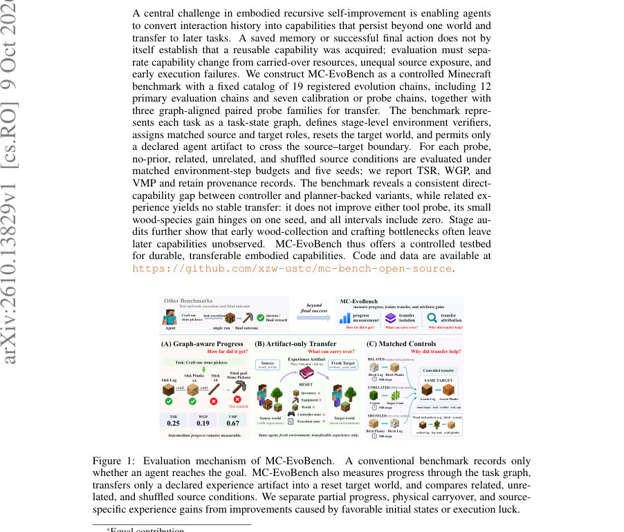
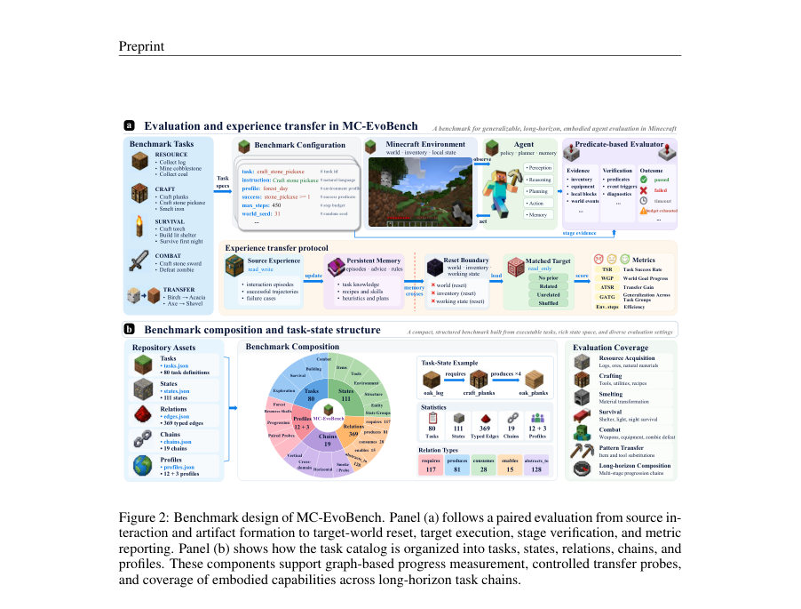
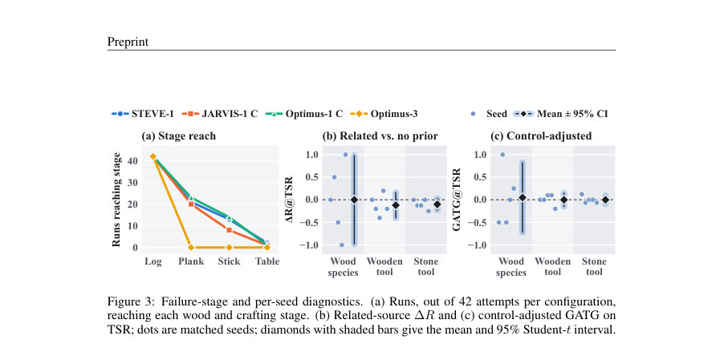

# MC-EvoBench: Auditing Experience-Driven Self-Improvement in Minecraft Agents

- **게시일:** 2026-10-12
- **arXiv:** [2610.13829v1](http://arxiv.org/abs/2610.13829v1) · [PDF](https://arxiv.org/pdf/2610.13829v1)
- **저자:** Jingwei Song, Zhisheng Chen, Bingfan Zeng, Jing Tang, Yubo Hou, Jinhao Jing, Zhengwei Xie, Linfeng Zhang
- **분야:** cs.RO, cs.AI
- **선정 점수:** 4.51
- **선정 이유:** 최근성 0.5, 인용 영향 0.0 (인용 0회), 저자 영향 0.0 (최고 h-index 0), AI 주제 적합성 2.2, 개발자 관심 1.1, 학술 신호 0.8, 오픈 웨이트·주요 연구조직 신호 0.0

[← 2026-10-12 목록으로 돌아가기](../daily/2026-10-12.html)

<!-- paper-visuals:start -->
## 주요 Figure

> 원문 PDF에서 실제 Figure 캡션과 그림 영역이 함께 확인된 자료만 자동 추출했다.

*Figure · 원문 PDF 1쪽 · Figure 1: Evaluation mechanism of MC-EvoBench.*

*Figure · 원문 PDF 5쪽 · Figure 2: Benchmark design of MC-EvoBench. Panel (a) follows a paired evaluation from source in-*

*Figure · 원문 PDF 9쪽 · Figure 3: Failure-stage and per-seed diagnostics. (a) Runs, out of 42 attempts per configuration,*

<!-- paper-visuals:end -->

## 한 문장 요약

MC-EvoBench는 마인크래프트에서의 경험 기반 자기개선(embodied recursive self-improvement)을 엄격히 감사하기 위해 태스크-상태 그래프, 단계별 검증기, 소스-대상 분리 프로토콜(오직 선언된 에이전트 아티팩트만 이동 허용)과 네 가지 대비(무경험/관련/무관/섞임)를 고정 예산·다중 시드로 비교하는 통제된 벤치마크를 제안한다.

## 해결하려는 문제

기존 평가들은 에이전스의 상호작용 기록이나 저장된 메모리가 이후 작업에서 재사용 가능한 능력으로 전환되었는지, 또는 단지 물리적 자원 이월·초기 조건 차이·추가 노출량 때문에 성능이 개선되었는지를 분리하지 못한다. 연구 질문은 '소스 경험이 리셋된 타깃 환경에서 관찰 가능한 재사용 가능한 능력으로 귀결되는가'이며, 이를 위해 능력 변화(내부 상태 변화)와 물리적 이월/노출 불균형/초기 실패를 분리하는 평가 설계가 필요하다.

## 핵심 기여

- 경험 기반 자기개선(embodied RSI)을 '대상 세계가 리셋된 이후에도 선언된 아티팩트만 경계로 건너가고, 관련/무관/섞임 대조를 통해 대안적 설명을 배제할 때만 경험-구동 이득으로 인정'하는 명시적 정의로 형식화함.
- 마인크래프트에 실행 가능한 MC-EvoBench를 구현: 80개 태스크·111개 상태·369 Typed edge로 구성된 태스크-상태 그래프, 19개 등록 체인(12개 주평가 체인 + 7개 보정/프로브), 단계별 검증기와 세 가지 핵심 지표(TSR, WGP, VMP), 그리고 네 조건(무경험·관련·무관·섞임)과 매치된 환경-스텝 예산·다중 시드 프로토콜을 제공.
- 참조 실험을 통해 제어된 증거 제시: 컨트롤러 기반 변형이 플래너(LLM) 기반 변형보다 직접 실행 능력에서 일관되게 우수하며, 관련 경험을 주어도 선언된 아티팩트만 전달한 상태에서 타깃 성능의 안정적 전이는 관찰되지 않음을 보였음.
- 단계별 실패·실행 병목 진단과 계산 비용(에피소드 수, LLM/플래너 콜 수)을 기록하여 '초기 목재 수집·제작 병목이 이후 능력 관찰을 가리는' 문제를 드러내고, 경험 전이가 단순한 추가 노출이나 더 많은 계산량과 결합될 수 있음을 지적함.
- 재현 가능한 자원(태스크·체인·프로필·검증 규칙·메모리 포맷·프롬프트)을 공개 리포지토리로 제공하여 동일한 검증 규칙 아래 다양한 경험 저장 방식(텍스트 메모리, 규칙, 스킬 라이브러리, 모델 업데이트)을 비교할 수 있도록 함.

## 접근 방법

* MC-EvoBench의 주요 구성은 다음과 같다.
* (1) 에이전트를 (정책 π, 보존 가능한 상태 z, 업데이트 규칙 U)로 형식화하고, 소스 경험 ES로부터 생성된 보존 상태 zS만 타깃으로 전달 가능한 '아티팩트'로 취급한다.
* (2) 태스크-상태 그래프 G=(T,S,E)를 만들고 requires/produces/consumes 등의 엄격 실행 엣지로 단계(스테이지) 체인을 정의한다.
* 각 스테이지는 검증기(predicate 기반)를 통해 통과 여부(vi)를 기록한다.
* (3) 메트릭으로는 단계완료 비율인 TSR(계획된 스테이지 수에 대한 통과 수), 그래프 기반의 가중 진행도 WGP(엄격 실행 엣지의 가중 검증 진행도), 타임라인상 획득된 중요 도구·아이템의 비율인 VMP를 사용한다.
* (4) paired protocol: 각 프로브 가족(wood species / wooden tool / stone tool)에 대해 동일한 타깃 태스크·시드·검증기를 사용하고, 네 조건(no-prior, related, unrelated, shuffled)으로 평가한다.
* 소스-타깃 경계에서 월드·인벤토리·임시 컨트롤 상태는 리셋되고 선언된 아티팩트(예: JSON 메모리, 규칙 집합)만 읽기 전용으로 로드된다.
* (5) 참조 에이전트 구현은 컨트롤러(예: STEVE-1, JARVIS-1 controller-only), 플래너-백드(LLM planner + controller) 변형, ExpeL/온라인 메모리(JARVIS 온라인 확장) 등으로 구성되며, 메모리 포맷·계획/성찰 템플릿·검색 규칙 등이 실험에 사용됨.

## 주요 결과

- 직접 능력(transfer 없는, 12개 주평가 체인)에서 컨트롤러 기반 변형(STEVE-1, JARVIS-1 controller-only, Optimus-1 controller-only)이 평균 TSR/WGP/VMP로 각각 8.4/6.4/25.5, 7.5/5.5/25.0, 8.1/6.1/25.4을 기록하여 플래너(LLM)-백드 변형보다 일관되게 우수함(본문 Sec.4.2 및 Table 2).
- 페어드 전이 실험(세 프로브 가족, 각 가족 5시드, 네 조건)에 대한 타깃 평균(표 3): Wood species 타깃 TSR (N/R/U/S)=0.400/0.400/0.200/0.500, WGP=0.360/0.400/0.200/0.480, VMP=0.400/0.400/0.200/0.500; Wooden tool TSR=0.320/0.200/0.160/0.240 등; Stone tool TSR=0.150/0.050/0.025/0.075 등(본문 Table 3).
- 관련 소스 대비 변화 ∆R 및 제어조정 GATG(관련 − 0.5*(무관+섞임))는 전반적으로 작고 불확실함(Table 4). 예: wood-species WGP ∆R=+0.040, GATG=+0.060; wooden-tool과 stone-tool은 대체로 음수 변화 또는 거의 0이며 모든 95% Student-t 신뢰구간이 0을 포함함(본문 Sec.4.4).
- 소스 비용과 실행 기록(Table 5): 프로브별 고정 환경-스텝 예산은 wood species 900, wooden tool 2,250, stone tool 3,600. 관련 조건에서만 소스중 통과(source TSR)가 관찰(0.100 / 0.080 / 0.150)되었고 관련 소스는 더 많은 플래너 호출을 소모했음(예: stone-tool 관련 평균 LLM 호출 24.8±4.6). 그럼에도 타깃 전이는 일관되게 나타나지 않음(본문 Sec.4.5).
- 단계별 실패 진단(Figure 3a, Table F10): 다수의 런이 초기 목재 수집·제작 단계에서 소멸하여 이후 단계의 능력이 관찰되지 않음(예: collect log 통과 24/42 등). wood-species 긍정적 평균 GATG는 단일 시드에 의해 크게 좌우됨(본문 Sec.4.6).

## 한계

- 저자 명시(논문에서 밝힌 한계): 결과는 '테스트된 에이전트, 프로브, 시드, 예산'에 한정되며, 보존·합성·더 강한 에이전트·더 많은 시드에서 다른 결과가 나올 수 있음을 저자가 명시함(결론).
- 실험적 제약(본문에서 합리적으로 확인되는 한계): (1) 페어드 전이 불확실성은 시드 수(5)와 시드 간 변동성으로 인해 신뢰구간이 넓음(Table 4, Sec.4.4). (2) 많은 실행이 초기 단계에서 정지하여 이후 능력이 관찰되지 않음(단계별 실패 사례, Fig.3a, Table F10) — 즉 '관찰되지 않은 능력' 문제. (3) 동일한 환경-스텝 예산이더라도 소스 조건별로 에피소드 수·플래너 호출·계산 자원(토큰 사용 등)이 달라 계산 비용의 비대칭이 존재(본문 Sec.4.5). (4) 아티팩트 수단은 JSON 메모리/문장·규칙 가중치 등 텍스트·경량 규칙 중심이며, 모델-체크포인트 수준의 파라미터 업데이트나 강력한 스킬 바이너리 전달을 실험하지 않음.

## 개발자 관점

- 전이·자기개선 주장을 하려면 타깃 세계를 리셋하고 '아티팩트-전용' 경계를 적용해야 물리적 자원 이월을 배제할 수 있다(MC-EvoBench의 핵심 설계).
- 단일 성공/최종 보상 대신 단계별 검증(스테이지 레코드)과 복수 지표(TSR, WGP, VMP)를 사용하면 초기 병목(예: 목재 수집·제작)으로 인해 후기 능력이 관찰되지 않는 문제를 발견할 수 있다. 따라서 로그·단계 레코드 구현이 필수적이다.
- 비교 실험은 관련·무관·섞임(순서 뒤집기) 대조를 포함하고, 환경-스텝 예산뿐 아니라 에피소드 수·플래너 호출·토큰 사용 등 계산 자원 소모를 함께 기록해야 동일 노출량의 계산·경험 차이를 해석할 수 있다.
- 재현을 위해서는 태스크·체인·프로필·검증 규칙·아티팩트 스키마(JSON)·프롬프트 템플릿(계획/성찰) 등을 코드 저장소와 함께 버전 고정 및 아티팩트 해시(예: SHA-256)로 제공해야 한다(논문이 실제로 이러한 자료를 공개함).
- 플래너(LLM) 기반 방법은 실행 실패가 많을 때 성능이 극도로 낮아지므로, RSI 연구에서는 먼저 실행-견고성(컨트롤러 통합, 저수준 행동 신뢰성)을 확보한 뒤 경험 저장·재사용 메커니즘의 효과를 주장해야 한다.

**근거 범위:** 이 분석은 제공된 논문 PDF 본문(초록 이외에 전체 본문, 표, 부록 포함)을 근거로 작성되었음. 표와 그림의 수치(예: Table 2–5, F8–F11, Appendix 자료)와 본문 기술을 직접 인용·요약했으며, 확인되지 않은 구현 세부사항이나 숫자는 생성하지 않았음. PDF에서 테이블 레이아웃·숫자 표기 일부가 압축 표기(예: 퍼센트·소수)로 제공되어 본문에 명시된 수치만 사용했음을 밝힘.
