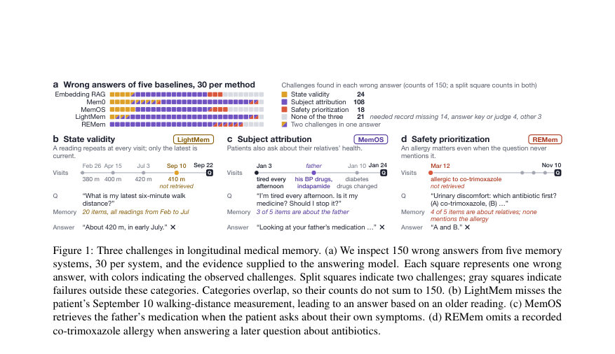
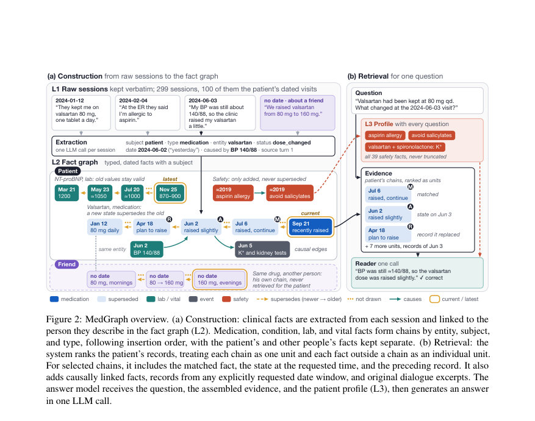
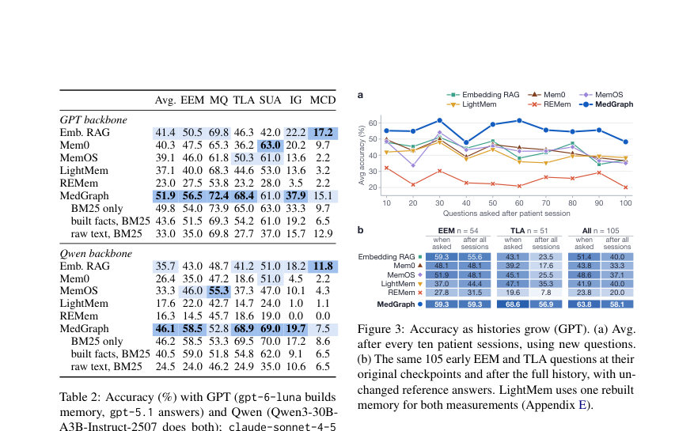

# MedGraph: Maintaining Patient State with Graph Memory for Long-Term Medical Dialogue

- **게시일:** 2026-11-07
- **arXiv:** [2611.08433v1](http://arxiv.org/abs/2611.08433v1) · [PDF](https://arxiv.org/pdf/2611.08433v1)
- **저자:** Donghua Zhang, Zizheng Wang, Ze Dong, Yiding Feng, Siyu Qian
- **분야:** cs.CL, cs.AI
- **선정 점수:** 5.30
- **선정 이유:** 최근성 0.7, 인용 영향 0.0 (인용 0회), 저자 영향 0.0 (최고 h-index 0), AI 주제 적합성 2.3, 개발자 관심 0.5, 학술 신호 0.3, 오픈 웨이트·주요 연구조직 신호 1.5

[← 2026-11-07 목록으로 돌아가기](../daily/2026-11-07.html)

<!-- paper-visuals:start -->
## 주요 Figure

> 원문 PDF에서 실제 Figure 캡션과 그림 영역이 함께 확인된 자료만 자동 추출했다.

*Figure · 원문 PDF 2쪽 · Figure 1: Three challenges in longitudinal medical memory. (a) We inspect 150 wrong answers from five memory*

*Figure · 원문 PDF 4쪽 · Figure 2: MedGraph overview. (a) Construction: clinical facts are extracted from each session and linked to the*

*Figure · 원문 PDF 6쪽 · Figure 3: Accuracy as histories grow (GPT). (a) Avg.*

<!-- paper-visuals:end -->

## 한 문장 요약

장기 의료 대화를 위해 각 방문의 날짜·주체·상태 정보를 보존하는 그래프 메모리(사실 체인과 환자 프로필)를 구축해 시점·주체·안전성 요구를 해결하는 MedGraph를 제안한다.

## 해결하려는 문제

기존 장기 메모리 시스템은(1) 동일 항목의 시점별 상태를 적절히 보존하거나 표시하지 못해 과거 또는 최신 상태를 잘못 사용하고(상태 유효성 문제), (2) 대화에 등장하는 타인의 건강 정보를 환자 정보로 잘못 사용할 수 있으며(주체 귀속 문제), (3) 처방·권고에 필수인 알레르기·금기 등 안전 정보가 후속 질의에 누락되는 문제가 있다. 따라서 장기 의료 대화를 따르는 보조자는 질문 시점에 적용되는 환자 상태를 정확히 반영하고, 각 사실의 대상(주체)을 명시하며, 안전 관련 사실을 항상 가용하게 유지하는 메모리가 필요하다.

## 핵심 기여

- 장기 의료 대화 실패 분석을 통해 세 가지 메모리 요구사항(상태 유효성, 주체 귀속, 안전성 우선순위)을 정식화함.
- MedGraph라는 다층(원문 L1, 사실 그래프 L2, 환자 프로필 L3) 그래프 메모리 구조를 제안하고, 사실을 날짜·주체·타입으로 추출해 동일 엔티티·주체·타입 기준으로 체인(연속 기록)을 구성함.
- 검색 시 체인 단위를 순위화하고 질문 시점에 체인을 그 시점으로 읽어 필요한 상태(Anchor)와 그 이전 상태(Relation)를 함께 제공하며, 모든 질의에 환자 프로필(특히 모든 안전 사실)을 항상 포함하도록 설계함.
- MedMemoryBench(967문항)에 대해 GPT·Qwen 두 백본으로 비교 실험을 수행해, 두 백본 모두에서 가장 높은 평균 정확도를 달성함(기존 최강 baseline 대비 GPT에서 +10.5pp, Qwen에서 +10.4pp).
- 짧은 추출/응답 비용 구조(세션당 추출 LLM 1회, 질의당 리트리벌 1회·응답 LLM 1회)로 효율성과 응답 지연 측면에서 경쟁적인 성능을 보였음을 보고함.

## 접근 방법

* 아키텍처: MedGraph는 세 층으로 구성된다.
* L1에 원문 대화를 보존하고, L2에 추출된 임상 사실(타입 τ, 주체 σ, 엔티티 e, 사건 날짜, 상태·값·단위·출처 등)을 노드로 저장하여 동일 (e,σ,τ) 키로 체인으로 연결(supersedes, causal edges 포함).
* L3는 환자 프로필로서 모든 안전 사실과 주요 진단·약물 체인 꼬리 등을 고정 예산으로 렌더링해 모든 질의에 동행한다.
* 구성(Construction): 각 세션마다 추출기(논문부록의 고정 프롬프트)를 통한 JSON 추출을 1 LLM 호출로 수행하고, 상대적 날짜는 세션 날짜로 해석하며 엔티티 정규화 및 중복·반복 판정(반복이면 mention_count만 갱신) 규칙에 따라 체인에 추가 또는 반복 업데이트한다.
* 저장 정책(Table 1): 약물·진단·검사·바이탈 등은 체인으로 관리하되 약물/진단은 삽입 순으로 체인 꼬리가 최신 삽입으로 취급되고 이전 유효구간은 새 기록의 event date로 종료 처리, 검사·바이탈은 event date 기준 최신으로 선택.
* 검색(Retrieval): 환자 주체 필터링 후 각 체인을 하나의 검색 단위로 BM25 및 dense embedding 랭킹(Reciprocal Rank Fusion)해 상위 8개 단위를 선택한다.
* 선택된 체인에서 Matched(검색 유발 기록), Anchor(질의 시점에 적용되는 기록), Relation(Anchor가 대체한 이전 기록) 최대 세 항목을 제공한다.
* 인과 확장으로 최대 4개 이웃 추가, 질문에 명시적 연도가 있으면 날짜 채널로 해당 창의 환자 기록(최대 12개) 및 그 시점 유효 상태(최대 4개) 추가.
* 렌더링은 각 사실을 한 줄로 날짜·상태와 함께 표기하고 상위 3개 매치에 원문 창(window)을 포함한다.
* 응답: 환자 프로필과 조합된 검색 결과를 고정 응답 프롬프트의 메모리 슬롯에 넣어 단일 LLM 호출로 리더가 응답을 생성한다.

## 주요 결과

- 데이터셋: MedMemoryBench의 중국어 혼합 설정에서 첫 10명의 환자, 총 967문항(각 히스토리에 환자 세션 약 100개와 약 200개의 산만 세션 포함). 문제 유형: EEM, MQ, TLA, SUA, IG, MCD의 6유형.
- 주요 비교: 다섯 개 baselines(Embedding RAG, Mem0, MemOS, LightMem, REMem)와 비교; GPT 설정에서는 gpt-6-luna가 메모리 구축, gpt-5.1이 응답 리더; Qwen 설정에서는 Qwen3-30B-A3B-Instruct-2507가 양쪽을 수행.
- 정량 성능(평균 정확도 Avg.): GPT 백본에서 MedGraph 51.9%로 Embedding RAG 41.4% 대비 +10.5 percentage points 우위. Qwen 백본에서 MedGraph 46.1%로 Embedding RAG 35.7% 대비 +10.4 pp 우위 (Table 2).
- 문제 유형별: MedGraph는 특히 TLA(시점 위치 정확도)와 IG(추론 생성)에서 큰 이득을 보였고(E.g., GPT에서 TLA 68.4% vs 최강 baseline들보다 큰 폭 개선), 상태 변경 질문(204문항 집합)에서 가장 높은 정확도를 기록함(Table 3).
- 구성·검색 분석: 추출된 단일문장 사실(fact)들만 BM25로 순위화해도 원문 세션을 BM25로 순위화한 것보다 절반 이상(메서드 전체 이득의 절반 이상)의 성능 향상을 설명함. 검색 측면(체인 단위 랭킹, 날짜 채널, 프로필 포함)은 TLA와 IG에서 추가 이득을 가져옴.

## 한계

- 저자 명시 한계: 논문은 한 가지 중국어 장기 의료 대화 벤치마크(MedMemoryBench)에서만 평가되었으므로 다른 언어·임상 환경으로의 일반화는 미확인이다.
- 저자 명시 한계: MedGraph는 세션당 LLM 추출기에 의존하므로 추출기 품질에 따라 메모리 정확도가 좌우된다.
- 저자 명시 한계: 인과 링크(causal edges)는 세션 내부로만 연결되며, 방문 간 인과 연결을 자동으로 연결하지 않는다.
- 저자 명시 한계: 체인은 삽입 순서(메모리에 기록된 순서)를 따르므로, 나중에 보고된 과거 사건(지연 보고)이 체인 꼬리로 와서 시점 해석을 혼동시킬 수 있다(본문 예시와 분석에서 지적). 또한 안전 사실은 절대 제거하지 않도록 설계되어, 이후 배제된 알레르기나 중단된 약물에 대한 오래된 경고가 프로필에 유지될 수 있다(프로필의 절삭 없음 정책).」「실험적·범위상의 관찰 제약: 판정(judging)의 일부(네 가지 문제 유형)는 LLM 판정자에 의해 채점되며, 판정자가 파싱 불가 응답을 잘못 처리하는 경우(논문에서 일부 사례 언급) 점수에 영향이 있어 완전한 인간 전문 평가가 포함되지는 않음.

## 개발자 관점

- 세션 단위로 사실을 추출하고 사실마다 주체(subject), 사건 날짜(event date), 타입(type), 값/단위/상태를 명시하면 BM25 기반 검색만으로도 긴 원문보다 관련 기록을 더 쉽게 매칭할 수 있다.
- 주체 귀속을 철저히 처리하라: ‘환자가 발화했음’이 곧 사실의 주체가 아님을 분명히 하고, 추출 단계에서 family:<relation> 식으로 주체를 표기해 저장·검색 시 필터링하라(논문 구현: 구성 시 거의 모든 타인 사실을 환자 아닌 주체로 할당).
- 약물/진단/검사/바이탈 같은 타입별 저장 정책을 정하라(Table 1). 특히 약물·진단은 체인으로 관리하고 새 삽입은 이전 기록의 유효구간을 종료시키는 방식이 상태 추적에 유리하다.
- 검색은 체인 단위로 순위화하고 질문에 연도가 명시되면 '날짜 채널'로 각 체인을 그 날짜 기준으로 읽어 Anchor/Relation을 제공하라. 프로필은 모든 안전 사실을 절대로 잘라내지 말고 모든 질의에 포함시켜 안전 관련 누락을 방지하라(프로필 예산은 논문에서 약 1,600자, 안전 부분은 절대 트림하지 않음).
- 비용·성능 설계: 세션당 추출 LLM 1회, 질의당 단일 리트리벌과 단일 리더 호출 구조는 응답 지연을 짧게 하고 구축 비용을 낮춘다. 실제 배포 시 추출기 품질·비용(LLM 호출량)과 저장소(체인·엔티티 인덱스)를 균형있게 설계해야 한다.

**근거 범위:** 이 분석은 제공된 논문 PDF 본문(본문, 표, 그림, 부록)에서 직접 인용·요약하여 작성되었다. 성능 수치와 구성·설정(예: GPT/Qwen 백본, MedMemoryBench 구성, 표의 정확도 값, 검색·렌더링 예산)은 본문과 표(Table 2, Table 3, Figure 2, 부록)의 수치와 설명에 기반한다. 본문에 직접 나오지 않는 내부 구현 세부(예: 실제 프로덕션 코드, 하드웨어·추론 지연의 절대값)는 작성하지 않았다.
