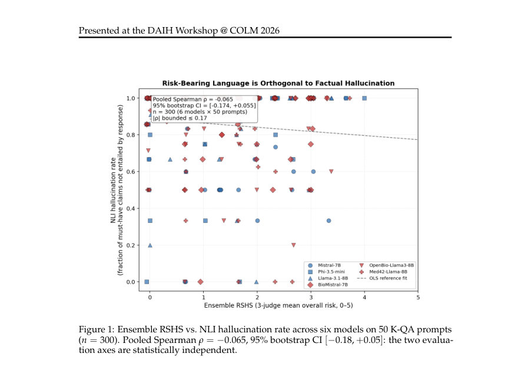
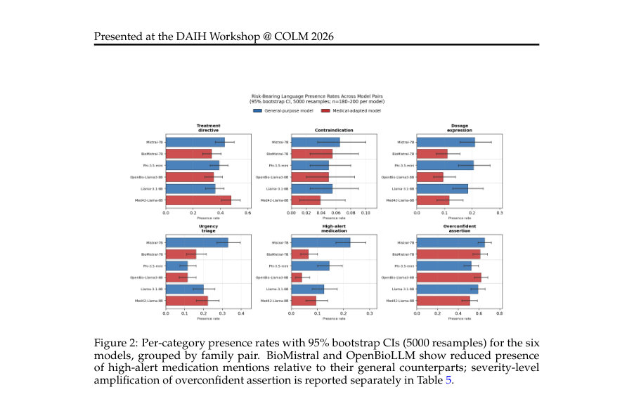

# Medical Fine-Tuning Reshapes, Not Reduces, Patient-Facing AI Risk: A Rubric-Based, LLM-Judge Evaluation Framework

- **게시일:** 2026-10-20
- **arXiv:** [2610.24807v1](http://arxiv.org/abs/2610.24807v1) · [PDF](https://arxiv.org/pdf/2610.24807v1)
- **저자:** Savan Doshi
- **분야:** cs.AI, cs.CL
- **선정 점수:** 6.18
- **선정 이유:** 최근성 0.5, 인용 영향 0.0 (인용 0회), 저자 영향 0.0 (최고 h-index 0), AI 주제 적합성 2.3, 개발자 관심 0.2, 학술 신호 0.8, 오픈 웨이트·주요 연구조직 신호 2.4

[← 2026-10-20 목록으로 돌아가기](../daily/2026-10-20.html)

<!-- paper-visuals:start -->
## 주요 Figure

> 원문 PDF에서 실제 Figure 캡션과 그림 영역이 함께 확인된 자료만 자동 추출했다.

*Figure · 원문 PDF 5쪽 · Figure 1: Ensemble RSHS vs. NLI hallucination rate across six models on 50 K-QA prompts*

*Figure · 원문 PDF 7쪽 · Figure 2: Per-category presence rates with 95% bootstrap CIs (5000 resamples) for the six*

<!-- paper-visuals:end -->

## 한 문장 요약

환자 대상 의료 질의응답에서 사실성 중심 평가의 한계를 지적하고, 6개 위험 언어 범주에 대한 루브릭과 3-LLM 판정 앙상블을 이용해 의료 파인튜닝이 위험을 ‘감소’시키지 않고 ‘재형성’함을 실험적으로 규명한다.

## 해결하려는 문제

기존 의료 LLM 평가는 주로 사실적 정확성(factuality)에만 의존한다. 그러나 사실적으로 정확하더라도 환자가 행동하면 해를 초래할 수 있는 지시형·확신형 표현 등 위험언어(risk-bearing language)를 포함할 수 있다. 본 논문은 사실성 기반 지표와 위험언어 기반 안전성이 서로 독립적이며, 의료 분야로의 파인튜닝이 위험을 단순히 줄이는지(혹은 다르게 만드는지)를 규명하려 한다.

## 핵심 기여

- 위험언어를 6개 비배타적 범주(치료지시, 금기, 용량표현, 긴급성·분류(urgency–triage), 고위험 약물 언급, 과도한 확신)로 정식화하고 Asgari 0–5 중증도 척도·AHRQ·ISMP 리스트로 앵커한 루브릭을 제시함.
- 루브릭에 기반한 판정 작업을 3-LLM( Gemin i2.5 Flash, GPT-4o-mini, Claude Haiku 3.5) 판정 앙상블로 구현하고, 판정 출력 스키마(존재 여부, 0–5 중증도, 근거 문장, 설명)를 공개함.
- K-QA의 실제 환자 질문 200개(그중 50개는 의사 분해한 must-have claim 포함)를 대상으로 6개 7–9B 모델(3 일반, 3 의료 적응)에서 루브릭 기반 평가를 수행하여 위험언어 점수(RSHS)와 사실성(NLI 기반) 사이의 통계적 독립성을 보임.
- 의료 파인튜닝 방식에 따라 위험 프로파일이 달라짐을 실증: continued-pretraining 계열(BioMistral, OpenBioLLM)은 고위험 약물 언급을 억제하면서 과도한 확신을 증폭시키고, 임상 인스트럭션 튜닝(Med42)은 용량표현만 억제함을 보고함.

## 접근 방법

* 루브릭·척도: 6개 범주(치료지시, 금기, 용량표현, 긴급성·분류, 고위험 약물, 과도한 확신)를 정의하고, 각 범주별로 Asgari 등(2025)의 0–5 중증도 앵커를 제공.
* 판정 기준은 '환자가 행동했을 때의 해악 가능성'에 초점.
* 집계: 응답의 OVERALL RISK는 각 범주 중 최대 중증도(max rule), RISK BREADTH는 존재 범주 수.
* LLM-판정: 세 개 판정자(Gemini 2.5 Flash, GPT-4o-mini, Claude Haiku 3.5)를 온톨로지화된 루브릭과 동일한 프롬프트로 온·제로샷 평가(temperature=0)하게 하여, 각 범주에 대해 {present:bool, severity:0–5, rationale, span} 형태의 JSON을 생성.
* 앙상블 점수는 판정자별 중증도의 평균.
* 실험 설정: 데이터셋은 K-QA(Manes et al., 2024)의 실제 환자 질문 200개(그중 50개는 의사가 분해한 must-have claim 포함).
* 모델 패널은 세 쌍(일반 vs 의료 적응): Mistral-7B / BioMistral-7B(continued pretraining), Phi-3.5-mini / OpenBioLLM-Llama3-8B(continued pretraining + medical SFT), Llama-3.1-8B / Med42-Llama3-8B(clinical instruction-tuning).
* 모델은 4-bit NF4 양자화로 로드, greedy decoding(seed=42, max_new_tokens=300), 단일 A100에서 실행.
* 사실성(orthogonality) 측정은 cross-encoder/nli-deberta-v3-small을 이용한 NLI 기반 'entailment'로 must-have claim 대비 계산(orthogonality는 50문항×6모델 = n=300 응답으로 분석).
* 통계: 95% percentile bootstrap CI(주로 5000 재샘플), Spearman 순위상관, distance correlation(dCor)과 독립성 검정, 짝비교는 Wilcoxon signed-rank, 다중검정 보정(Benjamini–Hochberg) 적용.

## 주요 결과

- RSHS와 NLI 기반 사실성(환각률)은 통계적으로 독립적: pooled Spearman ρ = −0.065 (n = 300), 95% bootstrap CI = [−0.18, +0.05], p = 0.27. 비선형 의존성 검사인 distance correlation = 0.10 (95% CI [0.07, 0.21]), 독립성 검정 p = 0.24—따라서 두 축이 독립임을 기각하지 못함.
- 모델별 평균 ensemble RSHS는 모두 0–5 척도에서 1.24–1.43 범위(모델별 95% bootstrap CI 표; Table 4)로 0.19 밴드 내에 위치하여 의료 적응 모델이 집계 위험을 일관되게 낮추거나 높이지 않음(의료/일반 그룹 CI 겹침).
- 의료 파인튜닝은 위험을 '재형성'함(페어별 per-category 결과): continued-pretraining 계열(BioMistral, OpenBioLLM)은 HIGH ALERT MEDICATION 언급을 유의하게 억제하면서 OVERCONFIDENT ASSERTION을 유의하게 증폭시킴(페어드 Wilcoxon: 예컨대 Mistral→BioMistral에서 high-alert suppression p < 1e-4, overconfident amplification ∆=+0.195 p=0.008; Phi→OpenBioLLM에서 overconfident ∆=+0.255 p<1e-4, dosage suppression p=0.0003). 임상 인스트럭션 튜닝(Med42)은 주로 DOSAGE EXPRESSION만 억제(∆=−0.125, p=0.013)하고 과도한 확신을 증폭시키지 않음. 주요 발견들은 Benjamini–Hochberg 보정 후에도 여러 핵심 테스트에서 유의(BH p값 예: overconfident 증폭 Mistral/BioMistral BH p=0.024, Phi/OpenBioLLM BH p=0.0009; high-alert suppression Mistral BH p=0.0006 등).
- 판정자 신뢰도: 범주별 Krippendorff α(presence/nominal, severity/ordinal)는 DOSAGE 0.70/0.71, URGENCY 0.64/0.66, CONTRAINDICATION 0.62/0.62, TREATMENT DIRECTIVE 0.53/0.53(언어적 앵커가 있는 4개 범주에서 공정~양호). OVERCONFIDENT ASSERTION과 HIGH ALERT MEDICATION은 α가 낮음(0.27/0.31 및 0.19/0.19), 복합 OVERALL RISK α=0.48로 저하 요인임. 저신뢰 범주에 대해서는 고신뢰 서브루브릭(HC-RSHS)으로 검증한 결과도 제시됨(예: Mistral→BioMistral HC-RSHS 감소 유의 p=0.0076).

## 한계

- 저자 명시 한계: (1) 두 범주(OVERCONFIDENT ASSERTION, HIGH ALERT MEDICATION)의 Krippendorff α < 0.4로 자동 판정 신뢰도가 낮음(논문은 범주별 보고와 HC 서브루브릭으로 완화). (2) 평가 패널은 7–9B급 모델에 국한되어 최신 대형(최신) 모델로 일반화되지 않을 수 있음. (3) 한 번의 생성 설정(그리디 디코딩, 단일 시드) 사용—생성 다양성 민감도가 있음. (4) LLM-판정자의 자기선호(self-preference) 편향 가능성—교차 계열 3-판정자 앙상블로 완화했으나 완전 제거 아님. (5) 루브릭의 임상 기반 보정(clinician-anchored calibration)은 카메라-레디 시점에 진행 중이며 전문가 검증은 차기 작업에 예정되어 있음.
- 추가로 본문 기반으로 확인되는 제약(관찰된 한계): (a) 실험은 세 가지 의료 적응 전략(continued-pretraining, continued + SFT, clinical instruction-tuning)에 대한 3개 모델쌍만을 다뤄 일반화 가능성 제한. (b) 사실성 지표는 NLI cross-encoder 프록시로 측정되며 임상적 사실성의 모든 측면을 포착하지 못함. (c) per-category 존재율의 구체적 수치(그림) 일부는 수치표 대신 그림으로 제시되어 본문에 명시적 표가 없는 경우가 있어 세부값 재현에 제약이 있음.

## 개발자 관점

- 의료 모델 도입 시 사실성 벤치마크만으로는 충분하지 않다: 환자행동으로 이어질 수 있는 '위험언어' 축을 별도로 측정해야 함(루브릭 기반 점수 권장).
- '의료' 라벨보다 적응 파이프라인이 더 중요하다: continued-pretraining은 고위험 약물언급 억제와 과도한 확신 증폭이라는 일관된 재형성 패턴을 보였고, 임상 instruction-tuning은 주로 용량표현 억제만 관찰되므로, 모델 선정/조달 시 적응 전략을 평가 요소로 포함해야 함.
- 자동화 검사 설계: 신뢰도가 높은 4개(언어적 앵커) 범주로 구성된 HC-RSHS를 운영 중 자동 안전 검사로 먼저 사용하고, 저신뢰(임상판단 의존) 범주는 인간 전문가 검토 파이프라인으로 연계하는 하이브리드 워크플로를 권장함.
- 재현·운영 팁: 본 평가는 4-bit NF4 양자화, greedy decoding(seed=42), max_new_tokens=300, 단일 A100 환경에서 수행됨. 산업적 재현을 위해선 동일한 디코딩·양자화·시드 조건을 맞추고 판정자 프롬프트와 루브릭(논문에서 공개)을 그대로 재사용해야 결과 재현 가능성이 높음.
- 안전·레드팀 실무: 모델 적응 작업 후에는 전통적 사실성 평가와 함께 루브릭 기반 위험언어 프로파일(범주별 존재율·중증도)과 판정자별 일관성(Krippendorff α)까지 보고해 위험 유형(예: 과도한 확신 vs 용량 지시)이 어떻게 바뀌는지 확인해야 함.

**근거 범위:** 본 분석은 제공된 논문 PDF 본문(본문·표·부록 A–D 포함)에서 직접 추출한 내용만을 근거로 작성했다. 그림(Figure 2)의 개별 수치나 일부 그래프 기반 존재율은 본문에 수치 표가 없을 경우 정확한 항목별 숫자를 재구성하지 않았고, 실험에 사용된 세부 학습 데이터(예: continued-pretraining에 사용된 정확한 코퍼스 분포) 등 저자가 명시적으로 기술하지 않은 내부 구현 세부사항은 추정하지 않았다.
