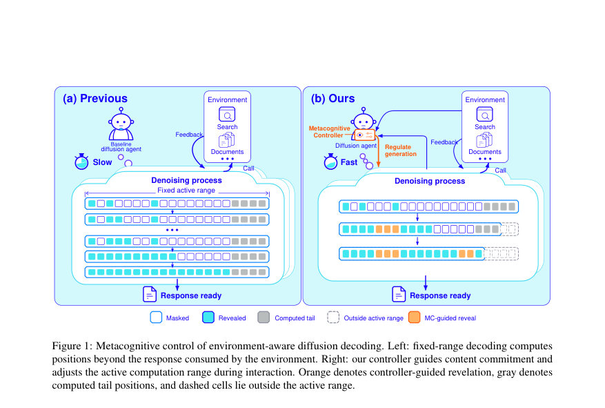
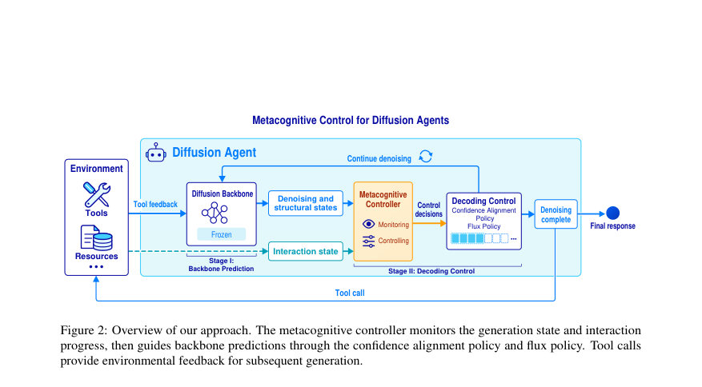
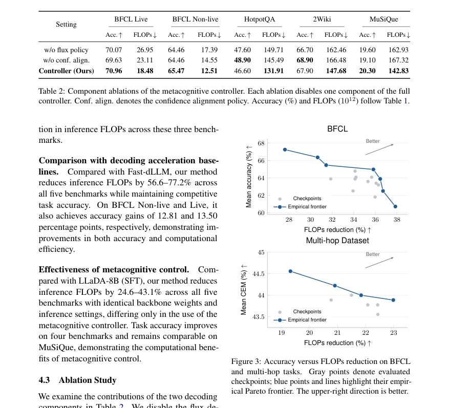

# Metacognitive Decoding: Efficient Inference for Diffusion Language Agents

- **게시일:** 2026-10-28
- **arXiv:** [2610.37642v1](http://arxiv.org/abs/2610.37642v1) · [PDF](https://arxiv.org/pdf/2610.37642v1)
- **저자:** Mingyu Zhao, Shuhang Lin, Ligong Han, Xiaojing Yu, Zhenting Wang, Yifei Pang, Yang Zhou, Dimitris N. Metaxas
- **분야:** cs.CL
- **선정 점수:** 5.69
- **선정 이유:** 최근성 1.4, 인용 영향 0.0 (인용 0회), 저자 영향 0.0 (최고 h-index 0), AI 주제 적합성 2.7, 개발자 관심 0.8, 학술 신호 0.9, 오픈 웨이트·주요 연구조직 신호 0.0

[← 2026-10-28 목록으로 돌아가기](../daily/2026-10-28.html)

<!-- paper-visuals:start -->
## 주요 Figure

> 원문 PDF에서 실제 Figure 캡션과 그림 영역이 함께 확인된 자료만 자동 추출했다.

*Figure · 원문 PDF 2쪽 · Figure 1: Metacognitive control of environment-aware diffusion decoding. Left: fixed-range decoding computes*

*Figure · 원문 PDF 4쪽 · Figure 2: Overview of our approach. The metacognitive controller monitors the generation state and interaction*

*Figure · 원문 PDF 7쪽 · Figure 3: Accuracy versus FLOPs reduction on BFCL*

<!-- paper-visuals:end -->

## 한 문장 요약

대화형 환경에서 불필요한 병렬 토큰 계산을 줄이기 위해, 에이전트 상호작용 상태와 모델 불확실성을 모니터링하여 토큰 확정 및 활성 계산 범위를 동적으로 조절하는 경량의 메타인지 컨트롤러를 제안한다.

## 해결하려는 문제

블록 기반 확산(diffusion) 언어모델은 병렬로 여러 토큰을 생성할 수 있어 에이전트 효율에 유리하지만, 기존의 고정 범위 고정 기준 디코딩은 에이전트 궤적의 구조적 특성을 반영하지 못해 계산 낭비가 발생한다. 구체적으로 (1) 에이전트 출력에는 API 템플릿처럼 예측이 쉬운 구조적 토큰과 복잡한 추론 토큰이 섞여 있어 동일한 처리 규칙이 쉬운 토큰에 과도한 연산을 쓰거나 어려운 토큰을 너무 일찍 확정하게 만든다; (2) 툴 호출(tool call) 이후 환경 피드백을 기다리는 경계가 있음에도 블록 단위 고정 크기 연산은 호출 경계 뒤의 추정(생성) 토큰들을 불필요하게 계산한다. 연구 질문은 이러한 상호작용 상태와 예측 신뢰도를 이용해 언제 토큰을 확정하고 활성 계산 범위를 얼마나 줄일지 동적으로 결정하여 추론 FLOPs를 낮추면서 정확도를 유지할 수 있는가이다.

## 핵심 기여

- 확산 기반 언어에이전트의 비효율성(토큰 수준의 불필요한 계산과 블록 꼬리 계산 낭비)을 규명함.
- 환경-인지적(metacognitive) 컨트롤러를 제안하여 모델 내부 신호(디노이징 상태·구조 상태)와 외부 상호작용 상태를 모니터링하고 디코딩을 제어함.
- 계단식(cascaded) 디코딩 정책을 도입: confidence alignment(구조 세그먼트 수용 및 토큰별 임계값 조정)와 flux decoding(복구 가능한 빈 토큰을 이용해 활성 계산 범위 동적 축소)으로 구성됨.
- 컨트롤러를 현장(에이전트) 궤적을 이용해 궤적 수준 보상(정확도와 추론 비용 균형)을 학습하고 frozen backbone과 플러그인 방식으로 동작시켜 백본 재훈련을 피함.
- 다섯 개의 벤치마크(BFCL live/non-live, HotpotQA, 2WikiMultiHopQA, MuSiQue)에서 주요 기준선보다 추론 FLOPs를 낮추면서 경쟁력 있는 정확도를 달성함; 구성 요소별 제거 실험으로 각 정책의 기여를 검증함.

## 접근 방법

* 아키텍처와 알고리즘 개요: - 백본: 블록 단위 확산(block diffusion) 백본(예: LLaDA-8B-Instruct, Dream-7B 등).
* 각 블록은 반복적 디노이징으로 생성되며 블록 간에는 자율회귀적 조건부 생성이 유지된다.
* - 메타인지 컨트롤러: 경량 플러그인(구현은 두 층 Transformer 인코더 사용).
* 입력으로 내부 모델 신호(디노이징 상태: 예측 불확실성·토큰 공개 상태·블록 진행도, 구조 상태: 반복되는 형식 패턴의 적합성)와 외부 상호작용 신호(상호작용 턴·사고·툴 호출·최종답 완료 여부)를 인코딩한다.
* - 계단식 디코딩 절차: Stage I(백본 예측)에서 각 활성 마스크 위치 i에 대해 백본이 토큰 확률 pi(v)를 예측하고 ˆxi, 신뢰도 ci = pi(ˆxi)를 산출한다.
* Stage II(디코딩 제어)에서 컨트롤러가 두 정책을 적용한다.
* 1) Confidence alignment: 학습된 구조적 후보(trajectory에서 추출된 반복 세그먼트)를 현재 블록 위치와 매칭하여 최고 점수 후보 j*의 점수 uj*와 글로벌 임계 ρ를 비교해 해당 세그먼트를 한꺼번에 확정할지 결정한다.
* 나머지 마스크 위치마다 위치별 임계 오프셋 δi를 예측해 백본 신뢰도 ci ≥ τ0 − δi일 때 토큰을 수용한다(τ0는 기본 기준).
* 2) Flux policy: 복구 가능한 빈 토큰 ε을 도입해 활성 계산 범위 길이 ℓ을 위치별 점수 sr(softmax로 prange 생성)에 따라 선택한다.
* ℓ 이후 위치들은 이후 디노이징에서 제외되며 필요 시 복구(활성 범위 확장, ℓ' > ℓ)할 수 있다(한 블록 내에서는 축소 불가).
* - 학습: 궤적 수준 보상 R(τ)을 정의(정답인 경우 R = (max(0, 1 − e(τ)/η))^α, 정답 아니면 0; e(τ)=F(τ)/Fref(q), Fref는 동일한 frozen backbone의 기준 비용).
* 컨트롤러는 온폴리시 GRPO로 학습하며, 각 라운드에서 에이전트 궤적을 샘플링하고 보상 표준화(advantage)를 사용해 업데이트한다.
* 백본은 동결되어 후속 비용이 절감되도록 설계됨.
* - 추론 절차: 각 디노이징 스텝에서 prange로 활성 길이를 샘플/선택하고(추론시 greedy로 선택), 구조 후보 수용과 토큰별 수용을 샘플/결정하여 확정된 토큰을 환경과의 인터랙션 경계에 맞게 즉시 커밋하거나 이후에 복구 가능하게 처리한다.

## 주요 결과

- 평가 환경: BFCL v3 (Live / Non-live; 툴 호출 정확도 평가), HotpotQA / 2WikiMultiHopQA / MuSiQue (각 1,000 질문 샘플; 다중 홉 QA, CEM(cover exact match)으로 평가). 추론 비용은 백본과 컨트롤러의 주요 행렬 연산을 누적한 FLOPs(단위: 10^12 연산).
- 주요 성능(논문 표 1, 'Ours' 행): BFCL Live: 정확도 70.96%, FLOPs 18.48×10^12; BFCL Non-live: 정확도 65.47%, FLOPs 12.51×10^12; HotpotQA: 정확도 46.60%, FLOPs 131.91×10^12; 2Wiki: 정확도 67.90%, FLOPs 147.68×10^12; MuSiQue: 정확도 20.30%, FLOPs 142.83×10^12. (값은 논문 표에 보고된 그대로임.)
- 기준선 비교 요약(논문 본문 서술): Fast-dLLM 대비 논문은 모든 다섯 벤치마크에서 FLOPs를 56.6%–77.2% 감소시키면서 정확도는 경쟁적임. 동일 백본(LLaDA-8B SFT)과 비교하면 컨트롤러 적용으로 FLOPs가 데이터셋별로 24.6%–43.1% 감소하고 정확도는 4개 벤치마크에서 증가하거나 유사함. 사례(case study): 동일 쿼리에서 백본 단독 예측은 108.44×10^12 FLOPs, 오류 응답(2005-08-16)였고, 메타인지 컨트롤러는 82.11×10^12 FLOPs로 24.3% 절감하며 정답(2005-08-19)을 출력함.
- 구성요소 기여(ablations): flux policy 제거 시 FLOPs가 평균 24.5% 증가, confidence alignment 제거 시 평균 16.3% 증가(논문 본문 요약).
- 다른 백본 실험(표 3): LLaDA 백본에 대해 BFCL Live에서 정확도 +4.44pt, FLOPs 43.1% 감소; Dream 백본에 대해 HotpotQA에서 정확도 +1.10pt, FLOPs 52.9% 감소(표에 보고된 값들).

## 한계

- 저자 명시 한계: '컨트롤러를 진화하는 확산 모델들에 적응시키는 것이 중요한 향후 과제'로 명시되어 있음.
- 본문·실험으로 확인되는 제약(확인된 한계): - 방법은 블록 확산(block diffusion) 계열 백본을 전제로 하며, 자율회귀 AR 모델이나 비블록 확산 구조에 대한 적용성은 본문에서 실험적으로 검증되지 않음. - 컨트롤러 학습은 에이전트 궤적(툴 호출 포함) 샘플링과 온폴리시 GRPO 기반 최적화가 필요하여 학습 과정 자체의 계산 비용과 복잡도가 존재함(논문은 8×A100, 40 라운드/스테이지로 학습함). - 일부 하이퍼파라미터(예: η, α, τ0의 구체적 값)는 본문에서 일반적 기법과 수식은 제시되지만 전체 실험 설정에서의 세부값은 논문 본문에 명시적으로 나와 있지 않음(따라서 재현 시 튜닝 필요). - 컨트롤러가 토큰을 조기 확정할 때 발생할 수 있는 오류 위험은 보상 설계와 임계값 조정에 의존하며, 복잡한 도메인에서의 안전성 검증은 제한적임.

## 개발자 관점

- 재현 관점: 컨트롤러는 백본을 동결(frozen)한 채 플러그인으로 동작하므로 백본 재학습 없이 적용 가능하지만, 효과적 후보(구조 세그먼트) 추출과 궤적 데이터 수집이 필요하다(논문은 학습에 에이전트 궤적을 사용).
- 구현 관점: 컨트롤러는 두 층 Transformer 인코더로 제시되어 경량이며, 추론 시에는 각 디노이징 스텝 후 백본 예측을 받아 구조 후보 점수, 위치별 임계 오프셋, prange를 계산해 활성 범위를 줄이거나 확장한다. 빈 토큰 ε의 복구 메커니즘(범위 확장 시 마스크 복원)과 ‘한 블록 내에서는 축소 불가’ 정책을 정확히 구현해야 한다.
- 학습·운영 비용: 논문은 컨트롤러 학습에 8×A100, 40 라운드/스테이지를 사용했다고 명시하므로 개발 시 초기 투자(궤적 샘플링·정책 학습 비용)를 고려해야 한다.참고로 평가 시에도 컨트롤러 계산은 전체 FLOPs에 포함되어 보고됨(순 이득은 컨트롤러 비용을 뺀 값이 아님).
- 배포·통합: 컨트롤러는 환경 상호작용 상태(툴 호출 완료 여부 등)를 입력으로 필요로 하므로 에이전트 실행 파이프라인과의 밀접한 통합이 필요하다.특히 툴 호출 경계에 맞춘 즉시 커밋/대기 로직과 툴 결과 반영 흐름을 검증해야 함.
- 안전성·신뢰성: 토큰 조기 확정은 툴 호출 형식의 신뢰도를 높여 효율을 제공하지만 잘못된 구조 수용이나 과도한 임계 완화는 잘못된 호출/응답을 야기할 수 있으므로 임계값(ρ, δi, τ0)과 보상 함수(η, α)의 신중한 튜닝, 오류 케이스 모니터링이 필요하다.

**근거 범위:** 이 분석은 제공된 논문 PDF 본문(및 본문에 포함된 표와 그림 캡션)을 근거로 작성되었음. 초록은 보조적으로 참고했다. 표와 본문에 명시된 수치(예: 정확도, FLOPs, 백본·백업 비교 수치, ablation 요약, 학습 환경 정보 등)는 문서에서 직접 인용하였다. 다만 일부 학습 하이퍼파라미터(예: η, α, τ0의 구체 값)와 모델의 일부 저수준 구현 세부(학습률, 배치 크기 등)는 본문에 명시되지 않아 본 분석에서는 추정 없이 누락했음을 밝힌다.
