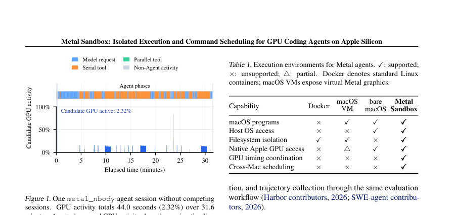
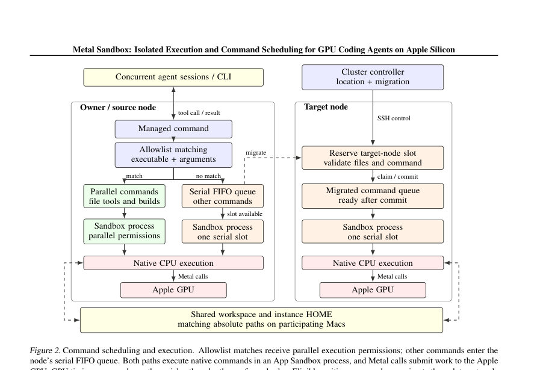
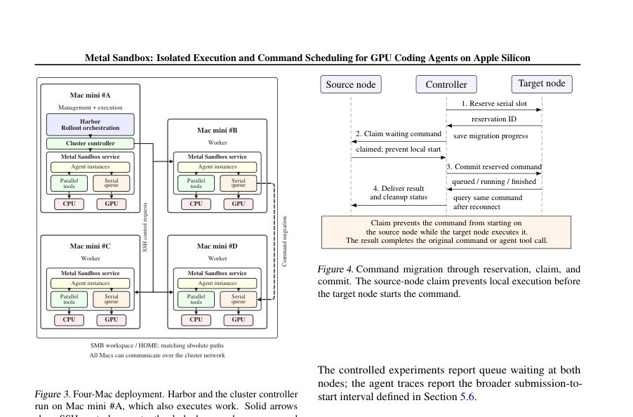

# Metal Sandbox: Isolated Execution and Command Scheduling for GPU Coding Agents on Apple Silicon

- **게시일:** 2026-11-14
- **arXiv:** [2611.17294v1](http://arxiv.org/abs/2611.17294v1) · [PDF](https://arxiv.org/pdf/2611.17294v1)
- **저자:** Haozhe Wang, Lina Chen, Fanqi Wan, Qi Han, Yinmin Zhang, Zheng Ge, Daxin Jiang, Junchi Yan
- **분야:** cs.LG, cs.AI, cs.CL, cs.DC
- **선정 점수:** 5.10
- **선정 이유:** 최근성 0.7, 인용 영향 0.0 (인용 0회), 저자 영향 0.0 (최고 h-index 0), AI 주제 적합성 2.7, 개발자 관심 1.1, 학술 신호 0.5, 오픈 웨이트·주요 연구조직 신호 0.0

[← 2026-11-14 목록으로 돌아가기](../daily/2026-11-14.html)

<!-- paper-visuals:start -->
## 주요 Figure

> 원문 PDF에서 실제 Figure 캡션과 그림 영역이 함께 확인된 자료만 자동 추출했다.

*Figure · 원문 PDF 2쪽 · Figure 1. One metal_nbody agent session without competing*

*Figure · 원문 PDF 4쪽 · Figure 2. Command scheduling and execution. Allowlist matches receive parallel execution permissions; other commands enter the*

*Figure · 원문 PDF 5쪽 · Figure 3. Four-Mac deployment. Harbor and the cluster controller*

<!-- paper-visuals:end -->

## 한 문장 요약

Apple Metal을 사용하는 대화형 코딩 에이전트들을 위해 macOS 네이티브 실행(애플 App Sandbox 기반)과 노드별 직렬 실행 슬롯 + 교차-맥 명령 마이그레이션(reserve/claim/commit)을 결합해 GPU 유휴 용량을 활용하고 명령 처리량을 높이는 인프라(Metal Sandbox)를 제안한다.

## 해결하려는 문제

대화형 GPU 커널 개발 에이전트 세션은 모델 요청, 소스 편집, 빌드/검증, GPU 실행을 교대로 수행하며 전체 세션에서 GPU가 차지하는 시간 비율은 매우 낮다(예: metal_nbody 세션에서 GPU 활동이 세션 시간의 2.32%). 기존 접근(각 노드 단위 직렬화 또는 가상화)은 (1) 네이티브 macOS/Metal 도구 접근을 제공하지 못하거나(일반 Docker), (2) 인스턴스별 파일 격리가 부족하거나(바로 macOS), (3) 명령 수준의 교차-맥 스케줄링을 지원하지 않아 GPU 자원이 유휴로 남아 도구 대기 시간이 길어지고 롤아웃 수집이 비효율적이라는 한계가 있다. 연구 질문은 persistent native macOS 인스턴스에서 파일 격리와 네이티브 GPU 접근을 유지하면서, 개별 명령 단위로 대기 중인 직렬 명령을 다른 여유 노드로 이관해 GPU 유휴 용량을 활용할 수 있는가이다.

## 핵심 기여

- 네이티브 macOS(App Sandbox) 기반의 인스턴스 모델: 인스턴스별 개발 HOME/워크스페이스 파일 격리, 네이티브 쉘·컴파일러·Metal 접근을 제공하고 툴 호출을 관리하는 실행 인터페이스를 구현.
- 명령-단위의 교차-맥 스케줄링과 마이그레이션 프로토콜(reserve → claim → commit): 각 노드에 단일 직렬 실행 슬롯과 FIFO 대기열을 두고, 대기 중인 직렬 명령이 공유 워크스페이스 요건을 만족하면 다른 노드의 유휴 슬롯으로 이관하여 실행하도록 설계.
- Harbor 통합: Claude Code, Codex, mini-SWE-agent 등과 연동해 태스크 생성·검증·궤적(trajectory) 수집을 동일 워크플로우로 지원.
- 실험적 평가: 4대 Mac mini M4 클러스터에서 집중적·균형적 제출 시 처리량·대기 개선을 보였고, 정적 에이전트 궤적 재생(replay)으로 동적 스케줄링의 이득을 분석하여 정량화함.
- 오픈소스 아티팩트 공개(논문에 기재된 GitHub 링크)로 재현 가능성 보조.

## 접근 방법

* 아키텍처: 각 에이전트 세션은 관리 노드가 기록하는 '인스턴스'를 할당받아 인스턴스 전용 워크스페이스와 HOME을 갖는다.
* 인스턴스 명령은 App Sandbox 프로세스에서 네이티브 macOS/Metal 도구로 직접 실행되며, 이로써 네이티브 툴체인 및 GPU 접근을 보장하면서 인스턴스 파일 쓰기는 허용된 경로로 제한한다.
* 파일 공유 및 마이그레이션: 마이그레이션을 지원하려면 인스턴스의 공유 워크스페이스가 스케줄링 풀에 속한 모든 참여 노드에 동일 절대경로로 SMB로 마운트되어야 한다(임시 파일·로그 등은 로컬).
* 스케줄링 정책: 각 노드는 (a) 병렬 실행 허용 명령(allowlist 매칭)과 (b) 직렬로 처리해야 하는 명령으로 분류한다.
* 직렬 명령은 노드당 하나의 직렬 실행 슬롯과 FIFO 큐로 직렬화된다.
* 동적 스케줄링: 컨트롤러는 대기 중인 직렬 명령들 가운데 공유 요건을 만족하는 것들을 대상으로 예약(reserve)할 수 있는 대상 노드를 탐색(유휴 슬롯·열 없음·열 임계값 등 조건), reserve→claim(소스에서 시작 방지)→commit(타깃에서 실행 허가) 절차로 마이그레이션을 수행한다.
* 배치/배치 균형화: 인스턴스 배치 시 후보 노드의 (활성 인스턴스 수 An + 생성중 Rn)를 최소화하는 노드를 선택한다.
* Harbor 통합: 태스크 어댑터가 인스턴스 생성, 파일 업로드, 에이전트 런타임 준비, 검증 단계 실행 및 결과·명령 궤적 수집을 담당하여 일관된 실험 워크플로우를 제공한다.
* 평가 절차: 고정 Metal 커널들(6개)을 사용한 제어 실험(2s/6s 루프), 4대 M4 Mac mini 클러스터, SMB 마운트, 명령별 최소 컴퓨트 루프 시간으로 처리량 및 대기 시계열을 측정하고, 실제 Harbor로 수집한 16개 에이전트 세션 궤적을 재생해 스케줄링 효과를 분석했다.

## 주요 결과

- 4대 M4 Mac mini 클러스터에서 고정 12명령(각 2초 최소 루프) 배치: 균형 제출 시(1,2,4 노드) 네이티브 병렬 확장으로 정적/동적 모두 성능 향상. 집중 제출(모든 명령을 관리 노드로 제출)에서 정적 배치의 중앙값 배치 시간은 25.3s였고 동적 스케줄링은 15.1s로 40.4% 감소, 명령 처리량은 1.68× 향상(정적 1,710/hr → 동적 2,870/hr). (표 3)
- 긴 명령(최소 6초 루프, 6개 커널 각 1회): 정적 36.8s → 동적 18.0s로 중앙값 배치 시간이 51.1% 감소, 명령 처리량은 2.05× (588 → 1,200 commands/hr).
- 명령 마이그레이션 오버헤드(직접 측정): 대기 명령 조회·예약(lookup+reserve) 중앙값 0.818s(범위 0.796–0.965s). Claim/commit는 각각 중앙값 0.97ms 및 3.89ms. 전체 예약→원격 결과까지의 중간 전체 경로(예: payload 0 MiB)는 최소 루프 길이에 따라 중앙값 1.86s(0s 루프), 2.19s(0.25s), 3.96s(2s) 등으로 보고(표 4).
- 실제 에이전트 궤적(16개 세션, Harbor 수집): 측정된 정적 배치의 배치 전체 시간 67.6분, 평균 툴 대기 21.0분, 평균 개별 세션 경과 시간 45.1분, 총 명령은 직렬 1,165개·병렬 114개. 재생(replay) 기반 동적 스케줄링으로 평균 툴 대기가 21.0 → 17.1분(18.8% 감소), 배치 시간 67.6 → 52.5분(22.3% 감소). 재생 중 수행된 마이그레이션 수는 276회.
- 지속적 처리량(추정): 종합적으로 논문은 '각 노드 당 4개의 동시 세션'을 즉시 보충한다고 가정할 때 1세션 대비 4세션으로의 노드당 지속 처리량 향상 추정치가 2.14×임을 계산(식: 4/T4 ÷ 1/T0 = 4×T0/T4, T0=24.12min, T4=45.12min).

## 한계

- 저자가 명시한 한계: (1) App Sandbox의 파일 접근 제한은 sandbox 프로세스와 그 평범한 자식 프로세스에 적용되지만 일부 애플리케이션 시작 경로는 경계 밖에 남는다. (2) 본 시스템은 적대적 멀티테넌트 격리(hostile multi-tenant containment)나 물리적 GPU 배타성(exclusive GPU ownership)을 제공하지 않는다. (3) allowlist(또는 blocklist)에 병렬로 분류된 명령도 실제로 GPU를 사용할 수 있어 완전한 검출을 제공하지 않음. (4) 재생(replay)은 모델 응답·명령·기간을 고정한 상태에서 스케줄링 효과를 평가하므로, 다른 도구 피드백이 에이전트 동작을 변화시킬 경우(예: 커널 품질 변화, 새로운 실패/재시도 패턴) 실제 효과는 달라질 수 있다고 저자가 명시.
- 본문 실험·설계에서 합리적으로 확인되는 한계: (1) 마이그레이션 비용이 ~0.8–2s(조회+예약 등)로 짧은 명령에서는 순이득이 작거나 음수일 수 있어, 매우 짧은 툴 호출이 빈번한 워크로드에서는 이 접근이 효율적이지 않을 수 있음. (2) 실험은 4대 Mac mini M4, SMB 마운트, 기가비트 이더넷 환경 등 특정 하드웨어·네트워크·파일시스템 구성에 기반하므로 다른 하드웨어/네트워크 조건에서 성능·오버헤드가 달라질 수 있음. (3) 공유 워크스페이스에 의존하므로 노드 간 툴체인·퍼미션 호환성 문제가 발생하면 마이그레이션 불가 또는 추가 오류가 발생할 수 있음. (4) 큐는 노드 단위로 유지되기 때문에 전역 도착 순서를 강제하지 않아 공정성이나 전역 지연 측면의 제약이 있을 수 있음.

## 개발자 관점

- 인스턴스 격리: macOS App Sandbox를 활용해 인스턴스별 HOME/워크스페이스 격리를 제공하면 네이티브 툴과 Metal을 그대로 쓰면서도 호스트 홈 디렉터리나 타 인스턴스 파일에 대한 쓰기 차단이 가능하다. 다만 일부 런처 경로는 우회될 수 있으므로 추가 검토 필요.
- 공유 워크스페이스(예: SMB)는 모든 참여 노드에서 동일한 절대경로로 마운트되어야 하고, 툴체인·권한이 모든 노드에서 호환되어야 마이그레이션이 가능하다. 이 조건을 배포·운영 체크리스트에 포함시켜야 한다.
- 마이그레이션 프로토콜(reserve→claim→commit) 패턴은 타깃 슬롯 선점과 소스 시작 방지로 경쟁 상태를 줄이지만 조회·예약 단계에 수백 ms~초(중앙값 약 0.818s)의 비용이 발생하므로 짧은 명령에서는 성능 손실을 유발할 수 있다. 마이그레이션 정책은 명령 길이 또는 최소 루프 시간에 민감하게 설계해야 한다.
- 스케줄링 분류(allowlist/blocklist)는 명령별로 GPU 사용 여부를 정확히 알기 어렵기 때문에 관리자 정책이 중요하다. 빌드 명령이 내부에서 GPU 테스트를 호출할 수 있으므로 관리자 측 분류 실수가 전체 직렬화·성능에 큰 영향을 줄 수 있다.
- 운영 관점: node당 단일 직렬 슬롯은 병렬 준비(파일 작업, 편집)와 GPU 타이밍 명령을 분리해 유휴 GPU를 활용하지만, 고도로 편중된 분포에서는 소스 노드에 큰 대기 누적이 발생하므로 인스턴스 배치와 동적 마이그레이션 조합이 필요하다. Harbor 연동으로 결과·로그·툴 대기를 분리 기록하면 재현·평가가 쉬워진다.

**근거 범위:** 본 분석은 제공된 논문 PDF 본문 전체의 텍스트에 근거해 작성되었다. 수치·결과(표, 본문에 명시된 중앙값·비율·시간·횟수 등)는 본문에서 직접 확인 가능한 값만 포함했다. 구현의 세부(예: SMB 설정의 정확한 마운트 옵션, App Sandbox 세부 권한 파일, 배포 스크립트 등)나 런타임 환경의 추가 미세조정은 본문에 자세히 기술되지 않아 재현 시 추가 확인이 필요하다.
