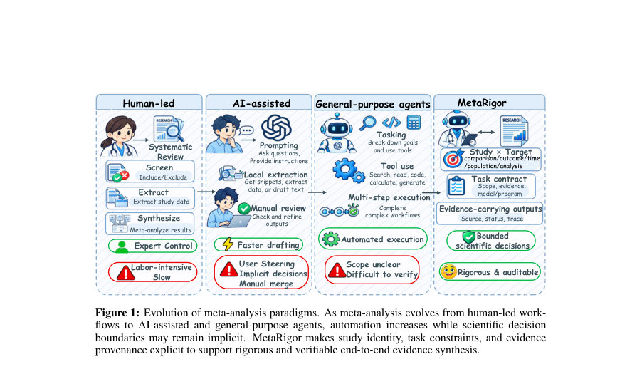
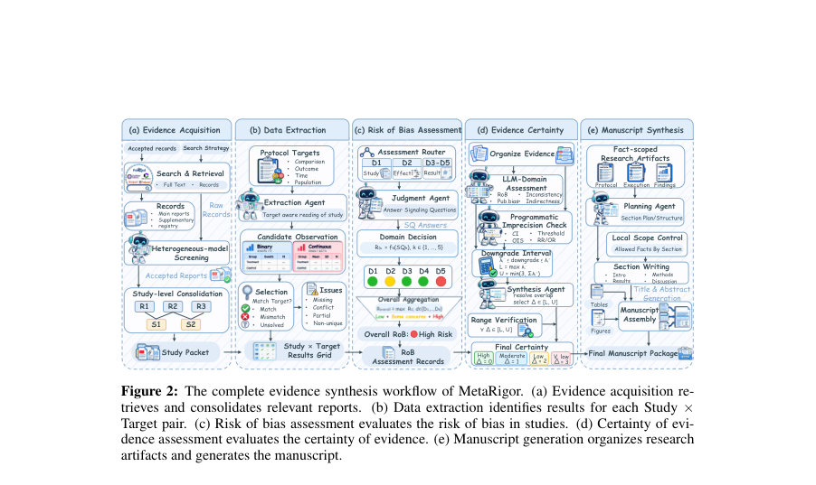
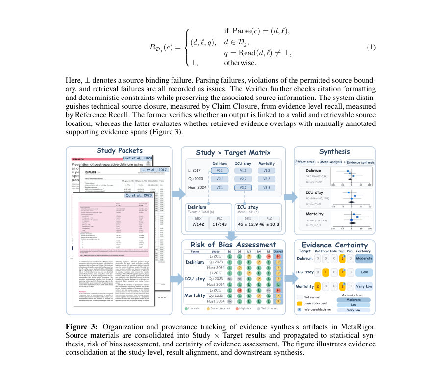

# MetaRigor: From Agentic Automation to Verifiable End-to-End Meta-Analysis Through Scientific Decision Boundaries

- **게시일:** 2026-11-23
- **arXiv:** [2611.27713v1](http://arxiv.org/abs/2611.27713v1) · [PDF](https://arxiv.org/pdf/2611.27713v1)
- **저자:** Yifeng Xie, Chenke Li, Yangshuo Miao, Jingyuan Zheng, Mingxuan Liu, Feiwei Qin, YaQi Wang, Huiyu Zhou, Yifei Chen
- **분야:** cs.AI, cs.SE
- **선정 점수:** 4.79
- **선정 이유:** 최근성 0.4, 인용 영향 0.0 (인용 0회), 저자 영향 0.0 (최고 h-index 0), AI 주제 적합성 2.3, 개발자 관심 0.0, 학술 신호 1.2, 오픈 웨이트·주요 연구조직 신호 0.8

[← 2026-11-23 목록으로 돌아가기](../daily/2026-11-23.html)

<!-- paper-visuals:start -->
## 주요 Figure

> 원문 PDF에서 실제 Figure 캡션과 그림 영역이 함께 확인된 자료만 자동 추출했다.

*Figure · 원문 PDF 2쪽 · Figure 1: Evolution of meta-analysis paradigms. As meta-analysis evolves from human-led work-*

*Figure · 원문 PDF 5쪽 · Figure 2: The complete evidence synthesis workflow of MetaRigor. (a) Evidence acquisition re-*

*Figure · 원문 PDF 6쪽 · Figure 3: Organization and provenance tracking of evidence synthesis artifacts in MetaRigor.*

<!-- paper-visuals:end -->

## 한 문장 요약

메타분석 전 과정에서 연구·결과 정체성(Study × Target), 과학적 결정경계(Task Contract·Code Logic·Source Anchor)를 명시적으로 유지하여 LLM 기반의 검증 가능한 엔드투엔드 자동화 워크플로우인 MetaRigor를 제안하고, 다단계 통제 평가와 소거(ablation) 실험으로 제안체계의 효과를 입증한다.

## 해결하려는 문제

기존 LLM·에이전트 기반 증거종합은 개별 숫자 추출에는 성과가 있으나 ‘어떤 연구의 어떤 결과(비교·인구·결과·시점·분석조건 등)에 해당하는가’라는 결과 정체성(result identity)과 그 정체성을 유지·검증하는 전단계(문헌수집→추출→RoB→GRADE→보고) 일관성이 명시적이지 않아 하류 통계·방법론 판단·보고 단계에서 오류(잘못된 시점 또는 비교에 수치가 연결되는 등)가 전파되는 문제가 있다.

## 핵심 기여

- Study × Target으로 결과를 인덱싱해 결과 정체성을 유지하는 연구·결과 중심의 공유 표현 제안
- 과학적 결정경계(Scientific Decision Boundary)를 Task Contract(객체·허용 사실·모델/프로그램 권한·전달요구), Code Logic(프로그램 규칙), Source Anchor(원문 위치·해시)로 운영화하여 모델 해석과 프로그램적 검증을 분리
- 증거획득(EA), 데이터추출(DE), 위험도평가(RoB), 근거확실성(EC), 원고생성(MS)의 5단계 통제 평가 프레임워크와 102편의 리뷰(총 717개 포함연구)를 사용한 실험적 검증 제공
- 소거 실험으로 Task Contract와 Code Logic이 단계별로 다른 역할을 수행함을 정량적으로 분석
- 아카이브된 산출물 추적을 통해 결과 정체성 불일치가 통계입력·RoB 평가·최종보고로 어떻게 전파되는지 사례 기반으로 제시

## 접근 방법

* 메타리거(MetaRigor)는 연구 프로토콜을 시작점으로 (1) 동일 연구의 모든 보고서(주저·보충·레지스트리 등)를 Study Packet으로 통합하고, (2) 분석 목표를 Target=(비교 κ, 인구 p, 결과 o, 시점 τ, 분석조건 a)로 정의해 Study × Target의 카르테시안 결과 공간 G=S×T를 유지한다.
* 각 과제는 Task Contract로 객체(무엇을 판단할지), 허용사실(공식 입력·원천자료), 모델과 프로그램의 의사결정 권한, 전달·검증 규칙을 명시한다.
* 모델(LLM)은 문맥적 의미 판정(예: 결과가 타깃과 일치하는지, 신호질문에 대한 서술적 근거 선택)을 담당하고, 프로그램(코드로 구현된 Code Logic)은 수치 계산, 후보열거, 소스 파싱·읽기·검증(공간·해시 포함), RoB·GRADE의 규칙적 분기·집계, 구간제약 검증 등을 결정론적으로 수행한다.
* 모든 출력은 Source Anchor로 원문 위치와 검색 가능한 증거로 바인딩되며, RoB 단계는 RoB 2(2019-08-22), EC 단계는 GRADE 규칙을 사용한다.
* 증거획득(독립 이중 스크리닝), 추출(Observation 분리→Target 매칭→Source Anchor 검증), RoB(시그널 질문 → 프로그램 규칙으로 도메인·전체 집계), EC(도메인별 허용 강하 구간 매핑 후 구간 합·검증), MS(상위 사실 범위만 사용해 PRISMA 2020에 맞춰 조립·생성)으로 구성된다.
* 실험에서는 DeepSeek-V4-Flash, GPT-5.6 Luna 등이 주요 모델로 사용되며, GPT-6.1 Terra로 추가 비교를 수행했다.

## 주요 결과

- 데이터셋·스케일: 전체 실험은 102개 체계적 리뷰(총 717개 포함 연구)를 대상으로 수행. 단계별 통제 평가 케이스 수: EA 5건(타이틀·초록 822건, 전문 300건, 25 연구 패밀리), DE 10건(405 Study×Target, 828 수치필드), RoB 7건(704 시그널질문), EC 100건, MS 10건.
- 데이터추출(DE, 주평가): MetaRigor 완전결과 F1 = 86.29%, Recall = 87.18%, Field accuracy = 88.89%, Precision = 85.43% (참고: unfiltered 성능도 보고됨). 비교: Codex CLI F1 84.62%, OpenHands 74.87%, Manalyzer 48.65%, meta-pipe 53.02%.
- 위험도평가(RoB): 도메인 일치율(Domain) = 71.25%, 전체 판단(Judgment) = 62.50%, 레퍼런스상의 'High risk' 회수(High Risk recall) = 69.23%. 비교: Codex CLI High risk recall 30.77%, OpenHands 46.15%, meta-pipe 7.69%.
- 근거확실성(EC): 도메인 일치율 = 80.20%, 전체 강하(downgrade) MAE = 0.413, 전체 도메인 수준 합의(도메인 일치) = 80.20%.
- 증거획득(EA): 타이틀/초록 F1 = 67.61% (F2 = 82.19%, Precision 52.17%, NNR 1.92), 전문 F1 = 76.19% (F2 = 86.96%, Precision 63.16%, NNR 1.58). 연구패밀리 복구율 88.00%, 동반 보고서 복구율 93.10%. (EA는 이중 독립 스크리닝 사용)

## 한계

- 저자가 직접 언급한 한계: 더 광범위한 검증이 필요함(결론·토의에서 명시). EC의 불확실성(특히 비이진 결과나 RR/OR 외 지표에 대한 즉시 적용성 제한) 및 RoB에서 '복합적 Some concerns가 합쳐져 High risk'인 문맥의 자동 집계는 현재 구현에 포함되어 있지 않음(본문에 구현범위 한계 기재). 또한, MetaRigor는 프로그램 검증에서 실패하거나 미해결(Unresolved) 상태가 발생한 경우 자동 재시도(모델 재호출)를 강제하지 않고 해당 상태를 보존함(설계적 선택).
- 추론에 의해 확인되는 추가 한계: 평가 데이터·설정은 통제된 입력(상위 단계 고정)을 기반으로 하므로, 실제 완전 자동 파이프라인의 입력 불확실성·검색 노이즈와 상호작용하는 성능은 본 논문 실험 밖임. EA의 스크리닝 성능은 모델 구성에 민감(논문 내 Dual-Luna / Dual-DeepSeek 비교에서 확인)하여, 실제 배포시 모델 선택·버전·비용에 따라 결과가 크게 달라질 가능성이 있음. DE 단계에서 출처 바인딩(Claim Closure)과 Reference Recall은 높으나, 출처가 '기술적으로 연결'되더라도 그 텍스트가 실제로 시스템 판단을 정당화하는지(의미적으로 지지하는지)는 별도 평가가 필요함(저자도 구분해서 보고). 또한, RoB·EC의 일부 규칙·임계값은 구현된 정형 규칙에 의존하므로 다른 프로토콜·영역(비무작위대조시험 등)으로 일반화하려면 추가 설계가 필요함.

## 개발자 관점

- 재현·구현: 핵심은 Study×Target 인덱싱과 Task Contract 사양에 따라 '모델은 해석(문맥판단)·프로그램은 규칙적 연산'으로 역할을 분리하는 아키텍처를 구현하는 것. Source Anchor(문서 ID·위치·본문·해시) 저장·검증을 반드시 설계해 결과의 추적성을 확보할 것.
- 검증·프로그램 규칙: RoB 2·GRADE와 같은 규칙 기반 결정을 프로그램으로 구현(결정론적 분기 및 구간 제약 검증)하면 표준화·검증 가능성이 상승하나, 문맥적 중복 강하(duplicate downgrading) 판단은 여전히 모델의 의미합성에 의존하므로 명확한 감사 로그를 남겨야 함.
- 운영·배포 비용: 논문에서 사용한 모델(DeepSeek-V4-Flash, GPT-5.6 Luna, GPT-6.1 Terra 등)·이중 스크리닝·검증단계는 계산 비용과 API 호출량이 큼. 실환경 배포시 모델 경량화·혼합전략(대형모델은 의미합성/문제해결용, 경량·온프레미스 도구는 규칙·검증용) 고려 필요.
- 안전성·사용자관리: 시스템은 '보조' 목적이며 인간 검사 필요성을 명시. 특히 결과 정체성 변경, 미해결 항목 유지, 자동 재시도 미실행 등 설계 선택은 사용자에게 투명하게 표시하고 검토 흐름을 만들어야 함.
- 추적·회계(auditing): 모든 중간 산출물(Observation, RoB 시그널 Q, 도메인판단, EC 구간, 통계입력 등)을 아카이브하여 변경이 downstream에 어떻게 전파되는지 추적할 수 있는 로그·버전관리 체계를 도입할 것.

**근거 범위:** 이 분석은 제공된 논문 PDF 본문(페이지 1–27)에 기반함. 본문에 수록된 표(예: Table 1–23), 수치(예: DE F1 86.29%, end-to-end 7건 F1 77.01% 등), 실험 설정(모델·케이스 수·단계별 입력)과 저자가 직접 서술한 설계·한계를 근거로 작성함. 부록 및 실행 로그 관련 세부 구현(예: 코드 수준의 함수명, 내부 파라미터)은 PDF에 기재된 범위만 인용했으며, PDF에서 직접 확인하기 어려운 추가 환경설정·비공개 코드·외부 데이터는 포함하지 않음.
