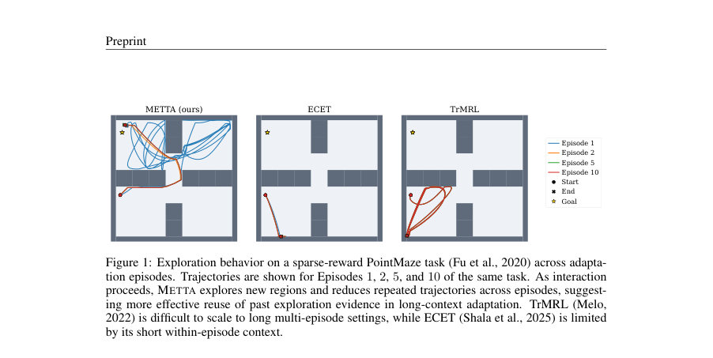
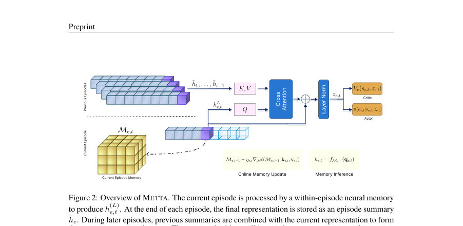
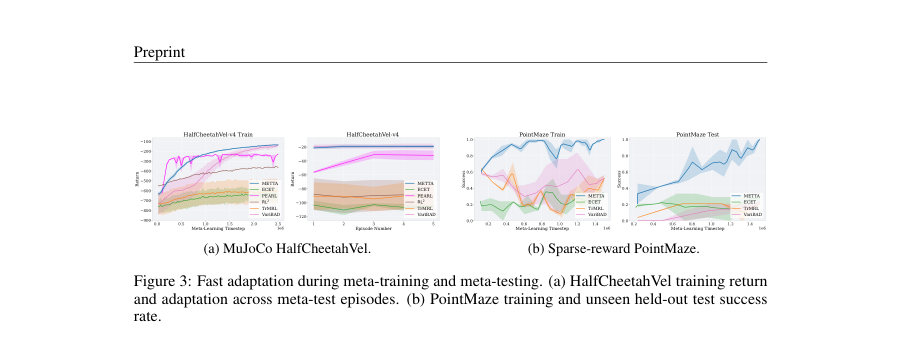

# METTA: Memory-Enhanced Test-Time Adaptation for Meta-Reinforcement Learning

- **게시일:** 2026-10-25
- **arXiv:** [2610.31656v1](http://arxiv.org/abs/2610.31656v1) · [PDF](https://arxiv.org/pdf/2610.31656v1)
- **저자:** Ali Najar, Hosein Hasani, Amir Kooshan Fattah, Yasamin Rajabi, Mahdieh Soleymani Baghshah
- **분야:** cs.LG, cs.AI
- **선정 점수:** 4.29
- **선정 이유:** 최근성 0.5, 인용 영향 0.0 (인용 0회), 저자 영향 0.0 (최고 h-index 0), AI 주제 적합성 2.0, 개발자 관심 0.7, 학술 신호 0.3, 오픈 웨이트·주요 연구조직 신호 0.8

[← 2026-10-25 목록으로 돌아가기](../daily/2026-10-25.html)

<!-- paper-visuals:start -->
## 주요 Figure

> 원문 PDF에서 실제 Figure 캡션과 그림 영역이 함께 확인된 자료만 자동 추출했다.

*Figure · 원문 PDF 2쪽 · Figure 1: Exploration behavior on a sparse-reward PointMaze task (Fu et al., 2020) across adapta-*

*Figure · 원문 PDF 4쪽 · Figure 2: Overview of METTA. The current episode is processed by a within-episode neural memory*

*Figure · 원문 PDF 6쪽 · Figure 3: Fast adaptation during meta-training and meta-testing. (a) HalfCheetahVel training return*

<!-- paper-visuals:end -->

## 한 문장 요약

METTA는 에피소드 내 causal 신경 메모리(TTT)와 에피소드간 요약(EMA 또는 attention)을 분리하여 테스트 시점에 메모리를 적응시키는 방식으로 장기 상호작용 히스토리를 효율적으로 활용해 메타강화학습 적응 성능과 추론 효율을 개선한다.

## 해결하려는 문제

메타-강화학습에서는 새로운 작업에 대한 빠른 적응을 위해 에이전트가 긴 상호작용 히스토리에서 작업 증거(task evidence)를 보존·활용해야 한다. 기존의 순환(recurrent) 기반 방법은 경험을 고정된 은닉 상태로 압축해 중요한 과거 증거를 복원하기 어렵고, 트랜스포머 기반 방법은 전체 히스토리에 대한 자기-어텐션이 시간·메모리 면에서 제곱(혹은 더 높은) 복잡도를 유발해 온라인·장기간 적응에 실용적이지 않다. 논문은 '긴 문맥(long-context)·다중 에피소드 적응'에서 효율적으로 작업 증거를 보존·재사용하면서도 테스트 시점에서 메모리를 학습(업데이트)할 수 있는 방법을 묻는다.

## 핵심 기여

- METTA 프레임워크 제안: 에피소드 내 세밀한 적응을 담당하는 causal 신경 메모리(실험에서는 TTT 레이어)와 에피소드 간 장기 추론을 담당하는 에피소드-레벨 요약(EMA 또는 attention)을 분리해 두 시계열 규모에서 빠른 적응을 수행함.
- Test-Time Training(TTT)을 메타-RL의 within-episode 메모리로 활용하여, 에피소드 진행 중 fast-weight(내부 메모리)를 self-supervised 손실로 온라인 업데이트하게 함으로써 테스트 시점에도 적응 가능하도록 설계.
- 교차-에피소드 집계 기법(지수이동평균(EMA) 및 요약 기반 attention) 제공으로 전-히스토리 어텐션 없이도 장기 정보 재사용을 지원하며, 필요시 선택적 검색(attention)으로 표현력을 확보.
- 여러 벤치마크(HalfCheetahVel, Meta-World ML1/ML10/ML45, PointMaze sparse-reward)에서 평가해 장기 문맥·희소 보상 환경에서 transformer 기반 및 기존 메타-RL 대비 적응 성능과 탐색 효율을 개선함을 보임.
- 트랜스포머 기반 방법들보다 실험상(정성·정량) 학습 비용과 추론 메모리·시간 측면에서 유리함을 보이고, 에피소드-요약만 유지하면 히스토리 의존 메모리가 선형 또는 상수로 유지됨을 분석·측정.

## 접근 방법

* 아키텍처와 알고리즘(본문 기준):
* 전체 설정: 각 trial은 동일한 숨겨진 작업에서 E개의 에피소드를 포함하며, 각 에피소드 길이는 H이다.
* 에이전트는 시점 t에서 상태 s_{e,t}와 문맥 z_{e,t}를 입력으로 받아 정책 πψ(·\|s_{e,t}, z_{e,t})로 행동을 샘플링한다.
* Within-episode 메모리: TTTθ 모듈을 L개의 TTT 레이어로 쌓아 사용한다.
* 입력 토큰(xe,t = [se,t, a_{e,t-1}, r_{e,t-1}, d_{e,t-1}])을 임베딩한 뒤 각 TTT 레이어 l은 키/라벨/쿼리 k,v,q 를 형성하고 self-supervised 손실 ℓ(M;k,v)=1/2\|\|f_M(k)-v\|\|^2 로 현재 fast-weight 메모리 M^{(l)}_{e,t}를 내적(경사하강) 업데이트한다(식(3)).
* 업데이트된 메모리로 쿼리를 읽어 다음층 표현 h^{(l)}_{e,t}를 얻는다.
* 내적 업데이트(또는 chunk-wise 미니배치 근사)를 통해 에피소드 진행 중 causal하게 메모리가 적응한다.
* Episode 요약 및 Cross-episode 집계: 에피소드 종료 시 최종 표현 ¯h_e = h^{(L)}_{e,H}를 저장한다.
* 다음 에피소드에서는 이전 요약 집합 H_{e-1}을 사용해 두 방식 중 하나로 집계
* 1) EMA: c_e = α c_{e-1} + (1-α) ¯h_e, z_{e,t} = α c_{e-1} + (1-α) h^{(L)}_{e,t}
* 2) Attention: query q_e,t = W_q h^{(L)}_{e,t}로 H_{e-1}에 대해 어텐션을 수행해 ˜h_{e,t}=Attn(q_e,t, H_{e-1})을 얻고 z_{e,t}=LayerNorm(h^{(L)}_{e,t}+˜h_{e,t})
* 학습·추론 절차: 전체는 PPO(clip PPO)로 end-to-end 학습.
* 효율을 위해 PPO 업데이트는 연대순(에피소드 단위 세그먼트)으로 수행해 prefix 재구성 방식으로 메모리 상태를 다시 계산하며, 역전파는 재구성된 시간적 인과 계산을 통해 slow 파라미터(뷰 프로젝션, 초기 메모리 파라미터, actor/critic 등)에 전파된다.
* TTT의 fast 파라미터는 에피소드 동안 초기화→온라인 업데이트→버려지는 inner-loop이다.
* 구현 성능 향상: TTT는 step-wise 업데이트를 chunk-wise 병렬 근사로 처리해 GPU 효율 개선(각 chunk의 gradient를 초기 메모리 기준으로 병렬 계산 후 누적)하고, PPO 배치 구성은 시간-연속성을 유지해 중복 계산을 줄이는 설계를 채택함(부록 B 참고).

## 주요 결과

- 벤치마크: MuJoCo HalfCheetahVel, Meta-World ML1/ML10/ML45(메타-트레이닝/테스트로 분리된 task-family 설정 포함), PointMaze(7×7, sparse reward, 100 train tasks, 24 held-out test tasks).
- Meta-World 일반화: 본문은 METTA가 ML10/ML45의 'unseen held-out test environments'에서 성공률(success rate) 50% 이상을 달성했다고 보고하며(초록), 또한 테스트 환경들에서 기존 방법 대비 최대 약 40%p 까지의 성공률 우위를 기록했다고 명시(문장: "up to a ∼40% success-rate margin"). (원문 수치 표는 곡선/그림으로 제공됨.)
- PointMaze(희소 보상 · 장문맥): Table 1의 정량값 — METTA: Coverage 0.447 ± 0.036, Episode Jaccard 0.792 ± 0.022, Steps 194.8 ± 30.1. 비교 대상 ECET과 TrMRL은 Coverage 0.250±0.087, 0.330±0.031 등으로 METTA가 더 넓은 탐색 범위와 더 적은 반복(overlap)을 보임.
- Within-episode 온라인 업데이트 중요성: online TTT 업데이트 비활성화 실험에서 PointMaze와 ML1 Push(목표 숨김)에서 온라인 업데이트가 테스트 성능과 에피소드-초반 성공률을 유의하게 향상시켰다(ML1 Push Episode 1 성능 차이 등, 그림 및 부록에 전체 곡선 제공). 그러나 ML10(목표 관측)에서는 온라인 업데이트 유무 차이가 작음.
- 추론·학습 효율성: 이론적·실험적 복잡도 비교(Table 3, 4). 복잡도: METTA+Attention은 전체 trial에 대해 O(E^2 T) 계산, METTA+EMA는 O(E T)으로 유지(히스토리-의존 메모리는 각각 O(E)와 O(1)). 측정값(Table 4) 예: T=500일 때 TTT-MLP per-step latency 2.159 ms, 메모리 5.034 MiB. 동일 조건에서 TrMRL와 ECET는 훨씬 큰 비용(예: ECET(E=25) latency 105.403 ms, 메모리 101.115 MiB)으로 보고되어 장문맥에서 METTA의 실용성을 강조.

## 한계

- 저자 언급: 본 연구는 'fixed-task trial' 설정(각 trial 내에서 작업이 고정된 상태로 여러 에피소드가 진행되는 설정)을 전제로 한다. 논문은 지속적 비정상(nonstationary) 환경이나 연속적 작업 전환 문제로의 확장을 향후 과제로 명시함(저자 제시한 한계).
- 저자 언급: 트랜스포머 최적화의 불안정성 및 긴 문맥에서의 계산 비용 문제를 지적하며, METTA는 이를 완화하지만 트레이닝 시간·상수 오버헤드(특히 짧은 문맥에서는 TTT의 상수 비용)는 존재한다고 서술함(본문 및 F절의 분석).
- 확인되는 제약(실험 기반): METTA 성능은 within-episode 메모리의 설계·용량에 민감함. 부록 G.4의 비교에서 TTT-MLP(고용량)가 TTT-Linear(저용량)보다 테스트 일반화에서 우수함을 보였고, 즉 메모리 용량이 작으면 장문맥 희소신호 환경에서 성능 저하가 발생함.
- 확인되는 제약(실험 기반): 많은 결과가 학습곡선/그림으로 제시되어 정량적 최종 수치(예: 각 벤치마크의 평균 최종 성공률 표준화된 표)가 본문에 표로 종합되어 있지 않아, 특정 벤치마크별 절대값·분산 비교는 그림 판독에 의존함(재현을 위해 원 코드·설정 확인이 필요).

## 개발자 관점

- 구현·재현: 논문은 구현·하이퍼파라미터, 학습 절차(연속적 PPO 세그먼트 처리), TTT chunk-wise 업데이트, 환경·배치 수 등 세부를 부록(B, C, E)에 문서화하고 코드 공개 예정이라고 명시하므로 재현 가능성이 높다. 평가 시 동일한 환경(RTX 3090 Ti)·다섯 시드로 실험한 점을 참고하라.
- 효율성 설계: TTT의 chunk-wise 병렬화와 'PPO를 에피소드 단위 세그먼트로 연대순으로 최적화'하는 방식은 메모리 내재성(reconstruction) 비용을 줄이므로 유사한 메모리-적응 모델을 구현할 때 모범 사례가 됨. 특히 에피소드 내 causal 업데이트를 재현하려면 rollout 저장 시 행동 로그·value·context를 함께 저장하고 PPO 단계에서 prefix를 재구성해야 함.
- 교차-에피소드 집계 선택: 단순 EMA는 상수 메모리·선형 계산으로 비용이 가장 낮고, attention은 선택적 재사용(표현력)에서 우수. 적용 도메인(에피소드 수 E, 필요 선택성)에 따라 EMA/attention 중 적절히 선택하거나 hybrid를 고려하라.
- 하드웨어·운영비용: 장문맥 환경(T large)에서 트랜스포머 기반 메서드는 메모리·지연 비용이 급증한다는 실측 결과가 있으므로 실무에서는 METTA 식의 선형·에피소드-요약 구조가 실시간 추론·저자원 환경에 적합하다. 다만 짧은 문맥에서는 TTT 상수 오버헤드가 상대적으로 클 수 있다.
- 안전성·배포: METTA는 탐색 행태를 변화시켜 더 넓은 영역을 탐색하도록 학습하므로 실제 로봇 배포 시 안전 제약(충돌 회피, 물리적 한계)를 보장하기 위한 추가 제약(안전 필터, 시뮬-리얼 갭 고려)이 필요하다.

**근거 범위:** 이 분석은 제출된 논문 PDF 본문(본문과 부록 포함)에 근거해 작성되었다. 본문과 부록에서 제공된 수치(예: Table 1, Table 3/4, 부록의 그림과 하이퍼파라미터 표)를 직접 인용하였다. 다만 일부 비교 성능은 논문에 학습 곡선(그림)으로 제시되어 있어 그래픽 판독에 의존했으며, 특정 최종 절대값(예: 각 방법의 최종 평균 성공률의 테이블 요약)은 본문에 표로 정리되어 있지 않으므로 정확한 수치는 공개된 코드/데이터로 확인하는 것을 권장한다.
