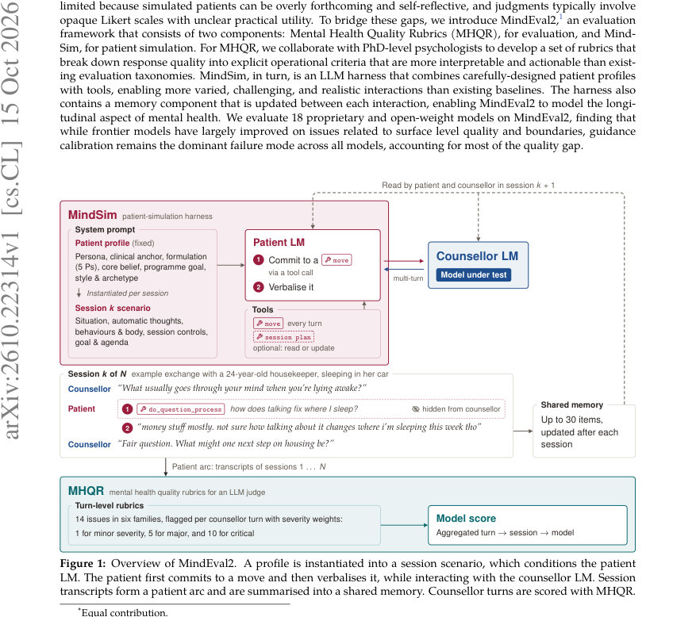
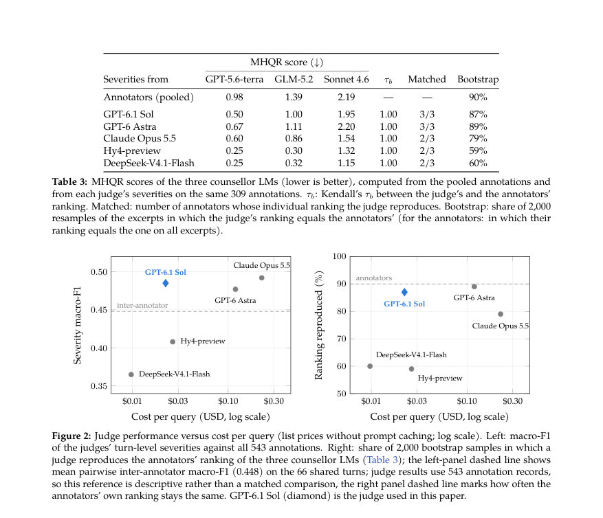
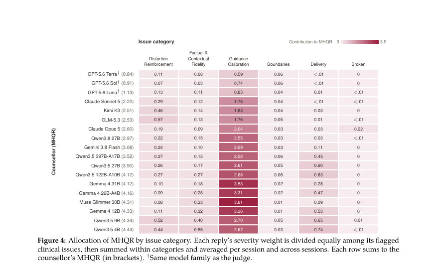

# MindEval2: Clinically Grounded Patients and Rubrics for Evaluating Language Models in Mental Health Support

- **게시일:** 2026-10-17
- **arXiv:** [2610.22314v1](http://arxiv.org/abs/2610.22314v1) · [PDF](https://arxiv.org/pdf/2610.22314v1)
- **저자:** John Mendonça, Daniel Tschernutter, José Pombal, Areti Vassilopoulos, Catarina Botelho, Ignacio Sarasua, Maya D'Eon, Nuno Guerreiro, Ricardo Rei
- **분야:** cs.CL
- **선정 점수:** 5.36
- **선정 이유:** 최근성 0.8, 인용 영향 0.0 (인용 0회), 저자 영향 0.0 (최고 h-index 0), AI 주제 적합성 2.3, 개발자 관심 0.2, 학술 신호 0.5, 오픈 웨이트·주요 연구조직 신호 1.6

[← 2026-10-17 목록으로 돌아가기](../daily/2026-10-17.html)

<!-- paper-visuals:start -->
## 주요 Figure

> 원문 PDF에서 실제 Figure 캡션과 그림 영역이 함께 확인된 자료만 자동 추출했다.

*Figure · 원문 PDF 1쪽 · Figure 1: Overview of MindEval2. A profile is instantiated into a session scenario, which conditions the patient*

*Figure · 원문 PDF 6쪽 · Figure 2: Judge performance versus cost per query (list prices without prompt caching; log scale). Left: macro-F1*

*Figure · 원문 PDF 11쪽 · Figure 4: Allocation of MHQR by issue category. Each reply’s severity weight is divided equally among its flagged*

<!-- paper-visuals:end -->

## 한 문장 요약

MindEval2는 임상 전문가가 설계한 14개 항목의 Mental Health Quality Rubrics(MHQR)과 도구 기반의 장기 환자 시뮬레이터(MindSim)를 결합해 LLM 기반 정신건강 지원 시스템을 다회기(장기) 상호작용 관점에서 평가하는 프레임워크이다.

## 해결하려는 문제

기존 평가(지식형 검사나 단일 응답 벤치마크)는 실제 이용자 상호작용의 동적·장기적 특성을 반영하지 못하고, 환자 시뮬레이터는 과도하게 통찰적이고 협조적이며(과다 자기반영), 평가는 전형적으로 불투명한 총체적 점수(Likert 등)에 의존해 실무적 유용성이 낮다. 본 연구는 (1) 상담자 응답의 구체적 실패모드를 임상적으로 해석 가능한 루브릭으로 분해하고, (2) 보다 현실적이고 다양하며 장기 기억을 갖는 환자 시뮬레이터로 다회기 상호작용을 생성하여 LLM 상담자 모델을 평가하려고 한다.

## 핵심 기여

- MHQR: 임상 박사급 전문가가 개발한 14개 임상 이슈(6개 상위 범주)와 회당 중대도(무관심/경미/중대/치명)를 갖는 턴 수준 루브릭을 제안하고, 심각도 가중치(무관심=0, 경미=1, 중대=5, 치명=10)를 이용한 집계 규칙을 정의함.
- MindSim: 인구통계·임상 앵커·케이스 포뮬레이션(5 Ps)·대처 아키타입 등을 포함하는 임상적으로 근거있는 프로필과, 환자 발화 직전에 'commit_move' 도구 호출로 대화행동(총 39개 move)을 약속한 뒤 발화하는 도구 기반 시뮬레이터를 설계해 다회기(세션 간 공유 메모리 포함) 상호작용을 생성함.
- LLM-심판(LLM-as-judge) 검증: 임상가(3명)가 67개 대화 발췌(총 411 상담자 턴)를 주석하고 판사 후보(여러 고성능 LLM)를 비교해 비용·성능 균형이 좋은 GPT-6.1 Sol을 MHQR 판정용 자동 심판으로 선정함.
- 대규모 벤치마크: DeepSeek-V4.1-Flash를 환자 LM으로 고정하고 50개의 임상 프로필을 사용해 18개(상용·오픈) 상담자 모델을 평가(논문 본문 기준 집계는 150 patient×session 점수 사용).
- 주요 발견: 최신(프런티어) 모델은 왜곡 강화(distortion reinforcement) 등 일부 안전성 문제에서 개선을 보이나, 모든 모델에서 'guidance calibration'(과도한 탐색 질문 vs. 구체적 안내의 부족)이 주된 실패모드로 남아 있으며 이는 품질 격차의 주요 원인임.

## 접근 방법

* 아키텍처 개요: MindEval2는 MHQR(평가 루브릭)과 MindSim(시뮬레이터)으로 구성된다.
* Profiles: Nemotron-Personas-USA에서 샘플한 인구통계·성격(빅파이브) 정보, 임상 앵커(주증상·영향 영역), 케이스 포뮬레이션(5 Ps: presenting, predisposing, precipitating, perpetuating, protective) 및 Beck 기반 핵심 신념 군(cluster)을 포함한다.
* Simulation harness: 각 환자 턴은(1) commit_move 도구 호출(주된 move 및 선택적 secondary_move, 짧은 1–2문장 reasoning 포함)로 '무엇을 하려는지' 약속하고(도구 응답으로 허용 여부 판정), (2) 허용되면 그 약속을 실제 언어 발화로 구현한다.
* Move 어휘는 39개로 분류(공개/은폐/표출/참여 등).
* 다회기 처리: 세션 간 공유 메모리(최대 30 항목)를 두어 이전 세션의 사실·약속·업데이트를 제3인칭 문장으로 요약·보존하고, 후속 세션 시나리오(간격 6시간–14일, 사건 카테고리: 좌절·정체·돌파 등)를 LLM이 생성해 연속성 유지.
* MHQR 세부: 14개 임상 이슈(예: Treating perspective as fact, Overstatement, Uncritical endorsement, False fact, Missed shared context, Over-exploring, Under-guiding, Gives bad advice, Anthropomorphizing, Out-of-scope responding, Formulaic responding, Excessive verbosity, Other/Hallucination 등)로 턴을 라벨링하고 턴별 심각도를 4단계로 매김.
* 점수화: 턴별 가중치를 평균하여 대화·세션·모델 수준으로 집계(w: 0,1,5,10).
* 판정 워크플로우: 임상가가 참조 주석을 만들고 여러 LLM 판사 후보의 턴별 심각도 예측 성능(매크로 F1, 순위 재현성)과 쿼리당 비용을 비교해 GPT-6.1 Sol을 판사로 선택.
* 실험 설정(본문 기준): 50개 프로필, 환자 LM으로 DeepSeek-V4.1-Flash 사용(NeMo UserSim harness), 각 환자에 대해 다회기(논문 결과 집계는 150 patient×session 점수), 상담자 모델 18종을 동일한 상담자 시스템 프롬프트로 호출(오픈·상용 모델 혼합), 각 상담자 턴을 MHQR로 판정해 모델별 MHQR 점수 산출.

## 주요 결과

- 임상 주석 데이터: 67개 대화 발췌에서 총 411개의 상담자 턴을 임상 심리학자 3명이 주석함. 턴 수준 심각도에 대한 평균 쌍별 쿼드라틱 가중 κ = 0.44, 주석자 간 순위 일치(Kendall’s W) ~0.72, 전체적으로 주석자들 간 97.5%는 한 단계 이내 불일치임(거의 대부분 인접 단계).
- LLM 판사 검증: 여러 판사 후보 비교에서 GPT-6.1 Sol이 비용 대비 성능(심각도 매크로-F1 및 순위 재현성)에서 최적의 균형을 보였고 본 논문 실험의 자동 판사로 사용됨(세부 성능·비용은 본문 Figure 2 및 Appendix B 참조).
- 벤치마크(표 6 발췌): 50개 프로필·다회기 집계(논문 표 기준 150 patient×session 점수)에서 MHQR(낮을수록 우수) 상위 모델 예: GPT-5.6 Terra 0.84 (95% CI 0.71–0.96), GPT-5.6 Sol 0.91 (0.80–1.01), GPT-5.6 Luna 1.13 (0.99–1.29). 중간/하위 모델 예: Claude Sonnet 5 = 2.22 (2.05–2.40), GLM-5.3 ≈2.53, 여러 오픈모델(예: Qwen, Gemma, Muse 등)은 MHQR 3~4대, 하위 일부는 MHQR ≈4.1–4.4로 집계됨. (표 6 전체 수치는 본문 표 참조).
- 세부 분포: 상위 모델은 'No concern' 응답 비율이 높음(예: GPT-5.6 Terra 약 70% no concern, 16% minor, 14% major, critical 거의 없음), 하위 모델은 major/critical의 비중이 커 전체 MHQR를 악화시킴(본문 표에 세부 비율 표기).
- 주요 결론: 프런티어 모델은 '왜곡 강화' 등 일부 안전 문제에서 큰 개선을 보였으나, 모든 모델에서 guidance calibration(과도한 탐색 질문 유지 혹은 적절한 시점의 구체적 안내 부족)이 주요 실패 모드로 남아 있으며, 장기적 상호작용에서 메모리를 잘 활용해 이전 세션을 반영하는 모델은 성능 향상을 보였음.

## 한계

- 저자 명시 한계: MHQR의 심각도 가중치(w:0/1/5/10)는 임상적 피해의 비율로 보정되지 않았으며(임상적 피해 크기 비율로 보정되지 않음), 따라서 가중치는 집계 관례로 해석되어야 함(본문 §3.3).
- 주석자 합의도·판정 한계: 턴 수준 심각도에 대한 가중 κ = 0.44로 중간 정도의 일치만 관찰되었고(대체로 인접 단계 불일치), 개별 임상 이슈(라벨) 수준의 합의는 더 낮음(본문 §3.4 및 Appendix B).
- 시뮬레이터 현실성 한계: MindSim은 종합적으로 MindEval 및 Patient-Ψ보다 인간 유사성 점수가 높았으나(turn 평균 3.55 vs 실제 4.20), 표면 통계(예: 단문 길이 변동성(word count CV)과 filler 비율)에서 실제 사용자와 차이가 존재함(본문 Table 4·5, Figure 3).
- 도메인 적용 범위: 본 벤치마크는 '일상적 비위기(non-crisis) 정신건강 지원'에 초점을 맞추며, 자해·자살 위험과 같은 위기 대응 시나리오는 프로필에서 배제되어 있음(환자 시스템 프롬프트에 '자해 없음' 명시). 따라서 위기 대응 능력 평가에는 적합하지 않음.」「추가 실험적 제약: 일부 표·수치는 본문에 부분적으로 잘려 제시되어 있어(예: 몇몇 모델의 세부 비율 표기가 중간에 생략된 경우) 완전한 분포는 본문 표·부록 원문 참조가 필요함.

## 개발자 관점

- MHQR는 14개 구체적 실패모드와 4단계 심각도로 응답을 분해하므로 모델 개선 시 타깃화된 진단(예: guidance calibration 보완, factuality 개선 등)에 유용함. 실무 도입 시 이 루브릭을 턴 수준 자동화(LLM 판사)와 결합하면 개선 우선순위를 정하기 쉬움.
- LLM-as-judge 운영 팁: 비용·성능을 모두 고려해 GPT-6.1 Sol을 본 논문에서 판사로 선택했으나 판사 모델의 편향(자기계열 모델에 대한 self-preference 등) 가능성 및 문제 미보고 경향(under-reporting)을 모니터링해야 함(본문에서 Claude·Hy4·DeepSeek 등이 문제 미보고로 배제된 사례 언급).
- 환자 시뮬레이터 설계: commit_move 도구(턴 당 move 약속 → 발화)는 환자 행동의 steerability를 높이고 지나치게 통찰적·협조적 환자 출력을 줄이는 데 효과적임. 엔지니어는 유사한 도구 호출 패턴과 'move' 어휘(예: 39개)를 도입해 환자 다양성·현실성 증가를 도모할 수 있음.
- 장기성 구현 세부: 세션 간 공유 메모리(최대 30 항목, '[open]' 태그로 미완료 약속 추적)와 세션 간격(6시간–14일), 세션별 최대 턴(환자 턴 15회 상한) 등은 재현 가능한 시뮬레이션 구성요소로 바로 활용 가능함.
- 배포·안전성 관점: 본 벤치마크는 일상적 지원에서 '구체적 안내 제공 시점 판단'이 중요함을 시사하므로 실서비스에선 guidance calibration 규칙(예: 어떤 신호에서 구조화된 제안/계획을 제공할지 명시)을 정책·프롬프트·후처리 규칙으로 도입해야 함. 또한 MHQR에서 '치명적'으로 분류될 수 있는 응답(예: 위험한 조언)은 자동 감지·차단 및 인간 상위 검토 흐름을 통해 다뤄야 함.

**근거 범위:** 이 분석은 제공된 논문 PDF 본문을 기반으로 작성되었으며(본문과 표, 그림 캡션, 부록 참조 문구 포함), 본문에서 직접 확인 가능한 수치와 문구만 인용했습니다. 다만 일부 표·열의 내용이 제공된 스니펫에서 잘려 있거나 부록의 세부 수치(예: 판사별 세부 F1/recall 등)는 본문 요약에서 간략화했으므로, 완전한 세부값/추가 실험 설정은 원문 전체(특히 Appendix B–E)를 참조하시기 바랍니다.
