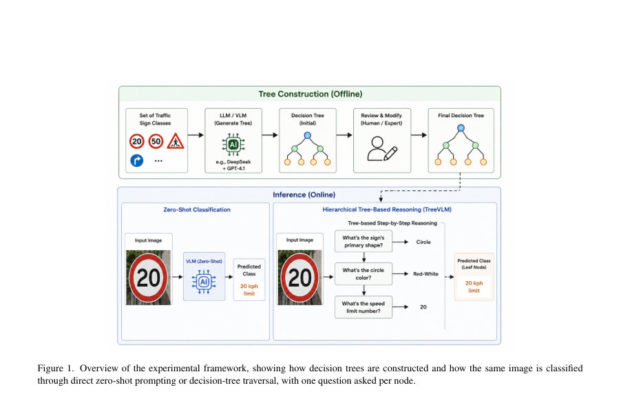
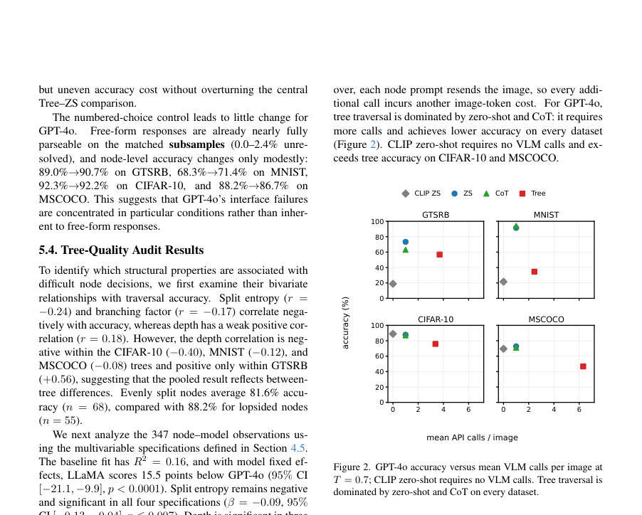

# MYOPIA: Understanding the Limits of Tree-Based Reasoning in Vision-Language Models

- **게시일:** 2026-10-16
- **arXiv:** [2610.21573v1](http://arxiv.org/abs/2610.21573v1) · [PDF](https://arxiv.org/pdf/2610.21573v1)
- **저자:** Islam Mesabah, Sary Elmansoury, Gerrit Großmann, Peter Neigel, Sebastian J. Vollmer
- **분야:** cs.CV
- **선정 점수:** 7.29
- **선정 이유:** 최근성 1.1, 인용 영향 0.0 (인용 0회), 저자 영향 0.0 (최고 h-index 0), AI 주제 적합성 2.5, 개발자 관심 0.2, 학술 신호 0.9, 오픈 웨이트·주요 연구조직 신호 2.5

[← 2026-10-16 목록으로 돌아가기](../daily/2026-10-16.html)

<!-- paper-visuals:start -->
## 주요 Figure

> 원문 PDF에서 실제 Figure 캡션과 그림 영역이 함께 확인된 자료만 자동 추출했다.

*Figure · 원문 PDF 3쪽 · Figure 1. Overview of the experimental framework, showing how decision trees are constructed and how the same image is classified*

*Figure · 원문 PDF 7쪽 · Figure 2. GPT-4o accuracy versus mean VLM calls per image at*

<!-- paper-visuals:end -->

## 한 문장 요약

LLM-생성·사람-정제된 결정트리를 VLM이 단일 경로로 탐색하는 MYOPIA 벤치마크를 제안하고, 그리디(비되돌아감) 트리 기반 추론이 3개 VLM·4개 데이터셋 전반에서 제로샷보다 일관되게 낮은 정확도를 보이며 실패 모드를 진단함.

## 해결하려는 문제

비교적 해석 가능한 결정트리 방식(루트→리프 질문 시퀀스)이 시각-언어 모델(VLM)의 제로샷 분류 대비 어떤 정확도 비용과 실패 모드를 가지는지 불명확하다. 구체적으로 VLM이 개별 노드 질문에 안정적으로 답할 수 있는지, 초기 오답이 되돌릴 수 없이 정답을 배제하는지, 프롬프트·출력 형식·트리 구조가 성능에 어떤 영향을 미치는지를 규명하는 것이 문제이다.

## 핵심 기여

- MYOPIA 벤치마크 제안: DeepSeek/GPT-4.1으로 생성하고 인간이 정제한 4개( GTSRB, MNIST, CIFAR-10, MSCOCO) 결정트리, 대응 프롬프트·진단 프로토콜·평가 허니스를 공개.
- 그리디(비되돌아감) 트리 순회와 제로샷·CoT·CLIP 기반 방법을 3개 VLM(GPT-4o, Qwen-VL Max, LLaMA-3.2 11B Vision)·4개 데이터셋에서 비교·평가하고, 모든 12개 모델–데이터셋 쌍에서 트리 순회가 제로샷보다 열등하다는 통계적 증거를 제시.
- 오류원 분해 진단 제안: 클래스-속성 회상(라벨-조건) vs 이미지-접지(이미지-조건), 경로선택(path-selection) 오류 재구성, 답안-인터페이스 실패(파싱 불가·미해결)로 성능 손실을 분리·측정.
- 트리 품질 감사와 구조 변수 분석: 분할 엔트로피, 분기수, 깊이, 최대 자식 비중 등과 노드 정확도의 연관성을 조사해, 분할 엔트로피가 낮은 수준이나마 일관되게 음의 관련을 보임을 보고.
- 실험 재현 산출물 공개 계획: 트리 생성 파이프라인·트리·프롬프트·평가 코드·결과 데이터셋 식별자 및 보조 자료를 공개하고 상세한 부록으로 결과·프롬프트 민감도·부팅스트랩 검정을 제공.

## 접근 방법

* 트리 생성: LLM(DeepSeek 또는 GPT-4.1)로 각 클래스 집합에 대해 재귀적으로 질문을 생성하고 평가자 점수(명확성, 시각적 관련성, 균형 등)로 상위 질문을 선택한 뒤 인간 주석자가 검토·정제하여 각 클래스가 정확히 하나의 리프에 대응하도록 구성.
* 트리 구조 지표(깊이, 분기수, 자식 최대 비중, 분할 엔트로피)를 계산하여 감사에 사용.
* 추론(트리 순회): 입력 이미지에 대해 루트부터 리프까지 각 내부 노드별 질문을 별도의 단일턴 VLM 호출로 제시(각 노드 호출은 전체 이미지를 포함), 모델의 응답에 따라 결정론적으로 다음 분기로 이동(비되돌아감).
* 진단 프로토콜: (1) 라벨-조건(label-conditioned): 정답 라벨만 주고 경로 상 질문에 응답하게 하여 클래스-속성 회상 측정, (2) 이미지-조건(image-conditioned): 이미지만 주고 동일 질문 응답하여 시각적 접지 측정, (3) 경로 재구성으로 경로선택 오류 식별, (4) 출력을 정규표현식으로 엄격 추출(미해결시 오류) 및 오라클 재파서 민감도 분석.
* 비교군: 제로샷 프롬프트(여러 파라프레이즈·설명 추가 변형), CoT(단일 콜에서 단계별 추론), CLIP 기반(plain ZS, description-based, CHiLS).
* 평가 모델·데이터: GPT-4o(OpenRouter), Qwen-VL Max(Alibaba), LLaMA-3.2 11B Vision(self-hosted FP16); 데이터셋: GTSRB(901 샘플), MNIST(1000), CIFAR-10(1000), MSCOCO(850).
* 비용 측정: 이미지·노드별 VLM 호출 수 집계.

## 주요 결과

- 주요 비교: 그리디 트리 순회는 3개 모델·4개 데이터셋의 12개 쌍 모두에서 제로샷보다 낮은 성능을 보임(부트스트랩(10,000)으로 모든 12개 비교에서 95% 신뢰구간이 제로를 제외; 트리−ZS 격차 범위 −3.9 to −65.1 포인트). 예시(GPT-4o, T=0.7): GTSRB ZS 71.14% vs Tree 57.71%; MNIST ZS 91.50% vs Tree 34.60%; CIFAR-10 ZS 87.90% vs Tree 76.00%; MSCOCO ZS 72.82% vs Tree 46.71% (Table 1).
- 라벨-대-이미지 접지 갭: 라벨-조건과 이미지-조건 응답 정확도 차이(grounding gap) 평균은 GPT-4o 9.5 pp, Qwen-VL 13.8 pp, LLaMA 12.6 pp(표 4). 즉 모델은 트리에 인코딩된 속성을 라벨로는 더 잘 회상하지만 동일 속성을 이미지에서 접지하지 못하는 경향.
- 경로선택·인터페이스 손실: 경로선택 오류(현지 오답이 정답 클래스를 되돌릴 수 없이 배제)와 답안-인터페이스(정규식 추출 실패로 미해결 처리) 둘 다 의미있는 손실을 줌. 전체 미해결 비율(엄격 추출): GTSRB 14.7%, MNIST 18.6%, CIFAR-10 10.8%, MSCOCO 22.0%; 오라클 재파싱 후 각각 11.0%, 11.1%, 3.7%, 16.2%로 감소하나 제로샷과의 격차는 여전히 큼(Table 6).
- 트리 품질 감사: 노드 수준의 단변량 상관 r값은 분할 엔트로피 r=−0.24(정적 음의 상관), 분기수 r=−0.17(약한 음의 상관), 깊이 r=+0.18(풀링에서 양의 상관이나 트리별로 다름: GTSRB 내 +0.56, CIFAR-10/MNIST/MSCOCO 내에서 음수). 다변량 회귀에서는 분할 엔트로피가 유의미하게 음(-0.09, 95% CI [−0.13, −0.04], p≤0.007)하게 남음; LLaMA는 GPT-4o 대비 고정효과로 −15.5 포인트(95% CI [−21.1, −9.9], p<0.0001). 접지 격차(grounding-gap) 계수는 일부 사양에서 유의미(β≈−0.03)하나 노드 랜덤 인터셉트 모델에서는 유의하지 않음(p=0.23).
- 추론 비용: 트리 순회는 이미지당 평균 VLM 호출이 2.5–6.3배 더 많음(평균 호출수: GTSRB 3.61, MNIST 2.45, CIFAR-10 3.37, MSCOCO 6.32), 각 노드 호출에 이미지 토큰 재전송 비용이 추가됨. 제로샷·CoT는 한 호출, CLIP 기반은 VLM 호출 0회(표 6, 그림 2).

## 한계

- 저자가 명시한 한계: (1) 규모·샘플링: 각 평가세트 850–1,000 이미지로 더 큰 평가가 필요함; (2) 모델 범위: 세 VLM으로만 평가되어 다른 모델·미래 모델 일반화 불확실; (3) 트리 의존성: 결론은 평가된 네 트리에 귀속됨(질문설계 문제 지적, 예: GTSRB의 8-분기 화살표 문항); (4) 트리 감사의 관찰적 성격: 상관관계이지 인과 아님, 노드별 도달 조건·결정 수 편향 존재; (5) 추출·강건성: 주 평가가 정규식 추출에 의존하며 오라클은 민감도 분석에 불과함; (6) 비용 측정은 API 호출 수로 한정, 금전적 비용 미보고.
- 논문 본문·실험 범위에서 합리적으로 확인되는 추가 제약: (A) 평가된 방식은 그리디·비되돌아감 단일 경로 구현에 한정되므로 되돌아감·소프트 라우팅·다중 후보 유지 같은 대안의 효율성은 평가하지 않음; (B) 제로샷 성능에 프롬프트 민감도가 큼(부록의 10-프롬프트 스윕에서 모델·데이터별 표준편차 최대 16.97포인트), 따라서 단일 제로샷 프롬프트 선택이 결과 방향에 영향; (C) 트리 순회의 여러 설정(노드 히스토리 포함/미포함, 설명 추가 등)이 모델·데이터별로 상이한 영향을 주어 일관된 개선 전략이 없음.

## 개발자 관점

- 트리 설계에 '지각적으로 답할 수 있는(perceptually answerable)' 분할을 우선시하라: 높은 분할 엔트로피(균형 분할)는 노드 정확도와 일관된 음의 상관을 보여, 정보이득 최대화만을 목적 함수로 삼지 말 것.
- 출력 형식 제약을 강하게 적용하라: 자유응답의 정규식 파싱 실패가 상당한 손실을 유발하므로(데이터·모델별 차이 큼) 배포시에는 번호 선택·제한된 토큰·정형화된 응답 템플릿 등으로 포맷을 강제하라(실험에서 번호 선택은 미해결을 거의 제거).
- 되돌아감·소프트 라우팅 도입을 고려하라: 초기 노드의 오류가 정답을 영구히 배제하므로 확률적/소프트 스코어링, 후보 보유, 신뢰도 기반 역추적(backtracking) 또는 다분기 탐색(예: Tree/Graph of Thoughts 스타일)을 도입해 복구력을 높여야 함.
- 프롬프트 민감도·재현성 관리: 제로샷과 트리 노드 프롬프트 모두에 대해 여러 문구를 시험하고 평균·분산을 보고하라. 특히 클라우드 API(예: GPT-4o, Qwen-VL) 사용 시 제공자·체크포인트 변경에 따른 비결정성을 고려해 모델 고정·시드·입력 식별자를 함께 저장하라.
- 비용·실시간 제약을 설계 기준에 포함하라: 트리 순회는 이미지당 다중 호출과 이미지 토큰 재전송을 요구하므로 실운영에서는 API 호출 비용·지연이 치명적일 수 있음. 노드 수·최대 깊이를 제한하거나 루트 수준에서 후보를 필터링해 호출 수를 줄이는 설계가 필요함.

**근거 범위:** 이 분석은 제공된 논문 PDF 본문(주문서 및 부록)을 기반으로 작성되었음. 본문과 보조자료의 표·절(예: Table 1–6, 부록의 부트스트랩·프롬프트 스윕·프로브 결과)을 직접 인용하여 수치·결론을 기술했다. 프롬프트 원문(전체 텍스트), 실행 시의 클라우드 제공자 상태, 생략된 원시 로그 등은 PDF에서 직접 재현할 수 없어 그와 관련된 세부 구현·실행 변동성(예: 정확한 프롬프트 문자열 변경에 따른 결과)은 원문에서 보고된 대로만 요약·보고함.
