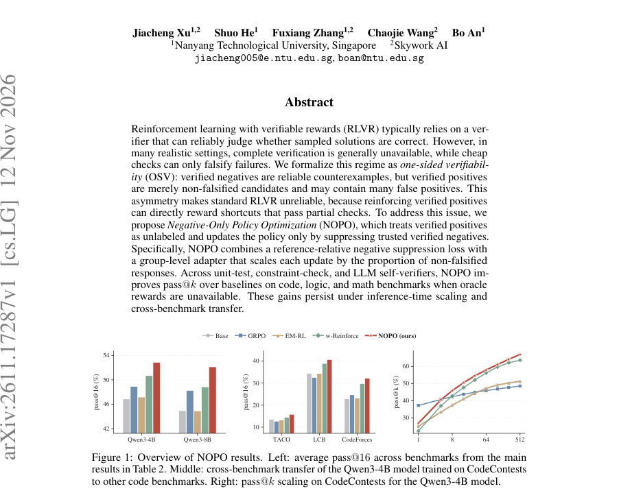
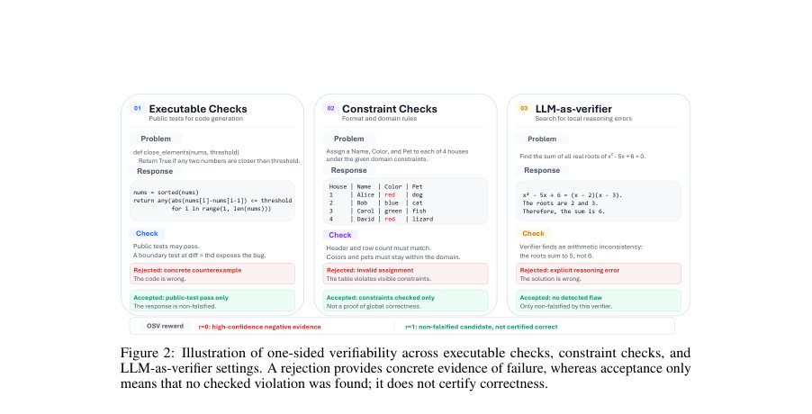
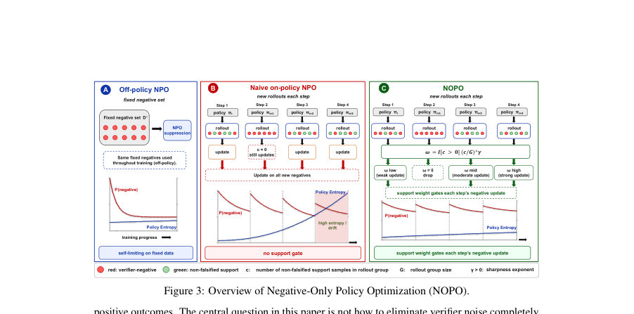

# Negative-Only Policy Optimization for One-Sided Verifiable Rewards

- **게시일:** 2026-11-15
- **arXiv:** [2611.17287v1](http://arxiv.org/abs/2611.17287v1) · [PDF](https://arxiv.org/pdf/2611.17287v1)
- **저자:** Jiacheng Xu, Shuo He, Fuxiang Zhang, Chaojie Wang, Bo An
- **분야:** cs.LG, cs.CL
- **선정 점수:** 4.33
- **선정 이유:** 최근성 0.5, 인용 영향 0.0 (인용 0회), 저자 영향 0.0 (최고 h-index 0), AI 주제 적합성 2.8, 개발자 관심 0.5, 학술 신호 0.6, 오픈 웨이트·주요 연구조직 신호 0.0

[← 2026-11-15 목록으로 돌아가기](../daily/2026-11-15.html)

<!-- paper-visuals:start -->
## 주요 Figure

> 원문 PDF에서 실제 Figure 캡션과 그림 영역이 함께 확인된 자료만 자동 추출했다.

*Figure · 원문 PDF 1쪽 · Figure 1: Overview of NOPO results. Left: average pass@16 across benchmarks from the main*

*Figure · 원문 PDF 2쪽 · Figure 2: Illustration of one-sided verifiability across executable checks, constraint checks, and*

*Figure · 원문 PDF 5쪽 · Figure 3: Overview of Negative-Only Policy Optimization (NOPO).*

<!-- paper-visuals:end -->

## 한 문장 요약

검증기가 '실패'만 안정적으로 판정하는 현실적 상황(One-Sided Verifiability)에서 검증-양성(accepted)을 정답으로 보지 않고 검증-음성(verified negatives)만 억제하는 Negative-Only Policy Optimization(NOPO)를 제안해 불완전한 검증 하에서 RL로 모델의 실제 성능(capability frontier)을 보존·확장한다.

## 해결하려는 문제

기존의 RL with verifiable rewards(RLVR)는 검증기가 샘플된 해답을 정확히 옳고 그름으로 판정한다고 가정한다. 하지만 현실에서는 완전 검증기가 없고 저비용 검사는 종종 실패만 드러낼 수 있다. 이 한쪽성(one-sided) 검증(OSV) 하에서는 r=0(검증-거부)은 높은 신뢰도의 음성 증거지만 r=1(검증-수용)은 다수의 위양성(false positive)을 포함할 수 있어, 표준 RLVR(예: GRPO)이 검증-수용을 보상하면 부분 검사만 통과하는 쉬운 숏컷을 강화하여 정책이 실제 정답 능력을 향상시키지 못하게 된다. 연구 질문은 '검증-양성이 신뢰할 수 없을 때 어떻게 검증-음성만으로 안전하게 정책을 개선할 것인가' 이다.

## 핵심 기여

- One-sided verifiability(OSV) 개념화: 검증-음성은 신뢰할 만한 반례(counterexamples)이나 검증-양성은 단지 비-반례(non-falsified) 후보라는 현실적 검증 노이즈 프로파일을 정의하고 정량적으로 측정함.
- Negative-Only Policy Optimization(NOPO) 제안: 검증-음성만을 억제(suppress)하고 검증-양성을 레이블로 쓰지 않는 음성전용 학습 원칙을 도입함.
- 샘플-레벨과 그룹-레벨의 보호 장치 제시: 참조정책 대비 자기-감쇄(reference-relative NPO loss)와 같은 롤아웃 그룹 내 비-반례 수에 따라 음성 업데이트를 스케일링하는 그룹 수준의 non-falsified support weight(ωγ) 결합으로 과도한 'move-away' 업데이트를 방지함.
- 광범위한 실험 검증: 코드(공개 테스트), 논리(제약 검사), 수학(LLM self-verifier) 영역에서 NOPO가 GRPO, EM-RL, w-Reinforce 등 기존 방법 대비 pass@k를 개선함을 보이고, 추론 시 샘플 수 증가(inference-time scaling)와 소스 벤치마크에서 다른 벤치로의 전이(transfer)에서도 이득이 유지됨을 실험적으로 제시함.
- 검증기(one-sided) 특성 분석: 훈련 전·후 검증기의 qneg, qpos, rneg(음성의 신뢰도와 양성의 위양성 비율 및 음성 리콜)을 측정하여 OSV가 실제로 존재함을 문서화함.

## 접근 방법

* NOPO의 핵심은 검증기 V가 반환하는 이진 라벨 r∈{0,1} 중 r=0(검증-음성)만을 신뢰 가능한 감독으로 사용하고 r=1은 레이블이 없는 후보로 취급하는 것이다.
* 구체적 구성요소는 다음과 같다.
* 샘플-레벨 손실: Negative Preference Optimization(NPO) 손실 LNPO,β(θ;x,y)= (2/β) log(1+exp(βΔθ(x,y)))를 사용해 참조정책 πref 대비 문제 샘플 y의 확률을 상대적으로 억제한다(Δθ = log πθ - log πref).
* 이 손실의 기울기는 음성 샘플이 이미 참조보다 충분히 작아지면 자기-감쇄(self-attenuate)한다.
* 그룹-레벨 가중치: 같은 프롬프트에 대해 G개의 롤아웃을 샘플하고 그중 비-반례(검증 통과) 개수 c(r)=Σi ri를 계산한다.
* 음성 업데이트는 ωγ(r) = (c/G)^γ (γ>0, 기본 γ=1)로 스케일된다.
* c=0인 그룹(모두 실패)은 ω=0이 되어 음성 억제가 적용되지 않는다.
* 전체 목적: LNOPO(θ) = E_{x,y∼πθold}[ ωγ(r) * (1/G) Σ_i I[ri=0] LNPO(θ;x,yi) ].
* 즉, 그라디언트는 오직 검증-음성 샘플의 NPO 항을 통해 흐르며 그룹 수준의 비-반례 지지가 작으면 업데이트가 작아진다.
* 학습·구현 세부사항(논문 본문/부록 C): G=16, NPO 온도 β=0.1, 기본 γ=1.0, 참조정책은 동결된 베이스 모델, KL 계수(kl_loss_coef)=0(기본 NOPO 설정), 롤아웃은 vLLM 사용, API·프레임워크는 verl, FSDP, AdamW lr=5e-7 등으로 통일된 설정 아래 여러 방법을 비교하였다.

## 주요 결과

- 전 영역(코드·논리·수학)에서 NOPO는 평균 pass@16에서 가장 높음. Qwen3-4B 기준 평균 pass@16: NOPO 52.86% vs GRPO 48.93% (Table 2). Qwen3-8B 기준 평균: NOPO 52.13% vs GRPO 48.27% (Table 2).
- 개별 셀 성과: 10개(5벤치마크×2 백본) 중 NOPO가 9개에서 1위(예외: OlympiadBench Qwen3-8B에서 GRPO가 근소 우세). 논문은 OlympiadBench에서 음성 리콜(rneg)이 매우 낮아(8.8–12.5%) NOPO 신호가 약해진다고 분석함(Section 5.2, Table 1, Table 2).
- 추론-시간 스케일링(예: CodeContests, Qwen3-4B): NOPO가 k 증가에 따라 격차가 벌어지는 frontier 확장 효과를 보임. 예로 k=512에서 CodeContests pass@512: NOPO 66.95% vs Base 51.05% 및 w-Reinforce 63.60% (Table 3).
- 교차-벤치 전이: CodeContests로 학습한 체크포인트의 unseen 평균(세 대상)에서 NOPO가 우수. 예: 소스=CodeContests인 경우 unseen-avg pass@16: NOPO 29.49% vs GRPO 23.30% (Table 4). LiveCodeBench 소스에서도 NOPO unseen-avg 31.93% vs GRPO 24.91%.
- 검증기 특성 분석: 훈련 전 qneg(Pr(r*=0|r=0))는 public tests·constraint checks에서 100%(구성상)이고 LLM self-verifier도 근접(≈95–97%)함. 반면 qpos(Pr(r*=0|r=1))는 벤치마다 비-무시적: 코드(≈20–67%), ZebraLogic(≈73–77%), Olympiad(≈44–46%) 등으로 확인되어 검증-양성에 위양성 비율이 존재함(Table 1). NOPO는 이 한쪽성 상황에서 음성만을 활용해 성능 이득을 냄.

## 한계

- 저자 명시 한계: 음성-전용 학습은 '어디로' 확률 질량을 옮길지 지정하지 못하는 근본적 모호성을 지니며(NOPO가 이 문제를 완화하려고 설계되었음), 검증-양성에서 부분적 양성 신호(쌍비교, 불확실성 기반 필터 등)를 안전하게 통합하는 연구가 필요하다고 저자가 명시함(Section 7 'Limitations').
- 실험적 제약(본문에서 합리적으로 확인되는 한계): NOPO의 이득은 검증기가 충분히 많은 신뢰할 만한 음성(rneg이 충분히 큼)을 식별할 때 두드러짐. OlympiadBench처럼 rneg가 매우 낮은 환경에서는 NOPO의 이득이 작거나 없는 경우가 관찰됨(Table 2, Table 9).
- 검증기 의존성: NOPO는 '검증-음성의 고신뢰성'을 전제로 하므로 그 전제가 깨지면(검증기가 정상 해답을 자주 오탐함) 성능이 보장되지 않음. LLM 기반 검증기의 오류(거짓음성·거짓양성) 특성은 실제 환경에서 달라질 수 있음(Table 1 논의).
- 훈련 안정성: 음성 위주 최적화는 장시간 학습 시 엔트로피 발산(policy entropy divergence)을 일으킬 수 있어, 논문은 엔트로피 모니터링과 발산 직전 체크포인트 보존을 수행했다고 밝힘(C.2). 이는 실전 재현 시 추가 모니터링·휴리스틱이 필요함.

## 개발자 관점

- 재현성·구현: 논문은 구현·훈련 세부사항을 부록에 명시함. 사용 프레임워크는 verl, 롤아웃은 vLLM, 분산은 FSDP. 핵심 하이퍼: G=16 샘플/프롬프트, NPO β=0.1, NOPO γ=1.0(기본), lr=5e-7(AdamW), 배치 16 프롬프트(총 256 롤아웃), PPO inner epoch 1, 최대 글로벌 스텝 150(부록 C). 참조정책은 동결된 베이스 모델(πref).
- 컴퓨팅 비용: 모든 RL 학습은 8×NVIDIA A100(80GB)에서 수행되었고, (method,backbone,benchmark) 하나당 약 12시간 소요라고 보고됨(C.2). 대규모 선행 비용과 롤아웃 수집 비용을 고려해야 함.
- 운영·안전: OSV·NOPO는 전체 검증기 구축 비용을 낮출 수 있으나, 부분 검사만으로 훈련하면 배포시 체크되지 않은 실패 모드가 증폭될 위험이 있음(부록 A 'Broader impacts' 및 결론). 따라서 배포 전 광범위한 오라클 기반 평가 및 추가 방어(예: 강화된 검증기·휴리스틱)를 권장함.
- 모니터링·튜닝 포인트: 음성-전용 업데이트는 엔트로피 발산 위험이 있어 엔트로피를 모니터링하고 발산 시 최근 체크포인트를 재사용하도록 설계해야 함. 또한 γ(지원 지수) 값을 조절하여 약한 그룹에서의 보수성(conservativeness)을 관리할 수 있음(γ=0은 NPO, γ>0은 지원 기반 축소).
- 응용 권고: 검증-음성이 높은 환경(예: 유닛테스트로 다수의 결함을 잡아내는 코드 벤치)에서는 NOPO가 실제 능력(frontier)을 확장하는 데 유리함. 검증-음성 비율이 낮은 문제(예: 복잡 수학 문제에서 LLM 검증기가 바르게 실패를 잡지 못함)에서는 다른 신호(비교·신뢰도 기반) 통합을 고려해야 함.

**근거 범위:** 이 분석은 제공된 논문 PDF 본문(주요 텍스트, 표, 부록)을 기반으로 작성되었음. 모든 수치와 설계·실험 세부사항은 본문 및 부록에서 직접 추출하였으며(예: Table 1–3, Table 4, 부록 C의 하이퍼파라미터/리소스 설명), 본문에 명시되지 않은 구현 세부(예: 내부 최적화 미세조정값 등)는 생성하지 않았음.
