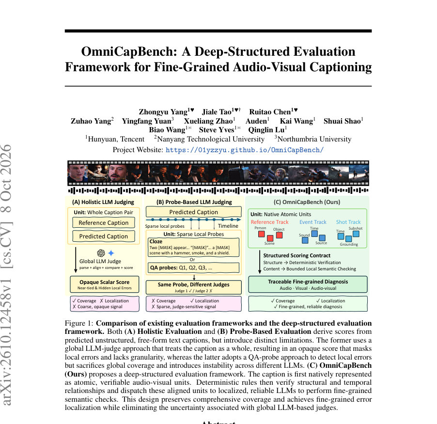
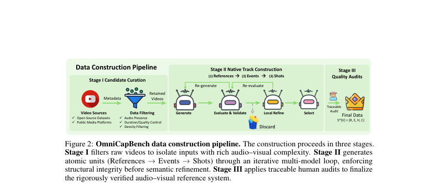
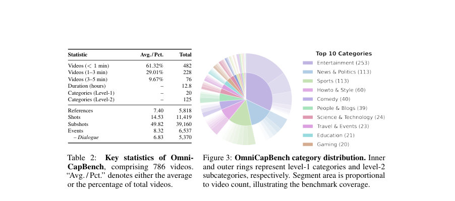

# OmniCapBench: A Deep-Structured Evaluation Framework for Fine-Grained Audio-Visual Captioning

- **게시일:** 2026-10-11
- **arXiv:** [2610.12458v1](http://arxiv.org/abs/2610.12458v1) · [PDF](https://arxiv.org/pdf/2610.12458v1)
- **저자:** Zhongyu Yang, Jiale Tao, Ruitao Chen, Zuhao Yang, Yingfang Yuan, Xueliang Zhao, Auden, Kai Wang, Shuai Shao, Biao Wang, Steve Yves, Qinglin Lu
- **분야:** cs.CV
- **선정 점수:** 3.83
- **선정 이유:** 최근성 0.5, 인용 영향 0.0 (인용 0회), 저자 영향 0.0 (최고 h-index 0), AI 주제 적합성 2.6, 개발자 관심 0.0, 학술 신호 0.8, 오픈 웨이트·주요 연구조직 신호 0.0

[← 2026-10-11 목록으로 돌아가기](../daily/2026-10-11.html)

<!-- paper-visuals:start -->
## 주요 Figure

> 원문 PDF에서 실제 Figure 캡션과 그림 영역이 함께 확인된 자료만 자동 추출했다.

*Figure · 원문 PDF 1쪽 · Figure 1: Comparison of existing evaluation frameworks and the deep-structured evaluation*

*Figure · 원문 PDF 4쪽 · Figure 2: OmniCapBench data construction pipeline. The construction proceeds in three stages.*

*Figure · 원문 PDF 5쪽 · Figure 3: OmniCapBench category distribution. Inner*

<!-- paper-visuals:end -->

## 한 문장 요약

오디오–비주얼 캡셔닝 평가를 자유문장 채점에서 원자적(atomic) 구조 단위로 재설계하여, 결정론적 구조 검사와 제한된(Limited) LLM 기반 의미 비교로 지역화된(shot/event/reference) 정밀 진단을 제공하는 벤치마크 OmniCapBench를 제안하고 786개 동영상으로 실험해 MLLM의 정체성 추적·시간적 접지·오디오-비주얼 연관성 약점을 노출한다.

## 해결하려는 문제

기존 오디오–비주얼 캡셔닝 평가들은 (1) 전체 문장 기반 전역 점수는 범위를 제공하지만 지역적 오류(시간적 접지·정체성 추적 등)를 가린다, (2) QA/클로즈식 프로브는 지역화는 가능하나 전체 커버리지가 부족하며 희소 신호에 의존해 불안정하다, (3) 전역 LLM 심판은 텍스트 파싱·정합·추론을 동시에 수행해야 하므로 채점 결과가 판사(judge) 선택에 민감하고 불안정하다는 한계를 가진다. 따라서 평가 단위(unit)와 채점 연산자(operator)를 공동 설계해 범위와 지역화를 동시에 제공하고 채점의 신뢰도를 높여야 한다.

## 핵심 기여

- Deep-Structured Evaluation Paradigm 제안: 오디오·비주얼 정보를 원자적(atomic) 단위(References, Events, Shots)로 분해하고 구조(IDs, 시간범위, 크로스링크)는 결정론적 규칙으로, 의미 비교는 제한된 지역 LLM으로 분리하는 채점 계약을 도입함.
- OmniCapBench 벤치마크 구축: 786개 동영상에 대해 Reference(5,818개), Events(6,537개), Shots(11,419개), Subshots(39,160개) 등 밀집 주석을 포함한 네이티브 트랙을 제공하고 구조 검증·정렬·지역 의미 채점을 위한 파이프라인을 공개함.
- 정밀 진단 지표군 설계: RefUse, CCC(교차컷 동종참조 일관성), Shot/Subshot/Event F1 및 tIoU, EVSA(Event–Shot Association) 등 구조(Deterministic)와 제한된 의미(Localized LLM) 평가를 분리해 세분화된 실패 모드를 노출함.
- 광범위한 모델 감사(empirical audit): 상용·오픈소스 최첨단 MLLM들을 OmniCapBench로 평가하여 전역 텍스트 점수가 지역적 구조 결함을 은폐하고 LLM 심판의 강도에 따라 점수가 크게 변한다는 것을 실험적으로 입증함.
- 평가 계약과 데이터 생성 파이프라인 제시: 생성→검증→국지적 정제→선택의 반복 루프와 프로그램적 밸리데이터·사람 감사로 구조적 무결성을 확보하는 3단계(Stage I–III) 데이터 구축 절차를 제시함.

## 접근 방법

* OmniCapBench는 평가 대상을 세 개의 네이티브 트랙(References, Events, Shots)으로 구조화하여 각 동영상 V에 대해 S*(V)=(R,E,H)로 표현한다.
* 데이터 구축은 (Stage I) 후보 큐레이션(오픈 소스·공용 플랫폼에서 오디오 존재·품질 등 필터링), (Stage II) 네이티브 트랙 생성(References→Events→Shots 순서로 생성)에서 Generate→Evaluate & Validate→Local Refine→Select의 반복 로컬 정제 루프를 수행하며 프로그램적 검증기로 스키마 무결성(정의된 ID 사용, 시간범위 유효성, 링크 호환성)을 강제한다.
* 채점은 두 단계로 이루어진다: (1) 결정론적 규칙과 시계열 중첩(tIoU) 또는 LLM 보조 매처로 구조적 유효성 검사 및 정렬(매칭)을 수행하고, 유효하지 않은 예측은 제거해 구조적 오류로 집계한다; (2) 정렬된 유닛들에 대해서만 지역화된(바운드된) LLM을 호출해 해당 필드의 의미적 동등성(정확성·포괄성)을 평가한다.
* 또한 양방향(Recall: GT→Pred / Precision: Pred→GT) 매칭·채점으로 누락과 환각을 분리하여 F1을 계산한다.
* 구조적 매칭(샷/이벤트)은 tIoU를 사용하고, 레퍼런스 및 서브샷 매칭은 제한된 LLM 매처로 로컬 비교를 수행한다.
* 전체 파이프라인은 프로그램적 밸리데이터와 인간 감사를 통해 최종 레퍼런스 시스템을 확정한다.

## 주요 결과

- 데이터셋: 786개 동영상(총 12.8시간), 평균 References 7.40개, Shots 14.53개, Subshots 49.82개, Events 8.32개(대화 6.83개).
- 구조적(결정론적) 평가(대표 수치, Table 3): Gemini 3.1-Pro의 SGC 97.36%, RefUse 70.39%, CCC(교차컷 일관성) 34.43%, Event F1 63.32%, EVSA F1 51.46%; Gemini 2.5-Pro의 CCC 37.81% 및 EVSA F1 43.74%. 공개 오픈소스 모델들은 CCC가 대체로 매우 낮아(예: Qwen3-Omni-Instruct CCC≈9.85%, MiniCPM-o-2.6 CCC≈4.29%) 장기 정체성 추적에 취약함.
- 제한된 의미 채점(대표 수치, Table 4): Gemini 3.1-Pro의 Subject(사람/객체) Precision 67.07%, Recall 43.78%로 보수적 전략을 보였고, Speaker(화자) F1은 높음(예: Gemini 3.1-Pro 91.18%, Qwen3.5-Omni-Plus 91.20%)으로 대화 전사는 강한 편이나 환경음 및 오디오-비주얼 연관성은 약함.
- 오디오-비주얼 결합 취약: Gemini 3.1-Pro가 Event F1 63.32%에서 Event–Shot Association(EVSA) F1 51.46%로 하락, 오픈소스 모델들은 EVSA F1이 20% 미만인 경우가 많아 음성과 시각의 구조적 결합(attach)이 약함(본문 서술).
- 전역 텍스트 평가의 불안정성: 동일한 예측에 대해 약한/중간/강한 심판(weak/mid/strong LLM)에 따라 Holistic 평가 점수가 크게 변화함(예: Holistic: weak 71.24 → strong 93.92), 반면 OmniCapBench는 심판 감수성(stability)이 훨씬 낮음(표 5).

## 한계

- 저자가 명시한 한계 — 평가 대상은 주석된 레퍼런스 시스템 S*(V)에 대한 구조적 충실도를 측정하므로, 주석 범위 밖의 유효한 주변 정보(부수적 사실)는 인정되지 않을 수 있다.
- 데이터셋은 5분 미만(또는 최대 5분 이내) 동영상을 중심으로 구성되어 있어 매우 장시간(long-horizon) 비디오에 대한 정체성 추적 문제는 본 벤치마크 범위를 벗어난다.
- Stage II에서 초안(드래프트)을 생성하는 데 최첨단 모델들이 사용되었으므로(evaluator–model bias 가능성), 참조가 특정 모델 계열의 맹점(blind spot)을 계승할 위험이 있으며 완전히 제거되지는 않았다고 저자가 밝힘.
- 엄격한 JSON 스키마와 원자적 단위 채점을 강제하므로 자유문체(free-form prose)에 최적화된 모델에게 불리할 수 있으며, 의도적으로 구조화된 생성으로 연구 방향을 유도한다는 설계적 선택이 있음.

## 개발자 관점

- 평가 설계: 오디오·비주얼 캡셔닝에서는 구조(IDs, 시간범위, 샷-이벤트-레퍼런스 링크)를 먼저 결정론적으로 검증하고, 그 결과로 정렬된 쌍에 대해서만 LLM으로 의미 비교를 수행하는 '구조 우선, 의미 후' 접근이 평가의 신뢰성과 지역화 가능성을 높임.
- 출력 형식: 모델은 자유문장이 아니라 엄격한 JSON 구조(References, Events, Shots)를 바로 생성하도록 요구되므로, 모델 인터페이스·프롬프트·post-processing을 재설계해야 함(스키마 준수 검증기 필요).
- 매칭·채점: 샷/이벤트 정합은 tIoU 기반 매칭, 레퍼런스·서브샷은 제한된 LLM 매처 활용, 그리고 양방향(Recall/Precision) 평가를 통해 누락과 환각을 분리·정량화할 것을 권장함.
- 재현·비용·운영: 데이터 생성·검증에 반복적 모델 생성을 포함하고(Generate→Validate→Refine), 프로그램적 밸리데이션과 인간 감사가 병행되므로 주석 비용과 LLM 호출 비용이 큼. 또한 다운로드 스크립트만 제공하고 원본 동영상은 배포하지 않으므로 재현 시 원저작권·플랫폼 정책 준수가 필요함.
- 안정성·해석성: 전역 LLM 심판을 제거하고 LLM 역할을 지역화하면 판사 민감도를 낮추고 결과 해석(traceability)을 개선하므로 연구·제품의 안전성(오류 분석, 책임소재 규명)에 유리함.

**근거 범위:** 이 분석은 제공된 논문 PDF 본문(주요 본문, 표 1-5, Table 2-4, 데이터 구축/한계/윤리 섹션 및 부록 일부 프롬프트)을 근거로 작성되었다. 일부 상세 구현·부가 수치(예: 전체 부록 표의 세부 항목)는 본문에 인용된 부록(Table B.*)을 참조하였으나 전체 부록이 완전하게 제공되지 않아 본문에 명시된 수치와 저자의 기술을 우선으로 인용했다. 확인하기 어려운 세부 정책·프롬프트 동작(예: 내부 LLM 프롬프트 튜닝 파라미터, 정확한 매칭 임계값)은 PDF 본문에 명시된 내용만으로는 완전 검증되지 않을 수 있다.
