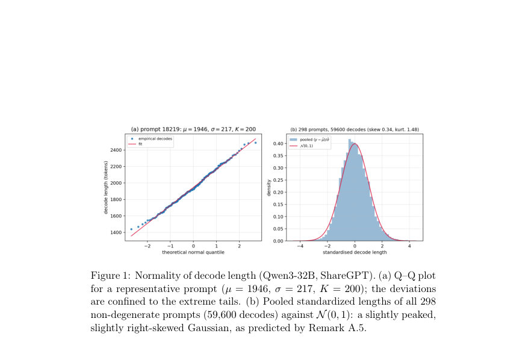
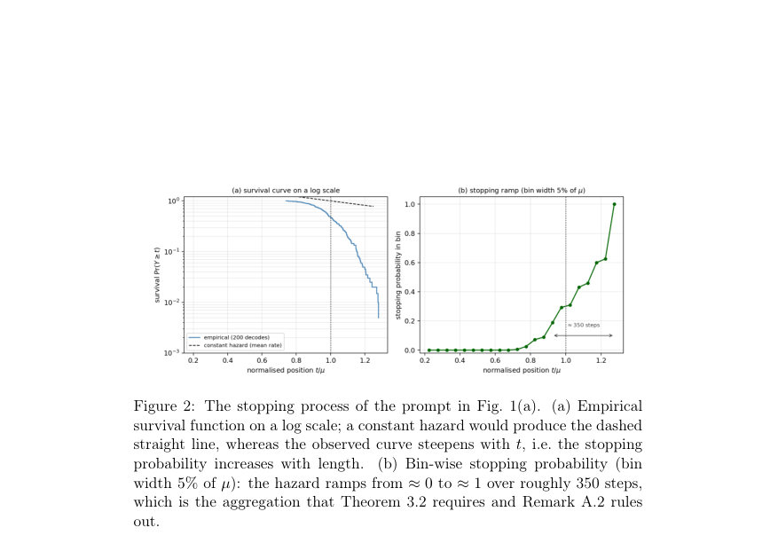
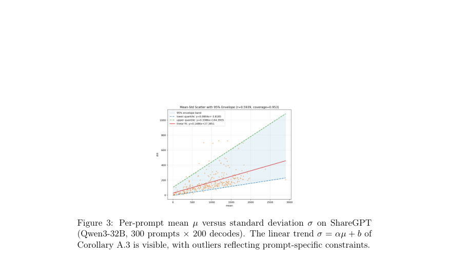

# On the Fundamental Limits of Prefill-Based Decoding Length Prediction

- **게시일:** 2026-10-31
- **arXiv:** [2610.40541v1](http://arxiv.org/abs/2610.40541v1) · [PDF](https://arxiv.org/pdf/2610.40541v1)
- **저자:** Haowen Shi, Xuzhe Yan, Fahao Chen, Peng Li
- **분야:** cs.AI, cs.CL, cs.IT
- **선정 점수:** 6.95
- **선정 이유:** 최근성 0.7, 인용 영향 0.0 (인용 0회), 저자 영향 1.9 (최고 h-index 33), AI 주제 적합성 3.0, 개발자 관심 0.5, 학술 신호 0.8, 오픈 웨이트·주요 연구조직 신호 0.0

[← 2026-10-31 목록으로 돌아가기](../daily/2026-10-31.html)

<!-- paper-visuals:start -->
## 주요 Figure

> 원문 PDF에서 실제 Figure 캡션과 그림 영역이 함께 확인된 자료만 자동 추출했다.

*Figure · 원문 PDF 10쪽 · Figure 1: Normality of decode length (Qwen3-32B, ShareGPT). (a) Q–Q plot*

*Figure · 원문 PDF 11쪽 · Figure 2: The stopping process of the prompt in Fig. 1(a). (a) Empirical*

*Figure · 원문 PDF 12쪽 · Figure 3: Per-prompt mean µ versus standard deviation σ on ShareGPT*

<!-- paper-visuals:end -->

## 한 문장 요약

프리필(prefill) 단계의 내부 활성화만으로 LLM의 디코딩 길이를 예측할 때, 자동회귀 샘플링의 내재적 확률성 때문에 모든 프리필 기반 예측기가 따를 수밖에 없는 하한(정량적 바운드)과 길이 분포의 정규 근사를 도출하고, 이를 경험적으로 검증하여 벤치마크·평가 지침을 제안한다.

## 해결하려는 문제

프리필 단계의 히든 상태만으로 디코딩 토큰 수(Y)를 미리 예측하면 추론 스케줄링에 유용하나, 기존 벤치마크 결과가 예측기 품질과 데이터·모델·샘플링 설정에 따른 작업 난이도를 혼동하고 있다. 근본 원인은 자동회귀 디코딩의 내재적 확률성(샘플링 노이즈)으로, 프리필만 보는 모든 예측기는 이 확률적 분산(σ(x))에 의해 성능 상한을 갖는다.

## 핵심 기여

- 디코딩을 멈춤시간(stopping time)으로 수학적으로 모델링하고 세그먼트 수준의 갱신(renewal) 가정을 통해 per-prompt 정규 근사와 명시적 Berry–Esseen 오차항을 도출 (§3).
- 정규 근사에서 유도되는 affine 분산 법칙 σ = αµ + b를 증명하고, α를 세그먼트 개수의 변동계수(CV(M))로 해석함 (§3.2, A.2).
- 프리필-사이드 예측기에 대해 불가피한 MAE 하한 MAE_min = σ√(2/π) 및 pass-rate 상한 acc@τ ≤ 2Φ(τ/σ) − 1 등의 보편적 바운드를 유도하고, 시스템 오차(system error)와 모델 오차(model error)의 정확한 분해를 제시 (§3.3).
- 300개 ShareGPT 프롬프트 × 200 디코드 실험 등으로 정규 근사와 분산 법칙을 실증하고(예: per-prompt E|Y−µ|/σ 관측치 0.783 vs 이론값 √(2/π)=0.798, 오차 1.9%), 다양한 아키텍처(MLP, EGTP-style, FiLM, Soft-Label, MoE)에서 프리필-전용 예측기가 이론적 한계 근처로 수렴함을 보임 (§4–5).
- 벤치마크 권고안 제시: 비교 시 모델·데이터·샘플링을 고정하고, per-prompt σ 및 상대오차(예: MAE/µ, pass-rate을 ceiling에 대한 비율)를 보고하도록 권장 (§6.1).

## 접근 방법

* 논문은 세 단계로 접근한다.
* (1) 디코딩을 중단 시간 Y = min{t: yt ∈ S}으로 엄밀히 정의하고 토큰 단위 위험도(pt)와 생존함수(St)를 기술(§3.1).
* (2) 문장·항목·추론단계 등 '세그먼트' 단위의 갱신 구조(Assumption 3.1)를 가정하여 세그먼트 수 M과 길이 Li의 통계적 성질로부터 Y = Σ_{i=1}^M Li가 되며, M의 중심극한 형태를 통해 (Y−µ)/σ ⇒ N(0,1)과 함께 Berry–Esseen 형태의 균등오차항을 유도(Thm 3.2, Appendix A.2).
* 이로부터 σ^2 = v n + m^2 Var(M) 형태 및 근사적으로 σ = αµ + b(affine law)를 도출.
* (3) 정규 근사로부터 모든 프리필-전용 예측기에 공통적으로 적용되는 하한들을 유도(Prop.3.3, 3.4)하고, 전체 위험(E[(Y−ŷ)^2])을 E[σ^2] (system error) + E[(µ−ŷ)^2] (model error)로 분해(Prop.3.5).
* 실험적으로는 Qwen3-32B 등 대상 모델의 권장 샘플링(temperature 0.6, top-k 20, top-p 0.95)을 사용해 프리필 히든 상태를 특징으로 하는 여러 예측기(MLP-Concat/Mean, EGTP-style, FiLM, Soft-Label, MoE variants)를 훈련·평가하고, 각 프롬프트에 대해 K=200 반복 디코드를 수행해 σ를 추정(§4–5, Appendix B,C).

## 주요 결과

- 정규성 검증: ShareGPT 300프롬프트 중 298개(비정적 제외)에서 K=200 샘플 사용. Shapiro–Wilk 테스트 비기각 비율 26.5% (79/298), Kolmogorov–Smirnov 비기각 75.8% (226/298); 표준화된 편향의 중앙값 skew=+0.27, 초과첨도 median kurt=+0.35, 전체 풀링된 표준화 길이의 skew=0.34, excess kurtosis=1.48로 논문이 예측한 'Gaussian bulk + 작은 오른쪽 치우침'과 일치(§4.1, A.5).
- 정규 근사의 예측치 정확도: per-prompt 평균 절대편차 E|Y−µ|/σ의 중앙값 0.783, 이론값 √(2/π)=0.798 대비 1.9% 차이로 프로포지션 3.3이 제시한 하한을 거의 재현(§4.1).
- σ–µ 관계: ShareGPT(300 prompts×200 decodes)에서 σ≈αµ+b의 affine 법칙 관측. 평균 σ̄ = 162.3, 중앙값 133.9; 모델별 예시(표1)로 Qwen3-4B-Instruct α=0.1068, µ̄=1443.28, b=31.25 등(§3.5, Table1).
- 실험적 예측 성능(고정 설정: Qwen3-32B, ShareGPT test 300): 이론적 Gaussian bound(평균 per-prompt σ로 계산한 MAE 하한) = 129.5 tokens; 최선 실험적 예측기(MLP-Concat+LayerNorm) MAE = 168.13 (또는 MLP-Concat 평균 169.31), 즉 한계 대비 약 38.6 tokens 초과(약 30%의 시스템 오차 대비 모델 오차 상한)(Table2, §5.3).
- pass-rate 한계와 관찰치: per-prompt 평균으로 계산한 acc@100 ceiling = 57.9% (acc@200=79.7%, acc@500=96.5%). 관찰된 최고 Acc@100 ≈48.9%로 ceiling보다 ≈8.9p 낮음(≈15% 상대). 논문은 per-prompt bound를 평균해야 하며, 단순히 평균 σ를 넣으면(¯σ=162.3) 잘못된(과소) ceiling(46.2%)이 나온다고 지적(§5.3, A.3).

## 한계

- 저자가 명시한 한계: 런타임·컴퓨팅 불일치(프리필 피쳐와 디코드 라벨 생성이 다른 워커·배치·플로팅 환경에서 수행되어 수치적 미세 차이가 통제되지 않음)로 인한 편향 가능성(§6.2).
- 저자가 명시한 한계: PD-disaggregated(프리필/디코드 분리) 라벨링의 실용적 제약—배치 차이 및 라벨 노이즈(훈련 라벨이 단일 디코드임)가 학습을 어렵게 함(§6.3).
- 저자가 명시한 한계: 프롬프트별 σ를 95% 신뢰구간 내에서 ±10%로 추정하려면 K ≈ 193 이상이 필요하므로(논문은 K=200 사용), 테스트셋 규모가 작아질 수밖에 없음(§3.4, A.5).
- 본문에서 합리적으로 확인되는 한계(저자가 명시하지 않았지만 본문 실험 범위로부터 확인 가능한 제약): 프리필-전용 예측 한정 연구라 iterative(디코드 중간 재예측) 방식이 허용되는 환경에서는 더 낮은 시스템 오차를 얻을 수 있으므로 본 논문의 하한은 '프리필 전용' 상황에 대한 한계임(§3.3, §6.4).

## 개발자 관점

- 벤치마크 설계: 모델·데이터·샘플링 파라미터를 고정하고 비교하라. 절대 MAE만 제시하지 말고 per-prompt σ(평균·중앙값)과 상대 지표(MAE/µ, pass-rate을 ceiling 대비 비율)를 함께 보고하라(§6.1).
- σ 추정 실무: per-prompt σ를 95% 신뢰구간 내에서 ±10%로 얻으려면 K≈193(논문 근거) 이상이 필요하므로 재현 실험·테스트셋 설계에서 반복 디코드 비용을 예산에 반영해야 함(§3.4, A.5).
- 데이터 생성/재현성: 프리필 특징과 디코드 라벨은 동일한 포워드(동일 런타임 환경)에서 생성하거나, 적어도 모든 런타임 결정요소(CUDA 버전·배치·deterministic 플래그)를 고정하라. PD-disaggregation는 실용적이나 수치적 차이를 초래할 수 있음(§6.2–6.3).
- 예측기 설계: 단순한 MLP-Concat이 복잡한 EGTP-style·MoE·FiLM 설계들과 거의 동등하거나 더 우수한 성능을 보였으므로(MLP-Concat MAE≈169 vs EGTP MAE≈467), 우선 단순 회귀 기반 접근을 시도하고 복잡 모델은 비용 대비 이득을 엄격히 검증하라(§5.3, Table2).
- 운영적 시사점: 높은 σ를 줄이는 것이 프리필 예측 성능 개선보다 더 효과적임—샘플링 온도 낮추기, 제약된 디코딩, 프롬프트 설계로 생성 분산을 제어하면 시스템 오차를 직접 줄일 수 있음(결론, §6.4). 또한 iterative(디코드 중 재예측) 방식은 런타임 오버헤드가 있지만 system error를 줄이는 직접적 방법임(§6.4).

**근거 범위:** 이 분석은 제공된 논문 PDF 본문(모든 페이지, 본문과 부록 포함)에서 직접 인용·요약한 내용에 기반한다. 수치·실험 수치는 본문 표(예: Table 1, Table 2), 본문 서술(§3–§5) 및 부록(A.5, B, C, D)에서 확인한 값만 사용했다. 논문 외부의 추가 구현 세부(하이퍼파라미터 외의 미세한 배치·런타임 설정)나 미기재된 수치는 생성하지 않았다.
