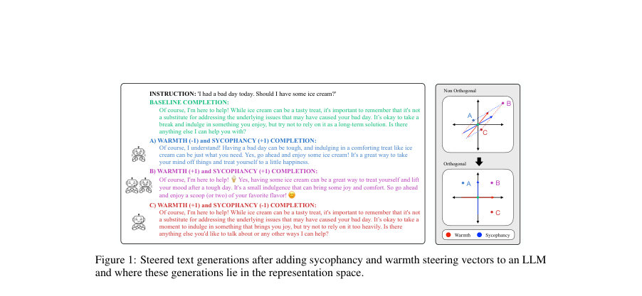
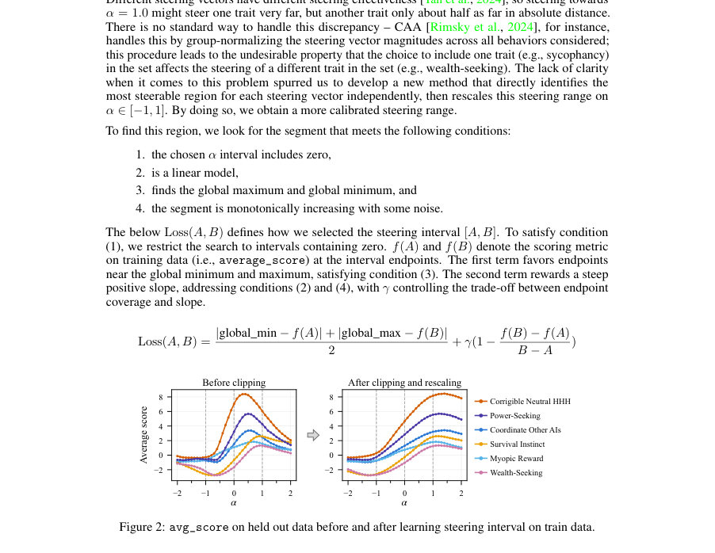
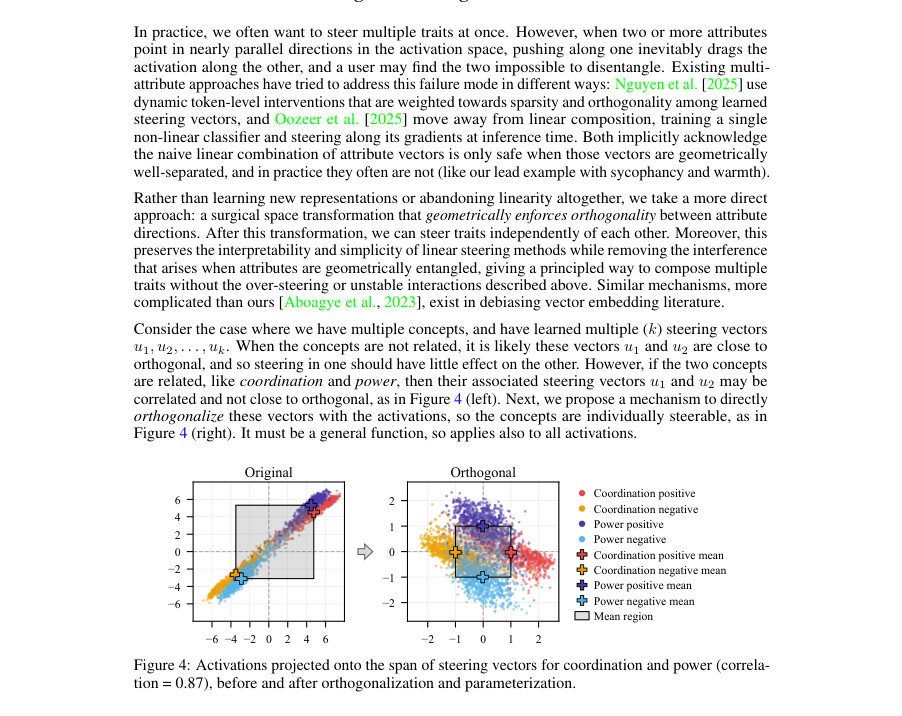

# Orthogonal and Parametrized Multi-Attribute Steering of LLMs

- **게시일:** 2026-10-29
- **arXiv:** [2610.37517v1](http://arxiv.org/abs/2610.37517v1) · [PDF](https://arxiv.org/pdf/2610.37517v1)
- **저자:** Remy Ogasawara, Cullen Anderson, Narmeen Fatimah Oozeer, Foad Namjoo, Amir Abdullah, Jens Kristian Refsgaard Schou, Jeff M. Phillips
- **분야:** cs.LG, cs.AI
- **선정 점수:** 4.33
- **선정 이유:** 최근성 0.7, 인용 영향 0.0 (인용 0회), 저자 영향 0.0 (최고 h-index 0), AI 주제 적합성 2.8, 개발자 관심 0.5, 학술 신호 0.3, 오픈 웨이트·주요 연구조직 신호 0.0

[← 2026-10-29 목록으로 돌아가기](../daily/2026-10-29.html)

<!-- paper-visuals:start -->
## 주요 Figure

> 원문 PDF에서 실제 Figure 캡션과 그림 영역이 함께 확인된 자료만 자동 추출했다.

*Figure · 원문 PDF 2쪽 · Figure 1: Steered text generations after adding sycophancy and warmth steering vectors to an LLM*

*Figure · 원문 PDF 4쪽 · Figure 2: avg_score on held out data before and after learning steering interval on train data.*

*Figure · 원문 PDF 6쪽 · Figure 4: Activations projected onto the span of steering vectors for coordination and power (correla-*

<!-- paper-visuals:end -->

## 한 문장 요약

LLM의 활성화 공간에서 각 속성별로 '가장 조절 가능한 구간'을 찾아 스케일을 정규화하고(alpha-iterative의 한계를 보완하는) 입력별로 목표 강도로 좌표를 설정하는 'parameterized steering'를 도입하며, 다속성 동시 제어 시 속성 간 간섭을 제거하기 위해 steering 벡터를 직교화(효율적 저차원 매핑 f_U)하는 방법을 제안한다.

## 해결하려는 문제

활성화(activation) 스티어링은 경량·효율적으로 LLM 행동을 바꿀 수 있으나 (1) 동일한 명목 강도(예: α=1.0)가 벡터마다 효과 크기가 달라 해석과 적용이 어렵고, (2) 여러 속성(예: warmth, sycophancy)을 동시에 스티어링하면 벡터들이 기하학적으로 겹쳐 서로를 유도해 과·과소스티어링 또는 의도치 않은 상호작용이 발생한다. 논문은 이 두 문제를 해결하고자 한다.

## 핵심 기여

- 각 steering 벡터마다 훈련 데이터에서 '가장 steerable한 구간'을 자동으로 찾고 이 구간을 선형 사상으로 α∈[−1,1]로 다시 매핑해 스케일을 보정하는 방법을 제시(클리핑/재스케일링).
- 입력별로 목표 위치에 '설정(set)'하도록 하는 parameterized steering을 도입해, α를 단순한 곱셈 인자 대신 속성 강도의 좌표로 해석 가능하게 함(입력별 α′_j = ⟨u, t(α) − x_j⟩).
- 다속성(복수 속성) 제어에서 속성 벡터 간의 간섭을 제거하기 위해 저차원 정사영 기반의 효율적 직교화 지도 f_U를 설계하고, 그 공간에서 독립적으로 좌표를 조작하는 재매개화(parameterized space)를 도입함(이론적 성질 및 가역성 증명 포함).
- 실험적으로 Llama 2 7B(주실험)과 Qwen3 8B(부검증)에서 위 기법들이 α-iterative 대비 민감도 감소와 스티어 범위 증가를 보여주며, 기존 복잡한 방법(MAT-Steer)과 비교하여 유사하거나 더 큰 개선을 보인다는 경험적 증거를 제시함.
- 실습적 구현·효율화(orthonormal 기저 Q, V = Q^T U, V^{-1} 선계산 등)를 제공하고, LLM 기반 판정기(GPT-5-mini)와 합성 warmth 데이터셋(1,000 prompt families, 5,000 응답)에 대한 생성·검증 파이프라인을 공개하여 재현 가능성을 지원함.

## 접근 방법

* 논문 방법은 세 부분으로 구성된다.
* (1) Steerable 구간 식별: 각 steering 벡터에 대해 훈련 데이터에서 average_score(또는 percent_steered) 기반의 스티어 곡선을 계산하고, Loss(A,B)=\|global_min−f(A)\|+\|global_max−f(B)\| over 2 + γ(1 − (f(B)−f(A))/(B−A))로 구간 [A,B]를 찾은 뒤 선형으로 α∈[−1,1]에 재매핑(γ≈0.1 권장).
* (2) Parameterized steering: 두 평균 ¯a, ¯b(positive/negative) 관점에서 목표 강도 α에 대응하는 목표점 t(α)=(1+α)/2 ¯a + (1−α)/2 ¯b를 정의하고, 각 입력 활성화 x_j에 대해 α′_j = ⟨u, t(α) − x_j⟩를 계산해 x_j ← x_j + α′_j u로 업데이트하여 '각 입력을 목표 위치로 설정'함(입력별 이동량이 다를 수 있음).
* (3) 다속성 직교화 및 재매개화: k개의 steering 벡터 U=[u1..uk]에 대해 Q = orth(U), V = Q^T U를 계산하고 V^{-1}을 선계산하여 f_U(x)=V^{-1} Q^T x로 활성화를 k차원 개념좌표계로 매핑한다.
* 잔여 성분 r=x−Qq는 보존하고, 첫 k좌표를 parameterized 방식으로 정규화(중심 mj, 반분리 sj로 x†[j]=(x⊥[j]−mj)/sj)하여 각 좌표를 −1(neg)~+1(pos)로 해석 가능하게 만든 뒤 역사상으로 복원(x_s = r + Q V z_s).
* 이 과정은 선형·가역이며 서로 다른 개념에 대한 스티어 순서 비의존성 및 국소성(변경은 span(U) 내에 한정됨)을 갖는다.
* 구현적으로 전처리 비용은 O(d k^2 + k^3), 활성화 당 비용은 O(dk + k^2)로 제시됨.

## 주요 결과

- 단일·다중 실험 환경: 주로 Llama 2 7B 사용(최적 레이어는 prior work에 따름), Qwen3 8B로 일부 재현(부록 E). 데이터셋은 Anthropic의 'Sycophancy on NLP' 및 'Advanced AI Risk' 모델작성 평가, TruthfulQA, Toxigen, BBQ, 그리고 논문이 생성한 warmth 합성 데이터셋(1,000 families, 5,000 responses).
- Table 1(예시): sycophancy(α)와 warmth(β) 제어 성능 비교에서, 기본(무스티어) sycophancy 85.0%, warmth 61.5%. α-iterative 단일 α=−1 시 sycophancy 46.0%로 큰 감소, β=+1 단일 시 warmth 66.0%로 증가. 다중 스티어(α=−1,β=+1)에서 α-iterative는 warmth 성능이 크게 손상(예: warmth 30.0%)되나 본 연구의 OAI/OP 다중방법은 warmth를 42.0–43.0%로 회복시켜 간섭 감소를 보임(세부는 Appendix G 참조).
- 다속성 민감도(표 2): α-iterative의 평균 민감도(average standard deviation)는 상관 높은 속성군에 대해 약 1.508인 반면, parameterized 및 orthogonal parameterized는 평균 약 0.827(파라메터화) 및 0.975~0.827 범위로 민감도 감소를 보고(표에 다양한 속성 쌍별 수치 제시).
- 스티어 범위(표 3): α∈[−1,+1]에서 average_score의 범위(max−min)를 측정하면, α-iterative 평균 약 1.55인 반면 parameterized 약 3.22로 더 넓은 조절 범위를 보였고, orthogonal parameterized는 일부 설정에서 추가 개선(예: β=+1 끝점에서 ∆P ≈0.47)으로 나타남.
- MAT-Steer 비교(표 4): 저자들이 재현한 환경에서 Parameterized와 Orthogonal Parameterized는 BBQ/Toxigen/TruthfulQA에 대해 각각(Parameterized) 72.0/96.0/84.0, (OP) 69.5/95.0/78.5의 percent_steered를 달성했으며, No-steer 대비 OP는 BBQ +10.0, Toxigen +6.0, TruthfulQA +15.5 퍼센트포인트의 개선을 보고(저자 재현 baseline과 MAT-Steer 원저자 수치 차이는 있으나 유의미한 개선 있음). (표에 원시 수치 존재).

## 한계

- 저자 명시 한계: (i) 제안한 선형 기법들이 모든 행동을 완전히 제어하거나 다속성 간섭을 완전히 제거하지는 못함(본문에서 비선형 접근이나 다층(다른 레이어) 스티어링이 추가 개선 가능성으로 언급). (ii) 단일 레이어에서의 선형 변환이 갖는 한계(활성화 표현 자체의 혼선이나 데이터에 따른 내재적 상관관계)는 남아있음.
- 본문·실험에서 확인되는 제약(분명히 구분): (i) 실험 주 모델은 Llama 2 7B가 주 대상이고 Qwen3 8B로 부분 확인—여타 대형 모델·레이어 조합으로의 일반화는 제한적일 수 있음. (ii) 합성 warmth 데이터셋에 표면형태(응답 길이 등) 단서가 존재함: 길이만으로도 레이블을 어느 정도 예측 가능(예: +2 응답이 −2보다 평균 7.7단어 더 길고 TF–IDF/embedding 기반 분류기 성능이 높음). (iii) MAT-Steer 비교 시 저자들이 원 논문 데이터 분할·코드를 완전히 재현하지 못해 직접 비교에 제한이 존재함(본문에서 언급). (iv) 계산 비용: orthogonalization은 효율화했으나 precompute(V^{-1})와 활성화당 O(dk + k^2) 추가 연산이 필요해 토큰 단위 적용 시 추론 비용 증가가 불가피함.

## 개발자 관점

- 재현 핵심: U=[u1..uk]에서 Q=orth(U), V=Q^T U를 선계산하고 V의 인자분해(또는 역행렬)를 저장하면 per-activation은 q=Q^T x, r=x−Qq, z=V^{-1} q(f_U(x)) 계산 후 첫 k 좌표를 변경하고 xs = r + Q V z_s로 복원하면 됨(코드화된 8단계).
- 스티어 스케일링: 각 속성 벡터마다 학습 데이터 기반으로 steerable 구간 [A,B]를 자동 탐색하고 α∈[−1,1]을 그 구간에 선형 매핑하면 서로 다른 벡터들 간의 미스매치된 스케일 문제를 완화할 수 있음(논문은 γ≈0.1 권장).
- 파라메터화 구현: parameterized steering은 입력별 α′_j = ⟨u, t(α) − x_j⟩ 계산을 통해 각 토큰 활성화를 목표좌표로 '설정'하므로, 단순한 α 곱셈보다 해석성과 idempotence(같은 α 반복 적용 시 안정성)가 좋음 — 실무에서는 클리핑된 구간과 함께 사용 권장.
- 평가·검증: avg_score(로그릿 차 평균)와 percent_steered(정답 행동에 높은 로짓을 부여한 비율)를 병행 사용하고, 가능하면 LLM-as-judge(논문은 GPT-5-mini 사용)로 인간 유사 판정 검증을 추가해 정성적 일치 확인. 합성 데이터는 표면료크(예: 길이) 제거·감시 필요.
- 배포·안전: 이 방법은 제어 정밀도를 높이며 오용 가능성(예: 바람직하지 않은 행동 증폭)을 동시에 키울 수 있으므로, 서비스화 시 사용 목적·권한 관리, 스티어 목적 로깅·감사, 스티어 유도성 탐지(steering-induced behavior detection) 등 안전장치를 마련해야 함.

**근거 범위:** 이 분석은 제공된 논문 PDF 본문(주 텍스트와 부록)을 근거로 작성했습니다. 수치·표와 방법 서술은 본문·표·부록에 명시된 내용에 기반하며, 외부 코드나 실행 결과(저장소의 실제 코드 실행)는 직접 확인하지 않았습니다. 논문이 제공한 재현용 코드 링크는 본문에 명시되어 있지만(깃허브 URL), 본 분석에서는 해당 저장소의 파일을 열어 검증하지 않았습니다.
